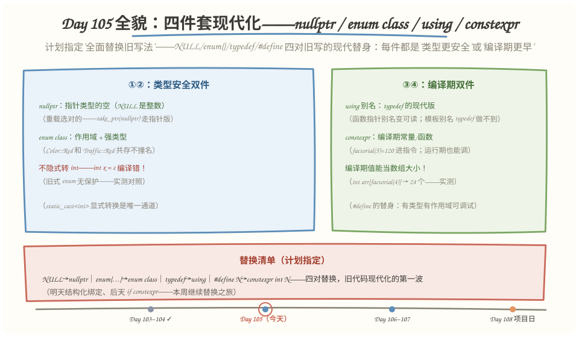

# 第 105 天：nullptr / enum class / using / constexpr——四件套现代化

> **今日目标**：完成本教程后，你能做到：说出 nullptr 的类型安全价值（重载选对门——实测）；用 enum class 避免撞名和隐式转换（`int x = c` 编译错的执法）；写 using 别名（含函数指针和模板别名）；用 constexpr 做编译期计算（阶乘 + 编译期值当数组大小）；背出计划指定的四对替换清单。
> **预计时间**：学习 20 分钟＋实践 40 分钟
> **前置准备**：完成 Day 103~104（阶段五的语言核心课继续）。
> **今日产出**：四件套实测、enum 隐式转换执法、替换清单。

## 1. 今天解决什么问题？

四对旧写的现代替身一天换齐（计划指定"全面替换旧写法"）：**NULL → nullptr**（空指针有了自己的类型——重载不再选错门）；**enum{} → enum class**（作用域隔离不撞名 + 强类型不隐式转 int）；**typedef → using**（从左往右读 + 模板别名）；**#define → constexpr**（有类型有作用域的编译期常量/函数）。四件套是同一场革命的四个侧翼——**"类型更安全"和"编译期更早"**。

## 2. 先看全貌：今天的内容位于哪里？



**图 1**：左卡蓝是类型安全双件（nullptr/enum class）；右卡绿是编译期双件（using/constexpr）；下方红卡是替换清单。

三步概括今天：

1. nullptr 是指针类型（重载选对门）；enum class 有作用域且不隐式转；
2. using 从左往右读（模板别名是 typedef 做不到的）；
3. constexpr 编译期算好（还能当数组大小）。

## 3. 核心概念：先用直觉，再给准确定义

### 3.1 nullptr：空指针的类型化

- **一句通俗解释**：NULL 本质是整数 0（宏）——传给重载函数要么选错门、要么（如本机）直接报重载歧义；nullptr 是指针类型——进"指针门"。
- **一个类比**：空房间——写"0 号房"（NULL）前台可能把你引去数字柜台；写"空房间"（nullptr）前台知道你要找房间。
- **对应到技术上是**：实测——`take_ptr(nullptr)` 走 `take_ptr(int*)`（指针重载 ✔）；`take_ptr(0)` 走 `take_ptr(int)`（整数重载）——**同一函数两个门，实参类型决定进哪个**（`take_ptr(NULL)` 在本机实测**直接编译错**：`call to 'take_ptr' is ambiguous`——NULL 两边都能转，nullptr 才是唯一无歧义写法）。Day 19 起的判空 `if (p)` 写法不变（nullptr 也符合）——变的只是"空"的写法。类比的边界：`p != NULL` 的旧代码仍编译（NULL 宏还在）——新代码一律 nullptr。
- **常见误解**："nullptr 就是 NULL 的美化"——是**类型**不同（nullptr_t 类型）——重载歧义从根上消除。

### 3.2 enum class：作用域 + 强类型

- **一句通俗解释**：enum class 的枚举值**锁在类名里**（Color::Red 不能裸用 Red）且**不隐式转 int**（要转必须 static_cast）。
- **一个类比**：门牌号——旧式 enum 是全城唯一编号（两个 Red 就撞）；enum class 是"小区+门牌"（阳光小区 1 号和花园小区 1 号并存）。
- **对应到技术上是**：实测——`Color::Red` 和 `Traffic::Red` **共存** ✔（各有作用域）；`int x = c` **编译错**（`cannot initialize a variable of type 'int'`——强类型执法）；`static_cast<int>(Color::Green)` = 1（显式转换是唯一通道）；对照旧式 `int old_x = OLD_RED` 隐式通过（无保护）。**为什么强类型好**：`if (color == 1)` 这类手滑比较直接编译错（枚举和整数不可比）。类比的边界：要按数值循环枚举时旧式方便——enum class 用 `static_cast` 循环或另配表。
- **常见误解**："enum class 麻烦（处处 cast）"——麻烦正是保护；真正的数值场景该用 constexpr int 而不是枚举。

### 3.3 using 与 constexpr

- **一句通俗解释**：`using 别名 = 类型` 从左往右读（typedef 的函数指针从中间往外读是噩梦）；constexpr 让常量和函数**编译期**就有值。
- **一个类比**：using 是"昵称声明"（读起来顺）；constexpr 是"出发前算好"（运行时不用算）。
- **对应到技术上是**：实测——`using Callback = void (*)(int)`（可读）对照 `typedef void (*OldCallback)(int)`（噩梦）；**模板别名** `template <typename T> using Vec = std::vector<T, Alloc<T>>` 是 typedef 做不到的（Day 98 的 `using iterator = T*` 当时就在用）。**constexpr 两用**：`constexpr int f5 = factorial(5)` 编译期算好（**120 直接进指令**）；`factorial(n)` 运行期也能调（同函数两用——n 是变量时退化为普通调用）；`int arr[factorial(4)]` 编译期值当**数组大小**（24 个——实测）。**kMax 替代 #define**：有类型、有作用域、可调试（宏是预处理文本替换——一切都没有）。类比的边界：constexpr 函数的限制——函数体要足够简单（C++14 起宽松很多）；递归也行（今天的阶乘）。
- **常见误解**："constexpr 函数只能编译期用"——两用（编译期常量上下文就编译期算、否则运行期跑）；这正是它比模板元编程亲民的地方。

## 4. 图解核心机制


**图 2**：上半部分蓝卡是 take_ptr 的重载选择对照（NULL 进错门 vs nullptr 进对门）；左下绿卡是 constexpr 的两用性（编译期 120/运行期 720/当数组大小）；右下灰卡是 using vs typedef 的可读性对照。

按图逐步讲：

1. **看两个门的分岔**：NULL 想进指针门却报重载歧义（本机实测）、nullptr 进指针门——**类型即意图**；
2. **读 constexpr 的三种用法**：常量上下文编译期算、运行期照调、数组大小（编译期值的特权——Day 99 非类型参数同款要求）；
3. **对比两种别名的读法**：typedef 从中间往外、using 从左往右——函数指针立即看出差距；
4. **记四对清单**：NULL→nullptr / enum{}→enum class / typedef→using / #define→constexpr——明天起旧代码见到就换。

## 5. 动手实践：完成一个最小可运行例子

### 5.1 准备文件

```bash
cd ai-compiler-roadmap/tutorials/day-105/examples
```

主角：`modern_four.cpp`（四件套 + 替换清单）。

### 5.2 编写代码

核心（完整代码见本目录）：

```cpp
void take_ptr(int* p) { … }                  // 指针重载
void take_ptr(int v)  { … }                  // 整数重载
take_ptr(nullptr);                            // → 指针门 ✔
take_ptr(0);                                  // → 整数门（NULL 的老坑）

enum class Color { Red, Green, Blue };
enum class Traffic { Red, Yellow, Green };    // 同名 Red 不打架！
// int x = Color::Red;                        // ✘ 编译错（强类型）
int v = static_cast<int>(Color::Green);       // 显式转换是唯一通道

using Callback = void (*)(int);               // 可读的函数指针别名

constexpr int factorial(int n) {
    return (n <= 1) ? 1 : n * factorial(n - 1);
}
constexpr int f5 = factorial(5);              // 编译期 = 120
int arr[factorial(4)];                        // 编译期值当数组大小（24 个）
```

### 5.3 运行与观察

```bash
g++ -Wall -std=c++17 modern_four.cpp -o mf && ./mf
```

实际执行结果（本机，节选）：

```text
== ① nullptr：类型安全的空 ==
  take_ptr(int*)：指针重载
  take_ptr(int)：整数重载
  p = nullptr; p == nullptr → true
  （NULL 是整数宏——重载歧义/选错门；nullptr 是指针类型）

== ② enum class：作用域 + 强类型 ==
  Color::Red 和 Traffic::Red 共存 ✔（旧式 enum 全局就撞名）
  static_cast<int>(Color::Green) = 1
  （不隐式转 int——要转必须显式 static_cast）
  旧式 OLD_RED 隐式转 int = 0（无保护）

== ③ using 别名：typedef 的现代版 ==
  IntList s = 别名也能当类型用
  Callback 是函数指针别名——typedef 时代的噩梦变可读
  （模板别名 using Vec<T> = vector<T,Alloc<T>> 更是 typedef 做不到）

== ④ constexpr：编译期计算 ==
  constexpr factorial(5) = 120
  运行期调用 factorial(6) = 720
  kMax = 100（替代 #define MAX——有类型有作用域）
  int arr[factorial(4)] → 大小 24（编译期定的）

== 四件套的替换清单（计划指定） ==
  NULL        → nullptr
  enum {…}    → enum class [名] {…}
  typedef …   → using … = …
  #define N   → constexpr int N
  （四对替换——旧代码现代化的第一波）
```

**enum 隐式转换执法**（探针实测）：

```text
/tmp/enum.cpp:2:40: error: cannot initialize a variable of type 'int' with an lvalue of type 'Color'
```


**图 3**：左上完整输出（四件套各段+清单）；右侧是四件套的知识回响（Day 19 判空/Day 53 暴露面/Day 99 非类型参数/Day 98 using iterator）；下方橙卡是现代化的主线。

### 5.4 修改一个输入再观察：constexpr 的边界探察

把 factorial 的参数换成运行期输入（cin 或 argv）——`factorial(n)` 照样能跑（退化为普通调用）；再试 `constexpr int bad = factorial(n);`（n 是变量）——**编译错**（constexpr 变量要求编译期可算——n 不是常量）。**一跑一错**：constexpr 的两用性（函数两用）和边界（constexpr 变量必须编译期值）都清楚了。

## 6. 常见错误与排查

**错误 1：`cannot initialize int with Color`（enum class 赋给 int）**

- 现象：`int x = my_color` 编译错；
- 原因：enum class 不隐式转 int（强类型保护）；
- 定位：报错提 lvalue of type 'Color'；
- 修复：显式 `static_cast<int>`；或反思是否真该转（多数时候是想比较——改比枚举值）。

**错误 2：`constexpr variable must be initialized by constant expression`**

- 现象：`constexpr int f = factorial(n)`（n 是变量）编译错；
- 原因：constexpr 变量要求编译期可算；
- 定位：报错提 constant expression；
- 修复：n 改 constexpr/字面量；或 f 改普通 int（运行期调用）。

**错误 3：`undeclared identifier 'Red'`（裸用枚举值）**

- 现象：`Color c = Red;` 编译错；
- 原因：enum class 的值锁在作用域里；
- 定位：报错 undeclared；
- 修复：`Color::Red`——作用域正是特性不是缺陷。

## 7. 今日练习

### 必做练习（计划指定：全面替换旧写法）

翻出自己 Day 70 以前的任意旧代码——地毯式替换四件套（NULL→nullptr、旧 enum→enum class、typedef→using、#define→constexpr）——记录替换了几处、哪处替换后编译错（通常是 enum 隐式转换的旧用法——正好补 cast）。预期产出：替换 diff + 错处清单。

### 选做挑战

"编译期斐波那契"：constexpr 的 fib(n)，用 `static_assert(fib(10) == 55, "...")` 在**编译期断言**结果（编译不过=断言失败）；再故意改成错误值看 static_assert 报错——编译期测试的初体验（Day 107 if constexpr 的前奏）。

## 8. 今日验收

- [ ] 我的 nullptr 重载实测通过（指针门 vs 整数门）
- [ ] 我的 enum class 双实测（同名共存 + 隐式转换编译错）
- [ ] 我能写出 using 的函数指针别名（和 typedef 版对照）
- [ ] 我的 constexpr 三用法通过（编译期 120/运行期 720/数组大小 24）
- [ ] 我背得出四对替换清单并能动手替换旧代码

## 9. 一句话总结与明天预告

今天的问题是"旧写法怎么成批现代化"；机制上，nullptr 类型化（重载不歧义）、enum class 作用域+强类型（撞名和隐式转换双杀）、using 可读+模板别名、constexpr 编译期计算（还能当数组大小）；实践上，四件套、隐式转换执法、两用性边界全部落地；验证标准是看到 NULL/旧 enum/typedef/#define 能条件反射地报出现代替身。明天 **Day 106：结构化绑定**——遍历 map 的简化写法（计划指定）：`for (auto& [k, v] : m)` 的正式课。
