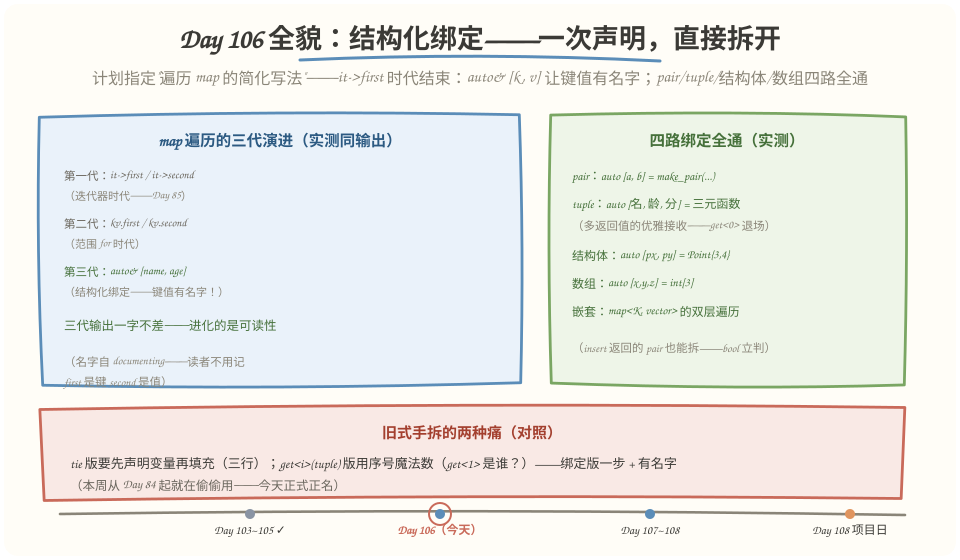
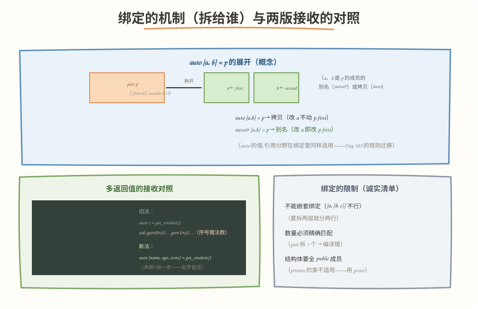

# 第 106 天：结构化绑定——遍历 map 的简化写法

> **今日目标**：完成本教程后，你能做到：用三代写法遍历 map 并说出结构化绑定版的可读性优势（计划指定）；对 pair/tuple/结构体/数组四路绑定各配实测；用 `auto [name, age, score] = 多返回值函数()` 优雅接收；拆 set::insert 的返回 pair（bool 立判新旧）；说出绑定的值/引用分野和三条限制。
> **预计时间**：学习 20 分钟＋实践 35 分钟
> **前置准备**：完成 Day 103~105（auto 的值/引用规则今天迁移到绑定）。
> **今日产出**：三代遍历对照、四路绑定、嵌套统计、insert 拆包。

## 1. 今天解决什么问题？

`.first` 和 `.second` 用了三周——读者永远要记"哪个是键哪个是值"。**结构化绑定**（C++17）解决命名问题：`for (auto& [name, age] : ages)` 让键值**有名字**（自 explaining）。计划指定的"遍历 map 的简化写法"正是主场景。

绑定不止 map：**pair / tuple / 结构体 / 数组**四路全通——多返回值函数的接收（告别 `get<0>` 序号魔法数）、insert 返回值的拆包（bool 立判）都是日常。教程从 Day 84 起"偷用"了十几次——今天正式正名（机制 + 限制）。

## 2. 先看全貌：今天的内容位于哪里？



**图 1**：左卡蓝是 map 遍历的三代演进（同输出、进化的是可读性）；右卡绿是四路绑定；下方红卡是旧式手拆的两种痛。

三步概括今天：

1. 三代：`it->first` → `kv.first` → `[name, age]`——名字自 documenting；
2. 四路：pair/tuple/结构体/数组都能拆（嵌套遍历更清晰）；
3. 分野：`auto [a,b]` 拷贝、`auto& [a,b]` 别名（Day 103 规则迁移）。

## 3. 核心概念：先用直觉，再给准确定义

### 3.1 map 遍历的三代演进

- **一句通俗解释**：第一代迭代器（`it->first`）、第二代范围 for（`kv.first`）、第三代结构化绑定（`[name, age]`）——输出一字不差，进化的是**可读性**。
- **一个类比**：点名方式——报学号（it->first：要查表）、报座位号（kv.first：还是编号）、直接喊名字（[name]：自 explaining）。
- **对应到技术上是**：实测——三代遍历同一 map 输出完全一致（小刚 16/小明 15/小红 14）；**绑定版的优势**：`name` 和 `age` 直接出现在循环体里——读者不用记"first 是键 second 是值"。**从 Day 84 的首次偷用到今天**：词频 v1 的 `[w, n]`、Day 87/94 的 equal_range 拆 `[first, last]`——十几次使用的正式正名。类比的边界：`.first/.second` 没消失（底层 API 还返回 pair）——绑定是**消费端**的语法糖。
- **常见误解**："绑定是新的遍历方式"——不；它是**拆解**语法（遍历还是范围 for——拆的对象从 kv 变成两个名字）。

### 3.2 四路绑定与多返回值

- **一句通俗解释**：pair、tuple、结构体、数组——任何"多个成员的东西"都能 `auto [a, b, c] = 它` 一步拆开。
- **一个类比**：快递拆箱——成对的（pair）、成套的（tuple）、定制的（结构体）、一排的（数组）——开箱姿势统一。
- **对应到技术上是**：实测——pair：`auto [a, b] = make_pair(42, 3.14)`；**tuple**：`auto [name, age, score] = get_student()`（多返回值优雅接收——`get<0>(t)` 序号魔法数退场）；**结构体**：`auto [px, py] = Point{3,4}`（按成员序）；**数组**：`auto [x,y,z] = arr`（定长数组按位置拆）；**嵌套**：`map<string, vector<int>>` 的 `[subject, scores]` 双层遍历（均分统计实测）；**insert 拆包**：`auto [iter, inserted] = seen.insert("apple")`（首 insert **true**、再 insert **false**——bool 立判新旧）。类比的边界：**不能嵌套声明**（`[a, [b, c]]` 不行——拆两层分两行）；**数量要精确**（pair 拆三个编译错）；**结构体要全 public**（private 的类用 getter）。
- **常见误解**："tuple 只能用 get\<i\> 取"——C++17 起绑定更好；get\<i\> 留给"只要其中一个"的场景。

### 3.3 值/引用分野的迁移

- **一句通俗解释**：`auto [a, b] = p` 是**拷贝**（改 a 不动 p）；`auto& [a, b] = p` 是**别名**（改 a 即改 p.first）——Day 103 的规则原样迁移。
- **一个类比**：还是那张照片/钥匙的图——拷贝版拆完各过各的、引用版拆完还连着原件。
- **对应到技术上是**：实测对照——`auto [a,b] = p` 后改 a，p.first 不变；`auto& [a,b] = p` 后改 a，p.first 跟着变（图 2 的展开图）。**遍历的标准姿势**：`for (const auto& [k, v] : m)`（只读引用——不拷贝大 value）；要改 value 用 `auto&`。**机制**（概念展开）：编译器把 `[a, b]` 展开成对成员的别名/拷贝——bind 的是成员不是整个对象。类比的边界：绑定的名字是**新变量**（不是重新声明 p 的成员）——作用域规则同普通变量。
- **常见误解**："绑定会拷贝整个对象"——`auto&` 版零拷贝（只建立别名）；`auto` 版拷贝（成员各一份）——按需选。

## 4. 图解核心机制



**图 2**：上半部分蓝卡是 `auto [a, b] = p` 的概念展开（pair 拆成两个名字 + 值/引用两种形态）；左下绿卡是多返回值的接收对照（get\<i\> 魔法数 vs 绑定一步）；右下灰卡是绑定的三条限制（诚实清单）。

按图逐步讲：

1. **看拆解的箭头**：p 的 first 流向 a、second 流向 b——`auto` 拷贝 / `auto&` 别名的分岔在箭头性质；
2. **读两版接收**：get\<0\>/get\<1\>（序号是魔法数）vs `[name, age, score]`（名字自述）——多返回值接收的进化；
3. **记三条限制**：不能嵌套 / 数量精确 / 结构体全 public——用前自检；
4. **连 Day 103**：auto 的值/引用规则迁移到绑定——一处学习处处适用（语言规则的一致性红利）。

## 5. 动手实践：完成一个最小可运行例子

### 5.1 准备文件

```bash
cd ai-compiler-roadmap/tutorials/day-106/examples
```

主角：`structured_bindings.cpp`（三代对照+四路+嵌套+insert）。

### 5.2 编写代码

核心（完整代码见本目录）：

```cpp
std::map<std::string, int> ages = {{"小明", 15}, {"小红", 14}, {"小刚", 16}};

for (auto it = ages.begin(); it != ages.end(); ++it) { … }     // 第一代
for (auto& kv : ages) { kv.first; kv.second; }                 // 第二代
for (auto& [name, age] : ages) { name; age; }                  // 第三代（计划指定）

auto p = std::make_pair(42, 3.14);
auto [a, b] = p;                                                // pair 拆

std::tuple<std::string, int, double> get_student() { return {"小明", 15, 88.5}; }
auto [name, age, score] = get_student();                        // 多返回值

auto [px, py] = Point{3.0, 4.0};                                // 结构体
auto [x, y, z] = int_arr;                                       // 数组

auto [iter, inserted] = seen.insert("apple");                   // insert 拆包（bool 立判）
```

### 5.3 运行与观察

```bash
g++ -Wall -std=c++17 structured_bindings.cpp -o sb && ./sb
```

实际执行结果（本机，节选）：

```text
== 计划指定：遍历 map 的简化写法 ==
旧写法（Day 85 时代）：
  小刚 = 16 … 小明 = 15 … 小红 = 14
中间写法（范围 for + .first/.second）：
  小刚 = 16 … （同上）
现代写法（结构化绑定——计划指定）：
  小刚 = 16 … （同上——三代一字不差）
  （k 和 v 有了名字——不用 it->first / kv.second）

== 旧式手拆对照（std::tie 时代） ==
  tie 版：42, 3.14（要先声明变量——啰嗦）
  绑定版：42, 3.14（auto [a, b] = p 一步）

== tuple：多返回值的优雅接收 ==
  小明，15 岁，88.5 分

== 结构体：直接拆字段 ==
  Point{3,4} 拆成 px=3, py=4

== 数组：定长拆解 ==
  arr 拆成 10, 20, 30

== 嵌套：map 里遍历并统计 ==
  数学 均分 = 87.5
  语文 均分 = 80
  共 2 科（嵌套遍历配绑定——清晰）

== insert 的返回值也能拆 ==
  insert(apple)：inserted = true（新插入）
  再 insert(apple)：inserted = false（重复被拒）
```


**图 3**：左上完整输出（三代/四路/嵌套/insert 各段）；右侧是教程里"偷用"绑定的历史时刻清单（Day 84 首用→今天正名）；下方橙卡是命名的价值。

### 5.4 修改一个输入再观察：数量不匹配的执法

把 tuple 三元的接收写成 `auto [a, b] = get_student();`（二元拆三元）——**编译错**（`decomposes into 3 elements, but only 2 names were provided`）。改回三个名字——通过。**一错一对**：绑定数量必须精确匹配的限制从清单变目击——这也是"编译器替你数数"的保护（漏拆多拆都拦）。

## 6. 常见错误与排查

**错误 1：`decomposes into N elements, but only M names`（数量不匹配）**

- 现象：pair 拆三个或 tuple 拆两个；
- 原因：绑定的数量红线（精确匹配）；
- 定位：报错直接给 N 和 M；
- 修复：按成员数写名字（多了删少了补）。

**错误 2：绑定后改值、原对象没动（拷贝误会）**

- 现象：`auto [a,b] = p; a = 999;` 后 p.first 不变；
- 原因：auto 绑定是拷贝（Day 103 规则）；
- 定位：对比修改前后；
- 修复：要改原件用 `auto& [a, b]`。

**错误 3：private 成员的类绑不了**

- 现象：`auto [x, y] = 私有成员对象;` 编译错；
- 原因：绑定要求全 public 数据成员；
- 定位：报错提 no matching decomposition；
- 修复：加 getter 按需取；或改聚合（全 public）设计。

## 7. 今日练习

### 必做练习（计划指定：遍历 map 的简化写法）

把 Day 84（词频 v1）和 Day 87（multimap 分组）的遍历代码用结构化绑定重写——对比每处的字符数和可读性；找一处 `.first/.second` 你觉得**反而更清楚**的场景（如果有）并说明理由。预期产出：重写版 + 一点批判性观察。

### 选做挑战

"绑定 + tie 的混搭"：写一个函数同时需要"只取 tuple 的第 2 个"和"全拆"两种消费——第 2 个用 `std::get<1>(t)`、全拆用绑定；体会两种姿势的适用面（绑定要全要、get 要单个）——工具箱多一件不是替换关系。

## 8. 今日验收

- [ ] 我的三代遍历实测同输出（计划指定的简化写法在列）
- [ ] 我的四路绑定全过（pair/tuple/结构体/数组）
- [ ] 我的多返回值接收优雅化（[name, age, score] 一步）
- [ ] 我能拆 insert 的返回 pair（bool 立判新旧——实测）
- [ ] 我知道值/引用分野和三条限制（含 5.4 的数量执法）

## 9. 一句话总结与明天预告

今天的问题是"键值和多返回值怎么消费才可读"；机制上，结构化绑定把成员拆成有名字的变量（auto 拷贝/auto& 别名——Day 103 规则迁移）、四路全通（pair/tuple/结构体/数组）、数量精确匹配（编译器替你数数）；实践上，三代对照、四路实测、嵌套统计、insert 拆包全部落地；验证标准是看到任何 `.first` 能条件反射地换绑定。明天 **Day 107：if constexpr 与编译期计算**——编译期阶乘（计划指定）：分支也能编译期裁剪。
