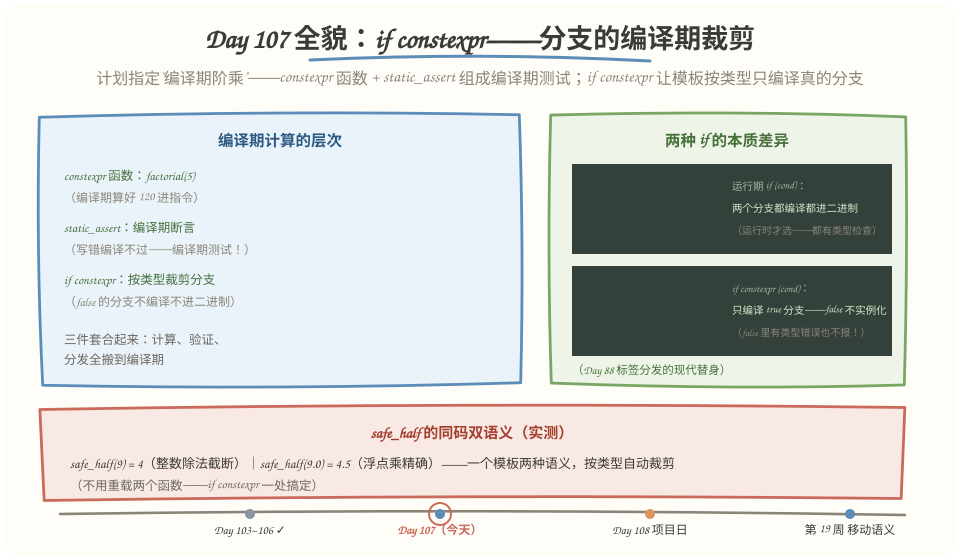
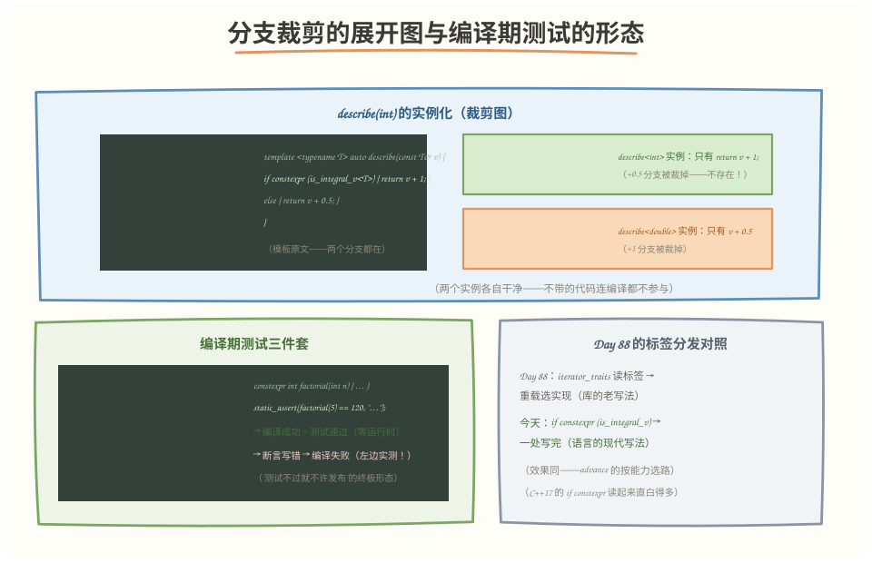
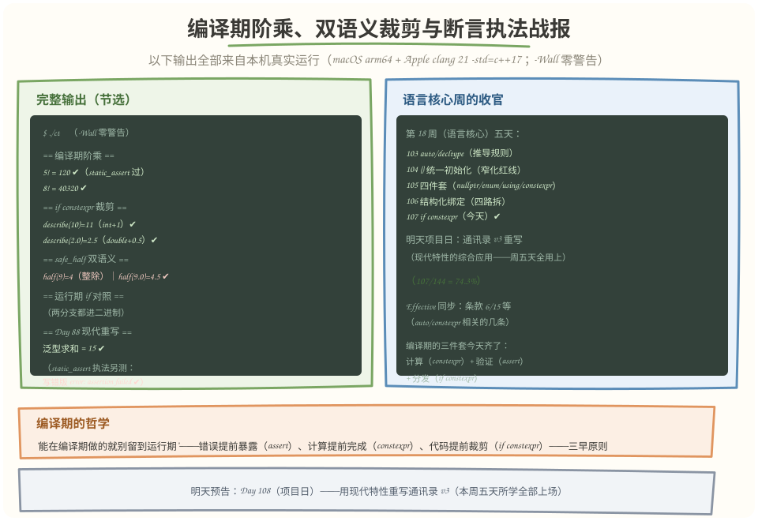

# 第 107 天：if constexpr 与编译期计算入门

> **今日目标**：完成本教程后，你能做到：用 constexpr 函数 + **static_assert** 组成编译期测试（计划指定的编译期阶乘——断言写错编译不过）；说出 if constexpr 和运行期 if 的本质差异（false 分支**不实例化**）；用 if constexpr 写同码双语义的模板（safe_half 的整除/浮点版）；知道它是 Day 88 标签分发的现代替身。
> **预计时间**：学习 20 分钟＋实践 40 分钟
> **前置准备**：完成 Day 105（constexpr 函数是今天的地基）。
> **今日产出**：编译期阶乘（static_assert 双断言）、双语义模板、断言执法实测。

## 1. 今天解决什么问题？

编译期编程的三件套今天配齐：**计算**（constexpr 函数——Day 105 学过）、**验证**（static_assert——编译期断言：测试不过就不许编译）、**分发**（if constexpr——按类型裁剪分支：false 的分支根本不编译）。计划指定的**编译期阶乘**正好把前两件串起来：`static_assert(factorial(5) == 120)` 写在代码里——编译成功即测试通过。

if constexpr 是 Day 88 标签分发（iterator_traits + 重载）的**现代替身**——一处写完、读起来直白得多。

## 2. 先看全貌：今天的内容位于哪里？



**图 1**：左卡蓝是编译期计算的层次（计算/验证/分发）；右卡绿是两种 if 的本质差异；下方红卡是 safe_half 双语义。

三步概括今天：

1. static_assert：编译期测试——断言错编译不过；
2. if constexpr：只编译 true 分支（false 不实例化）；
3. 同码双语义：一个模板按类型自动选路。

## 3. 核心概念：先用直觉，再给准确定义

### 3.1 static_assert：编译期测试

- **一句通俗解释**：`static_assert(条件, "消息")` 在**编译时**检查条件——不满足就编译失败（带着你的消息）。
- **一个类比**：出厂检验——不合格的产品（代码）根本不让出厂（编译）——比到客户手里才发现（运行时崩溃）早得多。
- **对应到技术上是**：实测——`static_assert(factorial(5) == 120)` 和 `== 3628800`（10!）**编译通过**（编译成功即证明）；**执法探针**：故意写成 `== 121` → `error: static assertion failed ... 故意写错的断言`——**编译期测试的失败形态**。**和运行时 assert 的差异**：静态版零运行开销（编译完就消失）、错误最早暴露；动态版能查运行时值（输入相关）——两者互补。类比的边界：条件必须是**编译期可算**（constexpr 表达式）——`static_assert(n > 0)`（n 是变量）不行。
- **常见误解**："static_assert 只是文档"——是**可执行的文档**（错了一定编译不过——比注释强一万倍）。

### 3.2 if constexpr：分支的编译期裁剪

- **一句通俗解释**：`if constexpr (条件)` 的 false 分支**根本不实例化**——不是"运行时不走"而是"编译时就不存在"。
- **一个类比**：裁缝做衣——运行期 if 是两件都做、出门时选一件穿；if constexpr 是量了尺寸**只做一件**（另一件的布料都不买）。
- **对应到技术上是**：实测——`describe(10)` 实例只有 `v+1` 分支（**+0.5 被裁掉**）、`describe(2.0)` 实例只有 `v+0.5`（+1 被裁）——两个实例各自干净。**和运行期 if 的本质差异**：运行期 if 的两个分支都编译都进二进制（都要类型检查过）；if constexpr 只编译真的那个——**false 里有类型错误也不报**（这正是它的威力：模板里写"整数才有的操作"不会被浮点实例化撞上）。**Day 88 的现代重写**：advance 按标签选路（traits + 重载两套函数）→ `if constexpr (is_integral_v<It>)` 一处写完——效果同、读起来直白。类比的边界：条件要是**编译期常量表达式**（类型判断/模板参数）——运行期值不行（那是普通 if 的事）。
- **常见误解**："if constexpr 是优化（更快）"——主要收益是**能编译**（false 分支的类型错误被豁免）和**代码组织**（一处写完）；速度差异通常被优化器抹平（反正死分支会被删）。

### 3.3 同码双语义：safe_half 案例

- **一句通俗解释**：同一个 `safe_half` 模板——int 实例用整除（截断是整数语义）、double 实例用乘 0.5（精确是浮点语义）。
- **一个类比**：老师傅看料做事——木头用锯（整数锯整段）、金属用锉（浮点磨精确）——一套工位两种手法。
- **对应到技术上是**：实测——`safe_half(9)` = **4**（int 走 `value / 2`——整数除法截断）、`safe_half(9.0)` = **4.5**（double 走 `value * 0.5`——精确）。**为什么不用重载**：重载要写两个函数（int 版/double 版）；if constexpr 一处搞定且语义差异**内联可见**（读者一眼看到"整数这样、浮点那样"）。**适用场景**：模板库里按类型微调行为（序列化的整数/字符串分路、算法的随机访问/双向分路）——STL 内部大量使用。类比的边界：差异大到我两个函数根本不同的，还是**分开写重载**更清楚——if constexpr 适合"小分叉"。
- **常见误解**："有了 if constexpr 不需要重载了"——大差异的重载更清晰；if constexpr 的地盘是模板里的**小分叉**。

## 4. 图解核心机制



**图 2**：上半部分蓝卡是 describe 的两个实例对照（模板原文两分支 → int 实例只剩 +1 / double 实例只剩 +0.5）；左下绿卡是编译期测试三件套（函数+断言+编译成败）；右下灰卡是 Day 88 标签分发的对照。

按图逐步讲：

1. **看两个实例的"瘦身"**：模板里两个分支、每个实例只有真的那个——裁剪的几何直观；
2. **读测试三件套**：constexpr 函数（可编译期算）→ static_assert（断言）→ 编译成败即测试结果——零运行时的测试闭环；
3. **对比 Day 88**：traits 读标签 + 两个重载（库的老写法）→ if constexpr 一处（语言的现代写法）——同一问题的两代答案；
4. **记三早原则**：错误早暴露（assert）、计算早完成（constexpr）、代码早裁剪（if constexpr）——编译期哲学的全部。

## 5. 动手实践：完成一个最小可运行例子

### 5.1 准备文件

```bash
cd ai-compiler-roadmap/tutorials/day-107/examples
```

主角：`compile_time.cpp`（阶乘+断言+双语义）。

### 5.2 编写代码

核心（完整代码见本目录）：

```cpp
constexpr int factorial(int n) {
    return (n <= 1) ? 1 : n * factorial(n - 1);
}
static_assert(factorial(5) == 120, "编译期断言：5! = 120");      // 编译期测试！
static_assert(factorial(10) == 3628800, "10! 也在编译期验证");

template <typename T>
auto describe(const T& value) {
    if constexpr (std::is_integral_v<T>) {
        return value + 1;                    // int 实例只有这段
    } else {
        return value + 0.5;                  // double 实例只有这段
    }
}

template <typename T>
T safe_half(const T& value) {
    if constexpr (std::is_integral_v<T>) {
        return value / 2;                    // 整数语义（截断）
    } else {
        return value * 0.5;                  // 浮点语义（精确）
    }
}
```

### 5.3 运行与观察

```bash
g++ -Wall -std=c++17 compile_time.cpp -o ct && ./ct
```

实际执行结果（本机，节选）：

```text
== 计划指定：编译期阶乘 ==
  constexpr 5! = 120（编译期算好）
  constexpr 8! = 40320
  static_assert(5! == 120) 已在编译期通过——编译成功即证明 ✔
  （写错的版本编译不过——编译期测试的形态）

== if constexpr：编译期分支裁剪 ==
  describe(10) = 11（int → +1 分支）
  describe(2.0) = 2.5（double → +0.5 分支）
  （false 的分支根本不实例化——类型错误也不报）

== safe_half：同码不同语义 ==
  safe_half(9) = 4（整数除法——4）
  safe_half(9.0) = 4.5（浮点乘——4.5）
  （一个模板两种语义——按类型裁剪）

== 对照：运行期 if 两个分支都要合法 ==
  运行期 if：走这分支
  （运行期 if 的两个分支都进二进制；if constexpr 只进真的那个）

== Day 88 的标签分发——if constexpr 版重写 ==
  求和（if constexpr 风格的泛型版）= 15
  （Day 88 的 advance 按标签选路——if constexpr 是更直白的现代写法）
```

**static_assert 执法**（探针实测）：

```text
/tmp/sa.cpp:2:15: error: static assertion failed due to requirement 'factorial(5) == 121': 故意写错的断言
```



**图 3**：左上完整输出（阶乘/裁剪/双语义/对照/现代重写五段）；右侧是语言核心周收官和编译期三件套；下方橙卡是三早原则。

### 5.4 修改一个输入再观察：false 分支的类型豁免

在 describe 的 else 分支写一个"只有浮点才合法"的表达式（如 `value + 0.5` 保持不变，但在 if 分支里写 `value.some_int_only_op()` 之类）——int 实例化时**不报错**（那个分支被裁掉、根本不编译）；换成**运行期 if** 同样的代码——int 实例**编译错**（两分支都要过类型检查）。**一豁免一检查**：if constexpr 的核心差异（false 分支的类型豁免）从文档变目击——这是模板能"按类型定制"的机制根基。

## 6. 常见错误与排查

**错误 1：`static assertion failed`（断言条件为假）**

- 现象：编译失败、消息是你在 static_assert 里写的；
- 原因：编译期断言不满足（逻辑错或类型能力变了）；
- 定位：报错自带行号和消息（最友好的编译错之一）；
- 修复：改逻辑或修断言（先确认真错了还是断言过期）。

**错误 2：`if constexpr` 条件用了运行期值**

- 现象：编译错（条件不是常量表达式）；
- 原因：if constexpr 要编译期条件（类型判断/模板参数）；
- 定位：报错提 constant expression；
- 修复：运行期判断用普通 if；类型判断用 is_xxx_v + if constexpr。

**错误 3：if constexpr 里忘了 constexpr（写成普通 if）**

- 现象：模板对某类型编译错（false 分支的类型错误被检查）；
- 原因：少写 constexpr——退化成运行期 if（两分支都编译）；
- 定位：对比报错位置（在"不该走的分支"里）；
- 修复：补 constexpr——这是模板定制的常见笔误。

## 7. 今日练习

### 必做练习（计划指定：编译期阶乘）

扩展编译期三连：①constexpr fib(n) + static_assert(fib(10) == 55)；②constexpr pow(b, e) + 断言 2^10 == 1024；③故意写错一个断言看编译失败的消息——三种失败形态都见一遍。预期产出：三个编译期函数 + 断言（含一个故意的错误版截图/记录）。

### 选做挑战

"编译期类型定制"：写 `to_string_any(T v)` 模板——整数用 to_string、浮点保留两位（to_string + 截断）、字符串原样返回——三个 if constexpr 分支各自定制。实测三种类型的输出——模板按类型"量体裁衣"的完整体验。

## 8. 今日验收

- [ ] 我的编译期阶乘通过（static_assert 双断言——编译成功即测试）
- [ ] 我目击了断言写错的编译失败（执法探针）
- [ ] 我的 describe/safe_half 双语义通过（11/2.5、4/4.5）
- [ ] 我能说出两种 if 的本质差异（false 分支不实例化）
- [ ] 我知道它是 Day 88 标签分发的现代替身

## 9. 一句话总结与明天预告

今天的问题是"分支和验证怎么搬到编译期"；机制上，static_assert 是编译期测试（断言错编译不过）、if constexpr 裁剪分支（false 不实例化——类型豁免是模板定制的根基）、三早原则（错误早暴露/计算早完成/代码早裁剪）；实践上，阶乘双断言、双语义模板、断言执法、豁免对照全部落地；验证标准是看到任何模板分叉能说出"用 if constexpr 还是重载、为什么"。明天 **Day 108（项目日）：用现代特性重写通讯录 v3**——本周五天所学（auto/{}/四件套/绑定/if constexpr）的综合实战。
