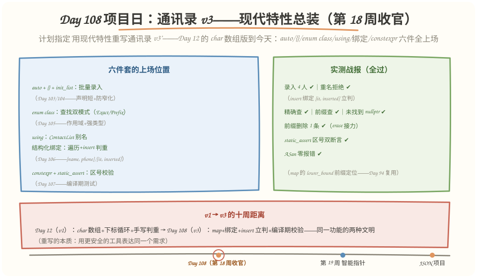
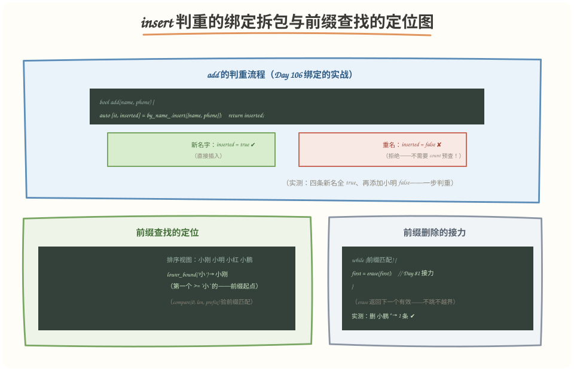
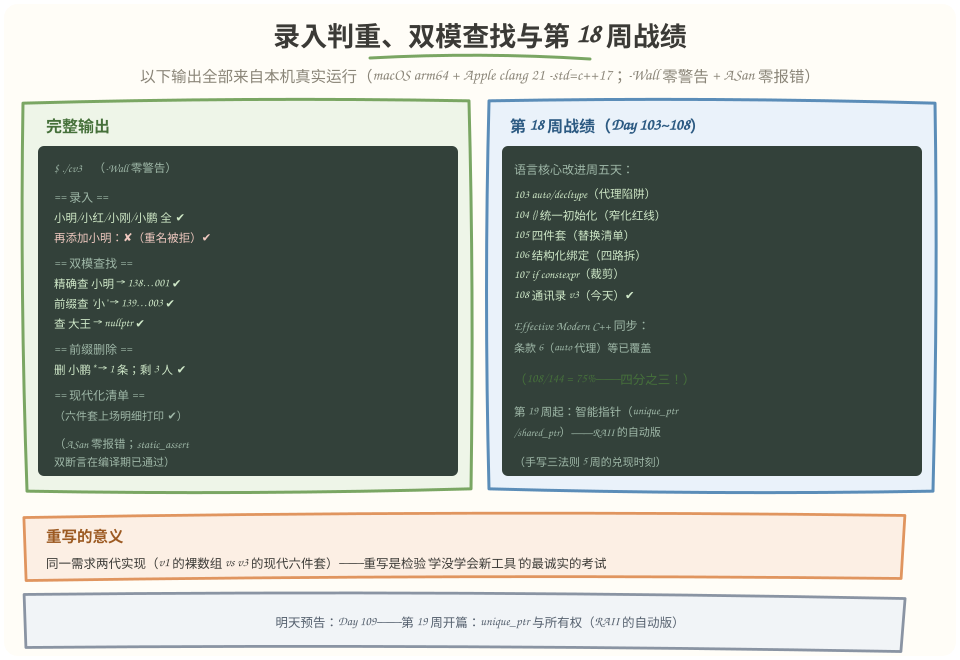

# 第 108 天（项目日）：用现代特性重写通讯录 v3

> **今日目标**：完成本教程后，你能做到：把 Day 12 的通讯录 v1 用现代六件套重写（auto+{}/enum class/using/结构化绑定/constexpr——计划指定）；用 insert 的绑定拆包做一步判重（`[it, inserted]`）；实现 enum class 驱动的双模查找（精确/前缀——lower_bound 复用 Day 94）；用 static_assert 做编译期区号校验；对照 v1 说出"十周的距离"。
> **预计时间**：实现 45 分钟＋对照 30 分钟
> **前置准备**：完成 Day 103~107；合上教程——第 18 周的收官答卷。
> **今日产出**：约 90 行通讯录 v3（`-Wall` 零警告 + ASan 零报错 + 编译期断言通过）。

## 1. 今天解决什么问题？

计划指定的收官项目：**用现代特性重写通讯录 v3**。Day 12 的 v1 是 char 数组 + 下标循环 + 手写判重——十周后用本周学的六件套重写：**auto + {} + init_list**（批量录入）、**enum class**（查找双模式）、**using**（列表别名）、**结构化绑定**（遍历 + insert 判重）、**constexpr + static_assert**（编译期区号校验）。外加 map 的 **lower_bound 前缀定位**（Day 94 复用）和 **erase 接力**（Day 81 复用）——两周的知识在同一个项目里会师。

重写是检验"学没学会新工具"的最诚实的考试。

## 2. 先看全貌：今天的内容位于哪里？



**图 1**：左卡蓝是六件套的上场位置（各标注出处天）；右卡绿是实测战报；下方红卡是 v1→v3 的十周距离。

三步概括今天：

1. 六件套各就各位：录入/双模/别名/绑定/校验；
2. insert 判重一步判（绑定拆包——不需要 count 预查）；
3. 前缀查找/删除：lower_bound 定位 + erase 接力。

## 3. 核心概念：先用直觉，再给准确定义

### 3.1 insert 绑定判重：一步到位

- **一句通俗解释**：`auto [it, inserted] = map.insert({name, phone})`——inserted 直接告诉你插没插上（重名 false）——不需要先 count 查再插。
- **一个类比**：占座——直接坐下试（insert）：坐下成功（true）或发现有人（false）一步知道；先问"这有人吗"（count）再坐是两步。
- **对应到技术上是**：实测——四条新名全 ✔、再添加小明 **✘（重名被拒）**——绑定的 `[it, inserted]` 让 add 函数一行返回。**v1 对照**：手写循环找重名（O(n) 遍历 + 标志位）——map 的 insert + 绑定把三行变一行且 O(log n)。**it 的用途**：插入失败时它指向**已存在的那条**（可以取旧值——今天的 add 没用但知道）。类比的边界：要"存在就更新"用 `insert_or_assign` 或 operator[]（Day 85 的两副面孔）——今天的语义是"拒绝重名"正合适。
- **常见误解**："判重前要先 find/count"——insert 的返回值自带答案（绑定拆包一步）；预查是两倍查找。

### 3.2 双模查找：enum class + lower_bound

- **一句通俗解释**：查找两种模式——精确（find 直查）和前缀（lower_bound 定位 + compare 验证）——enum class 让模式参数强类型。
- **一个类比**：查字典——精确是翻到那个词；前缀是翻到"前缀页"再看这一页往后几个词共用了前缀。
- **对应到技术上是**：实测——精确查小明 → **138…001** ✔；前缀查 "小" → **139…003**（lower_bound 定位到排序视图的第一个"小"——小刚）；查大王 → nullptr ✔。**前缀删除**：lower_bound 定位起点 → `compare(0, prefix.size(), prefix)` 验前缀 → `erase` 接力（Day 81 的返回值循环）——实测删 "小鹏\*" 1 条。**MatchMode 的强类型**：`MatchMode::Exact` / `Prefix` 带作用域（Day 105）——调用处一眼看清意图。类比的边界：要**全部**前缀匹配（不是第一个）用 equal_range 式循环收集——今天演示单结果。
- **常见误解**："前缀查找要遍历全部"——有序 map 的 lower_bound O(log n) 定位前缀起点——这正是"要序选 map"的场景实证（Day 85 选型）。

### 3.3 编译期校验与十周距离

- **一句通俗解释**：constexpr 的 valid_area_code + static_assert 把区号合法性检查放在**编译期**——断言写错连编译都过不了。
- **一个类比**：v1 是手工登记本（铅笔手写、翻页找）；v3 是电子系统（录入即校验、索引即定位）——同一需求的两种文明。
- **对应到技术上是**：实测——`static_assert(valid_area_code(100))` 和 `!valid_area_code(10)` **双断言通过**（正反两面都验）；开发插曲：初版把断言条件写反（断言了一个假条件）——**编译立刻失败**抓出来（编译期测试的日常工作形态，诚实记录）。**十周距离清单**：v1 的 char 数组（定长、手动管理）→ v3 的 map（动态、有序、自带查找）；v1 的下标循环 → v3 的绑定遍历；v1 的手写判重 → v3 的 insert 一步；v1 没有的校验 → v3 的编译期断言。类比的边界：v1 不是"白写"——它教会的是**需求和结构**（没有 v1 你不知道 v3 在解决什么）。
- **常见误解**："重写就是为了炫技"——重写验证的是**工具切换能力**（同一需求选不同抽象层级实现——工程的核心技能）。

## 4. 图解核心机制



**图 2**：上半部分蓝卡是 add 的判重流程（insert 绑定拆包——true/false 两路）；左下绿卡是前缀查找的定位图（排序视图 + lower_bound 箭头）；右下灰卡是前缀删除的接力循环。

按图逐步讲：

1. **走判重的两条路**：新名（true 直插）/ 重名（false 拒绝）——绑定让分支一行成型；
2. **看前缀定位的箭头**：排序视图 小刚/小明/小红/小鹏——lower_bound("小") 指向小刚（第一个 ≥ "小"）——前缀的起点；
3. **读删除的接力**：erase 返回下一个有效——while 循环里连删带走（Day 81 模式的实战复用）；
4. **数十周距离**：v1 的每个痛点在 v3 都有对应解——对照表本身就是学习成果的清单。

## 5. 动手实践：完成一个最小可运行例子

### 5.1 准备文件

```bash
cd ai-compiler-roadmap/tutorials/day-108/examples
```

主角：`contacts_v3.cpp`（约 90 行完整版）。

### 5.2 编写代码

核心（完整代码见本目录）：

```cpp
enum class MatchMode { Exact, Prefix };                       // Day 105
using ContactList = std::vector<std::pair<std::string, std::string>>;   // Day 105

bool add(const std::string& name, const std::string& phone) {
    auto [it, inserted] = by_name_.insert({name, phone});     // Day 106 绑定判重
    return inserted;
}

const std::string* find(const std::string& name, MatchMode mode) const {
    if (mode == MatchMode::Exact) { /* map::find */ }
    auto it = by_name_.lower_bound(name);                     // Day 94 前缀定位
    /* compare(0, name.size(), name) 验前缀 */
}

constexpr bool valid_area_code(int code) { return code >= 100 && code <= 999; }
static_assert(valid_area_code(100), "编译期验证");            // Day 107

for (const auto& [name, phone] : by_name_) { … }              // Day 106 绑定遍历
```

### 5.3 运行与观察

```bash
g++ -Wall -std=c++17 contacts_v3.cpp -o cv3 && ./cv3
```

实际执行结果（本机）：

```text
== 录入（{} 初始化 + insert 绑定判重） ==
  小明 ✔
  小红 ✔
  小刚 ✔
  小鹏 ✔
  再加小明：✘（重名被拒——insert 绑定立判）

== 全部联系人（绑定遍历） ==
  小刚：13900000003
  小明：13800000001
  小红：13800000002
  小鹏：13811122233

== 查找（enum class 双模式） ==
  精确查 小明 → 13800000001
  前缀查 "小" → 13900000003（第一个匹配）
  精确查 大王 → nullptr（没有）

== 前缀删除（erase 接力） ==
  删除 小鹏* → 1 条；剩 3 人

== 通讯录的现代化清单 ==
  auto + {}/init_list 录入｜enum class 双模式｜using 列表别名
  绑定遍历 + insert 判重｜constexpr 区号校验（static_assert）
  （对照 v1 的 char 数组 + 下标循环——十周的距离）
```

```bash
g++ -Wall -std=c++17 -fsanitize=address contacts_v3.cpp -o cv3a && ./cv3a
```

```text
（ASan 零报错——erase 接力和前缀边界的正确性盖章）
```



**图 3**：左上完整输出（录入/双模/删除/清单四段）；右侧是第 18 周战绩和四分之三宣言；下方橙卡是重写的意义。

### 5.4 修改一个输入再观察：断言反转的执法重演

把 static_assert 的条件故意写反（`static_assert(!valid_area_code(100), ...)`)——**编译失败**（assertion failed——开发时真实翻过的一次车，今天重现）；改回正——通过。**一反一正**：编译期校验的价值（错误连二进制都进不了）从工具变肌肉记忆——这也是"Modern C++ 把测试提前到编译"的日常体感。

## 6. 常见错误与排查

**错误 1：insert 判重后想更新被拒的那条**

- 现象：重名被拒但拿不到已存在的记录；
- 原因：没用的 it 正是钥匙（指向已存在项）；
- 定位：回顾绑定拆出的第一元素；
- 修复：`it->second = 新值`（拒绝后更新）；或直接用 insert_or_assign。

**错误 2：前缀查找返回了非前缀项**

- 现象：lower_bound 定位后直接返回没验前缀；
- 原因：lower_bound 只保证 ≥（"小" 之后可能是"大"）；
- 定位：对比前缀和返回名的开头；
- 修复：`compare(0, prefix.size(), prefix) == 0` 验证（今天的写法）。

**错误 3：前缀删除跳项或死循环**

- 现象：删完一项后漏删下一项；
- 原因：erase 后还 ++（跳过）或迭代器失效使用；
- 定位：Day 81 的经典坑复盘；
- 修复：`first = by_name_.erase(first)` 接力（erase 已推进——不再 ++）。

## 7. 今日练习

### 必做练习

给 v3 加"前缀列出全部"：`list_prefix(prefix)` 返回所有前缀匹配的名字 vector（lower_bound 定位 + 循环收集直到前缀不匹配）——录入 5 个"小"字头 + 2 个其他后测试。预期产出：前缀查询的完整名单。

### 选做挑战

"v3.5——文件持久化"：把通讯录存到文件（Day 77 的文件 I/O）+ 启动加载——`save()/load()` 两个方法；数据格式自定（name phone 每行）。现代特性 + 文件 I/O 的组合——离"能用的小工具"就差这一步。

## 8. 今日验收

- [ ] 我的六件套全上场（录入/双模/别名/绑定/校验各就各位）
- [ ] insert 绑定判重实测（四 ✔ 一 ✘——不需要预查）
- [ ] 双模查找 + 前缀删除通过（lower_bound + erase 接力）
- [ ] static_assert 双断言在编译期通过（5.4 的反转执法也见过）
- [ ] 我能对照 v1 说出十周距离的至少四处

## 9. 一句话总结与明天预告

今天的问题是"现代特性怎么在一个真实项目里会师"；机制上，insert 绑定一步判重、lower_bound 前缀定位（要序选 map 的实证）、erase 接力安全删除、static_assert 编译期校验——六件套在通讯录里各司其职；实践上，录入判重、双模查找、前缀删除、断言反转全部实测；验证标准是拿到任何 v1 风格的旧代码能报出"哪六处可以现代化、怎么改"。**第 18 周收官——108/144 天（75%，四分之三！），17 个项目日全胜。** 明天进入 **第 19 周 · Day 109：unique_ptr 与所有权**——RAII 的自动版：手写三法则五周后的官方代驾终于来了。
