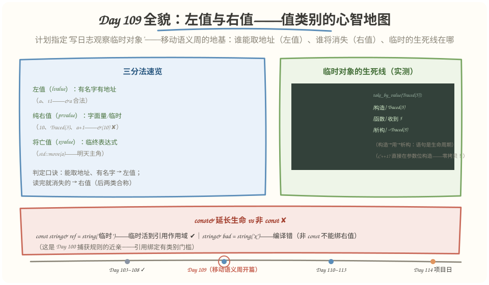
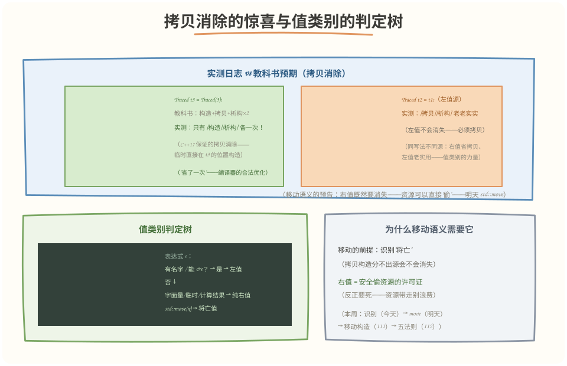
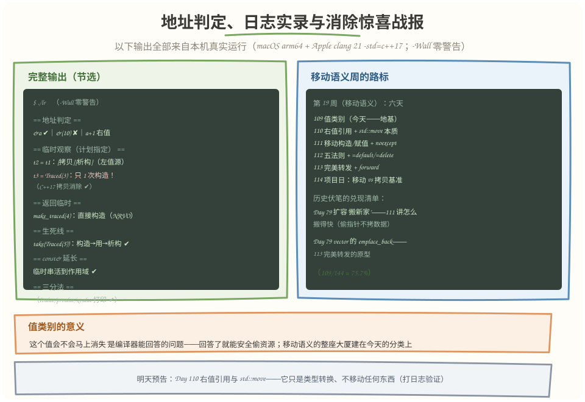

# 第 109 天：左值 / 右值 / 将亡值——值类别辨析

> **今日目标**：完成本教程后，你能做到：用"能否取地址"判定左值/右值并各配例证；写出 Traced 类的全套日志（构造/拷贝/移动/析构）观察临时对象（计划指定）；识别**拷贝消除**（`t3 = Traced(3)` 只有一次构造——C++17 的保证）；说出 const& 延长临时生命和非 const ✘ 的规则；背出三分法（lvalue/prvalue/xvalue）。
> **预计时间**：学习 20 分钟＋实践 40 分钟
> **前置准备**：完成 Day 103~108（现代特性的地基——移动语义周开篇）。
> **今日产出**：Traced 日志实测（含拷贝消除的惊喜）、生死线观察、三分法速览。

## 1. 今天解决什么问题？

移动语义周的地基：**值类别**（value category）——一个表达式是"左值"还是"右值"决定了它**会不会马上消失**，而这正是"能不能安全偷它资源"的判据。三个层次：**判定**（能否取地址——最实用的口诀）；**观察**（Traced 类的日志让临时对象的生死现形——计划指定）；**惊喜**（拷贝消除——`Traced t3 = Traced(3)` 只有一次构造，C++17 保证的合法优化）。

今天不写移动代码（明天的 std::move）——先把"谁是将亡者"看清楚。

## 2. 先看全貌：今天的内容位于哪里？



**图 1**：左卡蓝是三分法速览（判定口诀）；右卡绿是临时对象的生死线；下方红卡是 const& 的延长与禁止。路线图：**109/144 = 75.7%，移动语义周开篇**。

三步概括今天：

1. 判定：有名字能取地址 → 左值；读完就消失 → 右值；
2. 观察：Traced 日志——构造/拷贝/析构全程现形；
3. 惊喜：拷贝消除（右值源直接构造——省一次）。

## 3. 核心概念：先用直觉，再给准确定义

### 3.1 左值与右值：地址判定法

- **一句通俗解释**：有名字、能取地址、还会继续存在的表达式是**左值**；字面量、临时、计算结果这些"读完就消失"的是**右值**。
- **一个类比**：左值是"住在房子里的人"（有地址、明天还在）；右值是"路边的一次性咖啡杯"（用完即弃——没有"住址"）。
- **对应到技术上是**：实测——`int a = 10; &a ✔`（左值）；`&(10) ✘`（字面量右值没地址——编译错）；`a + 1` 也是右值（表达式的临时结果）。**判定树**（图 2）：有名字/能 &e → 左值；字面量/临时 → 纯右值（prvalue）；`std::move(x)` → 将亡值（xvalue）。**后两类合称右值**——能绑 `&&` 引用（明天主角）。类比的边界：左值**可能**被优化掉（寄存器缓存）但语言层面"有地址"；右值**绝对**活不过所在语句（除了 const& 延长——3.3）。
- **常见误解**："左值在左边、右值在右边"（赋值两侧）——不准确：`a = b` 的 b 在右边但是左值！按**地址/持久性**判，不按位置。

### 3.2 临时对象的日志观察（计划指定）

- **一句通俗解释**：给类写全套日志（构造/拷贝/移动/析构）——每条语句触发什么都现形。
- **一个类比**：icu 监护仪——对象的每次心跳（构造）转移（拷贝/移动）和离世（析构）都有记录。
- **对应到技术上是**：实测——`Traced t2 = t1;`（左值源）→ `[拷贝][析构]`（老实拷贝——左值不会消失）；**惊喜**：`Traced t3 = Traced(3);`（右值源）→ **只有一次 `[构造]`**（教科书说"构造+拷贝"——C++17 的**拷贝消除**保证：纯右值直接在目标位置构造——省了拷贝）；`make_traced(4)` 同样直接构造（NRVO——返回值优化）；`take_by_value(Traced(5))` 的临时直接在**参数位**构造（零拷贝传入）。**生死线**：临时活到**所在语句结束**（构造→用→析构三拍——实测日志的顺序）。类比的边界：移动构造函数今天定义了但**没被调用**（消除抢了先）——明天用 std::move 强制走移动再看它出场。
- **常见误解**："`t3 = Traced(3)` 一定有拷贝"——C++17 起纯右值初始化**保证消除**（不是优化是规定）；要用日志看到移动/拷贝得换场景（std::move——明天）。

### 3.3 const& 延长生命与三分法

- **一句通俗解释**：`const string& ref = string("临时")` —— const 引用能绑右值并**延长**它的生命到引用的作用域；非 const 引用**不允许**绑右值。
- **一个类比**：领养——const& 是"收留所"（临时被收留、活到收留所关门）；普通 & 是"要求常住户口"的（临时没户口——拒收）。
- **对应到技术上是**：实测——`const string& ref = string("临时串")` 后 ref 可用 ✔（临时活到 main 结束）；`string& bad = string("x")` **编译错**（非 const 不能绑右值——保护：临时被改没意义）。**三分法收束**：lvalue（有名字有地址——a、t1）/ prvalue（纯右值——字面量/临时/计算结果）/ xvalue（将亡值—— std::move(x)，明天主角）；后两类合称**右值**（能绑 &&）。**和 Day 100 的近亲**：lambda 的 `[&x]` 捕获要求 x 是左值（有地址可绑）——引用绑定的类别门槛处处都在。类比的边界：延长生命只对**栈上的 const&**——成员引用/函数返回引用不延长（经典悬空来源——Day 100 的坑同源）。
- **常见误解**："临时一返回就死"——const& 接住能延长（局部 const& 场景）；但**不要**返回局部变量的引用（那是另一回事——悬空）。

## 4. 图解核心机制



**图 2**：上半部分蓝卡是实测日志 vs 教科书预期的对照（右值源只构造一次——消除；左值源老实拷贝）；左下绿卡是值类别判定树；右下灰卡是"为什么移动语义需要它"。

按图逐步讲：

1. **对比两个源的日志**：`t3 = Traced(3)` 一次构造（消除）、`t2 = t1` 拷贝+析构（老实）——**同写法不同源**，值类别的力量；
2. **走判定树**：有名字能取址 → 左值；否则字面量/临时 → prvalue；std::move → xvalue——三步定型；
3. **读移动的预告**：右值 = 将消失 = **安全偷资源的许可证**——明天 std::move 把左值"标记"为将亡值来触发；
4. **记生死线**：临时活到语句结束（构造→用→析构）——const& 是唯一例外（延长）。

## 5. 动手实践：完成一个最小可运行例子

### 5.1 准备文件

```bash
cd ai-compiler-roadmap/tutorials/day-109/examples
```

主角：`lvalue_rvalue.cpp`（Traced 全日志 + 六组观察）。

### 5.2 编写代码

核心（完整代码见本目录）：

```cpp
class Traced {
public:
    Traced(int v) : v_(v)          { std::cout << "  [构造] Traced(" << v << ")\n"; }
    Traced(const Traced& o)        { std::cout << "  [拷贝] …\n"; }
    Traced(Traced&& o) noexcept    { std::cout << "  [移动] …（偷资源）\n"; }
    ~Traced()                       { std::cout << "  [析构] ~Traced(…)\n"; }
};

Traced t1(1);                        // [构造]
Traced t2 = t1;                      // [拷贝][析构]——左值源
Traced t3 = Traced(3);               // 只 [构造]——拷贝消除（C++17）！
Traced t4 = make_traced(4);          // 直接构造（NRVO）
take_by_value(Traced(5));            // 临时在参数位构造——零拷贝
const std::string& ref = std::string("临时串");   // 延长生命 ✔
// std::string& bad = std::string("x");           // ✘ 非 const 绑右值
```

### 5.3 运行与观察

```bash
g++ -Wall -std=c++17 lvalue_rvalue.cpp -o lr && ./lr
```

实际执行结果（本机，节选）：

```text
== 左值 vs 右值：谁能取地址 ==
  int a = 10; &a ✔（左值：可取地址、有名字）
  &(10) ✘（右值：字面量/临时——没地址）
  a + 1 也是右值（表达式结果——临时的）

== 计划指定：写日志观察临时对象 ==
语句：Traced t1(1);
  [构造] Traced(1)
语句：Traced t2 = t1;（拷贝初始化——左值源）
  [拷贝] Traced(1) → 新对象
  [析构] ~Traced(1)
语句：Traced t3 = Traced(3);（右值源——直接构造）
  [构造] Traced(3)
  [析构] ~Traced(3)

== 函数返回的临时 ==
语句：Traced t4 = make_traced(4);
  [构造] Traced(4)
  [析构] ~Traced(4)
  （返回的临时被'接收'——现代编译器直接在 t4 的位置构造）

== 临时对象的生死线（完整语句） ==
语句：take_by_value(Traced(5));
  [构造] Traced(5)
  [函数] take_by_value 收到 5
  [析构] ~Traced(5)
  （临时直接在参数位构造（C++17 保证消除）→ 函数结束析构——一次构造一次析构）

== 用完临时就死的经典坑 ==
  const& 延长临时生命：临时串（引用绑定临时——活到引用作用域）
  （非 const 引用绑右值 ✘——const& 可以并延长生命）

== 三分法速览（左值/纯右值/将亡值） ==
  左值（lvalue）：有名字有地址（a、t1）
  纯右值（prvalue）：字面量/临时（10、Traced(3)、a+1）
  将亡值（xvalue）：可被移动的'临终'表达式（std::move(a)）
  （后两者合称右值——能绑 && 引用）
```



**图 3**：左上完整输出（地址判定/日志/生死线/延长/三分法五段）；右侧是移动语义周的路标和历史伏笔兑现清单；下方橙卡是值类别的意义。

### 5.4 修改一个输入再观察：关掉消除看老式行为

用 `-fno-elide-constructors` 编译重跑——`t3 = Traced(3)` 变成**构造+移动+析构 ×2**（消除被关——移动构造函数终于出场！`[移动] Traced(3) → 新对象（偷资源）`）；`make_traced` 变成构造+移动。**一开一关**：消除（默认的合法优化）和移动（消除不可用时的后备）是同一枚硬币的两面——这正好预演明天的移动构造。

## 6. 常见错误与排查

**错误 1：`non-const lvalue reference cannot bind to a temporary`**

- 现象：`string& bad = string("x");` 编译错；
- 原因：非 const 引用不收右值（临时被改无意义）；
- 定位：报错提 rvalue/temporary；
- 修复：const&（延长生命）或按值接收（拷贝/消除）。

**错误 2：误以为 `t = T(值)` 有拷贝、写出冗余注释**

- 现象：注释说"这里拷贝一次"但日志没有；
- 原因：C++17 拷贝消除（纯右值直接构造）；
- 定位：数日志的行数（1 次构造 = 消除生效）；
- 修复：注释更新；要看拷贝用 -fno-elide 或左值源。

**错误 3：返回局部变量的引用/指针**

- 现象：函数返回 `local` 的引用——调用后用是垃圾；
- 原因：local 是函数内左值但函数结束即亡——引用悬空；
- 定位：ASan 的 stack-use-after-return；
- 修复：按值返回（消除/NRVO 让它高效）；Day 100 悬空的函数版。

## 7. 今日练习

### 必做练习（计划指定：写日志观察临时对象）

把 Traced 换成"带资源的版本"（`char* data_` + 构造 new/析构 delete）——重跑六组语句；再用 -fno-elide 编一版对照——把两种模式下的日志行数各记成表。预期产出：两张日志对照表 + "消除省了几次"的统计。

### 选做挑战

"值类别狩猎"：写 10 个表达式（函数调用返回值、a+b、*p、字符串字面量、std::move(x)、前缀 ++i、后缀 i++ 等）——逐个用"能否取地址"判定并验证（`&expr` 编不编译）。预期产出：10 行判定表（左值/右值 + 验证方式）。提示：++i 是左值、i++ 是右值——经典的反直觉对。

## 8. 今日验收

- [ ] 我能用地址法判定左右值（&a ✔ vs &(10) ✘ 的实测）
- [ ] 我的 Traced 日志观察完成（计划指定——六组语句全记录）
- [ ] 我识别了拷贝消除（右值源只构造一次——C++17 保证）
- [ ] 我知道 const& 延长生命和非 const ✘ 的规则
- [ ] 我做过 -fno-elide 对照（5.4——移动构造的预演）

## 9. 一句话总结与明天预告

今天的问题是"怎么识别一个值会不会马上消失"；机制上，地址法判定（有名字能取址 → 左值）、三分法（lvalue/prvalue/xvalue——后两类合称右值）、临时活到语句末（const& 是唯一延长）、拷贝消除（右值源直接构造——C++17 的免费午餐）；实践上，Traced 全日志、生死线、消除对照全部落地；验证标准是看到任何表达式能报出类别和"它能不能被偷资源"。明天 **Day 110：右值引用与 std::move**——它只是类型转换、不移动任何东西（打日志验证——计划指定）：今天认出的将亡者明天贴上"可偷"标签。
