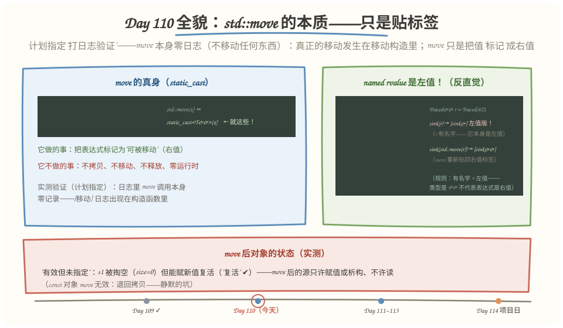
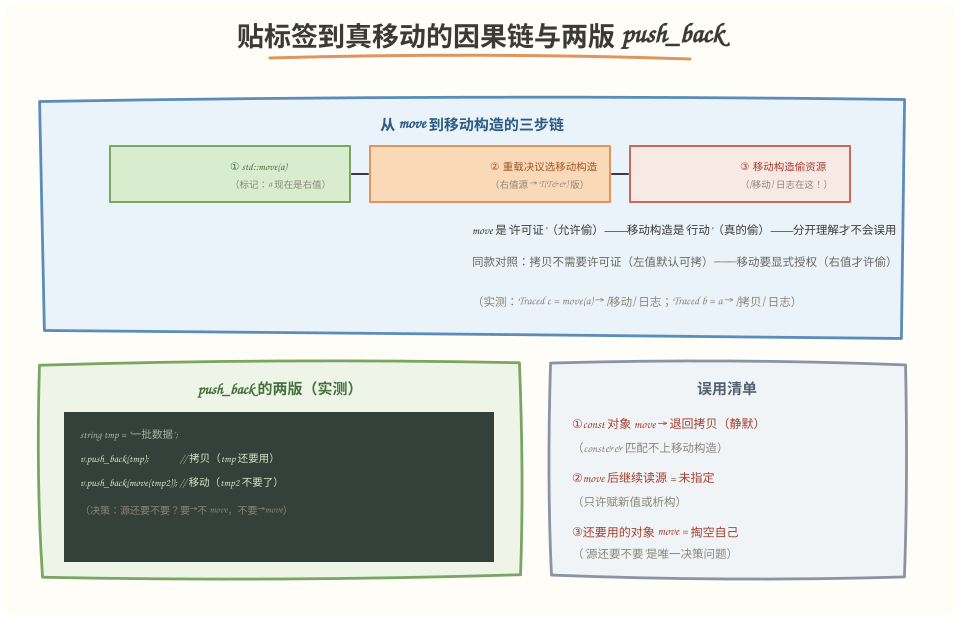
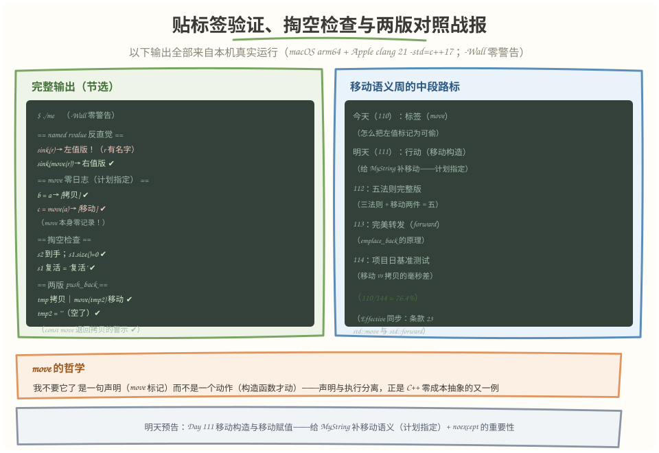

# 第 110 天：右值引用与 std::move 的本质

> **今日目标**：完成本教程后，你能做到：用打日志验证 **move 不移动任何东西**（计划指定——[移动] 日志出现在构造函数里、move 调用本身零记录）；说出 move 的真身（static_cast\<T&&\>——只是贴标签）；避开 named rvalue 的反直觉（`Traced&& r` 的 r 本身是**左值**）；检查 move 后源的状态（"有效但未指定"——能赋新值复活）；背出误用三清单（const 退拷贝/读源未指定/还要用就别 move）。
> **预计时间**：学习 20 分钟＋实践 40 分钟
> **前置准备**：完成 Day 109（值类别是今天的前置——右值=可偷许可证）。
> **今日产出**：move 零日志验证、掏空检查、两版 push_back、named rvalue 反直觉。

## 1. 今天解决什么问题？

昨天认出了"将亡者"（右值）——今天学**贴标签**的工具：`std::move`。最大的认知纠正是它的名字骗了你——**move 不移动任何东西**：它只是 `static_cast<T&&>`（把表达式标记为右值/可被移动），真正的移动发生在**移动构造函数**里（明天正课）。计划指定的"打日志验证"今天执行：move 调用本身**零日志**——[移动] 日志出现在构造函数里。

配套三个认知：**named rvalue 是左值**（`Traced&& r` 的 r 有名字——传参会走左值版！经典反直觉）；**move 后源的状态**（"有效但未指定"——被掏空但能赋新值复活）；**误用三清单**（const 对象 move 静默退回拷贝是最阴的坑）。

## 2. 先看全貌：今天的内容位于哪里？



**图 1**：左卡蓝是 move 的真身（static_cast——做/不做清单）；右卡绿是 named rvalue 反直觉；下方红卡是 move 后状态。

三步概括今天：

1. move = 贴标签（许可证）——移动构造才是行动；
2. named rvalue 是左值（有名字）——要再 move 一次；
3. 源被掏空（有效但未指定）——只许赋值或析构。

## 3. 核心概念：先用直觉，再给准确定义

### 3.1 move 不移动：标签与行动分离

- **一句通俗解释**：`std::move(a)` 只是**声明**"我不要 a 了"（贴上可偷标签）；真正把资源搬走的是**移动构造函数**（执行偷的动作）。
- **一个类比**：捐赠意向书（move）vs 搬家公司上门（移动构造）——签了意向书东西还在你家；搬家公司来了才真搬。意向书的作用是让搬家公司（重载决议）接单。
- **对应到技术上是**：实测——`Traced b = a;` → `[拷贝]`；`Traced c = std::move(a);` → `[移动]`；**move 调用本身零日志**（计划指定的验证——它是编译期的类型转换）。**三步因果链**（图 2）：①move 贴标签（a 变右值表达式）→ ②重载决议选 `T(T&&)` 移动构造 → ③构造函数偷资源（[移动] 日志在这）。**为什么这样设计**：拷贝不需要许可（左值默认可拷）；移动要显式授权（避免"我还在用就被偷了"）——**授权与执行分离**是零成本抽象的又一例。类比的边界：对没有移动构造的类，move 后退回拷贝（有拷贝构造的话）——标签贴了但没人接单（搬家公司不存在）。
- **常见误解**："move(x) 会把 x 清空/释放"——不；它**什么也不做**（类型转换）；清空是移动构造的副作用（偷资源的附带）。

### 3.2 named rvalue 是左值：反直觉第一名

- **一句通俗解释**：`Traced&& r = Traced(42);` 的 r **本身是左值**（有名字、可取地址）——用 r 传参走**左值版**重载！要再 `std::move(r)`。
- **一个类比**：信箱标签——&& 是"这个信箱收右值邮件"（能绑临时）；但信箱本身有地址有名字（左值）——寄给"信箱"走普通通道。
- **对应到技术上是**：实测——`sink(r)` → **`[sink&] 左值版`**（r 有名字）；`sink(std::move(r))` → `[sink&&] 右值版`。**规则**：值类别看**表达式**不是声明类型——`r` 这个表达式的类别是左值（named）；`Traced(42)`、`std::move(x)` 才是右值表达式。**实际影响**：容器里存右值引用、函数收 `T&&` 参数后**转发**时——参数本身是左值、要再 move/forward（Day 113 完美转发的核心问题！）。类比的边界：`Traced&& r` 的**声明**合法（绑临时+延长生命——同 const& 的效果）——只是 r 的**后续使用**是左值。
- **常见误解**："声明成 && 它就是右值了"——类型是引用、表达式类别是左值（两回事）；这个区分是移动语义的试金石。

### 3.3 move 后状态与误用清单

- **一句通俗解释**：被 move 的源进入"有效但未指定"状态——能析构、能赋新值、**不能**读内容（读到什么看实现）。
- **一个类比**：搬家后的旧房子——产权已转移（资源被偷）、但你还有钥匙（对象还在）；能重新装修（赋新值）不能当仓库用（读内容——已经是空房）。
- **对应到技术上是**：实测——`s2 = std::move(s1)` 后 s2 到手（"重要数据…"）、**s1.size() = 0**（被掏空——libc++ 的 string 实现置空）；`s1 = "复活"` ✔（赋新值合法）。**误用三清单**：①`const` 对象 move → `const&&` 匹配不上移动构造 → **静默退回拷贝**（不报错——最阴的坑）；②move 后**读**源 = 未指定（只许赋值/析构）；③**还要用的对象别 move**（"源还要不要"是唯一决策问题——两版 push_back 的实测对照）。类比的边界：标准库类型的 move 后状态各家略不同（string 常见置空）——**别依赖具体值**，按"未指定"对待最安全。
- **常见误解**："move 后对象就坏了不能用"——能赋新值复活（合法操作）；坏的是"读旧内容"的期待。

## 4. 图解核心机制



**图 2**：上半部分蓝卡是从 move 到移动构造的三步链（贴标签→重载决议→偷资源——[移动] 日志的位置）；左下绿卡是 push_back 两版（拷贝 vs 移动的决策）；右下灰卡是误用三清单。

按图逐步讲：

1. **走三步链**：move（声明）→ 重载选移动版（接单）→ 构造偷资源（行动）——日志只在第三步出现（今天的验证）；
2. **看两版 push_back**：`push_back(tmp)` 拷贝（tmp 还要用）、`push_back(move(tmp2))` 移动（不要了）——**决策问题只有一个**；
3. **读误用三清单**：const 退拷贝（静默）、读源未指定、还要用就别 move——每条配一个"为什么会这样"；
4. **连昨天**：昨天认出右值（将亡者）——今天学会贴标签（move）——明天写偷资源的代码（移动构造）——三天的连续剧。

## 5. 动手实践：完成一个最小可运行例子

### 5.1 准备文件

```bash
cd ai-compiler-roadmap/tutorials/day-110/examples
```

主角：`move_essence.cpp`（标签验证 + 状态检查 + 两版对照）。

### 5.2 编写代码

核心（完整代码见本目录）：

```cpp
void sink(Traced& t)  { std::cout << "[sink&]  左值版\n"; }     // 重载对
void sink(Traced&& t) { std::cout << "[sink&&] 右值版\n"; }

Traced&& r = Traced(42);        // && 绑临时（延长生命）
sink(r);                        // 左值版！（r 有名字——named rvalue）
sink(std::move(r));             // 右值版（重新贴标签）

Traced b = a;                   // [拷贝]
Traced c = std::move(a);        // [移动]——move 本身零日志！

std::string s2 = std::move(s1); // 掏空检查：s1.size() == 0
s1 = "复活";                     // 赋新值合法 ✔

v.push_back(tmp);               // 拷贝（tmp 还要用）
v.push_back(std::move(tmp2));   // 移动（tmp2 不要了）
```

### 5.3 运行与观察

```bash
g++ -Wall -std=c++17 move_essence.cpp -o me && ./me
```

实际执行结果（本机，节选）：

```text
== 右值引用：能绑右值的引用 ==
  [构造] Traced(42)
  Traced&& r = Traced(42); r.value() = 42
  [sink&]  左值版收到 42
  [sink&&] 右值版收到 42

== std::move 不移动任何东西（计划指定验证） ==
  [构造] Traced(7)
语句：Traced b = a;（不 move——拷贝）
  [拷贝] Traced(7)
  [析构] ~Traced(7)
语句：Traced c = std::move(a);（move 后——移动）
  [移动] Traced(7)（偷资源）
  [析构] ~Traced(7)
  （move 本身零日志——它只是把 a '标记'成右值）
  （真正的移动发生在移动构造函数里）

== move 后对象的状态（诚实检查） ==
  s2 = "重要数据重要数据重要数据"（资源到手）
  s1.size() = 0（被掏空——但对象'有效但未指定'状态）
  （可以赋新值复活：s1 = "复活"）

== move 的正确场景：要丢弃源时 ==
  push_back(tmp)：拷贝（tmp 还要用）
  push_back(move(tmp2))：移动（tmp2 不要了）
  容量 2 条；tmp2 = ""（空了）

== move 的误用警示 ==
  const 对象 move 无效：move(const T) → 还是走拷贝！
  （const&& 找不到移动构造——静默退回拷贝——坑！）
  还有：move 后继续用源 = 未指定行为（除了赋新值/析构）
```



**图 3**：左上完整输出（反直觉/零日志/掏空/两版/误用五段）；右侧是移动语义周的中段路标；下方橙卡是 move 的哲学。

### 5.4 修改一个输入再观察：const 退拷贝的日志目击

给 Traced 加一个 const 实例并 `Traced d = std::move(ca);`（ca 是 const）——日志打出的是 **[拷贝]** 不是 [移动]！（const&& 匹配不上 `T(T&&)`——退回 `T(const T&)`）。**一移动一拷贝**：误用清单第一条从口头变日志证据——const 是移动的天敌（不可变的东西当然不能被"偷"）。

## 6. 常见错误与排查

**错误 1：`move(a)` 后 a 的内容还是老值/被清空了？**

- 现象：对 move 后的源读内容，结果不确定；
- 原因：源在"有效但未指定"状态（实现决定掏成什么样）；
- 定位：审计 move 之后的所有对源的**读**；
- 修复：move 后只赋新值或析构；要读就别 move。

**错误 2：const 对象 move 了但日志显示拷贝**

- 现象：`move(常量)` 走了拷贝构造；
- 原因：const&& 匹配不上 T&& 的移动构造——静默退回拷贝；
- 定位：看日志（今天的 5.4 验证法）；
- 修复：去 const（如果逻辑允许）；或接受拷贝（const 的本意就是不可动）。

**错误 3：函数参数 `T&& t` 里对 t 再移动忘了 move**

- 现象：`void f(T&& t) { other(t); }` 走了拷贝；
- 原因：t 有名字——是左值（named rvalue 反直觉）；
- 定位：日志显示 [sink&]/拷贝；
- 修复：`other(std::move(t))`（要移动）或 `std::forward<T>(t)`（完美转发——Day 113）。

## 7. 今日练习

### 必做练习（计划指定：打日志验证）

扩展 Traced 加移动赋值运算符（`operator=(Traced&&)` 打 [移动赋值] 日志）——测四组：拷贝构造/拷贝赋值/移动构造/移动赋值各一次，日志逐条记录。预期产出：四行日志 + 每行触发的语句。

### 选做挑战

"move 计数器"：写一个函数 `swap_by_move(T& a, T& b)`（三步 move 交换：tmp=move(a); a=move(b); b=move(tmp)）——用 Traced 验证全程零拷贝（只 [移动] 日志）。对比 std::swap 的行为——移动语义版 swap 是它高效的原因。

## 8. 今日验收

- [ ] 我用日志验证了 move 零动作（[移动] 在构造函数里、move 调用零记录——计划指定）
- [ ] 我能说出 move 的真身（static_cast——标签与行动分离）
- [ ] 我实测了 named rvalue 反直觉（sink(r) 走左值版）
- [ ] 我的掏空检查通过（s1.size()=0、赋新值复活）
- [ ] 我背得出误用三清单（含 5.4 的 const 退拷贝目击）

## 9. 一句话总结与明天预告

今天的问题是"std::move 到底做了什么"；机制上，它是 static_cast（贴标签/签意向书）——移动构造才是行动（搬家）、named rvalue 是左值（有名字）、源进"有效但未指定"（只许赋值或析构）；实践上，零日志验证、掏空检查、两版 push_back、const 退拷贝全部实测；验证标准是看到任何 move 能说出"标签贴给谁、谁执行、源现在什么状态"。明天 **Day 111：移动构造与移动赋值**——给 MyString 补移动语义（计划指定）+ noexcept 的重要性：今天签的意向书明天有搬家公司来接。
