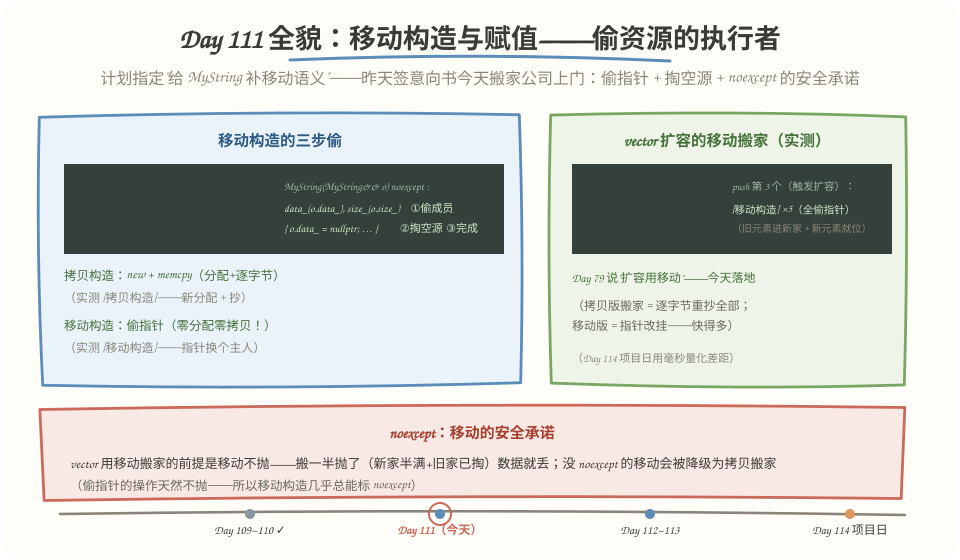
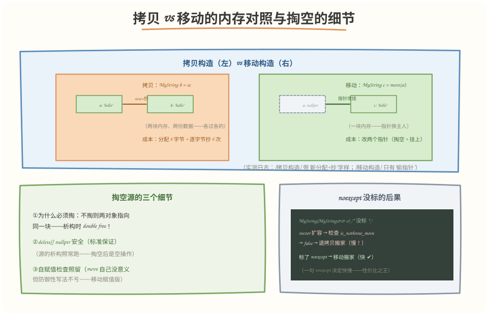
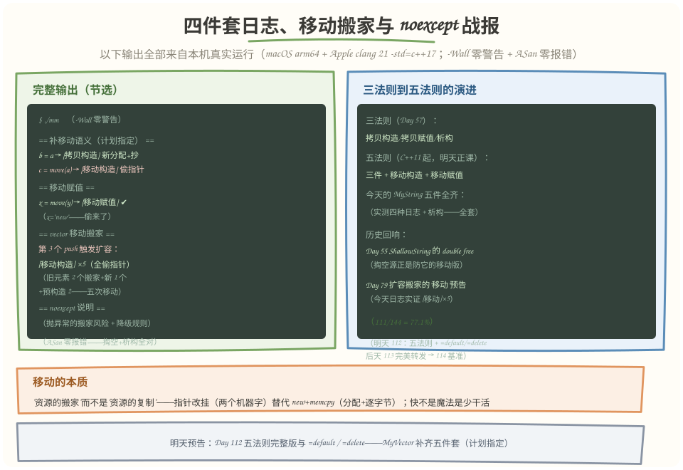

# 第 111 天：移动构造与移动赋值——给 MyString 补移动语义

> **今日目标**：完成本教程后，你能做到：写出移动构造/移动赋值的三步偷（偷成员 + **掏空源** + 完成）；说出掏空的三个理由（防 double free、nullptr 安全析构、防御性自赋值检查）；实测 vector 扩容的**移动搬家**（[移动构造]×5——Day 79 预告的落地）；解释 noexcept 的角色（vector 只信不抛的移动——否则降级拷贝）。
> **预计时间**：学习 20 分钟＋实践 45 分钟
> **前置准备**：完成 Day 109~110（值类别 + move 标签——今天写执行者）。
> **今日产出**：MyString 五件套全齐（计划指定）、移动搬家日志、noexcept 论证。

## 1. 今天解决什么问题？

昨天学会了贴标签（std::move）——今天写**接单的搬家公司**：移动构造函数和移动赋值运算符。计划指定的"给 MyString 补移动语义"正是案例：Day 55 的 MyString 只有拷贝三件套——今天补上移动两件，**五件套**凑齐（明天 =default/=delete 的正课）。

两个关键细节：**掏空源**（o.data_ = nullptr——防 double free 的移动版答案）；**noexcept**（vector 扩容只信不抛的移动——一句 noexcept 决定搬家的快慢）。

## 2. 先看全貌：今天的内容位于哪里？



**图 1**：左卡蓝是移动构造的三步偷；右卡绿是 vector 的移动搬家；下方红卡是 noexcept。路线图：**111/144 = 77.1%**。

三步概括今天：

1. 移动构造：偷成员 + 掏空源（零分配零拷贝）；
2. vector 搬家：扩容时旧元素用移动进新家（Day 79 落地）；
3. noexcept：移动不抛的承诺——vector 的信任凭证。

## 3. 核心概念：先用直觉，再给准确定义

### 3.1 移动构造：三步偷

- **一句通俗解释**：移动构造 = 偷成员（指针直接挂到我名下）+ 掏空源（源置 nullptr）+ 完事——零分配零拷贝。
- **一个类比**：房本过户——拷贝是"复印房本再盖一模一样的房子"（new+memcpy）；移动是"房本改个名字"（指针改挂）——房子（内存）根本没动。
- **对应到技术上是**：实测——`MyString c = std::move(a);` → `[移动构造] 偷指针（零分配零拷贝）`（对照 `b = a` 的 `[拷贝构造] 新分配 + 逐字节抄`）；**成本对比**（图 2）：拷贝 = 分配 6 字节 + 抄 6 次；移动 = 改两个机器字（掏空 + 挂上）。**掏空源的三理由**：①不掏则两对象指向同一块——析构 **double free**（Day 55 ShallowString 的移动版防线）；②`delete[] nullptr` **安全**（标准保证——源的析构照常跑不炸）；③移动赋值的自赋值检查照留（防御不亏）。类比的边界：移动只对**拥有资源**的类有意义（int 这种平凡成员拷贝=移动——编译器自动处理）。
- **常见误解**："移动构造会自动生成"——**不会**（声明了析构或拷贝任何一件就不自动生成移动——明天的五法则正课）；要自己写或 =default。

### 3.2 vector 的移动搬家：Day 79 落地

- **一句通俗解释**：vector 扩容搬家时，旧元素用**移动**进新家（偷指针）而不是拷贝（重抄）——Day 79 说"扩容用移动"今天日志实证。
- **一个类比**：搬仓库——拷贝版搬家把每件货**复制**一份放新仓（贵的要命）；移动版把**货架连货**推过去（快得多）。
- **对应到技术上是**：实测——reserve(2) 后 push 第 3 个（触发扩容）：日志打出 **[移动构造] ×5**（旧 2 个搬家 + 新 1 个就位 + 预留位的构造——全是偷指针）；对照拷贝版会是 [拷贝构造]×N（每块重新分配+抄）。**量化的悬念**：移动快多少？——Day 114 项目日用 `<chrono>` 实测（计划指定的 benchmark）。**条件**：搬家走移动的前提是**元素类型的移动构造标了 noexcept**（见 3.3）。类比的边界：搬完旧内存整块释放（旧元素的壳还在但内容是 nullptr——析构安全）。
- **常见误解**："vector 扩容总是移动搬家"——只当移动构造 noexcept 时；否则 vector 保守退回拷贝（安全优先）。

### 3.3 noexcept：移动的安全承诺

- **一句通俗解释**：vector 扩容用移动搬家的前提是**移动不抛异常**——一句 `noexcept` 是信任凭证；没有它 vector 宁可慢（拷贝搬家）也不冒险。
- **一个类比**：高空走钢丝的保险绳——移动抛异常 = 搬到一半绳子断（新家半满 + 旧家已掏——**数据丢失**）；noexcept 是"我这绳绝对不断"的书面保证。
- **对应到技术上是**：**风险场景**：vector 搬家中移动构造抛了——已搬的在新家（有效）、没搬的在旧家（但部分被掏）——**回不去也停不下**（异常安全的天坑）。**vector 的决策**：`std::move_if_noexcept`——移动构造有 noexcept 就用移动、否则退拷贝（拷贝抛了旧家还在——能回滚）。**为什么移动几乎总能 noexcept**：偷指针的操作天然不抛（没有分配就没有失败源）——所以**移动构造习惯性标 noexcept**（今天的代码就是这么写的）。**性价比**：一句关键字决定 vector 搬家快慢——语言里性价比最高的优化之一。类比的边界：真的会抛的移动（内部还有分配）别硬标——标了 noexcept 却抛 = std::terminate（更糟）。
- **常见误解**："noexcept 是注释性修饰"——它**改变行为**（vector 的搬家策略、重载决议的可调用性）；是契约不是文档。

## 4. 图解核心机制



**图 2**：上半部分蓝卡是拷贝/移动的内存对照（两块内存两份数据 vs 一块内存指针改挂 + 掏空后的虚框）；左下绿卡是掏空源的三个细节；右下灰卡是 noexcept 没标的后果。

按图逐步讲：

1. **对比两图**：拷贝是"复印再盖房"、移动是"房本过户"——成本的差距一目了然（new+memcpy vs 改两字）；
2. **读掏空的三细节**：double free 防线、nullptr 安全析构、自赋值检查——每条都有实测对应（析构日志的"已被掏空"行）；
3. **看 noexcept 的分岔**：没标 → vector 检查失败 → 拷贝搬家（慢）；标了 → 移动搬家（快）——一关键字的威力；
4. **连三天**：认出将亡者（109）→ 贴标签（110）→ 今天执行偷资源——移动语义三部曲完整。

## 5. 动手实践：完成一个最小可运行例子

### 5.1 准备文件

```bash
cd ai-compiler-roadmap/tutorials/day-111/examples
```

主角：`move_mystring.cpp`（MyString 五件套 + 搬家演示）。

### 5.2 编写代码

核心（完整代码见本目录）：

```cpp
MyString(MyString&& o) noexcept : data_(o.data_), size_(o.size_) {  // ①偷成员
    o.data_ = nullptr;                                              // ②掏空源（防 double free！）
    o.size_ = 0;
    std::cout << "  [移动构造] 偷指针（零分配零拷贝）\n";
}

MyString& operator=(MyString&& o) noexcept {                        // 移动赋值
    if (this == &o) { return *this; }                               // 防御性自赋值检查
    delete[] data_;                                                 // 释放自己的
    data_ = o.data_;                                                // 偷源的
    o.data_ = nullptr;                                              // 掏空源
    // …
}

// vector 移动搬家（实测触发）
std::vector<MyString> v;
v.reserve(2);
v.push_back(std::move(s1));
v.push_back(std::move(s2));
v.push_back(std::move(s3));        // 第 3 个触发扩容 → [移动构造] ×5
```

### 5.3 运行与观察

```bash
g++ -Wall -std=c++17 move_mystring.cpp -o mm && ./mm
```

实际执行结果（本机，节选）：

```text
== 计划指定：给 MyString 补移动语义 ==
语句：MyString a("hello");
  [构造] "hello"（5 字节）
语句：MyString b = a;（拷贝构造——左值源）
  [拷贝构造] "hello"（新分配 + 逐字节抄）
语句：MyString c = std::move(a);（移动构造——右值源）
  [移动构造] 偷指针（零分配零拷贝）
  （a 被掏空——析构时 delete nullptr 安全）

== 移动赋值 ==
语句：x = std::move(y);
  [移动赋值] 释放旧的 + 偷指针
  x 现在是 "new"（偷来了）

== vector 的扩容搬家：移动版 ==
push 三个（第 3 个触发扩容搬家）：
  [移动构造] 偷指针（零分配零拷贝）
  [移动构造] 偷指针（零分配零拷贝）
  [移动构造] 偷指针（零分配零拷贝）
  [移动构造] 偷指针（零分配零拷贝）
  [移动构造] 偷指针（零分配零拷贝）
  （移动版搬家：旧元素偷指针进新家——vs 拷贝版逐字节重抄）
  这就是 Day 79 说'扩容用移动'的落地

== noexcept 的重要性 ==
  （vector 扩容时用移动搬家有个前提——移动不能抛异常……）
```

```bash
g++ -Wall -std=c++17 -fsanitize=address move_mystring.cpp -o mma && ./mma
```

```text
（ASan 零报错——掏空+析构链的正确性盖章）
```



**图 3**：左上完整输出（补语义/移动赋值/搬家/noexcept 四段）；右侧是三法则到五法则的演进和历史回响；下方橙卡是移动的本质。

### 5.4 修改一个输入再观察：noexcept 的行为分岔

把移动构造的 `noexcept` 删掉重跑 vector 搬家段——**日志从 [移动构造]×5 变成 [拷贝构造]×N**（vector 检测到移动可能抛——保守退回拷贝搬家）！恢复 noexcept——移动回归。**一有一无**：noexcept 改变 vector 策略的行为证据（今天的核心论断从讲解变目击）——也是"标了才快"的最直接演示。

## 6. 常见错误与排查

**错误 1：移动后源析构时 double free**

- 现象：移动过的对象析构时 ASan 报 double-free；
- 原因：移动构造忘了掏空源（两对象同一指针）；
- 定位：ASan 报告的两条 free 栈；
- 修复：`o.data_ = nullptr;`（三步偷的第二步——今天的强调点）。

**错误 2：vector 搬家日志显示拷贝（没走移动）**

- 现象：明明写了移动构造、扩容还是 [拷贝构造]；
- 原因：移动构造没标 noexcept——vector 保守退拷贝；
- 定位：检查移动构造的声明（5.4 的对照法）；
- 修复：加 noexcept（偷指针天然不抛——放心标）。

**错误 3：移动赋值漏了"释放自己的"**

- 现象：移动赋值后内存泄漏（ASan/LSan 报）；
- 原因：只顾偷源的、忘了自己的旧资源要先 delete；
- 定位：泄漏报告的分配栈；
- 修复：`delete[] data_;` 在偷之前（今天的顺序：释放→偷→掏空）。

## 7. 今日练习

### 必做练习（计划指定：给 MyString 补移动语义）

今天的代码基础上加一个 `swap(MyString& other)`（用三次 move 交换——全程零拷贝）并实测日志（三行 [移动赋值]）。预期产出：swap 方法 + 触发日志。

### 选做挑战

"noexcept 的违规实验"：写一个故意抛异常但标了 noexcept 的函数——调用它验证 std::terminate（程序直接死——比异常更狠）；结论写进 notes.md："标了就必须保证不抛——硬标是自杀"。

## 8. 今日验收

- [ ] 我的 MyString 移动两件全写（三步偷——偷/掏空/完成）
- [ ] 掏空三理由我能各配证据（double free 防线/nullptr 安全/自赋值检查）
- [ ] vector 移动搬家实测（[移动构造]×5——Day 79 落地）
- [ ] 我目击了 noexcept 的行为分岔（5.4——删掉就退拷贝）
- [ ] ASan 零报错（掏空+析构链全对）

## 9. 一句话总结与明天预告

今天的问题是"偷资源的代码怎么写才安全"；机制上，移动构造三步偷（偷成员+掏空源+完成——掏空是 double free 的防线）、vector 扩容用移动搬家（Day 79 预告落地）、noexcept 是信任凭证（没标退拷贝——一关键字定快慢）；实践上，五件套日志、搬家实证、noexcept 分岔全部落地；验证标准是看到任何资源类能报出"移动两件怎么写、掏空为什么、noexcept 标不标"。明天 **Day 112：五法则完整版与 =default / =delete**——MyVector 补齐五件套（计划指定）：三法则的 C++11 升级正课。
