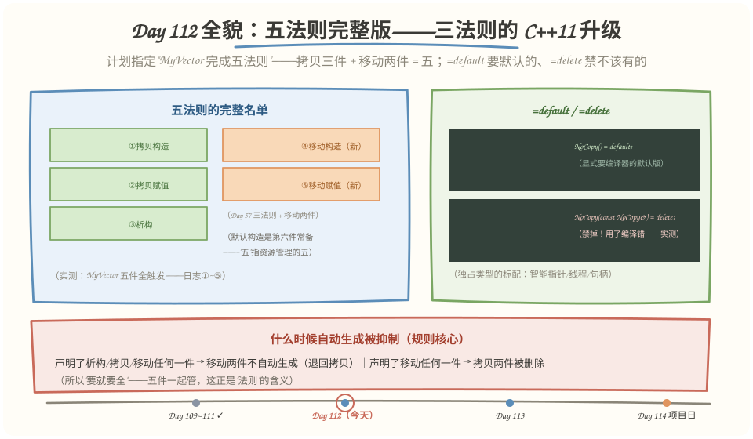
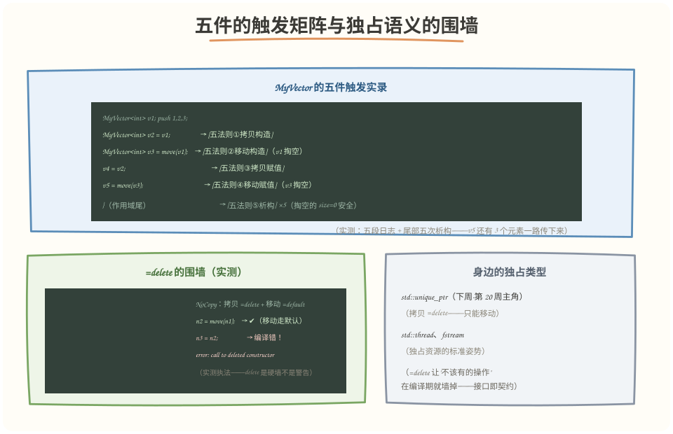
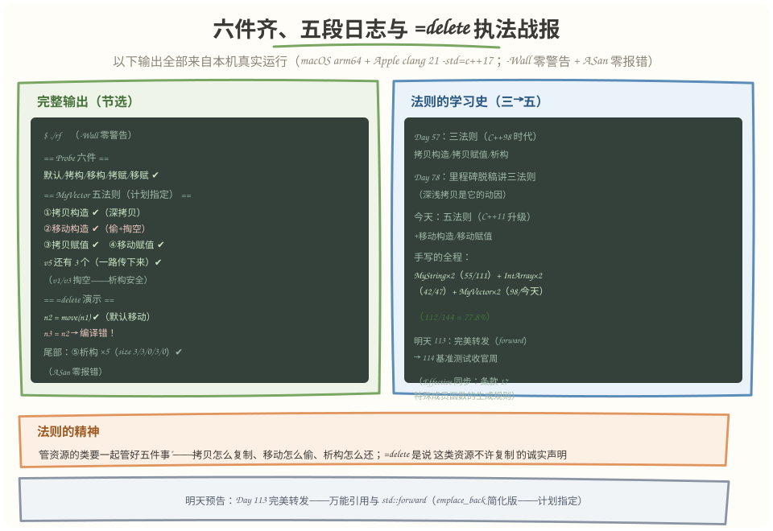

# 第 112 天：五法则完整版与 =default / =delete

> **今日目标**：完成本教程后，你能做到：背出五法则名单（拷贝构造/拷贝赋值/析构 + **移动构造/移动赋值**——三法则的 C++11 升级）；给 MyVector 补齐五件并实测五段日志（计划指定）；说出**自动生成的抑制规则**（声明析构 → 移动不自动生成；声明移动 → 拷贝被删）；用 =delete 禁拷贝（独占语义——编译期硬墙）和 =default 要默认。
> **预计时间**：学习 20 分钟＋实践 45 分钟
> **前置准备**：完成 Day 109~111（值类别 → move → 移动构造——今天收束成法则）。
> **今日产出**：MyVector 五件套（五段日志）、NoCopy 的 =delete 执法、抑制规则。

## 1. 今天解决什么问题？

Day 57 的三法则（拷贝构造/拷贝赋值/析构）是 C++98 时代的管理清单——C++11 加了移动两件变成**五法则**（Rule of Five）。计划指定的"MyVector 完成五法则"正是收束：Day 98 的 MyVector 只有拷贝三件——今天补上移动两件（昨天 MyString 的技术直接迁移）。

配套两个现代工具：**=default**（显式要编译器的默认版——"默认的就够用"）和 **=delete**（禁掉不该有的操作——独占语义的硬墙）。**抑制规则**是理解核心：声明了析构 → 移动两件**不自动生成**（静默退回拷贝——慢）；所以要移动就得自己写——"要就要全"正是法则的含义。

## 2. 先看全貌：今天的内容位于哪里？



**图 1**：左卡蓝是五法则的完整名单（三旧 + 两新）；右卡绿是 =default/=delete；下方红卡是抑制规则。

三步概括今天：

1. 五件：拷贝×2 + 析构 + 移动×2——资源管理的完整清单；
2. =delete：独占语义（拷贝编译错）；=default：要默认；
3. 抑制：声明析构杀移动——要全就写全。

## 3. 核心概念：先用直觉，再给准确定义

### 3.1 五法则：从三到五

- **一句通俗解释**：管资源的类要一起管好五件事——怎么复制（拷贝×2）、怎么偷（移动×2）、怎么还（析构）。
- **一个类比**：租车合同的三条老条款（怎么借、怎么还、怎么赔）加了两条新条款（怎么"过户"给下一租客）——五条全签才是完整合同。
- **对应到技术上是**：实测——MyVector 五段日志全触发：`v2 = v1` → **[①拷贝构造]**、`v3 = move(v1)` → **[②移动构造]**（v1 掏空）、`v4 = v2` → **[③拷贝赋值]**、`v5 = move(v3)` → **[④移动赋值]**、作用域尾 → **[⑤析构]×5**（掏空的 size=0 安全析构）；v5 还有 3 个元素一路传下来 ✔。**默认构造是第六件常备**（Probe 的六件实测）——"五"特指**资源管理**的五。**昨天到今天的迁移**：MyString 学的移动两件（偷+掏空+noexcept）直接搬进 MyVector——技术不变载体变。类比的边界：**零法则**（Rule of Zero）是进阶选项——全用标准库成员（string/vector）时五件都不用写（编译器默认就够）——手写资源才需要五。
- **常见误解**："三法则过时了"——是扩展不是替换；不用移动的场景三件照够（移动是优化不是正确性必需）。

### 3.2 抑制规则：自动生成的联锁

- **一句通俗解释**：你声明了五件中的任何一件，编译器就"谨慎"地收走其他自动生成——声明析构 → 移动不自动生成（退回拷贝）；声明移动 → 拷贝被删。
- **一个类比**：多米诺——动了其中一块（声明一件），其他块的站立状态（自动生成）跟着变；编译器的保守逻辑："你都自己管了，我就不多手"。
- **对应到技术上是**：**两条核心规则**：①声明了**析构或拷贝**任何一件 → **移动两件不自动生成**（move 调用静默退回拷贝——性能悄悄损失，Day 111 的 vector 退拷贝同类）；②声明了**移动**任何一件 → **拷贝两件被删除**（防不一致）。**实际后果**：Day 98 的 MyVector（有析构）如果没写移动——扩容搬家全走拷贝（慢）而**没有任何警告**；今天补齐五件后 grow() 里的 `std::move(data_[i])` 才真正走移动。**对策**：要么五件全写（今天的做法）、要么全不写用零法则（成员全标准库）。类比的边界：=default 可以"恢复"默认版（写了析构还想用默认拷贝——`=default` 显式要回来）。
- **常见误解**："编译器总会生成移动构造"——**只在什么都没声明时**；写了析构（几乎每个资源类都要写）它就消失——这是静默性能坑的第一名。

### 3.3 =default 与 =delete

- **一句通俗解释**：`=default` 说"要编译器的默认版"（成员逐个拷/移的机械版）；`=delete` 说"这个操作**禁止**"（用了编译错——硬墙）。
- **一个类比**：餐厅菜单——=default 是"按标准做法"（厨房默认手艺）；=delete 是"本店不做这道菜"（点了直接拒绝——不是"没有"是"不做"）。
- **对应到技术上是**：实测——NoCopy 类：拷贝构造/拷贝赋值 `=delete`、移动 `=default`：`n2 = move(n1)` **✔**（移动走默认——成员偷过去）、`n3 = n2` → **编译错**（`error: call to deleted constructor`——探针执法）；**身边的独占类型**：unique_ptr（第 19 周主角）、thread、fstream 全是这个写法（拷贝 =delete——资源独占不许复制）。**=default 的场景**：写了其他 =delete 后想让某件走默认；或显式表达"默认即可"（文档价值）。**接口即契约**：=delete 把"不该有的操作"从运行时纪律（注释"别拷贝"）变成编译期硬墙（拷了就不过）——Day 53 暴露面最小化的语言级武器。类比的边界：=delete 不限于特殊成员——普通函数也能删（禁某个重载——进阶用法）。
- **常见误解**："=delete 是注释"——是**编译期执法**（今天的探针日志就是证据）；比任何文档都硬。

## 4. 图解核心机制



**图 2**：上半部分蓝卡是 MyVector 的五件触发实录（每条语句对应哪段日志）；左下绿卡是 =delete 的围墙（NoCopy 的 ✔/✘ 实测）；右下灰卡是身边的独占类型。

按图逐步讲：

1. **对照五条语句和五段日志**：每件法则一个触发语句——考试时能默写这五对；
2. **看 =delete 的硬墙**：移动 ✔ vs 拷贝 ✘（同一类两种命运——delete 的精准打击）；
3. **读抑制规则的连锁**：声明析构 → 移动消失（退拷贝）——静默性能坑；五件全写是解药；
4. **认身边的独占类型**：unique_ptr/thread/fstream——下周（智能指针）的正主就这么写的。

## 5. 动手实践：完成一个最小可运行例子

### 5.1 准备文件

```bash
cd ai-compiler-roadmap/tutorials/day-112/examples
```

主角：`rule_of_five.cpp`（Probe 六件 + MyVector 五件 + NoCopy）。

### 5.2 编写代码

核心（完整代码见本目录）：

```cpp
MyVector(MyVector&& o) noexcept                  // ④移动构造（补齐五法则）
    : data_(o.data_), size_(o.size_), cap_(o.cap_) {
    o.data_ = nullptr; o.size_ = o.cap_ = 0;      // 掏空源
}
MyVector& operator=(MyVector&& o) noexcept {      // ⑤移动赋值
    if (this == &o) { return *this; }
    delete[] data_;                               // 释放自己的
    data_ = o.data_; size_ = o.size_; cap_ = o.cap_;
    o.data_ = nullptr; o.size_ = o.cap_ = 0;
    return *this;
}
// grow() 里的搬家：nd[i] = std::move(data_[i]); ← 现在真的走移动了

class NoCopy {
public:
    NoCopy() = default;
    NoCopy(const NoCopy&) = delete;               // 禁拷贝（独占）
    NoCopy& operator=(const NoCopy&) = delete;
    NoCopy(NoCopy&&) noexcept = default;          // 移动走默认
    // …
};
```

### 5.3 运行与观察

```bash
g++ -Wall -std=c++17 rule_of_five.cpp -o rf && ./rf
```

实际执行结果（本机，节选）：

```text
== 五法则全景：Probe 的六件 ==
  [默认构造] [拷贝构造] [移动构造] [拷贝赋值] [移动赋值]
  （六件齐——五法则的'五' + 默认构造）

== 计划指定：MyVector 完成五法则 ==
  [五法则①拷贝构造]
  [五法则②移动构造]
  [五法则③拷贝赋值]
  [五法则④移动赋值]
  v5 还有 3 个元素（一路传下来）
  （v1/v3 已掏空——size=0，析构安全）

== =delete：不可拷贝的类型 ==
  NoCopy n1; n1.value = 42
  NoCopy n2 = move(n1); ✔（移动默认）
  NoCopy n3 = n2;  → 编译错（拷贝被 =delete）
  （独占语义的类型都这么写——智能指针/线程/文件句柄）
  [五法则⑤析构]（size=3）×2
  [五法则⑤析构]（size=0）×2（掏空的）
  …
```

**=delete 执法**（探针实测）：

```text
/tmp/del.cpp:2:31: error: call to deleted constructor of 'NoCopy'
```



**图 3**：左上完整输出（六件/五段/=delete 三部分）；右侧是法则的学习史（三→五的手写全程：MyString×2 + IntArray×2 + MyVector×2）；下方橙卡是法则的精神。

### 5.4 修改一个输入再观察：抑制规则的目击

把 MyVector 的移动两件**注释掉**（只留拷贝三件）重跑——`v3 = move(v1)` 的日志变成 **[五法则①拷贝构造]**（不是移动！抑制规则生效：有析构 → 移动不自动生成 → move 标签没人接 → 退回拷贝）。恢复移动两件——[②移动构造] 回归。**一退一回**：抑制规则从文档变目击——这就是"静默性能坑"的真身（功能没错、就是慢）。

## 6. 常见错误与排查

**错误 1：`call to deleted constructor`（拷贝被禁的类型）**

- 现象：`NoCopy b = a;` 编译错；
- 原因：拷贝构造被 =delete（独占语义）；
- 定位：报错提 deleted constructor；
- 修复：按语义改——用移动（move）或引用/指针传递；真要复制说明设计错了。

**错误 2：写了析构后 move 静默走拷贝（性能坑）**

- 现象：move(a) 日志显示 [拷贝构造]；
- 原因：抑制规则——有析构移动不自动生成；
- 定位：日志对照（5.4 的方法）；
- 修复：补移动两件（五法则全写）或 =default（成员能默认移时）。

**错误 3：=default 用在不能默认的场景**

- 现象：`=default` 的拷贝构造行为不对（浅拷贝 double free）；
- 原因：成员有裸指针——默认版逐成员拷贝（指针抄指针）；
- 定位：ASan 的 double free；
- 修复：默认版只对"自己会管理自己的成员"（string/vector）安全；裸资源手写。

## 7. 今日练习

### 必做练习（计划指定：MyVector 完成五法则）

在今天的 MyVector 上加 `swap(MyVector& other) noexcept`（三次 move 交换——Day 111 练习的类模板版）并测五件的触发。预期产出：swap 方法 + 全套日志。

### 选做挑战

"零法则体验"：写一个 `struct Safe` { std::string name; std::vector<int> data; }——**什么都不写**（零法则）——测拷贝/移动全走编译器默认（日志正常、无泄漏）。对照手写五件的 MyVector——体会"成员自己会管自己时，法则可以零条"。

## 8. 今日验收

- [ ] 我能背出五法则名单（拷贝×2 + 析构 + 移动×2——三→五的演进）
- [ ] 我的 MyVector 五段日志全触发（计划指定——①~⑤）
- [ ] 我目击了抑制规则（5.4——注释移动后退拷贝）
- [ ] 我的 =delete 执法实测（拷贝编译错、移动 ✔）
- [ ] 我能说出身边三个独占类型（unique_ptr/thread/fstream）

## 9. 一句话总结与明天预告

今天的问题是"资源管理的完整清单是什么"；机制上，五法则（拷贝怎么复制/移动怎么偷/析构怎么还）、抑制规则（声明一件杀一批——静默性能坑）、=delete（独占语义的编译期硬墙）；实践上，五段日志、抑制目击、delete 执法全部落地；验证标准是看到任何资源类能报出"五件写了没、哪件被抑制、要不要 =delete"。明天 **Day 113：完美转发**——万能引用与 std::forward（emplace_back 简化版——计划指定）：Day 110 的 named rvalue 问题在这里得到正式解法。
