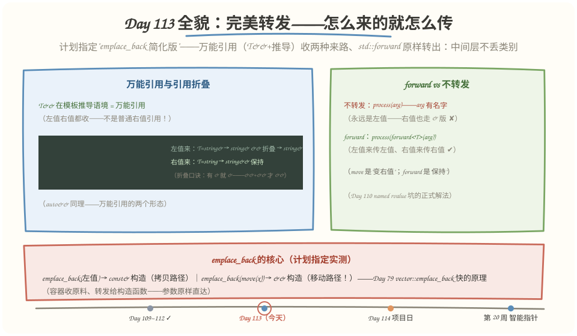
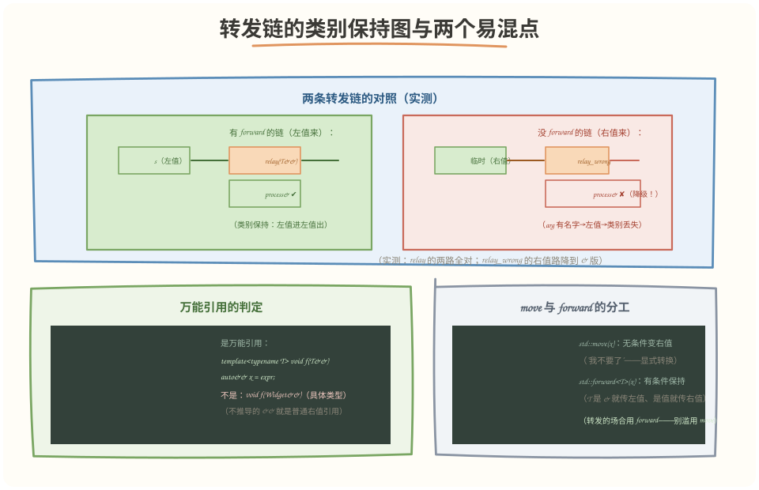
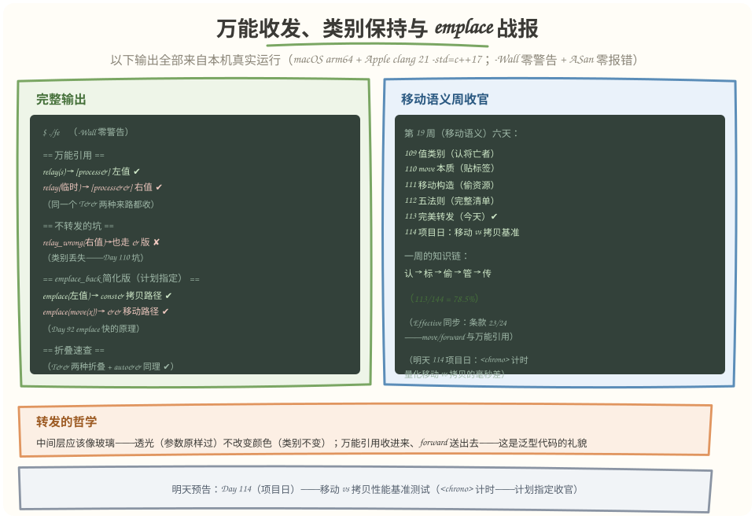

# 第 113 天：完美转发——万能引用与 std::forward

> **今日目标**：完成本教程后，你能做到：识别万能引用（`T&&` 在**推导语境**——普通右值引用不是）；背出引用折叠口诀（有 & 就 &——`string& &&` 折成 `string&`）；用 forward 保持类别转发（对照不转发的降级坑）；实现计划指定的 **emplace_back 简化版**（万能引用 + forward——拷贝/移动双路径实测）；说出 move 与 forward 的分工（无条件变 vs 有条件保持）。
> **预计时间**：学习 25 分钟＋实践 45 分钟
> **前置准备**：完成 Day 109~112（Day 110 的 named rvalue 坑今天正式解）。
> **今日产出**：万能收发实测、双路径 emplace、折叠速查。

## 1. 今天解决什么问题？

Day 110 留下的问题：转发函数 `void relay(T&& arg)` 里 **arg 本身是左值**（有名字）——直接 `process(arg)` 传出去**永远走左值版**（右值来的也降级）！今天的**完美转发**是正式解法：`process(std::forward<T>(arg))`——左值来传左值、右值来传右值（**类别保持**）。

配套两个前置概念：**万能引用**（`T&&` 在模板推导语境——左值右值都能收，靠**引用折叠**实现）和 **move/forward 的分工**（move 无条件变右值——"我不要了"；forward 有条件保持——"怎么来的怎么传"）。计划指定的 **emplace_back 简化版**是落地场景：Day 92 的 vector::emplace_back 为什么快——今天手写看原理。

## 2. 先看全貌：今天的内容位于哪里？



**图 1**：左卡蓝是万能引用与折叠；右卡绿是 forward vs 不转发；下方红卡是 emplace 核心。

三步概括今天：

1. 万能引用：`T&&`+推导——两种来路都收（折叠实现）；
2. forward：有条件保持——转发层不丢类别；
3. emplace_back：容器收原料、forward 直达构造函数。

## 3. 核心概念：先用直觉，再给准确定义

### 3.1 万能引用与引用折叠

- **一句通俗解释**：`template <typename T> void f(T&& arg)` 的 `T&&` 是**万能引用**——左值来 T 推成 `string&`、右值来推成 `string`；配合折叠规则两种都能收。
- **一个类比**：万能插座——形状随插头变（左值来变 & 型、右值来保持 && 型）——不是固定的一种口。
- **对应到技术上是**：实测——`relay(s)`（左值）→ T=`std::string&` → `string& &&` **折叠**成 `string&`（arg 是左值引用）；`relay(std::string("临时"))`（右值）→ T=`std::string` → arg 是 `string&&`。**折叠口诀**：有 & 就 &（`& + &`、`& + &&`、`&& + &` 全折成 &）——只有 `&& + &&` 保持 &&。**判定**（图 2 右下）：万能引用 = 模板 `T&&`（推导语境）或 `auto&&`；**具体类型**的 `Widget&&` 是普通右值引用（不万能）。**两阶段查找的开发插曲**（诚实记录）：今天首版把 process 声明放模板后面——编译报"neither visible nor found by ADL"（模板实例化时要看见声明）——前移声明后通过。类比的边界：万能引用是**形**（语法位置）不是类型——脱离推导语境就不万能了。
- **常见误解**："T&& 就是右值引用"——在模板推导语境它是万能的（能收左值——靠折叠）；`Widget&&` 才是纯右值引用。

### 3.2 forward：有条件的类别保持

- **一句通俗解释**：`std::forward<T>(arg)` 按 T 的推导结果还原类别——T 是 `string&` 传左值、T 是 `string` 传右值（**怎么来的就怎么传**）。
- **一个类比**：快递中转站——forward 是"原样转寄"（信封上的类别标签不变）；不转发是"拆开重装"（一律按普通件处理——加急件变平邮）。
- **对应到技术上是**：实测——`relay` 版（带 forward）：左值来 → `[process&]` ✔、右值来 → `[process&&]` ✔（**双路全对**）；`relay_wrong` 版（直接 `process(arg)`）：**右值来也走 `[process&]` ✘**（arg 有名字是左值——类别在中间层丢失）。**move 与 forward 的分工**：`move(x)` **无条件**变右值（"我不要了"——终点的语义）；`forward<T>(x)` **有条件**保持（"还原来路"——中间层的语义）。**误用警告**：转发场合用 move 会把左值也变右值（调用方还要用的对象被偷——事故）；forward 只该用于万能引用参数。类比的边界：forward 不在万能引用上用没意义（T 不是引用才转右值——普通参数自己选）。
- **常见误解**："forward 和 move 差不多"——方向相反：move 主动变、forward 被动保持；用错场合要么丢类别（该用不用）要么偷资源（不该用乱用）。

### 3.3 emplace_back 简化版（计划指定）

- **一句通俗解释**：`emplace_back(U&& v)` 收万能引用、`forward<U>(v)` 直达构造函数——左值走拷贝构造、右值走移动构造（**参数原样直达**，不先造临时再拷）。
- **一个类比**：装修送材——push_back 是"先在楼下组装好家具再搬上楼"（临时+搬运）；emplace_back 是"把原料直接送上楼在你家组装"（forward 直达）。
- **对应到技术上是**：实测——`emplace_back(material)`（左值）→ Widget 走 `[构造] 从 const string&`（**拷贝路径**）；`emplace_back(std::move(material))`（右值）→ `[构造] 从 string&&`（**移动路径！**）——**同一个 emplace、按来路选路径**。**Day 92 的兑现**：当时说"emplace_back 把构造参数转发进容器、省一次拷贝"——今天的 `new (slot) T(std::forward<U>(v))` 就是原理（就地构造——不产生临时）。**进阶注**：完整版 emplace_back 是变参模板（`template <typename... Args> emplace_back(Args&&... args)`——任意个数参数全转发）——今天是单参简化版（变参是模板进阶话题）。类比的边界：emplace 要求参数和构造函数**匹配**（不匹配编译错）；push_back 永远是"拷/移一个现成对象"。
- **常见误解**："emplace_back 就是 push_back 的快版"——本质是**语义不同**：push 收对象、emplace 收**构造参数**；快是"省临时"的副产品。

## 4. 图解核心机制



**图 2**：上半部分蓝卡是两条转发链的对照（有 forward 的双路全对 vs 没 forward 的右值降级）；左下绿卡是万能引用的判定（是/不是）；右下灰卡是 move 与 forward 的分工。

按图逐步讲：

1. **对比两条链**：绿色链（forward）左右值各得其所、红色链（不转发）右值降到 & 版——**中间层的一步决定全程**；
2. **背折叠口诀**：有 & 就 &——`string& && → string&` 是万能引用能收左值的机制根基；
3. **读判定的两栏**：模板 T&&（推导）和 auto&& 是万能；`Widget&&`（具体型）不是——形似的两种东西；
4. **记 move/forward 分工**：终点用 move（不要了）、中间层用 forward（还原）——一个位置一种工具。

## 5. 动手实践：完成一个最小可运行例子

### 5.1 准备文件

```bash
cd ai-compiler-roadmap/tutorials/day-113/examples
```

主角：`forward_emplace.cpp`（relay 双版 + MiniVector 的 emplace）。

### 5.2 编写代码

核心（完整代码见本目录）：

```cpp
void process(const std::string& s);          // 声明前置（两阶段查找）
void process(std::string&& s);

template <typename T>
void relay(T&& arg) {                         // 万能引用
    process(std::forward<T>(arg));            // 类别保持！
}

template <typename T>
void relay_wrong(T&& arg) {
    process(arg);                             // arg 有名字——永远左值（坑）
}

template <typename T>
class MiniVector {
public:
    template <typename U>
    void emplace_back(U&& v) {                // 万能引用收原料
        new (slot(n_)) T(std::forward<U>(v)); // 就地构造——怎么来的怎么传
        ++n_;
    }
    // …
};
```

### 5.3 运行与观察

```bash
g++ -Wall -std=c++17 forward_emplace.cpp -o fe && ./fe
```

实际执行结果（本机）：

```text
== 万能引用：左值右值都收 ==
  [relay] 收到 → 转发：[process&] 左值 "我是左值"
  [relay] 收到 → 转发：[process&&] 右值 "我是右值"（可移动）
  （同一个 T&&——两种来路都收 = 万能）

== 不转发的坑（Day 110 复习） ==
  [relay_wrong] arg 本身是左值（有名字！）→ [process&] 左值 "我是左值"
  [relay_wrong] arg 本身是左值（有名字！）→ [process&] 左值 "右值"
  （转发层必须 forward——不然后半程类别丢失）

== 计划指定：emplace_back 简化版 ==
emplace_back(左值 material)：
  [构造] 从 const string&："原材料"（拷贝路径）
emplace_back(move(material))：
  [构造] 从 string&&："原材料"（移动路径！）
  （同一个 emplace——forward 保持来路的类别）
  （这就是 Day 92 vector::emplace_back 快的原理）

== 引用折叠速查 ==
  T=string  时 T&& = string&&（右值引用）
  T=string& 时 T&& = string& && → string&（左值引用！）
  （折叠规则：有 & 就 &——只有 &&+&& 才 &&）
  （万能引用 = 模板 T&& + 推导语境——auto&& 同理）
```



**图 3**：左上完整输出（万能/坑/emplace/折叠四段）；右侧是移动语义周的收官（认→标→偷→管→传的知识链）；下方橙卡是转发的哲学。

**开发插曲（诚实记录）**：首版把 process 的定义放在模板之后——编译报"neither visible in the template definition nor found by ADL"（模板实例化时要看见声明——两阶段查找的要求）；前移声明后通过。

### 5.4 修改一个输入再观察：万能引用的判定实验

把 relay 的参数改成具体类型 `void relay2(std::string&& arg)`——调用 `relay2(s)`（左值）**编译错**（普通右值引用不收左值——万能性消失）！对照 `relay(s)` ✔（万能引用收）。**一普通一万能**：`T&&`（推导）和 `string&&`（具体）形似神异——判定的两栏从清单变目击。

## 6. 常见错误与排查

**错误 1：转发函数没 forward——右值降级走拷贝**

- 现象：中间层传出的对象走了 & 版（拷贝慢/语义错）；
- 原因：arg 有名字是左值（Day 110 坑）；
- 定位：日志对照（relay_wrong 的实测法）；
- 修复：`std::forward<T>(arg)`——今天的核心。

**错误 2：把普通 `Widget&&` 当万能引用传左值**

- 现象：`f(左值对象)` 编译错（no matching function）；
- 原因：具体类型的 && 是纯右值引用（不折叠）；
- 定位：参数是不是模板 T&&（判定的两栏）；
- 修复：改成模板 `template<typename T> void f(T&&)`。

**错误 3：在转发场合误用 move（偷了调用方还要用的）**

- 现象：调用方传左值、被中间层 move 掏空；
- 原因：中间层用 move（无条件变右值）而不是 forward；
- 定位：调用方的对象莫名为空；
- 修复：中间层一律 forward；move 只在"确定丢弃"的终点用。

## 7. 今日练习

### 必做练习（计划指定：emplace_back 简化版）

给 MiniVector 加 `push_back(const T&)`（拷贝路径对照）——三种方式各 push 一个 Widget（左值 push / 左值 emplace / 右值 emplace）——日志对比三条路径。预期产出：三行构造日志 + 一句路径总结。

### 选做挑战

"make_unique 简化版"：写 `template <typename T, typename U> T* my_make(U&& arg)`——内部 `new T(std::forward<U>(arg))` 返回裸指针（智能指针明天见）——测左值/右值两种来路的构造路径。这是完美转发的第二个经典应用（工厂函数）。

## 8. 今日验收

- [ ] 我能识别万能引用（模板 T&&/auto&& 是、具体 Widget&& 不是——5.4 目击）
- [ ] 我背得出折叠口诀（有 & 就 &——&&+&& 才 &&）
- [ ] 我的 relay 双路全对（forward 保持）/ relay_wrong 的降级目击
- [ ] 我的 emplace_back 双路径实测（拷贝/移动——计划指定）
- [ ] 我能说出 move 与 forward 的分工（终点变 vs 中间保持）

## 9. 一句话总结与明天预告

今天的问题是"中间层怎么不丢参数的类别"；机制上，万能引用（T&&+推导——折叠实现两种来路都收）、forward（有条件保持——怎么来的怎么传）、emplace_back 是落地（参数直达构造——Day 92 的原理）；实践上，万能收发、双路径、判定实验、两阶段查找插曲全部落地；验证标准是看到任何 T&& 能报出"万能吗、怎么折叠、转发用什么"。明天 **Day 114（项目日）：移动 vs 拷贝性能基准测试**（`<chrono>` 计时——计划指定）：一周的移动语义用毫秒数收官。
