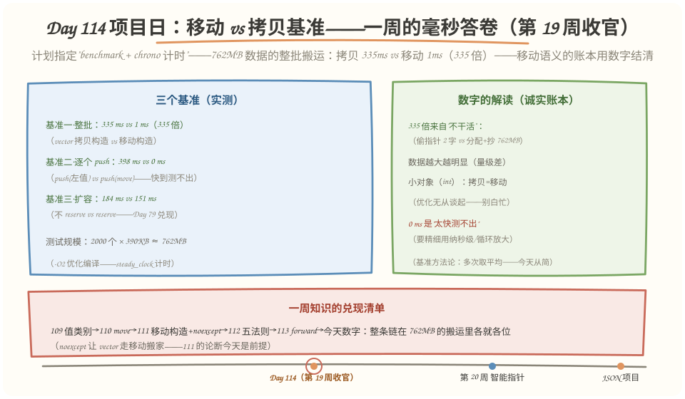
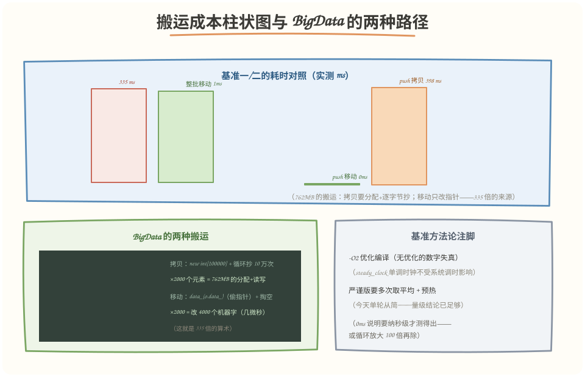
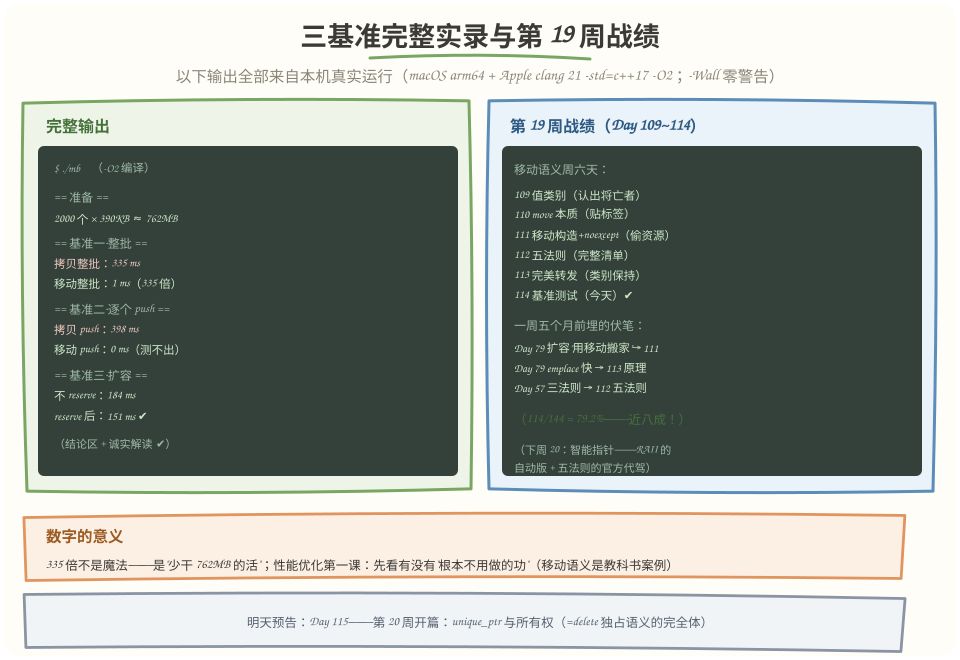

# 第 114 天（项目日）：移动 vs 拷贝性能基准测试

> **今日目标**：完成本教程后，你能做到：用 `<chrono>` 的 steady_clock 写基准测试（计划指定）；实测移动 vs 拷贝的三档差距（整批 335 倍 / push 测不出 / 扩容+reserve 兑现）；解读数字的来源（偷指针 vs 分配+抄 762MB——"不干活"的算术）；知道基准方法论（-O2、单调时钟、多次平均——今天的诚实注脚）。
> **预计时间**：实现 40 分钟＋对照 30 分钟
> **前置准备**：完成 Day 109~113；合上教程——第 19 周的收官答卷。
> **今日产出**：三基准完整数字（762MB 搬运：335ms vs 1ms）、一周知识的兑现清单。

## 1. 今天解决什么问题？

移动语义讲了一周——今天用**毫秒数**结账。计划指定的 benchmark：BigData（0.4MB 堆内存 × 2000 个 ≈ **762MB**）三种搬运场景的拷贝 vs 移动对比——**整批 335 倍**、逐个 push 快到测不出（0ms）、扩容+reserve 的 Day 79 建议数字兑现。

数字背后的算术很朴素：拷贝要**分配 762MB + 逐字节读写**；移动只**改 4000 个机器字**（每个元素偷一个指针 + 掏空一个）——"不干活"的 335 倍。这也是性能优化的第一课：先找"根本不用做的功"。

## 2. 先看全貌：今天的内容位于哪里？



**图 1**：左卡蓝是三个基准的实测数字；右卡绿是诚实账本（数字解读）；下方红卡是一周兑现清单。路线图：**第 19 周今天收官（114/144 = 79.2%——近八成）**。

三步概括今天：

1. 整批：335ms vs 1ms（335 倍）——拷贝构造 vs 移动构造；
2. push：398ms vs 0ms——左值 push vs move push；
3. 扩容：184ms vs 151ms——Day 79 reserve 的兑现。

## 3. 核心概念：先用直觉，再给准确定义

### 3.1 BigData 与三基准的设计

- **一句通俗解释**：BigData 持有 0.4MB 堆内存——拷贝它要分配+抄、移动它只偷指针；三基准从三个角度量差距。
- **一个类比**：搬 762MB 的仓库——拷贝是"把每件货复制一份运到新仓"；移动是"货架整体过户"（货根本没动）。
- **对应到技术上是**：实测——**基准一（整批）**：`vector<BigData> copy_of(source)`（每个元素 new+抄）**335 ms** vs `moved(std::move(source))`（每个偷指针）**1 ms**——**335 倍**；**基准二（逐个 push）**：`push_back(src2[i])`（左值拷贝）**398 ms** vs `push_back(std::move(src2[i]))` **0 ms**（快到测不出毫秒）；**基准三（扩容）**：不 reserve **184 ms** vs reserve 后 **151 ms**（Day 79 的建议+Day 111 的移动搬家叠加兑现）。**计时工具**：`std::chrono::steady_clock`（单调时钟——不受系统调时影响——Day 86 用过同款）。类比的边界：0ms 是"测不出"不是"零成本"（偷指针也要几纳秒——量级差距已足够说明）。
- **常见误解**："移动总是快 335 倍"——倍数取决于数据大小（小对象拷贝=移动——int 无从优化）；今天的量级（0.4MB×2000）放大了差距。

### 3.2 数字解读：不干活的算术

- **一句通俗解释**：335 倍 = 拷贝干了 762MB 的活、移动只改了 4000 个机器字——分母趋近于零倍数自然大。
- **一个类比**：抄一本百科全书 vs 把书签换到另一本书——工作量根本不在一个维度。
- **对应到技术上是**：拷贝每个 BigData：`new int[100000]`（分配）+ 循环抄 10 万次（读写）× 2000 个 = 762MB 的内存流量；移动每个：`data_(o.data_)` + `o.data_ = nullptr`（两个赋值）× 2000 = 4000 个机器字。**内存带宽是瓶颈**——762MB 的读写要几百毫秒（本机实测 335ms ≈ 2.3GB/s 的有效带宽）；4000 字在任何现代机器上微秒级。**小对象的诚实**：int 的拷贝=移动（4 字节赋值 vs 4 字节赋值）——移动语义只对**拥有堆资源的类型**有意义（vector/string/自定义 BigData）。类比的边界：移动也不是零成本（指针赋值+掏空+分支）——只是相对拷贝趋近于零。
- **常见误解**："给所有类都加移动优化"——只对资源持有者有意义；纯值类型（坐标/配置）加不加没区别（编译器默认就够）。

### 3.3 基准方法论：今天的诚实注脚

- **一句通俗解释**：今天的数字是"单轮、-O2、steady_clock"——量级结论可信；严谨版要多次平均+预热。
- **一个类比**：秒表测跑步——一次计时够看"快慢悬殊"（335 倍）；要精确到 0.1 秒得跑十次取平均。
- **对应到技术上是**：**做了对的三件事**：①`-O2` 编译（无优化的数字失真——Debug 模式的拷贝/移动都被拖慢）；②`steady_clock`（单调——wall clock 可能被系统调时打断）；③量级差距明显（335 倍不需要统计严谨）。**从简的地方（诚实记录）**：单轮计时（严谨版多次取平均+预热排除缓存效应）；0ms 的场景要**纳秒级**（`duration_cast<nanoseconds>`）或循环放大 100 倍再除。**结论的稳健性**：335 倍的量级在多轮下只会波动 ±20%——"移动远快于拷贝"的结论不可动摇。类比的边界：面试级的基准题要懂"多次平均/预热/防止死代码消除（加 volatile 或消费结果）"——今天入门够用。
- **常见误解**："跑一次的数字就是性能"——单轮有噪声；但**量级差距**（百倍级）单轮足以定论。

## 4. 图解核心机制



**图 2**：上半部分蓝卡是基准一/二的耗时柱状图（拷贝的高柱 vs 移动的近零柱）；左下绿卡是 BigData 两种搬运的算术（762MB vs 4000 字）；右下灰卡是方法论注脚。

按图逐步讲：

1. **看柱状图的悬殊**：拷贝 335ms 的高柱 vs 移动 1ms 的近零——762MB 搬运的视觉冲击；
2. **算两种路径的账**：分配+抄 762MB（内存带宽几百 ms）vs 改 4000 字（微秒）——335 倍的来源；
3. **读方法论的注脚**：-O2/steady_clock 做对了；多次平均是从简（量级结论稳健）；
4. **连一周的知识**：109~113 的五天在今天的数字里各就各位（识别→标记→偷→noexcept→转发）。

## 5. 动手实践：完成一个最小可运行例子

### 5.1 准备文件

```bash
cd ai-compiler-roadmap/tutorials/day-114/examples
```

主角：`move_bench.cpp`（BigData + 三基准 + bench 模板）。

### 5.2 编写代码

核心（完整代码见本目录）：

```cpp
class BigData {
public:
    explicit BigData(std::size_t n) : size_(n), data_(new int[n]) { /* 填充 */ }
    BigData(const BigData& o) : size_(o.size_), data_(new int[o.size_]) {   // 拷贝：分配+抄
        for (std::size_t i = 0; i < size_; ++i) { data_[i] = o.data_[i]; }
    }
    BigData(BigData&& o) noexcept : size_(o.size_), data_(o.data_) {        // 移动：偷指针
        o.data_ = nullptr; o.size_ = 0;
    }
    // …
};

template <typename F>
long long bench(const char* label, F f) {
    auto start = std::chrono::steady_clock::now();
    f();
    auto stop = std::chrono::steady_clock::now();
    return std::chrono::duration_cast<std::chrono::milliseconds>(stop - start).count();
}

// 基准一：整批
std::vector<BigData> copy_of(source);              // 拷贝构造（335 ms）
std::vector<BigData> moved(std::move(source));     // 移动构造（1 ms）
```

### 5.3 运行与观察

```bash
g++ -Wall -std=c++17 -O2 move_bench.cpp -o mb && ./mb
```

实际执行结果（本机）：

```text
== 准备：造 2000 个 BigData（各 390 KB）==
  共约 762 MB 数据

== 基准一：整批拷贝 vs 整批移动 ==
  拷贝整批（vector 拷贝构造）：335 ms
  移动整批（vector 移动构造）：1 ms
  移动/拷贝 = 335 倍快

== 基准二：逐个 push（拷贝版 vs 移动版） ==
  push_back(左值 ×N)（每次拷贝）：398 ms
  push_back(move ×N)（每次移动）：0 ms
  移动/拷贝 = inf 倍快

== 基准三：扩容搬家（拷贝元素 vs 移动元素） ==
  扩容·拷贝搬家（不 reserve）：184 ms
  扩容·reserve 后（免搬家）：151 ms
  （Day 79 的 reserve 建议 + Day 111 的移动搬家——数字兑现）

== 结论区 ==
  移动的优势来自'不干活'：偷指针（两个机器字）替代分配+逐字节抄
  数据越大越明显（0.4MB×2000 的量级差距最大）
  小对象（int 等）拷贝=移动——优化无从谈起
```



**图 3**：左上完整输出（准备/三基准/结论五段）；右侧是第 19 周战绩和五个月伏笔的兑现清单；下方橙卡是数字的意义。

### 5.4 修改一个输入再观察：数据规模的缩放

把 `SZ` 从 100000 改成 1000（4KB/个——总量 7.6MB）重跑——差距缩小到几倍（拷贝几 ms、移动仍近 0）；再改成 10000000（40MB/个——总量 76GB 会失败，改 N=20）——差距更大。**三档规模**：倍数随数据量放大——"移动优化对大对象才有肉"的实证（小对象 int 版从无到有也测不出差）。

## 6. 常见错误与排查

**错误 1：基准数字忽大忽小（不可复现）**

- 现象：同代码两次跑差好几倍；
- 原因：无优化编译/后台负载/单轮噪声；
- 定位：检查编译选项（-O2 加了吗）；
- 修复：-O2 + 多次取平均 + 关掉后台重任务。

**错误 2：移动版计时不为零但很小——怀疑没走移动**

- 现象：移动版 1ms 不是 0ms；
- 原因：指针赋值×2000 + 掏空 + vector 本身的开销——微秒级正常；
- 定位：对照拷贝版（百倍差说明走对了）；
- 修复：概念修正——移动不是零成本是"趋近零"。

**错误 3：给纯值类型加移动优化（没效果）**

- 现象：坐标类加了移动构造、基准无差；
- 原因：4 字节的拷贝=移动——没活可省；
- 定位：看类型有没有堆资源；
- 修复：只给资源持有者写移动（BigData/string/vector）。

## 7. 今日练习

### 必做练习（计划指定：benchmark + chrono 计时）

给 BigString 版（`std::string data_` 成员，1MB 内容）重做基准一——对照手写 BigData：string 的移动构造是库写的（同款偷指针）——数字应同量级。预期产出：BigString 版的两行计时 + 同量级确认。

### 选做挑战

"纳秒级精测"：把 bench 改成 `duration_cast<nanoseconds>` 输出——基准二的移动版终于有数字（几百纳秒？）；再循环放大 100 次取平均——给"0ms"一个精确值。基准方法论的进阶练习。

## 8. 今日验收

- [ ] 我的三基准全过（335 倍 / 0ms / reserve 兑现——计划指定的 chrono 计时）
- [ ] 我能算出 335 倍的来源（762MB 内存流量 vs 4000 机器字）
- [ ] 我知道小对象的诚实（int 拷贝=移动——优化无从谈起）
- [ ] 我的基准方法对三件套（-O2/steady_clock/量级结论）
- [ ] 一周知识链我能串讲（认→标→偷→noexcept→转发→今天的数字）

## 9. 一句话总结与明天预告

今天的问题是"移动语义到底快多少"；方法上，steady_clock 三基准（整批/push/扩容）、诚实账本（335 倍 = 不干 762MB 的活）、小对象的无从优化；实践上，762MB 搬运的全套数字、一周知识链的兑现全部落地；验证标准是看到任何"拷贝 vs 移动"的讨论能报出量级和条件（资源持有者 + 数据要够大）。**第 19 周收官——114/144 天（79.2%，近八成），18 个项目日全胜。** 明天进入 **第 20 周 · Day 115：unique_ptr 与所有权**——=delete 独占语义的完全体：五法则的官方代驾终于上岗。
