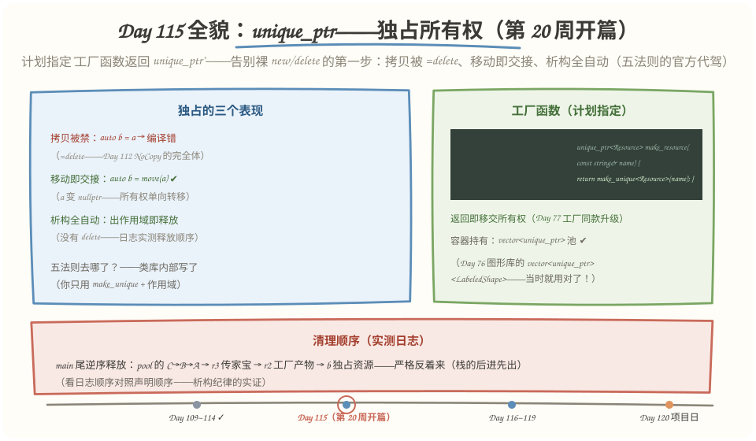
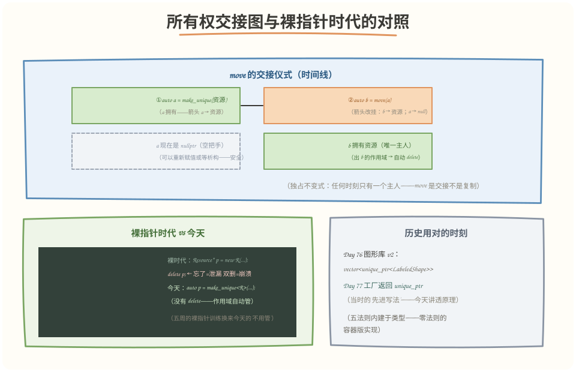
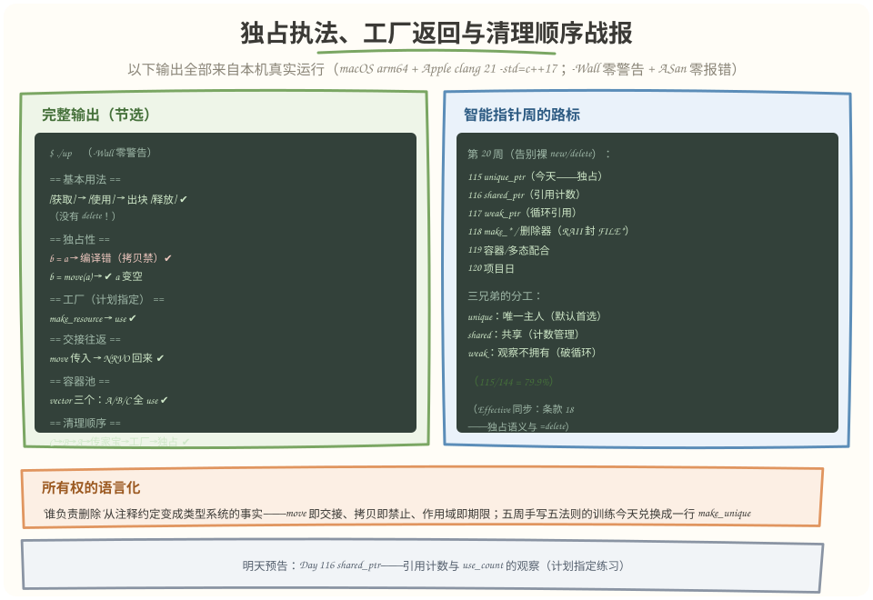

# 第 115 天：unique_ptr——独占所有权

> **今日目标**：完成本教程后，你能做到：用 make_unique 创建独占指针（无 delete 的自动释放——日志实测清理顺序）；说出独占的三个表现（拷贝 =delete 编译错、移动即交接、析构全自动）；写计划指定的**工厂函数返回 unique_ptr**（Day 77 的升级）；在容器里持有独占指针（Day 76 的正名）；解释它和五法则的关系（类库内部写好了——你只用作用域）。
> **预计时间**：学习 20 分钟＋实践 40 分钟
> **前置准备**：完成 Day 112（=delete 独占语义）+ Day 114（移动语义——unique_ptr 只能移动）。
> **今日产出**：独占三表现实测、工厂函数、容器池、清理顺序日志。

## 1. 今天解决什么问题？

第 20 周开篇：**告别裸 new/delete**。第一件武器 **unique_ptr**——独占所有权：拷贝被 =delete（Day 112 的 NoCopy 完全体）、移动即所有权交接（Day 110~111 的移动语义实战）、析构全自动（作用域即期限——RAII 的指针版）。**五法则的官方代驾**：手写了五周的三法则/五法则（MyString/IntArray/MyVector）——unique_ptr 类库内部全写好了，你只需要 `make_unique` + 作用域。

历史伏笔的兑现：Day 76 图形库的 `vector<unique_ptr<LabeledShape>>`、Day 77 工厂的 `unique_ptr<LabeledShape> make_shape()`——当时的"先进写法"今天讲透原理。

## 2. 先看全貌：今天的内容位于哪里？



**图 1**：左卡蓝是独占的三个表现；右卡绿是工厂函数（计划指定）；下方红卡是清理顺序。路线图：**115/144 = 79.9%，第 20 周（智能指针）开篇**。

三步概括今天：

1. 独占：拷贝编译错、移动即交接、出域自动释放；
2. 工厂：make_unique 返回——调用方拿到就是所有者；
3. 容器：vector 持有池——析构逐个释放（逆序）。

## 3. 核心概念：先用直觉，再给准确定义

### 3.1 独占的三个表现

- **一句通俗解释**：资源任何时刻只有一个主人——拷贝被禁止（不能复制主人）、移动即交接（主人换人）、析构自动（主人走了资源释放）。
- **一个类比**：房产证——原件只有一张（拷贝 ✘）；过户即交接（move ✔——原主的证作废）；持有者注销时房产处置（自动释放）。
- **对应到技术上是**：实测——`auto b = a;` → **编译错**（`call to implicitly-deleted copy constructor`——探针执法；Day 112 NoCopy 的完全体）；`auto b = std::move(a);` → ✔（**a 变 nullptr**——交接完成、b 是唯一主人）；出作用域 → `[释放]` 日志（**没有一行 delete**）。**清理顺序**（实测日志）：main 尾**逆序**释放（pool 的 C→B→A → r3 → r2 → b——栈的后进先出纪律）。类比的边界：被 move 掏空的 a 可以重新赋值或等析构（nullptr 状态安全——同 Day 110 的"有效但未指定"）。
- **常见误解**："unique_ptr 很智能很复杂"——核心就是"一个裸指针 + =delete 拷贝 + 移动偷指针 + 析构 delete"——五法则你已经会手写了，它只是标准化的包装。

### 3.2 工厂函数返回 unique_ptr（计划指定）

- **一句通俗解释**：`std::unique_ptr<Resource> make_resource(name)` ——工厂造资源、返回即移交所有权（调用方拿到就是主人）。
- **一个类比**：4S 店交车——车（资源）造好、钥匙（所有权）直接给你——不存在"店里还留一把"（不共享）。
- **对应到技术上是**：实测——`auto r2 = make_resource("工厂产物"); r2->use();` ✔（**返回即所有**）；**交接往返**：`r3 = transfer_ownership(std::move(r3))`——按值收 unique_ptr（交接仪式）+ 返回（NRVO/移动回来）——传家宝出去旅游一圈还是你的。**Day 77 的对照**：当时的 make_shape 返回 `unique_ptr<LabeledShape>`（类型最小面决策）——今天知道这个模式的深意：**工厂 + 独占返回 = 所有权清晰流转**（没有"谁删"的问题）。**为什么返回值优化重要**：工厂若返回裸指针——调用方不知道要不要删（泄漏风险）；返回 unique_ptr——类型即文档。类比的边界：工厂内部 `make_unique` 就地构造（免临时——Day 113 forward 的收益）。
- **常见误解**："返回 unique_ptr 有拷贝开销"——移动构造几乎免费（偷指针——Day 114 的 1ms 整批）；NRVO 下更是零。

### 3.3 容器持有与五法则的关系

- **一句通俗解释**：`vector<unique_ptr<Resource>>` 池——容器拥有指针、指针拥有资源；析构时逐个自动释放（两层 RAII 叠加）。
- **一个类比**：仓库的货架——仓库（vector）管格子、格子里的标签（unique_ptr）管货——拆仓库时逐格清货（一层层自动）。
- **对应到技术上是**：实测——pool 装 3 个（工厂返回的 A/B + make_unique 的 C）——遍历 use ✔、main 尾**逆序释放**（C→B→A）。**Day 76 的正名**：图形库 v2 的 `vector<unique_ptr<LabeledShape>>`——当时"照官方写"——今天的原理：多态容器 + 独占所有权 + 自动析构（虚析构在 LabeledShape 层保证——Day 69）。**和五法则的关系**：unique_ptr **类内**实现了五件（拷贝 =delete、移动偷指针、析构 delete）——**你的类用它做成员就是零法则**（不用再手写任何一件）。类比的边界：容器存 unique_ptr 后**容器本身不可拷贝**（元素拷贝被禁——vector 的拷贝会连锁失败）——要拷贝语义的容器换 shared_ptr（明天）。
- **常见误解**："vector 存 unique_ptr 后不能拷贝是缺陷"——是**独占语义的正确传播**（独占的东西放进可拷的容器就矛盾了）；要共享明天有 shared_ptr。

## 4. 图解核心机制



**图 2**：上半部分蓝卡是 move 的交接仪式时间线（a 拥有 → 交接 → a 空 b 拥有 → b 出域自动释放）；左下绿卡是裸指针时代 vs 今天的对照；右下灰卡是历史用对的时刻。

按图逐步讲：

1. **走交接的时间线**：箭头从 a 改挂到 b（资源不动）、a 变空把手——**独占不变式**：任何时刻只有一个主人；
2. **读两个时代的对照**：裸时代 `delete p` 忘了泄漏/双删崩（Day 39/55 的旧伤）；今天没有 delete 这一行——作用域自动；
3. **看历史用对的时刻**：Day 76/77 的 unique_ptr 用法——五周多前埋的正确写法今天有了原理注脚；
4. **连五法则**：手写五周（MyString/IntArray/MyVector）换来的是"知道 unique_ptr 在替你干什么"——不是白学。

## 5. 动手实践：完成一个最小可运行例子

### 5.1 准备文件

```bash
cd ai-compiler-roadmap/tutorials/day-115/examples
```

主角：`unique_ownership.cpp`（Resource + 工厂 + 容器池）。

### 5.2 编写代码

核心（完整代码见本目录）：

```cpp
std::unique_ptr<Resource> make_resource(const std::string& name) {   // 计划指定：工厂
    return std::make_unique<Resource>(name);                        // 就地构造 + 独占包装
}

auto r = std::make_unique<Resource>("数据库连接");                   // 创建（无 new）
r->use();                                                            // 像指针一样用
// 出块自动 [释放]——没有 delete

auto a = std::make_unique<Resource>("独占资源");
// auto b = a;                       // ✘ 编译错（拷贝 =delete）
auto b = std::move(a);               // ✔ 交接（a 变 nullptr）

std::vector<std::unique_ptr<Resource>> pool;                        // 容器持有
pool.push_back(make_resource("资源A"));
pool.push_back(std::make_unique<Resource>("资源C"));
```

### 5.3 运行与观察

```bash
g++ -Wall -std=c++17 unique_ownership.cpp -o up && ./up
```

实际执行结果（本机，节选）：

```text
== 基本用法：创建与自动释放 ==
  [获取] Resource("数据库连接")
  [使用] 数据库连接
  （作用域尾自动释放——没有 delete！）
  [释放] ~Resource("数据库连接")

== 独占性：拷贝被禁 ==
  auto b = a; → 编译错（拷贝被禁——Day 112 =delete 实战）
  auto b = move(a); → ✔（所有权交给 b）
  a 现在 空（nullptr）
  [使用] 独占资源

== 计划指定：工厂函数 ==
  [获取] Resource("工厂产物")
  [使用] 工厂产物

== 所有权交接（函数往返） ==
  [交接] 收到 "传家宝"（我是新主人）
  （回来了——非空 ✔）

== 容器里的独占指针 ==
  池里有 3 个：
  [使用] 资源A … [使用] 资源C
  （vector 持有所有权——析构时逐个自动释放）

== 作用域结束的清理顺序 ==
  [释放] ~Resource("资源C")
  [释放] ~Resource("资源B")
  [释放] ~Resource("资源A")
  [释放] ~Resource("传家宝")
  [释放] ~Resource("工厂产物")
  [释放] ~Resource("独占资源")
```

**拷贝执法**（探针实测）：

```text
/tmp/cp.cpp:2:54: error: call to implicitly-deleted copy constructor of 'unique_ptr<int>'
```



**图 3**：左上完整输出（六段 + 逆序清理）；右侧是智能指针周路标和三兄弟分工；下方橙卡是所有权的语言化。

### 5.4 修改一个输入再观察：get() 与裸指针的边界

加 `Resource* raw = b.get();`——拿到裸指针**只读用**（raw->name() ✔）；试 `delete raw;`——编译过但**双删崩溃**（b 析构时再 delete 一次——ASan 抓 double free）。**一用一崩**：get() 是"借看不是拥有"——所有权还在 unique_ptr 手里；裸指针时代的老习惯（见指针就删）在这里是事故。recover：删掉那行——一切正常。

## 6. 常见错误与排查

**错误 1：`implicitly-deleted copy constructor`（拷贝独占指针）**

- 现象：`auto b = a;` 编译错；
- 原因：unique_ptr 拷贝被 =delete（独占语义）；
- 定位：报错提 deleted copy constructor；
- 修复：要交接 `std::move(a)`；要共享换 shared_ptr（明天）。

**错误 2：get() 出来的裸指针被 delete（双删崩溃）**

- 现象：ASan 报 double-free；
- 原因：get() 只是借看——所有权没转移；unique_ptr 析构时会再删；
- 定位：ASan 的两条 free 栈；
- 修复：永远不要 delete get() 的结果；要移交用 release()（进阶——慎用）。

**错误 3：make_unique 和 new unique_ptr 混用困惑**

- 现象：`unique_ptr<Resource> p(new Resource(...))` 也能编译——用哪个？
- 原因：两种都合法（make_unique 是 C++14 的糖）；
- 定位：风格问题不报错；
- 修复：一律 make_unique（异常安全 + 简洁——Effective 条款 21）；裸 new 版留给面试题。

## 7. 今日练习

### 必做练习（计划指定：工厂函数返回 unique_ptr）

把 Day 77 的 make_shape 升级成模板版：`template <typename T, typename... Args> std::unique_ptr<T> my_make(Args&&... args) { return std::unique_ptr<T>(new T(std::forward<Args>(args)...)); }`——测 `my_make<Resource>("名字")`（Day 113 forward 的实战 + 今天的工厂）。预期产出：模板工厂 + 构造/释放日志。

### 选做挑战

"独占守卫"：写 `template <typename T> class ScopeGuard { std::unique_ptr<T> p_; ... }`——构造接 unique_ptr、析构时打印"守卫释放"再走（双层 RAII 的嵌套观察）；实测守卫出块时**先**打日志**后**释放成员（析构顺序：析构函数体先于成员销毁）。

## 8. 今日验收

- [ ] 我的独占三表现全过（拷贝编译错 / move 交接 / 自动释放——探针+日志）
- [ ] 我的工厂函数返回 unique_ptr（计划指定——交接往返也测了）
- [ ] 容器池实测（vector 持有 + 逆序清理日志）
- [ ] 我能说出它和五法则的关系（类内实现——零法则的钥匙）
- [ ] 我知道 get() 的边界（借看不是拥有——5.4 双删目击）

## 9. 一句话总结与明天预告

今天的问题是"独占所有权怎么表达才安全"；机制上，拷贝 =delete（不能复制主人）、移动即交接（move 的所有权语义）、析构自动（作用域即期限）——五法则被类库内化、你只剩 make_unique；实践上，工厂返回、容器持有、交接往返、清理顺序全部实测；验证标准是看到任何 new/delete 能报出"这段能不能换 unique_ptr、所有权归谁"。明天 **Day 116：shared_ptr**——引用计数与 use_count 的观察（计划指定）：资源要共享时怎么办。
