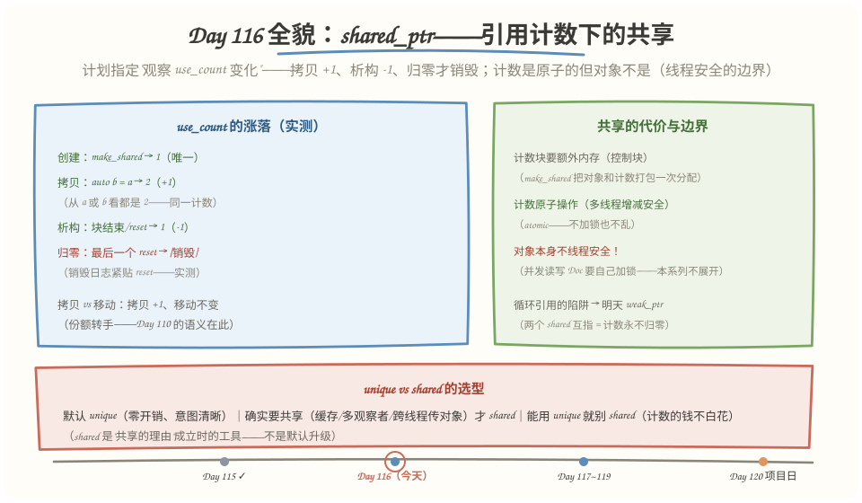
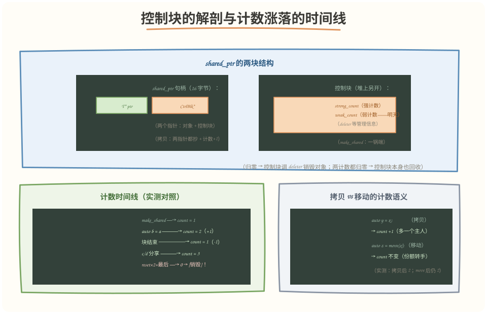
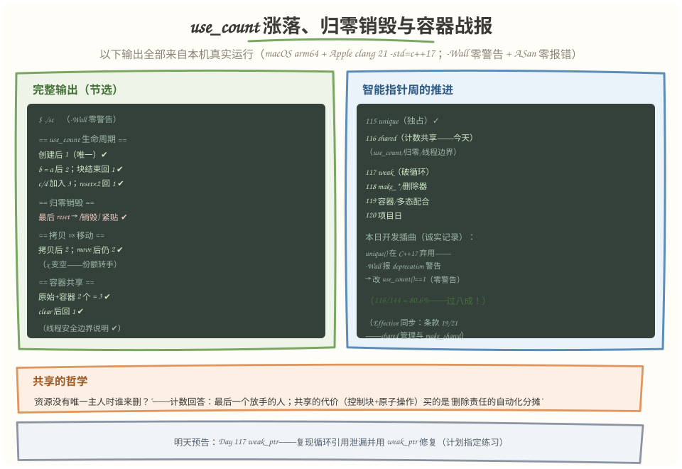

# 第 116 天：shared_ptr——引用计数

> **今日目标**：完成本教程后，你能做到：观察 use_count 的完整生命周期（计划指定——创建 1/拷贝 +1/析构 -1/归零销毁）；说出拷贝和移动对计数的不同影响（+1 vs 不变转手）；画出 shared_ptr 的两块结构（句柄双指针 + 控制块）；背出线程安全的边界（**计数原子、对象不是**）；给出 unique/shared 的选型（默认 unique、有共享理由才 shared）。
> **预计时间**：学习 20 分钟＋实践 40 分钟
> **前置准备**：完成 Day 115（独占是对照系）。
> **今日产出**：use_count 涨落实测、归零销毁、容器共享、拷贝/移动对照。

## 1. 今天解决什么问题？

资源没有唯一主人时（缓存/多观察者/跨线程传对象）——unique_ptr 不够用。**shared_ptr** 用**引用计数**回答"谁来删"：每个持有者 +1、放手 -1、**归零才销毁**——删除责任被自动化分摊。计划指定的"观察 use_count 变化"是今天的骨架：创建 1 → 拷贝 2 → 析构 1 → 归零 [销毁]——每一步实测。

两个边界认知：**线程安全**（计数原子但对象不是——多线程读写对象要自己加锁）；**循环引用的陷阱**（两个 shared 互指 = 计数永不归零 = 泄漏——明天 weak_ptr 的正题）。

## 2. 先看全貌：今天的内容位于哪里？



**图 1**：左卡蓝是 use_count 的涨落实测；右卡绿是共享的代价与边界；下方红卡是选型。路线图：**116/144 = 80.6%——过八成**。

三步概括今天：

1. 计数：拷贝 +1、析构/reset -1、归零销毁；
2. 结构：句柄双指针（对象+控制块）——make_shared 一锅端；
3. 边界：计数原子、对象不是；循环引用是陷阱。

## 3. 核心概念：先用直觉，再给准确定义

### 3.1 use_count 的生命周期（计划指定）

- **一句通俗解释**：use_count 是"现在有几个主人"——创建 1、拷贝 +1、析构/reset -1、**归零时销毁资源**。
- **一个类比**：合租的电闸——每搬进一人开一盏灯（+1）、搬走关一盏（-1）、**最后一人离开时锁门断电**（销毁）。
- **对应到技术上是**：实测——`make_shared` 后 **1（唯一）**；`{ auto b = a; }` 块内 **2**（从 a 或 b 看都是 2——同一计数）、块结束回 **1**；c/d 加入 **3**、reset×2 回 1；**最后的 a.reset() → [销毁] 日志紧贴打出**（计数归零的瞬间触发）。**拷贝 vs 移动**：`auto y = x`（拷贝）→ count **+1**（2）；`auto z = move(x)`（移动）→ count **不变**（仍 2——x 的份额转给 z、x 变空）——Day 110 的移动语义在计数上的投影。类比的边界：use_count 在多线程下是**近似值**（别的线程可能同时增减）——只做调试观察不做同步依据。
- **常见误解**："shared_ptr 到处传就安全了"——计数只管**删除**；对象本身的并发读写它不管（见 3.3）。

### 3.2 两块结构与 make_shared

- **一句通俗解释**：shared_ptr 句柄装两个指针（对象 + 控制块）；控制块在堆上另开（装计数/删除器等）；make_shared 把对象和控制块**一次分配**（省一次 new + 缓存友好）。
- **一个类比**：会员卡系统——卡（句柄）上印着两个地址（店铺 + 会员中心）；会员中心（控制块）记着"这张卡有几份副本"；办卡套餐（make_shared）把店和中心开在同一栋楼。
- **对应到技术上是**：实测的日志背后——每次拷贝是"两指针都抄 + 控制块的原子 +1"；**归零时**控制块调 deleter 销毁对象；**两个计数都归零**（strong + weak——明天）时控制块本身回收。**make_shared 的优势**：对象和控制块一次 new（少一次分配 + 同缓存行）；劣势：对象和控制块同生共死（weak 还活着时对象内存不能还——进阶细节）。**弃用插曲（诚实记录）**：`p.unique()` 在 C++17 起弃用——今天的 -Wall 报 deprecation 警告 → 改 `use_count() == 1`（零警告——标准演进的一个小脚印）。类比的边界：make_shared 至今（C++23）仍不能直接配自定义删除器（Effective 条款 21 的 drawback 之一）——要删除器就用 shared_ptr 构造函数或 unique_ptr（Day 118 细说）。
- **常见误解**："make_shared 就是 new 的语法糖"——还有一次分配省略 + 异常安全的实质差异（Effective 条款 21）。

### 3.3 线程安全边界与选型

- **一句通俗解释**：**计数是原子的**（多线程增减不乱）；**对象不是**（并发读写要自己加锁）——shared_ptr 管删除不管数据竞争。
- **一个类比**：公共储物柜的登记本（计数）——登记是排队原子操作（不会记错人数）；但柜子里的东西（对象）两人同时拿取会打架（要自己约规矩）。
- **对应到技术上是**：**计数原子**：控制块用 atomic 计数（fetch_add/fetch_sub）——多线程各持拷贝增减不加锁也正确；**对象不安全**：两个线程同时 `p->modify()` 是数据竞争（UB——本系列未安排并发正课，需自行加锁防护）；**句柄的操作**：不同线程操作**各自的** shared_ptr 拷贝安全、操作**同一个**要保护。**选型口诀**：默认 unique（零开销意图清）；确实要共享（多观察者/缓存/跨线程传**所有权**）才 shared；循环里互指用 weak（明天）。类比的边界：`shared_ptr<const T>` 跨线程读是安全的（const 不写）——"共享只读"是免锁的常见合法形态。
- **常见误解**："shared_ptr 线程安全"——半对半错：计数安全、对象不安全；把这半句话当全部是并发 bug 的常见来源。

## 4. 图解核心机制



**图 2**：上半部分蓝卡是两块结构（句柄双指针 + 控制块的 strong/weak 计数）；左下绿卡是计数时间线（实测的五步涨落）；右下灰卡是拷贝 vs 移动的计数语义对照。

按图逐步讲：

1. **看两块结构的分工**：句柄（你手里）只有指针；控制块（堆上）管计数——拷贝是抄句柄+动计数；
2. **走计数时间线**：1→2→1→3→2→1→0→[销毁]——每一步对应一句代码（今天的实测序列）；
3. **对比拷贝/移动**：拷贝 +1（多一个主人）、移动不变（份额转手）——Day 110 的所有权语义在计数维度的投影；
4. **记线程边界**：计数原子（登记本排队）、对象不安全（柜里打架）——半句话的正确版本。

## 5. 动手实践：完成一个最小可运行例子

### 5.1 准备文件

```bash
cd ai-compiler-roadmap/tutorials/day-116/examples
```

主角：`shared_count.cpp`（Doc + use_count 全程观察）。

### 5.2 编写代码

核心（完整代码见本目录）：

```cpp
auto a = std::make_shared<Doc>("共享文档");
show("创建后 a", a);                    // use_count = 1

{
    auto b = a;                         // 拷贝 → 计数 +1
    show("块内", a);                     // 2
}                                       // b 析构 → -1
show("块结束", a);                       // 1

auto c = a; auto d = a;                 // 3
c.reset(); d = nullptr;                 // 放手的两种写法 → 1
a.reset();                              // 归零 → [销毁] 紧贴打出！

auto y = x;                             // 拷贝：+1
auto z = std::move(x);                  // 移动：不变（份额转手）

std::vector<std::shared_ptr<Doc>> refs; // 容器共享
refs.push_back(shared_doc);             // +1
```

### 5.3 运行与观察

```bash
g++ -Wall -std=c++17 shared_count.cpp -o sc && ./sc
```

实际执行结果（本机，节选）：

```text
== 计划指定：use_count 的生命周期 ==
  [创建] Doc("共享文档")
  创建后 a：use_count = 1（唯一）
  块内 b = a 后：use_count = 2
  从 b 看：use_count = 2
  块结束 b 析构后：use_count = 1（唯一）
  三个共享时：use_count = 3
  c.reset() 后：use_count = 2
  d = nullptr 后：use_count = 1（唯一）

== 最后一个放手才销毁 ==
  [销毁] ~Doc("共享文档")          ← 归零瞬间！
  （上面应打出 [销毁]——计数归零触发）

== 拷贝 vs 移动对计数的不同影响 ==
  拷贝后 x：use_count = 2
  move 后 z：use_count = 2        ← 不变！
  x 现在 空                        ← 份额转手

== 容器共享：多处持有一份 ==
  原始 + 容器两个：use_count = 3
  容器清空后：use_count = 1（唯一）

== 计数的原子性（线程安全说明） ==
  计数本身是原子的（多线程增减不加锁也不乱）
  但指向的对象不是！（并发读写 Doc 要自己加锁）
```



**图 3**：左上完整输出（生命周期/归零/拷贝移动/容器/线程边界五段）；右侧是智能指针周推进和**弃用插曲的诚实记录**（unique() → use_count()==1）；下方橙卡是共享的哲学。

### 5.4 修改一个输入再观察：多线程下的计数正确性

起两个线程各拷贝 a 一万次再全放手（`std::thread`——本系列未细讲，今天当黑盒用）——结束后 use_count 应回到 **1**（计数原子的证据：一万次 +1/-1 精确平衡不丢）。**对照**：把 Doc 内部加个非原子的计数器让两线程同时 ++——结果 < 20000（**数据竞争**丢了更新）——"计数原子、对象不是"的一正一反双证。

## 6. 常见错误与排查

**错误 1：资源迟迟不销毁（计数不归零）**

- 现象：reset 了所有能看到的还在——泄漏嫌疑；
- 原因：某处还有拷贝没放手（容器里/全局/lambda 捕获）；或循环引用（明天正题）；
- 定位：use_count 逐处打印（今天的方法）；
- 修复：清理遗漏的持有者；互指场景换 weak_ptr。

**错误 2：多线程同时读写对象出诡异值**

- 现象：并发写 Doc 的字段后数据错乱；
- 原因：shared_ptr 只保计数安全——对象的数据竞争它不管；
- 定位：5.4 的非原子对照（丢更新的形态）；
- 修复：加锁（mutex）或改 `shared_ptr<const T>` 只读共享。

**错误 3：`p.unique()` 的弃用警告**

- 现象：-Wall 报 deprecated；
- 原因：unique() 在 C++17 弃用（多线程下语义不可靠）；
- 定位：警告指到那一行；
- 修复：`use_count() == 1`（今天的修正实录）。

## 7. 今日练习

### 必做练习（计划指定：观察 use_count 变化）

写一个"计数追踪表"程序：依次执行 创建/拷贝/再拷贝/reset/move/容器加入/容器清空——每步后打印 use_count，手推预测后实测对照。预期产出：七行对照表（预测 vs 实测）。

### 选做挑战

"shared 工厂"：`template <typename T, typename... Args> std::shared_ptr<T> make_traced(Args&&... args)`——除了返回 make_shared，还在内部打"创建+当前 count"日志；测多个拷贝后 count 的变化路径（Day 113 forward + Day 115 工厂 + 今天计数的组合）。

## 8. 今日验收

- [ ] 我的 use_count 全程实测（1→2→1→3→2→1→0→[销毁]——计划指定）
- [ ] 我能说清拷贝 vs 移动的计数差异（+1 vs 不变转手——实测数字）
- [ ] 我能画出两块结构（句柄双指针 + 控制块）并说 make_shared 的打包优势
- [ ] 我背得出线程安全边界（计数原子、对象不是——5.4 双证）
- [ ] 我能给出选型口诀（默认 unique、有共享理由才 shared）

## 9. 一句话总结与明天预告

今天的问题是"多个主人共享时谁来删"；机制上，引用计数（拷贝 +1/放手 -1/归零销毁——删除责任自动化分摊）、两块结构（句柄+控制块；make_shared 一锅端）、边界（计数原子对象不是）；实践上，use_count 涨落、归零销毁、容器共享、拷贝移动对照全部实测；验证标准是看到任何共享场景能报出"count 现在几、归零谁触发、对象并发要不要锁"。明天 **Day 117：weak_ptr 与循环引用**——复现泄漏并用 weak 修复（计划指定）：两个 shared 互指的死结怎么解。
