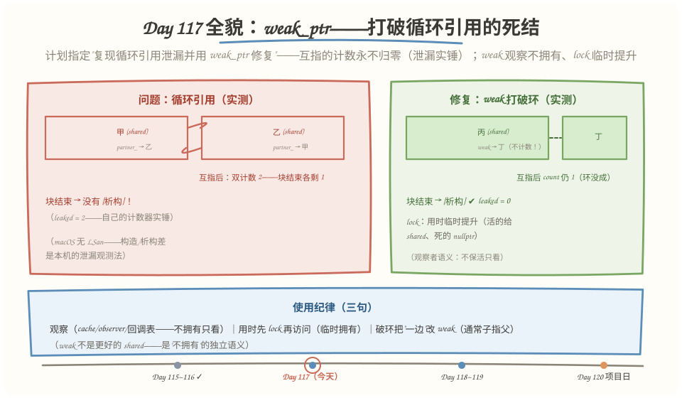
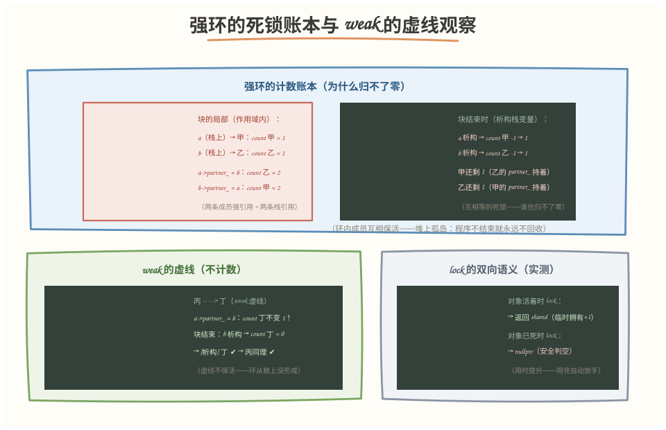
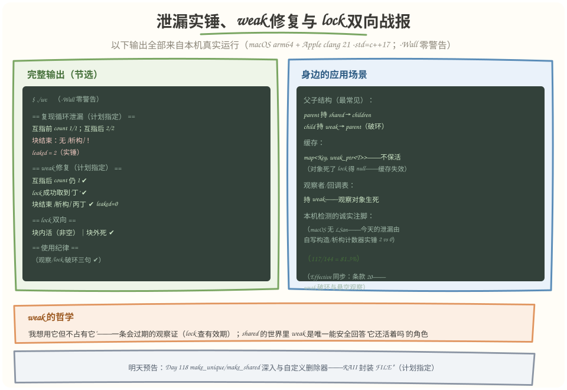

# 第 117 天：weak_ptr 与循环引用问题

> **今日目标**：完成本教程后，你能做到：**复现循环引用泄漏**（计划指定——互指后计数 2/2、块结束无 [析构]、leaked=2 实锤）；用 **weak_ptr 修复**（虚线不计数——环从根上没形成、正常析构）；解释强环归零不了的账本（互等死锁）；用 lock 的双向语义（活→shared 临时拥有 / 死→nullptr）；背出使用纪律三句（观察/lock/破环）。
> **预计时间**：学习 20 分钟＋实践 40 分钟
> **前置准备**：完成 Day 116（计数是"归零销毁"的机制——今天看它怎么被环骗过）。
> **今日产出**：泄漏复现+修复双实测、lock 双向、使用纪律。

## 1. 今天解决什么问题？

昨天埋的陷阱今天爆：**两个 shared_ptr 互指**——成员互相保活，块结束后计数各剩 1、**永远归不了零**——资源泄漏（堆上孤岛）。计划指定的"复现+修复"今天全程：先复现（甲乙互指 → 无 [析构]、leaked=2 实锤——本机用自写计数器观测（macOS 无 LSan 的诚实注脚）），再修复（一边改 **weak_ptr**——不计数、环从根上没形成）。

**weak 的语义**：观察者——不保活只看；要用时 **lock**（活的给 shared 临时拥有、死的给 nullptr）。

## 2. 先看全貌：今天的内容位于哪里？



**图 1**：左卡红是问题（强环——计数死锁）；右卡绿是修复（weak 虚线）；下方蓝卡是使用纪律三句。

三步概括今天：

1. 问题：互指 → 各剩 1 → 不归零 → 泄漏；
2. 修复：一边改 weak——不计数（环没形成）；
3. 纪律：观察不拥有、用时 lock、破环改子指父。

## 3. 核心概念：先用直觉，再给准确定义

### 3.1 循环引用：归零不了的账本

- **一句通俗解释**：两个对象互相持有对方——"我等他放手他才放手、他等我放手我才放手"——谁也等不到，计数双 1 永悬。
- **一个类比**：两人互相扶着对方过独木桥——"你先撒手我就撒"、"不你先"——僵持到天黑（程序结束）也没人下来。
- **对应到技术上是**：实测——甲乙互指后 count **2/2**（栈引用+成员引用）；块结束栈变量析构各 -1 → **各剩 1**（对方的 partner_ 还持着）；**[析构] 没打**、leaked = **2**（自写计数器实锤）。**账本细节**（图 2）：成员引用也是强引用（+1）——甲的销毁需要乙的 partner_ 释放、乙的销毁需要甲的 partner_ 释放——**互为前提**。**孤岛的命运**：程序结束时 OS 回收全部内存（进程级清理）——但长跑进程里这些孤岛**一直占着**（缓存膨胀/内存涨的常见根因）。类比的边界：**自指**（a->partner_ = a 自己）也是环（count 2——自己保自己）。
- **常见误解**："shared_ptr 会自动检测环"——不会（检测环是 GC 的活、引用计数做不到）；防线只有一条：**设计时不让环形成**（weak）。

### 3.2 weak_ptr：不拥有的观察者

- **一句通俗解释**：weak_ptr 指向对象但**不增加计数**（虚线不保活）——对象死了它就"失效"（lock 得 nullptr）。
- **一个类比**：名片——你有人家的联系方式（能找到）但不掌握人家的生死；去拜访（lock）前先确认（可能已搬走——nullptr）。
- **对应到技术上是**：实测——丙丁用 weak 互指后 count **仍 1**（赋值不 +1——环没形成）；块结束 count 归零 → **[析构] 丙丁 ✔ leaked = 0**。**lock 的双向语义**：块内 `w.lock()` → **非空 shared**（临时拥有——作用域内 +1、用完自动放手）；块外（对象已亡）→ **nullptr**（安全判空）。**控制块的配合**：strong 归零销毁对象、weak 计数管控制块的生命期（对象死了 weak 还能"知道"它死了——Day 116 控制块的双计数在这里合流）。**不能直接用**：weak 没有 `->`（不保活怎么敢用）——必须 lock 先提升（这正是安全设计）。类比的边界：lock 返回的 shared 是**快照**——提升成功后即使别的 weak 过期、你手里这份仍有效（临时的确定性拥有）。
- **常见误解**："weak 是性能更好的 shared"——是**不同语义**（不拥有 vs 拥有）；该拥有的地方用 weak 是悬空事故，该观察的地方用 shared 是环风险。

### 3.3 使用纪律：三句话

- **一句通俗解释**：**观察**（cache/observer/回调表——不拥有只看）；**用时 lock**（先提升再访问）；**破环**（双向引用的"一边"改 weak——通常子指父）。
- **一个类比**：图书馆规则——读者证（weak）只能进馆看书（lock 后翻阅）、不能把书带走（不拥有）；书被下架（对象亡）读者证就刷不开了（nullptr）。
- **对应到技术上是**：**父子结构**（最常见）：parent 持 shared → children（父拥有子）、child 持 weak → parent（子观察父——反向断开）；**缓存**：`map<Key, weak_ptr<T>>`——条目不保活对象（对象死 → lock 得 null → 缓存失效可清理）；**观察者**：事件系统持 weak（对象死了通知自动跳过——悬空调用的预防）。**选型口诀的补全**：unique（独占默认）→ shared（共享有理由）→ **weak（观察/破环）**——三兄弟各就各位。类比的边界：weak 也有成本（控制块的 weak 计数维护）——只是比 shared 轻（不保活）。
- **常见误解**："全部用 weak 就没有泄漏了"——weak 不拥有（对象可能被过早销毁）；该拥有的还得 shared——**边界清晰**才有正确性。

## 4. 图解核心机制



**图 2**：上半部分蓝卡是强环的计数账本（互指的 +1/+1 和块结束的死锁）；左下绿卡是 weak 虚线（不计数、归零正常析构）；右下灰卡是 lock 的双向语义。

按图逐步讲：

1. **算强环的账**：栈 2 条 + 成员 2 条 = 4 条引用；块结束 -2 剩 2——**互等的死锁**（每一步都在图上）；
2. **看虚线的区别**：weak 赋值不动计数——环从根上没形成（对比同一场景的两种结局）；
3. **读 lock 的两路**：活（临时 shared）/死（nullptr）——"用时提升"的安全设计；
4. **连昨天**：控制块的 strong/weak 双计数——今天看到 weak 那一半的用途（对象死后仍能回答"死了"）。

## 5. 动手实践：完成一个最小可运行例子

### 5.1 准备文件

```bash
cd ai-compiler-roadmap/tutorials/day-117/examples
```

主角：`weak_cycle.cpp`（Node 强环版 + Node2 weak 修复版）。

### 5.2 编写代码

核心（完整代码见本目录）：

```cpp
class Node {
    std::shared_ptr<Node> partner_;        // 强引用——会成环！
};
class Node2 {
    std::weak_ptr<Node2> partner_;         // 弱引用——不计数、破环！
    std::shared_ptr<Node2> partner_shared() const {
        return partner_.lock();            // 用时提升（活→shared / 死→nullptr）
    }
};

// 复现（强环）
auto a = std::make_shared<Node>("甲");
auto b = std::make_shared<Node>("乙");
a->partner_ = b;                            // count 乙 = 2
b->partner_ = a;                            // count 甲 = 2 —— 环！
// 块结束：无 [析构]、leaked = 2

// 修复（weak）
a->partner_ = b;                            // weak——count 不变 1
b->partner_ = a;
if (auto p = a->partner_shared()) { … }     // lock 临时拥有
// 块结束：[析构] ✔ leaked = 0
```

### 5.3 运行与观察

```bash
g++ -Wall -std=c++17 weak_cycle.cpp -o wc && ./wc
```

实际执行结果（本机，节选）：

```text
== 计划指定：复现循环引用泄漏 ==
  [构造] 甲
  [构造] 乙
  互指前：a.use_count = 1，b.use_count = 1
  互指后：a.use_count = 2，b.use_count = 2
  （块结束：a/b 析构各 -1 → 都剩 1 —— 不归零！）
  块结束了——看上面：没有 [析构]！泄漏实锤（leaked = 2）

== 修复版：weak_ptr 打破环 ==
  [构造] 丙
  [构造] 丁
  互指后：a.use_count = 1（weak 不增计数——环没形成）
  a 的伙伴是：丁（lock 成功）
  （块结束：a/b 计数归零 → 正常析构）
  [析构] 丁
  [析构] 丙
  块结束了——上面有 [析构] ✔（leaked = 0）

== lock 的双向语义 ==
  块内 lock：活（非空）
  [析构] 短暂
  块外 lock：死（nullptr——对象已亡）
  （weak 是观察者：不保活、死了就 nullptr）
```



**图 3**：左上完整输出（复现/修复/lock/纪律四段）；右侧是身边的应用场景（父子/缓存/观察者）和本机检测的诚实注脚；下方橙卡是 weak 的哲学。

**检测方法的诚实注脚**：macOS 无 LeakSanitizer——今天的泄漏由**自写的构造/析构计数器**实锤（leaked = 2 vs 0）；ASan 版运行通过（访问全部合法——泄漏不是访问错误是"没还"）。

### 5.4 修改一个输入再观察：自指的单节点环

加一段：`auto solo = make_shared<Node>("自指"); solo->partner_ = solo;`（自己指自己）——块结束同样**无 [析构]**（count 2：栈 1 + 自己 1；栈析构后剩 1——**自己保自己**的单环）。solo 版改 weak 同样修复。**双环单环都验**：环的形态不限两个（自指/三节点环/更长环同病同治——断一处 weak 即解）。

## 6. 常见错误与排查

**错误 1：块结束资源不释放（计数悬 1）**

- 现象：reset 了可见的还剩、无析构日志；
- 原因：某处还有强引用（容器/捕获/全局）或循环引用；
- 定位：use_count 逐处打印（昨天的方法）+ 检查双向引用；
- 修复：清遗漏持有者；环的"一边"改 weak。

**错误 2：直接用 weak_ptr 访问成员**

- 现象：`w->name_` 编译错（weak 没有 ->）；
- 原因：weak 不保活——直接访问可能悬空（语言禁止）；
- 定位：报错提 no member；
- 修复：`if (auto p = w.lock()) { p->… }`——先提升判空。

**错误 3：lock 结果不判空就解引用**

- 现象：偶发崩（对象刚死）；
- 原因：lock 可能返回 nullptr（观察对象已亡）；
- 定位：崩溃在 lock 后的访问行；
- 修复：`if (auto p = w.lock())` 模式——判空是 lock 的固定搭档。

## 7. 今日练习

### 必做练习（计划指定：复现并修复）

把环升级成**三节点**（甲→乙→丙→甲 的强环）——复现泄漏（三个都不析构）；再只把**一处**（丙→甲）改 weak——验证三节点环断一处即解（全部正常析构）。预期产出：两轮日志（泄漏版/修复版）+ "断一处即解"的结论。

### 选做挑战

"weak 缓存"：`map<string, weak_ptr<Doc>>` 缓存——第一次 get 时 make_shared 存入、后续 get 先 lock（活的直接用/死的重新造）——写这个 `get_or_create(key)`；观察"对象死后自动失效重建"的行为。这是 weak 最实用的日常形态。

## 8. 今日验收

- [ ] 我复现了循环泄漏（互指 2/2 → 无析构 → leaked=2——计划指定）
- [ ] 我用 weak 修复了（不计数 → 正常析构 → leaked=0）
- [ ] 我能算出强环的账本（互等死锁——为什么归不了零）
- [ ] 我的 lock 双向实测（活→shared / 死→nullptr）
- [ ] 我背得出使用纪律三句（观察/lock/破环——子指父）

## 9. 一句话总结与明天预告

今天的问题是"互指的 shared 怎么泄漏、怎么破"；机制上，强环是互等死锁（成员互相保活——计数永悬）、weak 是不拥有的观察（虚线不计数——环从根上没形成）、lock 是安全提升（活给 shared 死给 null）；实践上，复现、修复、自指变体、lock 双向全部实测；验证标准是看到任何双向引用能报出"哪边该 weak、为什么"。明天 **Day 118：make_unique/make_shared 深入与自定义删除器**——RAII 封装 FILE\*（计划指定）：智能指针不只管 new/delete，还能管任何"要关的东西"。
