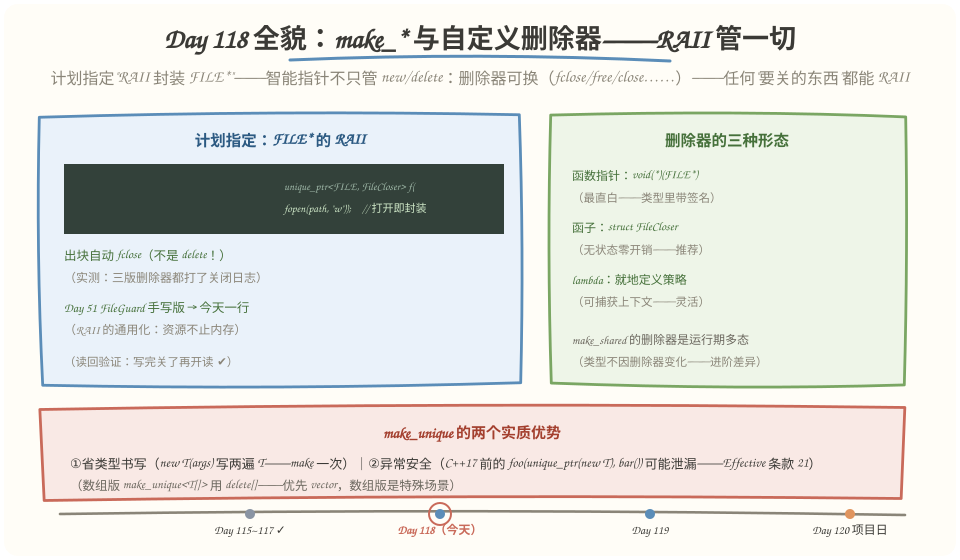
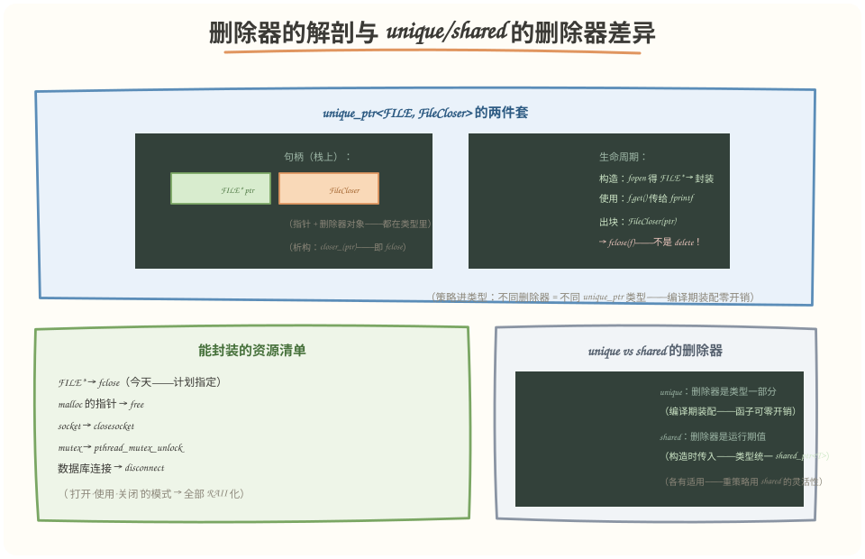
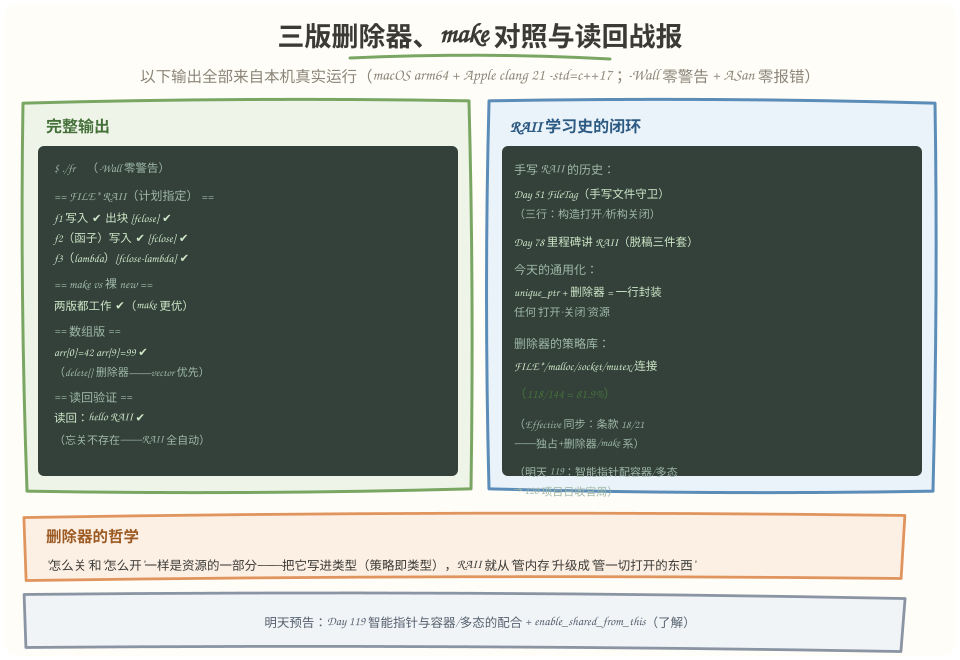

# 第 118 天：make_unique / make_shared 与自定义删除器

> **今日目标**：完成本教程后，你能做到：用 unique_ptr + 自定义删除器 **RAII 封装 FILE\***（计划指定——fclose 不是 delete）；写出删除器的三种形态（函数指针/函子/lambda——各有适用）；说出 make_unique 的两个实质优势（省类型书写 + 异常安全——Effective 21）；用数组版（make_unique\<T[]\> + delete[]）；列出"能封装的资源清单"（FILE/malloc/socket/mutex/连接——打开-关闭模式的通用化）。
> **预计时间**：学习 20 分钟＋实践 40 分钟
> **前置准备**：完成 Day 115~117（三兄弟语义齐——今天加"删除器"这第四维度）。
> **今日产出**：FILE\* 三版封装实测、make 对照、读回验证。

## 1. 今天解决什么问题？

智能指针默认管 new/delete——但很多资源的"关"不是 delete：**FILE\* 要 fclose**、malloc 的要 free、socket 要 closesocket……**自定义删除器**把"怎么关"写进类型——任何"打开-使用-关闭"的资源都能 RAII 化。计划指定的 **FILE\* 封装**是今天的骨架：Day 51 手写过 FileTag（三行守卫）——今天 `unique_ptr<FILE, FileCloser>` 一行搞定（RAII 从"管内存"升级成"管一切"）。

配套讲 make_unique/make_shared 的**实质优势**（不只是语法糖——异常安全是 Effective 条款 21 的正题）和数组版本。

## 2. 先看全貌：今天的内容位于哪里？



**图 1**：左卡蓝是 FILE\* 的 RAII（计划指定）；右卡绿是删除器三形态；下方红卡是 make 的两个优势。

三步概括今天：

1. 删除器：FILE\* 配 fclose（不是 delete）——策略进类型；
2. 三形态：函数指针/函子/lambda——各有适用；
3. make 优势：省书写 + 异常安全（数组版 delete[]）。

## 3. 核心概念：先用直觉，再给准确定义

### 3.1 RAII 封装 FILE*（计划指定）

- **一句通俗解释**：`unique_ptr<FILE, FileCloser> f(fopen(...))`——打开即封装、出块自动 **fclose**（不是 delete！怎么关由删除器说了算）。
- **一个类比**：租车还车——普通车（new/delete）还车是"原样归还"；特殊车（FILE\*）还车要"熄火+拔钥匙+交费"（fclose）——还车流程（删除器）因车而异。
- **对应到技术上是**：实测——三版删除器（函数指针/函子/lambda）**都打出关闭日志**（[fclose] ×2 + [fclose-lambda]）；写完出块自动关；**读回验证**：重新 fopen 读出 "hello RAII" ✔（关了再开读——RAII 封装后读写两不误）。**Day 51 的闭环**：FileTag 手写三行（构造打开/析构关闭/中间用）——今天一行（类型里带策略）；手写版教会的是**原理**、删除器版是**通用化**。**忘记 fclose 不存在**：出块必关（哪怕中途 return/抛异常——RAII 的全覆盖）。类比的边界：fopen 失败返回 nullptr——删除器要**判空**（今天的 `if (f)`——fclose(nullptr) 是 UB）。
- **常见误解**："unique_ptr 只能管 new 出来的"——默认是；**删除器一换什么都能管**（今天的 FILE\* 就是证明）。

### 3.2 删除器的三种形态

- **一句通俗解释**：告诉 unique_ptr"怎么关"有三种写法——函数指针（直白）、函子（无状态零开销）、lambda（就地+可捕获）。
- **一个类比**：关门方式——挂牌说明（函数指针：看牌找规程）、专职保安（函子：人随类型走）、临时交代（lambda：当场说清还能带家钥匙）。
- **对应到技术上是**：实测三版全过——**函数指针** `void(*)(FILE*)`（类型里带签名——最直白）；**函子** `struct FileCloser { void operator()(FILE*) const; }`（无状态——**推荐**：类型局部性好、可内联零开销）；**lambda**（就地定义——**可捕获上下文**：比如关闭时打日志带文件名）。**unique vs shared 的删除器差异**：unique 的删除器是**类型的一部分**（编译期装配——不同删除器不同类型）；shared 的是**运行期的值**（构造时传入——类型统一 `shared_ptr<T>`，代价是间接调用）。**选择**：轻策略 unique+函子（零开销）；需要"运行期才定的关闭方式"或类型统一——shared。类比的边界：lambda 转 unique 要给类型（`unique_ptr<FILE, void(*)(FILE*)>`——无捕获 lambda 才能转函数指针；捕获的要用 decltype 或 auto 推导——进阶）。
- **常见误解**："函子删除器有对象开销"——无状态函子是**空类型**（sizeof 可能 1——零开销抽象的老朋友）；函数指针版反而多一次间接。

### 3.3 make_unique 的实质优势与数组版

- **一句通俗解释**：make_unique 不只是少打字——还有**异常安全**（C++17 前的经典坑：`foo(unique_ptr<T>(new T), bar())` 中间可能泄漏）；数组版配 delete[]。
- **一个类比**：代客泊车（make）vs 自己停（new）——不只省事，还保证钥匙不中途丢（异常安全）。
- **对应到技术上是**：实测——`make_unique<string>("make 版")` vs `unique_ptr<string>(new string("裸 new 版"))` **都能工作**（功能同）；**优势一**：省类型书写（new 版写两遍 string）；**优势二**：异常安全——C++17 前求值顺序未定，`foo(unique_ptr<T>(new T), may_throw())` 可能 new 完还没进 unique_ptr 就被异常打断（泄漏）；C++17 修了求值顺序但 make 依然是**无脑安全**的选择（Effective 21）。**数组版**：`make_unique<int[]>(10)` + 下标访问（arr[0]=42 ✔）——删除器自动 **delete[]**（数组要配对）；**但优先 vector**（Day 79 起的主力——数组版是"和 C API 交互"等特殊场景）。**make_shared 的复利**：对象+控制块一次分配（Day 116 讲过）。类比的边界：make_shared 不能直接配自定义删除器（C++20 才补上 make_shared_for_overwrite 等——今天用 unique 演示删除器正是原因之一）。
- **常见误解**："make 就是语法糖"——异常安全是**实质差异**（历史坑的现代解法）；裸 new 版留给"面试要求解释为什么"的场景。

## 4. 图解核心机制



**图 2**：上半部分蓝卡是 unique_ptr\<FILE, FileCloser\> 的两件套（句柄 = 指针+删除器对象——析构时 closer_(ptr) 即 fclose）；左下绿卡是能封装的资源清单；右下灰卡是 unique/shared 的删除器差异。

按图逐步讲：

1. **看两件套的分工**：指针管"指向谁"、删除器管"怎么关"——策略进类型（编译期装配）；
2. **读资源清单**：FILE\*/malloc/socket/mutex/连接——"打开-关闭"模式的**全部**都能套今天的模板；
3. **对比两家的删除器**：unique 编译期（类型带策略零开销）/ shared 运行期（类型统一有间接）——按需求选；
4. **连 Day 51**：FileTag 的三行 → 今天的一行——手写教会原理、删除器完成通用化。

## 5. 动手实践：完成一个最小可运行例子

### 5.1 准备文件

```bash
cd ai-compiler-roadmap/tutorials/day-118/examples
```

主角：`file_raii.cpp`（FILE\* 三版封装 + make 对照 + 数组版）。

### 5.2 编写代码

核心（完整代码见本目录）：

```cpp
void file_closer(FILE* f) {                     // ①函数指针版
    if (f) { std::cout << "  [fclose]\n"; fclose(f); }
}
struct FileCloser {                             // ②函子版（推荐）
    void operator()(FILE* f) const { file_closer(f); }
};

// ③lambda 版
auto f3 = std::unique_ptr<FILE, void(*)(FILE*)>(
    fopen("/tmp/x.txt", "w"),
    [](FILE* f) { if (f) { fclose(f); } });

std::unique_ptr<FILE, FileCloser> f(fopen(path, "w"));   // 计划指定的封装
fprintf(f.get(), "hello RAII\n");                        // get() 给 C API
// 出块自动 fclose！

auto a = std::make_unique<std::string>("make 版");       // make 优势
auto arr = std::make_unique<int[]>(10);                  // 数组版（delete[]）
```

### 5.3 运行与观察

```bash
g++ -Wall -std=c++17 file_raii.cpp -o fr && ./fr
```

实际执行结果（本机，节选）：

```text
== 计划指定：RAII 封装 FILE* ==
  f1 写入完成（函数指针删除器）
  [fclose] 0x2091ea380
  （f1 出块——上面打了 [fclose]）
  f2 写入完成（函子删除器）
  [fclose] 0x2091ea380
  （f2 出块也自动 fclose）
  [fclose-lambda]

== make_unique vs 裸 new 的对照 ==
  make_unique：make 版；裸 new：裸 new 版
  （make 省一次类型书写 + 异常安全——Effective 21）

== 数组版本 ==
  arr[0]=42 arr[9]=99（make_unique<int[]>——数组删除器 delete[]）
  （优先 vector<int>——数组版是特殊情况）

== 验证文件真的关了 ==
  读回：hello RAII
  （RAII 封装后读写两不误——忘了 fclose 不存在）
```



**图 3**：左上完整输出（FILE RAII/make 对照/数组/读回四段）；右侧是 RAII 学习史的闭环（Day 51 FileTag → 今天的通用化）和资源清单；下方橙卡是删除器的哲学。

### 5.4 修改一个输入再观察：忘记判空的删除器

把 file_closer 的 `if (f)` 删掉、fopen 一个不存在的路径（f 得 nullptr）——出块 fclose(nullptr) 是 **UB**（本机可能崩或被 ASan 抓 access violation）。恢复判空——安全。**一崩一稳**：删除器的**防御性纪律**（C API 的失败返回 null 是常态——删除器必须假设 ptr 可能是 null；今天代码里的 `if (f)` 不是装饰是安全带）。

## 6. 常见错误与排查

**错误 1：`no matching constructor`（删除器类型没对上）**

- 现象：`unique_ptr<FILE> f(fopen(...), file_closer);` 编译错；
- 原因：默认删除器是 default_delete（要 delete）——配 FILE\* 得显式给类型；
- 定位：报错提 constructor；
- 修复：`unique_ptr<FILE, void(*)(FILE*)>` 或 `unique_ptr<FILE, FileCloser>`（第二个模板参）。

**错误 2：fclose(nullptr) 崩溃（删除器没判空）**

- 现象：fopen 失败后出块崩；
- 原因：C API 失败返回 null——fclose(nullptr) 是 UB；
- 定位：崩在关闭日志前后；
- 修复：删除器里 `if (f)`（5.4 的实验——安全带必备）。

**错误 3：数组版用了 make_unique\<T\>（非 []）**

- 现象：`unique_ptr<T>` 管数组——delete（非 delete[]）UB；
- 原因：new T[n] 要配 delete[]；
- 定位：ASan 报 mismatched delete；
- 修复：`make_unique<T[]>(n)`；或优先 vector。

## 7. 今日练习

### 必做练习（计划指定：RAII 封装 FILE\*）

把三版删除器各自完整封装一遍（函数指针/函子/lambda）——各写一个"写入+出块自动关+读回验证"的完整循环。预期产出：三段日志（各含 [fclose]）+ 读回成功。

### 选做挑战

"malloc 版 RAII"：`unique_ptr<void, FreeDeleter>` 封装 malloc 的内存（删除器调 free）——写一段分配/使用/自动释放的循环；对照 new/delete 的类型安全差异写一句结论（malloc 版 void\* 无类型——C 遗产接口的封装场景）。

## 8. 今日验收

- [ ] 我的 FILE\* 三版封装全过（计划指定——出块 [fclose] + 读回验证）
- [ ] 我能说出删除器三形态的适用（直白/零开销推荐/可捕获）
- [ ] 我背得出 make 的两个实质优势（省书写 + 异常安全——Effective 21）
- [ ] 我知道数组版 delete[] 和"优先 vector"的忠告
- [ ] 我做过判空实验（5.4——fclose(nullptr) 的 UB 目击）

## 9. 一句话总结与明天预告

今天的问题是"智能指针怎么管非内存资源"；机制上，删除器把"怎么关"写进类型（策略即类型——FILE\* 配 fclose）、三形态各有适用（函子零开销推荐）、make 系有实质优势（异常安全）；实践上，三版封装、make 对照、读回验证、判空实验全部落地；验证标准是看到任何"打开-关闭"资源能报出"怎么封装、删除器怎么写"。明天 **Day 119：智能指针与容器/多态的配合**——enable_shared_from_this（了解）：三兄弟的最后一块拼图。
