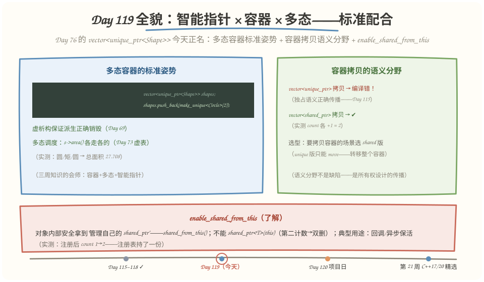
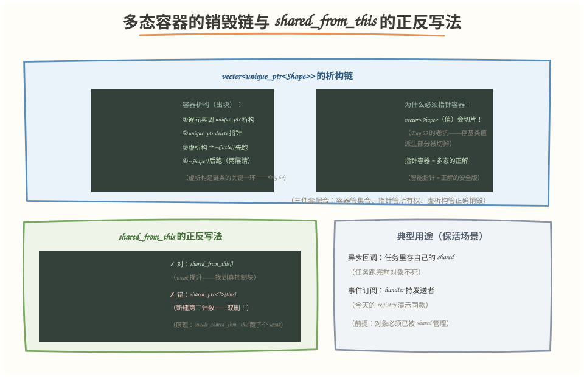
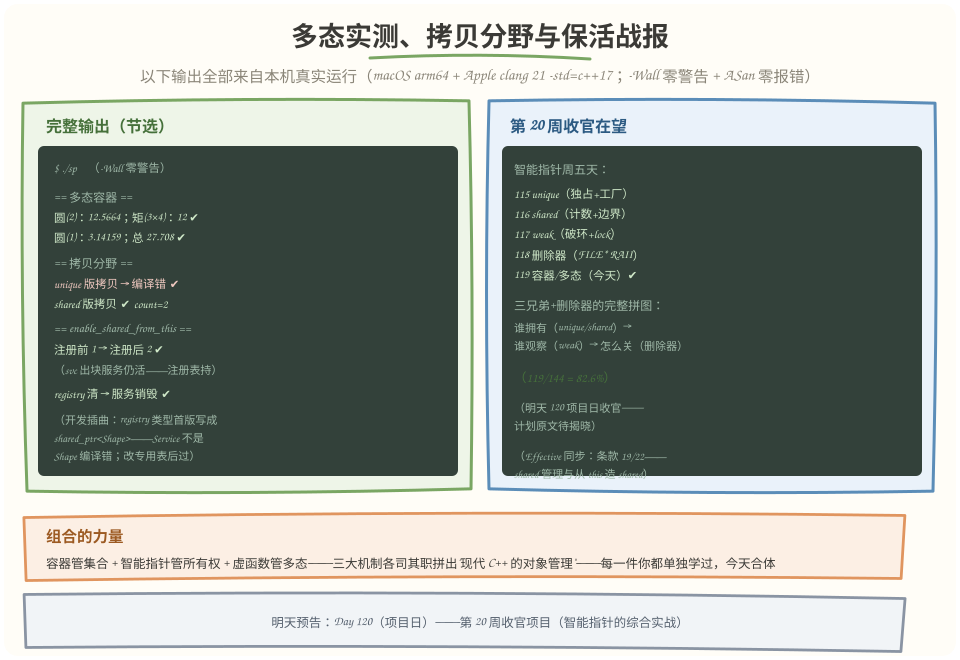

# 第 119 天：智能指针与容器、多态的配合

> **今日目标**：完成本教程后，你能做到：写出多态容器的标准姿势（`vector<unique_ptr<Shape>>` + 虚析构 + 范围 for——Day 76 的正名全套）；说出容器拷贝的**语义分野**（unique 版编译错——独占传播；shared 版 ✔——计数 +1）及其选型；解释 `enable_shared_from_this`（对象内安全拿自己的 shared——`shared_ptr<T>(this)` 是双删坑）；描述析构链（容器→unique→虚析构→派生先基类后）。
> **预计时间**：学习 20 分钟＋实践 40 分钟
> **前置准备**：完成 Day 115~118（三兄弟+删除器——今天组合成完整拼图）。
> **今日产出**：多态容器实测（总面积 27.708）、拷贝分野执法、保活演示。

## 1. 今天解决什么问题？

智能指针周的最后一块拼图：**组合**。单独学会了 unique/shared/weak/删除器——今天看它们和**容器**、**多态**配合的完整图景：多态容器的标准姿势（`vector<unique_ptr<Shape>>`——Day 76 图形库就用对了）、容器拷贝的语义分野（要拷贝选 shared 版）、`enable_shared_from_this`（对象内部安全拿自己的 shared——异步保活的正解，`shared_ptr<T>(this)` 的双删坑对照）。

三大机制各司其职：**容器管集合、智能指针管所有权、虚函数管多态**——每一件都单独学过，今天合体。

## 2. 先看全貌：今天的内容位于哪里？



**图 1**：左卡蓝是多态容器的标准姿势；右卡绿是容器拷贝的语义分野；下方红卡是 enable_shared_from_this。

三步概括今天：

1. 多态容器：`vector<unique_ptr<Shape>>`——切片的解 + 虚析构的保；
2. 拷贝分野：unique 版编译错（独占传播）/ shared 版 ✔（计数 +1）；
3. shared_from_this：内拿 shared 的正解（this 版是双删坑）。

## 3. 核心概念：先用直觉，再给准确定义

### 3.1 多态容器的标准姿势

- **一句通俗解释**：`vector<unique_ptr<Shape>>` 装 Circle/Rect 混合——指针避免切片、虚析构保证正确销毁、unique 自动管理。
- **一个类比**：艺术品展柜——展柜（vector）管陈列、防弹玻璃（unique_ptr）管每件的安全、讲解系统（虚函数）让每件讲自己的故事。
- **对应到技术上是**：实测——圆(2)/矩(3×4)/圆(1) 混装：`s->name()` 各走各的（Day 73 虚表）、`s->area()` 求和 **27.708**。**为什么必须指针**：`vector<Shape>`（值容器）会**切片**（Day 68 的老坑——基类值把派生部分切掉）；指针容器是多态的正解、智能指针是正解的安全版。**析构链**（图 2）：容器析构 → 逐元素 unique_ptr 析构 → delete 指针 → **虚析构** → ~Circle 先 ~Shape 后（Day 69 的虚析构在这链条上）。**Day 76 的正名**：图形库 v2 的写法当时"照官方"——今天全部要素到齐。类比的边界：多态容器的排序/查找要自定义比较器（Day 93 的两级裁判配 function/deref——进阶组合）。
- **常见误解**："智能指针容器性能差"——unique 版和裸指针版**零差距**（Day 115 的零开销）；shared 版多一次原子计数（要拷贝语义时才用）。

### 3.2 容器拷贝的语义分野

- **一句通俗解释**：`vector<unique_ptr>` 拷贝 → **编译错**（独占语义正确传播）；`vector<shared_ptr>` 拷贝 → ✔（每个元素计数 +1）——选型看"要不要拷贝容器"。
- **一个类比**：一夫一妻制的名单（unique）不能复印（复印就有两个"配偶"）；共同好友名单（shared）随便复印（朋友本来就可共享）。
- **对应到技术上是**：实测——`auto copy = shapes;`（unique 版）→ **error: implicitly-deleted copy constructor**（探针执法——vector 的拷贝连锁到元素的拷贝被禁）；shared 版 `auto copy = shared_shapes;` → ✔（`copy[0].use_count()` = **2**——两份容器共享元素）。**unique 版的替代**：`std::move(shapes)`（转移整个容器——原容器变空）或逐个 move 元素；**语义分野不是缺陷**——是所有权设计的自动传播（编译器替你守规矩）。**选型**：只此一份的容器（主流）→ unique；要快照/多视图 → shared。类比的边界：shared 容器的拷贝是"浅层共享"（元素同一份）——要深层独立拷贝得手动逐元素 clone（进阶：虚 clone 的原型模式）。
- **常见误解**："vector 存 unique 后容器没用了"——只是**不能拷贝**（能移动/能改/能遍历）；日常操作全部正常。

### 3.3 enable_shared_from_this（了解）

- **一句通俗解释**：对象内部想拿"管理自己的 shared_ptr"（注册回调/异步保活）——继承 `enable_shared_from_this` 后用 `shared_from_this()`；**不能** `shared_ptr<T>(this)`（会造第二计数 → 双删）。
- **一个类比**：房主想在交易中出具"房产证"——应该从登记系统调出**原件记录**（shared_from_this），而不是自己再画一张（`shared_ptr<T>(this)`——两本证两个计数，拆两次崩）。
- **对应到技术上是**：实测——Service 继承 enable_shared_from_this；`svc->register_self()` 内部 `service_registry.push_back(shared_from_this())` → count **1→2**（注册表持了一份）；svc 出块后服务**仍活**（注册表还持着）——`service_registry.clear()` 才销毁 ✔。**原理**：基类里藏了一个 weak_ptr（构造 shared 时自动记录控制块）——shared_from_this 就是它的 lock（找到真控制块造 shared 拷贝）。**this 版的坑**：`shared_ptr<T>(this)` 新建独立控制块——两个计数各自归零 → **double delete**。**典型用途**：异步任务里保活自己（任务对象持 shared——跑完前不死）、事件订阅的 handler 持发送者。**前提**：对象**必须已被 shared 管理**（栈对象/unique 管理下调 shared_from_this 会抛 std::bad_weak_ptr——C++17 前才是 UB）。类比的边界：**了解级**——用时再查；工程里回调保活更常见的手法是传 shared 拷贝进 lambda 捕获（Day 100 的捕获 + 这里的 from_this 两路）。
- **常见误解**："enable_shared_from_this 很高级很难"——核心就一句"基类藏了个 weak、帮你 lock"；今天了解语义、认得场景即可。

## 4. 图解核心机制



**图 2**：上半部分蓝卡是 vector\<unique_ptr\<Shape\>\> 的四步析构链（容器→unique→delete→虚析构两层）+ 为什么必须指针（切片对照）；左下绿卡是 shared_from_this 的正反写法；右下灰卡是典型用途。

按图逐步讲：

1. **走析构链的四步**：容器逐元素 → unique delete → 虚析构 → 派生先基类后——**虚析构是关键一环**（少它派生资源漏拆——Day 69 的旧案）；
2. **看值容器的切片**：vector\<Shape\> 把派生切掉——指针容器的存在理由；
3. **对比正反写法**：shared_from_this（weak 提升）vs `shared_ptr<T>(this)`（第二计数双删）——一字之差两种命运；
4. **连 Day 76**：图形库的写法当时对——今天的要素（虚析构/unique/多态调度）每一件都学过了，组合才成立。

## 5. 动手实践：完成一个最小可运行例子

### 5.1 准备文件

```bash
cd ai-compiler-roadmap/tutorials/day-119/examples
```

主角：`smart_polymorphic.cpp`（Shape 层次 + Service 注册）。

### 5.2 编写代码

核心（完整代码见本目录）：

```cpp
class Shape {
public:
    virtual ~Shape() = default;                  // 虚析构（多态容器底线）
    virtual std::string name() const = 0;
    virtual double area() const = 0;
};

std::vector<std::unique_ptr<Shape>> shapes;      // 多态容器标准姿势
shapes.push_back(std::make_unique<Circle>(2));
shapes.push_back(std::make_unique<Rect>(3, 4));
for (const auto& s : shapes) { total += s->area(); }

// auto copy = shapes;                           // ✘ 编译错（独占传播）
auto shared_copy = shared_shapes;                // ✔（count 各 +1）

class Service : public std::enable_shared_from_this<Service> {
public:
    void register_self() {
        service_registry.push_back(shared_from_this());   // ✓ 正解
        // service_registry.push_back(shared_ptr<Service>(this));  // ✘ 双删！
    }
};
```

### 5.3 运行与观察

```bash
g++ -Wall -std=c++17 smart_polymorphic.cpp -o sp && ./sp
```

实际执行结果（本机，节选）：

```text
== 多态容器：智能指针的标准配合 ==
  圆(r=2.000000)：面积 12.5664
  矩形(3.000000×4.000000)：面积 12
  圆(r=1.000000)：面积 3.14159
  总面积 = 27.708（Day 76 的老朋友——vector<unique_ptr<Shape>>）

== 容器拷贝语义：unique 版 vs shared 版 ==
  vector<unique_ptr> 拷贝 → 编译错（独占传播）
  vector<shared_ptr> 拷贝 → ✔（计数各 +1：2）
  （要拷贝容器的场景选 shared 版）

== enable_shared_from_this（了解） ==
  注册前 count = 1
  注册后 count = 2（registry 里那份也是 +1）
  （svc 出块——但 service_registry 还持着：服务活着
   （查一下：非空）
  （典型用途：回调/异步任务里保活自己）
  registry 清了——服务此刻销毁 ✔
```

**容器拷贝执法**（探针实测）：

```text
allocator.h:141:24: error: call to implicitly-deleted copy constructor of 'std::unique_ptr<S>'
```



**图 3**：左上完整输出（多态/拷贝分野/保活三段 + **开发插曲**——registry 首版写成 shared_ptr\<Shape\>（Service 不是 Shape）编译错、改专用表后过的实录）；右侧是智能指针周的拼图总结；下方橙卡是组合的力量。

### 5.4 修改一个输入再观察：this 版双删的执法

把 register_self 改成 `service_registry.push_back(std::shared_ptr<Service>(this));`——编译过但运行**崩**（ASan 抓 double-free：两个控制块各 delete 一次同一对象）；恢复 shared_from_this——正常。**一崩一好**：反写法的坑从文档变目击——这就是 enable_shared_from_this 存在的全部理由（一字之差、两种命运）。

## 6. 常见错误与排查

**错误 1：`implicitly-deleted copy constructor`（拷贝 unique 容器）**

- 现象：`auto copy = unique_vec;` 编译错；
- 原因：元素的拷贝被禁——连锁到容器；
- 定位：报错链最后指向 unique_ptr；
- 修复：要转移 `std::move(vec)`；要拷贝语义换 shared 版容器。

**错误 2：`bad_weak_ptr` 异常（栈对象调 shared_from_this）**

- 现象：运行抛 std::bad_weak_ptr；
- 原因：对象不是 shared 管理的（内部 weak 是空的）；
- 定位：异常从 shared_from_this 抛出；
- 修复：对象改 make_shared 管理；或重新设计（不需要 from_this）。

**错误 3：多态容器忘了虚析构（资源漏拆）**

- 现象：派生类的资源泄漏（只析构了基类层）；
- 原因：基类析构非 virtual——delete 基类指针切到基类析构；
- 定位：Day 69 的 1000 字节实验同款（leaked 计数）；
- 修复：`virtual ~Shape() = default;`——多态基类的底线。

## 7. 今日练习

### 必做练习

给 Shape 层次加 `clone()`（虚函数返回 `unique_ptr<Shape>`——每个派生 `return make_unique<Circle>(*this)`）——实现多态容器的**深拷贝**：`auto deep = clone_all(shapes);`。预期产出：clone_all + 深拷贝后的独立验证（改原不改拷）。

### 选做挑战

"保活回调"：写一个 `async_task(shared_ptr<Service> self)` 风格的延时任务——Service 的 `schedule()` 里把 `shared_from_this()` 捕获进 lambda（Day 100 捕获 + 今天 from_this 的组合）：任务持有 shared 保活——即使外部 svc 先亡任务也能安全访问。跑一遍验证"外部死了任务里对象还活"。

## 8. 今日验收

- [ ] 我的多态容器全过（混装 + 虚调度 + 总面积 27.708 + 虚析构链）
- [ ] 我实测了拷贝分野（unique 版编译错 / shared 版 count=2）
- [ ] 我能说出 shared_from_this 的正反写法（this 版双删——5.4 目击）
- [ ] 我知道 enable_shared_from_this 的原理（基类藏 weak）和前提（必须 shared 管理）
- [ ] 我能讲出三大机制的分工（容器集合/指针所有权/虚函数多态）

## 9. 一句话总结与明天预告

今天的问题是"智能指针怎么和容器多态组合"；机制上，多态容器的标准姿势（unique+虚析构——切片和漏拆的双解）、容器拷贝的语义分野（独占传播 vs 计数共享——编译器守规矩）、shared_from_this（weak 提升的正解——this 版双删）；实践上，多态实测、拷贝执法、保活演示、双删目击全部落地；验证标准是看到任何对象管理需求能报出"容器选哪种、指针选哪个、虚析构有没有"。明天 **Day 120（项目日）：第 20 周收官**——智能指针综合实战（计划原文待揭晓）：一周的拼图装进一个真实项目。
