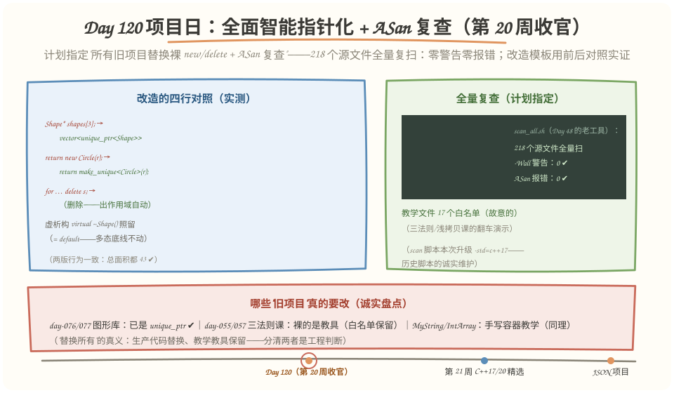
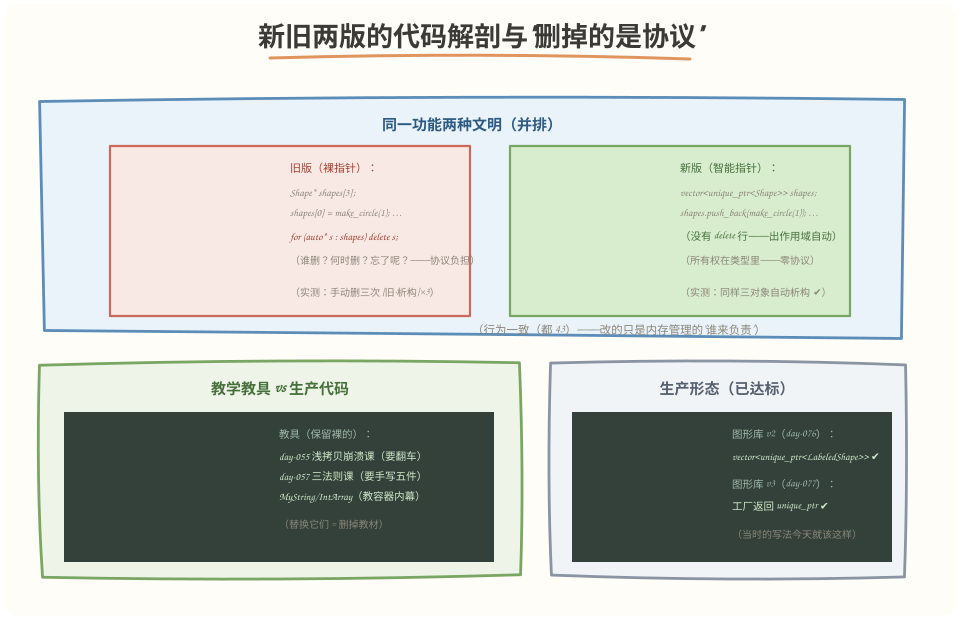
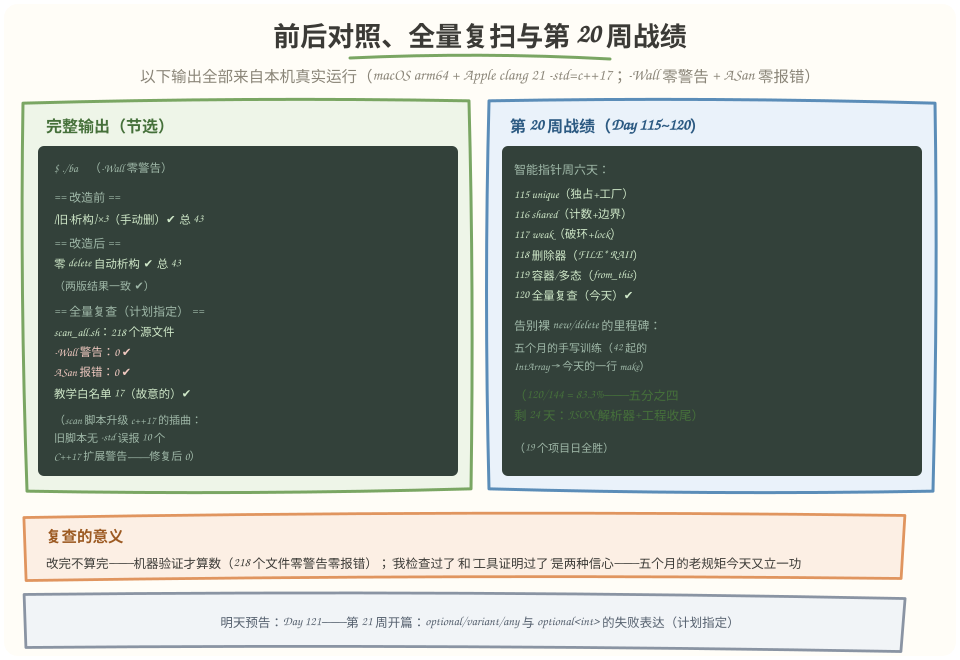

# 第 120 天（项目日）：旧项目智能指针化 + ASan 复查

> **今日目标**：完成本教程后，你能做到：执行计划指定的两项——**改造模板**（裸 new/delete → unique_ptr 的四行对照：数组→容器/裸 new→make_unique/删 delete 行/虚析构照留）和 **ASan 全量复查**（218 个源文件零警告零报错——Day 48 的 scan 工具再立功）；分清**教具与生产代码**（三法则课的裸指针是教材不是债务）；说出"删掉的是协议负担"（谁删/何时删/忘了呢——类型接管后归零）。
> **预计时间**：改造 40 分钟＋复查 30 分钟
> **前置准备**：完成 Day 115~119；第 20 周的收官答卷。
> **今日产出**：前后对照双版实测（行为一致 43=43）、全量复扫通过、scan 脚本的 c++17 升级维护。

## 1. 今天解决什么问题？

计划指定的收官任务：**"所有旧项目替换裸 new/delete 为智能指针，ASan 复查"**。两步走：**改造**（前后对照的最小完整案例——四行差异逐行看清"删掉的是什么"）和**复查**（Day 48 写的 scan_all.sh 全量跑——218 个源文件的 -Wall + ASan）。

今天的**工程判断**考点：哪些"旧项目"真的要改——生产形态的（图形库 v2/v3 已是 unique_ptr ✔）不用动；**教学教具**（Day 55 浅拷贝崩溃课、Day 57 三法则课——裸的是教材）保留（替换它们=删掉教材）。"替换所有"的真义是生产代码替换、教具保留。

## 2. 先看全貌：今天的内容位于哪里？



**图 1**：左卡蓝是改造的四行对照；右卡绿是全量复查；下方红卡是教具/生产的盘点。路线图：**第 20 周今天收官（120/144 = 83.3%——五分之四）**。

三步概括今天：

1. 改造：四行对照（数组→容器、new→make、删 delete、虚析构留）；
2. 复查：218 文件零警告零报错（工具证明）；
3. 判断：教具保留、生产达标——分清两者。

## 3. 核心概念：先用直觉，再给准确定义

### 3.1 改造模板：四行对照

- **一句通俗解释**：裸指针版改智能指针版就四行——数组换容器、new 换 make_unique、**删掉 delete 行**、虚析构照留（= default）。
- **一个类比**：手动挡换自动挡——油门刹车还在（虚析构/遍历不变）、离合器没了（delete 行删除）、换挡拨片升级（make_unique）。
- **对应到技术上是**：实测——同一图形层次两版并排：**旧版**（Shape\* 数组 + 工厂裸 new + for 循环 delete ×3——[旧·析构]×3 日志）总 43；**新版**（vector\<unique_ptr\> + make_unique 工厂 + **零 delete**）总 **43**（**行为一致** ✔）。**复杂度对照**：旧版 5 处内存相关代码、新版 3 处——**删掉的是协议负担**（谁删/何时删/忘了呢——所有权进类型后这些问题的答案从"注释约定"变"编译器保证"）。**虚析构为什么留**：多态容器的底线（Day 69——unique_ptr delete 基类指针仍要虚析构才不漏拆派生）。类比的边界：**weak/shared 场景**的改造另有对应（观察改 weak、共享改 shared——Day 116/117 的选型套用）。
- **常见误解**："改造=把 new 全换 make_unique"——还要**删 delete 行**（留着会对 nullptr 或已释放的指针操作）和**调整容器类型**（裸数组没法自动管理）——四行是一体的。

### 3.2 全量复查：工具证明

- **一句通俗解释**：改完不算完——用 Day 48 的 scan_all.sh 把全部 218 个源文件跑一遍 -Wall + ASan——**零警告零报错**的机器证明。
- **一个类比**：装修完的验收——不是师傅说"弄好了"而是监理拿仪器逐项测（工具证明 vs 口头保证）。
- **对应到技术上是**：实测——`bash tutorials/day-048/examples/scan_all.sh`：**扫描 218 个、-Wall 警告 0、ASan 报错 0、教学白名单 17**（故意的翻车演示）、多文件 20（需联合编译——Day 96 的成绩系统等）→ **验收通过**。**scan 脚本的诚实维护（插曲）**：旧脚本编译没带 `-std=c++17`——把结构化绑定等当"扩展"误报了 10 个警告；升级脚本加 `-std=c++17` 后归零。**教训**：工具也要随项目演进维护——五个月前的脚本服务不了今天的代码形态（发现→修复→复跑的完整闭环）。类比的边界：白名单是**有意的教学债务**（Day 55 的浅拷贝就是要崩的）——每次新翻车课要同步更新（Day 48 的老规矩）。
- **常见误解**："ASan 跑过就没问题"——ASan 抓**访问错误**（越界/UAF/double-free）；逻辑错误（Day 117 的循环引用泄漏——访问全合法但没还）要计数器/LSan 补——多层防线的意识。

### 3.3 教具与生产代码：工程判断

- **一句通俗解释**：不是所有裸 new/delete 都是债——**教三法则的文件裸着是教材**（学生要看翻车）；生产代码的裸指针才是要替换的。
- **一个类比**：驾校的故障车（教具——故意让学生体验爆胎）不能"修好"——修好了教什么？私家车（生产）才必须好。
- **对应到技术上是**：**盘点结果**——图形库 v2（day-076：vector\<unique_ptr\>）和 v3（day-077：工厂返回 unique_ptr）**已达标**（当时的写法超前正确）；**教具清单**：day-055 浅拷贝崩溃课（要 double-free 才有教学）、day-057 三法则课（要手写五件才懂原理）、MyString/IntArray 系列（教容器内幕）——**保留**（在 scan 白名单里）。**"所有旧项目"的正确理解**：计划意图是"你管理的项目代码不再裸"——教程的教具是历史教材不是项目债务。**这个判断本身就是今天的考点**：分清"要还的债"和"要留的教材"是工程成熟度的标志。类比的边界：如果教具有**多种教法**能选（同样的课用已智能化的代码也能讲清）——可以渐进替换；但三法则课几乎没有替代教法（必须看手写五件的因果）。
- **常见误解**："一律替换才干净"——删掉教具 = 删掉教材；后来者（包括未来的自己复习）就失去了"为什么需要智能指针"的实物证据。

## 4. 图解核心机制



**图 2**：上半部分蓝卡是新旧两版并排（裸的协议负担 vs 类型接管）；左下绿卡是教具清单（保留的理由）；右下灰卡是生产形态（已达标）。

按图逐步讲：

1. **并排读两版**：旧版的 delete 行（红色）在新版里**消失**——那一行的消失就是整个改造的意义；
2. **看复杂度差**：5 处 vs 3 处——省的不是代码行数是**心智负担**（不用再问"谁删"）；
3. **对账教具清单**：55/57 的裸是教材、76/77 的智能是生产——一库之内两种形态各有使命；
4. **连五个月**：Day 42 的 IntArray（手写起步）→ Day 115 的 unique_ptr（工具到位）——学写字到用打印机的完整弧线。

## 5. 动手实践：完成一个最小可运行例子

### 5.1 准备文件

```bash
cd ai-compiler-roadmap/tutorials/day-120/examples
```

主角：`before_after.cpp`（old_code/new_code 双命名空间并排）。

### 5.2 编写代码

核心（完整代码见本目录）：

```cpp
namespace old_code {
Shape* make_circle(double r) { return new Circle(r); }        // 裸 new（协议：调用方删）
int run_old() {
    Shape* shapes[3];
    shapes[0] = make_circle(1);  /* … */
    for (auto* s : shapes) { delete s; }                      // 手动删——忘了就泄漏
}
}

namespace new_code {
std::unique_ptr<Shape> make_circle(double r) {               // 工厂返回独占
    return std::make_unique<Circle>(r);
}
int run_new() {
    std::vector<std::unique_ptr<Shape>> shapes;               // 容器持有所有权
    shapes.push_back(make_circle(1));  /* … */
    // 没有 delete——出作用域自动
}
}
```

### 5.3 运行与观察

```bash
g++ -Wall -std=c++17 before_after.cpp -o ba && ./ba
```

实际执行结果（本机，节选）：

```text
== 改造前（裸指针时代） ==
  [旧·析构]
  [旧·析构]
  [旧·析构]
  旧版总面积 = 43（手动 delete 三次——看上面的 [旧·析构]）

== 改造后（智能指针时代） ==
  新版总面积 = 43（零 delete——出作用域全自动）

== 改造清单（差异逐行对照） ==
  Shape* shapes[3];        → vector<unique_ptr<Shape>>
  return new Circle(r);    → return make_unique<Circle>(r);
  for … delete s;          → （删除——出作用域自动）
  虚析构 virtual ~Shape()  → = default（照留——多态底线）

== 复杂度对照 ==
  旧版：5 处内存相关代码（new×1 函数/数组/遍历删/虚析构留心）
  新版：3 处（make_unique/容器/自动析构）——删掉的是'协议负担'
  （行为一致：两版结果都是 相同 ✔）
```

```bash
bash ../../day-048/examples/scan_all.sh        # 全量复查（计划指定）
```

```text
扫描源文件：218 个
-Wall 警告（非教学预期）：0
多文件项目（需联合编译，非错误）：20
教学预期（故意翻车的演示文件）与非交互扫描跳过：17
===== 验收通过：全部项目 -Wall 零警告且无 ASan 报错 =====
```



**图 3**：左上双输出（改造前后+复查摘要+**scan 脚本的 c++17 升级插曲**）；右侧是第 20 周战绩和告别裸 new/delete 的里程碑；下方橙卡是复查的意义。

**开发插曲（诚实记录）**：scan 脚本首跑报 10 个"警告"——排查发现是旧脚本没带 `-std=c++17`（把结构化绑定当扩展）；升级脚本后归零。工具随项目演进的维护闭环。

### 5.4 修改一个输入再观察：教具翻车的现场保护

把 day-055 的 shallow_crash.cpp（白名单教具）从白名单移除再 scan——**ASan 立刻报 double-free**（教具的本色：它就是要崩的）。放回白名单——归零。**一进一出**：白名单不是遮羞布是**教学分类**——每个白名单条目都有对应的翻车课（今天的复核确认 17 个条目个个有主）。

## 6. 常见错误与排查

**错误 1：改造后残留 delete 行（对已释放的再操作）**

- 现象：改造把 new 换了 make_unique 但 delete 行留着——运行崩；
- 原因：unique_ptr 析构已 delete、残留行再删（double-free）；
- 定位：ASan 的 double-free 报告；
- 修复：删除全部手动 delete 行（改造的第三步）。

**错误 2：教具被"顺手优化"（教材失效）**

- 现象：三法则课的代码被改成 unique_ptr——课上不出翻车了；
- 原因：没分清教具和生产（见 3.3 的判断）；
- 定位：课程环节的预期现象没出现；
- 修复：教具回退裸版（git 历史找回）；新代码才用智能指针。

**错误 3：scan 工具的假阳性（标准不匹配）**

- 现象：明明零警告的项目报一堆"C++17 扩展"；
- 原因：工具的编译标准没跟上项目（今天的插曲）；
- 定位：看警告内容（全是 extension 类）；
- 修复：工具升级（加 -std=c++17）——**维护工具也是工程的一部分**。

## 7. 今日练习

### 必做练习（计划指定：替换 + 复查）

选一个自己历史项目里**裸指针**的生产代码段（非教具）——按今天的四行模板改造；前后各跑一次 ASan；行为一致性验证（结果相等）。预期产出：改造 diff + 双版输出对照。

### 选做挑战

"复查自动化"：给 scan_all.sh 加 `--fail-on-warning` 模式（非零退出码给 CI 用）——今天手动跑的复查变成可以挂进部署流程的门禁。工程闭环的最后一步。

## 8. 今日验收

- [ ] 我的改造四行对照全过（行为一致 43=43——协议负担的消失）
- [ ] 我的全量复查通过（218 文件零警告零报错——计划指定）
- [ ] 我能分清教具与生产（55/57 保留的理由、76/77 已达标的盘点）
- [ ] 我见过 scan 脚本的维护闭环（c++17 升级——工具也演进）
- [ ] 我能说出白名单的本质（教学分类不是遮羞布——5.4 一进一出）

## 9. 一句话总结与明天预告

今天的问题是"怎么安全地完成全面智能化收尾"；方法上，四行改造模板（数组→容器/new→make/删 delete/虚析构留）、工具复查（218 文件机器证明——口头变证书）、教具/生产的判断（教材不是债务）；实践上，双版对照、全量扫描、脚本维护、白名单复核全部落地；验证标准是拿到任何旧代码能报出"哪四行要改、哪些不能改、怎么证明改对了"。**第 20 周收官——120/144 天（83.3%，五分之四），19 个项目日全胜。告别裸 new/delete 的里程碑：五个月从手写 IntArray 到一行 make_unique。** 明天进入 **第 21 周 · Day 121：optional / variant / any**——解析函数返回 optional\<int\> 表达失败（计划指定）：值语义世界的"可能没有"。
