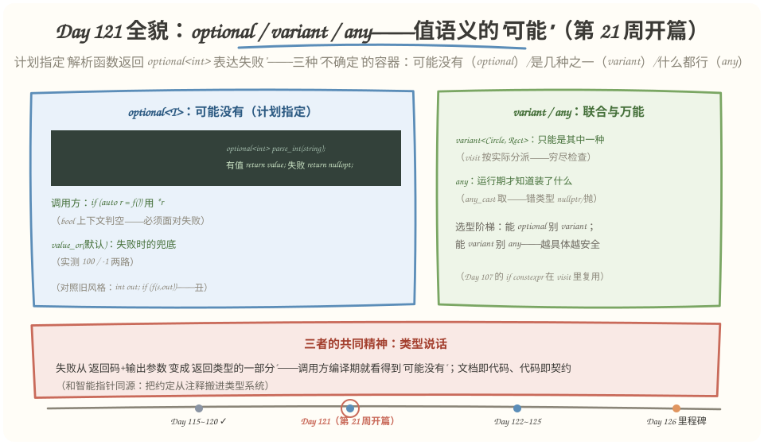

# 第 121 天：optional / variant / any

> **今日目标**：完成本教程后，你能做到：写计划指定的**解析函数返回 optional\<int\>**（失败是返回类型的一部分——调用方必须面对）；用 if 判空 + \*r 取值 + value_or 兜底（三种消费姿势各配实测）；用 variant + visit 写类型安全的联合（配 if constexpr 的穷尽分派）；用 any 装取不同类型（any_cast 的两形态）；背出**选型阶梯**（能 optional 别 variant、能 variant 别 any——越具体越安全）。
> **预计时间**：学习 20 分钟＋实践 40 分钟
> **前置准备**：完成 Day 115~120（"类型说话"的哲学一脉相承）。
> **今日产出**：parse_int 六例实测、visit 三形状、any 万能盒、选型阶梯。

## 1. 今天解决什么问题？

第 21 周（C++17/20 精选）开篇：三种"不确定"的**值语义**容器。主角是计划指定的 **optional\<T\>**——"可能没有的 T"：解析失败、查找未果、配置未设——这些旧 C 用"返回码+输出参数"或"哨兵值 -1"表达的失败，今天写进**返回类型**（调用方编译期就看得到、不判空过不了审查）。配角 **variant**（只能是列出的几种之一——类型安全的联合体）和 **any**（运行期才知道装了什么——最灵活最不安全）。

三者共同的哲学：**把约定从注释搬进类型系统**——和智能指针（所有权进类型）同源。

## 2. 先看全貌：今天的内容位于哪里？



**图 1**：左卡蓝是 optional（计划指定）；右卡绿是 variant/any；下方红卡是共同精神。路线图：**121/144 = 84%——第 21 周开篇**。

三步概括今天：

1. optional：`if (auto r = f()) 用 *r`——失败在类型里；
2. variant：visit 按实际分派（穷尽检查）；any：any_cast 取；
3. 阶梯：越具体越安全（optional > variant > any）。

## 3. 核心概念：先用直觉，再给准确定义

### 3.1 optional：可能没有的 T（计划指定）

- **一句通俗解释**：`optional<int>` 是"**一个 int 或者什么都没有**"——成功装值、失败装 nullopt；类型自己会告诉你"可能没有"。
- **一个类比**：快递柜的格子——可能有一个包裹（值）也可能是空的（nullopt）；取件前先看有没有（判空）是规矩。
- **对应到技术上是**：实测——`parse_int("42")` → **42**、`"-7"` → **-7**；`"3.14"`/`"abc"`/`""`/`"12x"` → **失败**（六例四种失败形态全过——计划指定完成）。**三种消费姿势**：①`if (auto r = f()) { 用 *r; }`（判空后解引用——bool 上下文判空）；②`r.value_or(默认)`（失败兜底——实测 100/-1）；③`r.value()`（空时抛 bad_optional_access——要异常路径时）。**红线**：空时 `*r` 是 **UB**（不检查的解引用——和 Day 117 的 lock 判空同款纪律）。**内部结构**（概念）：值 + 有效标志（sizeof 通常 T+对齐）。**对照旧风格**：`int out; if (parse(s, out))`（输出参数的丑）——optional 把失败变成**值语义**返回的一部分。类比的边界：optional 是**缺席**不是**错误详情**（要原因/错误码还是返回 struct 或抛异常——进阶）。
- **常见误解**："optional 就是可空的指针"——不拷贝不间接（**值语义**——存在对象内部）；开销通常就是那个 bool。

### 3.2 variant：类型安全的联合体

- **一句通俗解释**：`variant<Circle, Rect>` 表示"**是这两种之一**"（编译期列出清单）；`visit` 按当前实际是哪种来分派——**穷尽检查**（漏一种编译不过）。
- **一个类比**：一卡多用——交通卡**或**门禁卡（同时只能是其一）；读卡器（visit）自动按当前卡类型处理。
- **对应到技术上是**：实测——`vector<Shape>`（Shape = variant\<Circle, Rect\>）装三种：`std::visit([](const auto& sh){…}, s)` 按实际分派 → 12.5664/12/3.14159。**和 union 的差异**：C 的 union 不记"当前是哪种"（读错类型 UB）；variant 记（index()）且 visit 穷尽。**和继承的差异**：variant 的清单**封闭**（编译期定）；继承开放（随时加派生）——封闭枚举场景（解析结果的几种形态）variant 更轻。**和 Day 107 的连接**：visit 里的泛型 lambda 正是 `if constexpr` 分派的舞台（实测代码同款）。**holds\_alternative\<T\>/get\<T\>**：也可以显式问"是 T 吗"再取（visit 之外的姿势）。类比的边界：清单很长（5+ 种）或要开放扩展——继承/虚函数更合适。
- **常见误解**："variant 是多态的替代"——是**封闭集合**的轻量替代；开放多态还是虚函数的地盘。

### 3.3 any 与选型阶梯

- **一句通俗解释**：`any` 是"**装什么都行**"的盒子（运行期才知道内容）——最灵活也最不安全；取值要 any_cast（对类型+运行期检查）。
- **一个类比**：黑箱行李——托运时不知道里面是什么（any）；开箱检查（any_cast）要申报类型——申报错了开不了（nullptr/抛异常）。
- **对应到技术上是**：实测——`any b1 = 42; b2 = "hello"s; b3 = 3.14;`——`print_any` 用 `any_cast<int>(&box)` 系列判别（指针版**得 nullptr 不抛**；引用版错类型**抛 bad_any_cast**）。**和 variant 的差异**：variant 编译期**列清单**（类型安全）；any 运行期才查（灵活但要自己管理期望）。**选型阶梯**：**能 optional 别 variant；能 variant 别 any**——越具体越安全（编译期能查的别留到运行期）。any 的合理场景：真正动态的数据（脚本值/配置树/跨接口的透传）——少数。类比的边界：any 的开销（类型信息+可能的堆分配）也比 variant 高——性能敏感更要避开。
- **常见误解**："any 万能所以好用"——万能=没有编译期保障；95% 的场景 optional/variant 更对。

## 4. 图解核心机制


**图 2**：上半部分蓝卡是 optional 的概念结构（值+有效标志）和访问纪律（判空/value_or/UB 红线）；左下绿卡是新旧风格对照（输出参数 vs 值语义返回）；右下灰卡是身边的 optional 场景。

按图逐步讲：

1. **看概念结构**：optional 就是"值+有没有"——sizeof 的代价一目了然（不是指针的间接）；
2. **背访问纪律**：判空后 `*r`、`value()` 抛、`value_or` 兜底——三种姿势按场景选（UB 红线是 Day 117 同款）；
3. **对比新旧风格**：`int out; if (f(s,out))` 的丑 vs `if (auto r = f())` 的净——**值语义**是差别核心；
4. **数身边的场景**：查找/解析/配置/首元素——一切"可能没有"，告别哨兵值。

## 5. 动手实践：完成一个最小可运行例子

### 5.1 准备文件

```bash
cd ai-compiler-roadmap/tutorials/day-121/examples
```

主角：`vocab_three.cpp`（parse_int + variant 形状 + any 盒子）。

### 5.2 编写代码

核心（完整代码见本目录）：

```cpp
std::optional<int> parse_int(const std::string& s) {       // 计划指定
    if (s.empty()) { return std::nullopt; }
    int value = 0;  std::size_t i = 0;  bool neg = false;
    if (s[0] == '-') { neg = true; i = 1; if (s.size() == 1) return std::nullopt; }
    for (; i < s.size(); ++i) {
        if (s[i] < '0' || s[i] > '9') { return std::nullopt; }   // 非数字 → 失败
        value = value * 10 + (s[i] - '0');
    }
    return neg ? -value : value;                            // 有（隐式包进 optional）
}

// 消费的三种姿势
if (auto r = parse_int(s)) { std::cout << *r; }            // ①判空解引用
std::cout << r.value_or(0);                                 // ②失败兜底
auto bad = parse_int("xx");  bad.value_or(-1);              // -1

using Shape = std::variant<Circle, Rect>;                   // 联合
double area(const Shape& s) {
    return std::visit([](const auto& sh) -> double {         // 按实际分派
        using T = std::decay_t<decltype(sh)>;
        if constexpr (std::is_same_v<T, Circle>) { return 3.14159 * sh.r * sh.r; }
        else { return sh.w * sh.h; }
    }, s);
}

std::any box = 42;                                          // 万能盒
if (auto* p = std::any_cast<int>(&box)) { std::cout << *p; }
```

### 5.3 运行与观察

```bash
g++ -Wall -std=c++17 vocab_three.cpp -o vt && ./vt
```

实际执行结果（本机）：

```text
== 计划指定：optional 表达失败 ==
  "42" → 42（成功）
  "-7" → -7（成功）
  "3.14" → 失败（nullopt）
  "abc" → 失败（nullopt）
  "" → 失败（nullopt）
  "12x" → 失败（nullopt）
  （对照旧风格：int out; if (parse(s, out))——输出参数的丑）
  （optional 把'可能失败'写进返回类型——调用方必须面对）
  r.value_or(0) = 100（失败时的默认值）
  bad.value_or(-1) = -1

== variant：类型安全的联合 ==
  面积 = 12.5664
  面积 = 12
  面积 = 3.14159
  （visit 按实际存的那种分派——穷尽检查）

== any：运行期的万能盒 ==
  int：42
  string："hello"
  double：3.14
  （any_cast 错类型 → 得 nullptr（指针版）或抛 bad_any_cast）

== 三者选型 ==
  optional<T>：可能没有的 T（失败/缺席）——静态一种类型
  variant<A,B,…>：只能是列出的几种——visit 穷尽
  any：真·什么都行（运行期才知道）——最不安全最灵活
  （能 optional 别 variant；能 variant 别 any——越具体越安全）
```


**图 3**：左上完整输出（解析/visit/any/选型四段）；右侧是第 21 周路标和已学知识的连接（判空纪律=lock、visit=if constexpr、类型说话=智能指针）；下方橙卡是哨兵值的黄昏。

### 5.4 修改一个输入再观察：越界数字的溢出实验

给 parse_int 喂 `"9999999999"`（超 int 范围）——实测会**溢出成负数**（没检测溢出——今天的简化实现）；升级：解析中检测 `value > (INT_MAX - digit) / 10` 越界 → 返回 nullopt——重跑该例变"失败" ✔。**一简一严**：optional 表达失败的结构不变、**失败的条件**可以按需收紧——结构（怎么报）和策略（什么算失败）分离的红利。

## 6. 常见错误与排查

**错误 1：空 optional 解引用（UB）**

- 现象：`auto r = f(); std::cout << *r;` 偶尔打出垃圾/崩；
- 原因：没判空就解引用（nullopt 状态）；
- 定位：UB 的经典随机形态；
- 修复：`if (r) …` 或 `r.value_or(默认)`——判空纪律（Day 117 同款）。

**错误 2：`value()` 抛 bad_optional_access**

- 现象：运行时抛异常；
- 原因：value() 对空 optional 抛（比 \* 的 UB"礼貌"）；
- 定位：异常栈指向 value 行；
- 修复：要默认值 value_or；确实异常路径就 catch（设计意图）。

**错误 3：any_cast 类型不匹配**

- 现象：指针版得 nullptr（if 走不进）、引用版抛 bad_any_cast；
- 原因：装的和取的类型不一致（int vs long 也不行——要精确）；
- 定位：检查装入和取出的类型声明；
- 修复：对准类型；或改 variant（编译期列清单更安全）。

## 7. 今日练习

### 必做练习（计划指定：解析返回 optional\<int\>）

按 5.4 给 parse_int 加溢出检测；再写 `parse_double`（可选负号+小数点——失败 nullopt）；测试表扩到 10 例。预期产出：两个解析函数 + 10 例对照表。

### 选做挑战

"配置读取器"：`std::map<std::string, std::any>` 存配置——`get_int(key) → optional<int>`（查不到/类型不对都 nullopt——any_cast\<int\>\(&v\) 判别）——三个词汇表（map/any/optional）在一个函数里协作。

## 8. 今日验收

- [ ] 我的 parse_int 六例全过（计划指定——四种失败形态 + 成功两例）
- [ ] 我的三种消费姿势实测（判空解引用/value_or 100 与 -1/value() 抛）
- [ ] 我的 variant+visit 三形状通过（if constexpr 分派——穷尽）
- [ ] 我的 any 装取三类型通过（指针版判别）
- [ ] 我背得出选型阶梯（optional > variant > any——越具体越安全）

## 9. 一句话总结与明天预告

今天的问题是"'可能没有/是几种之一/什么都行'怎么用类型表达"；机制上，optional 把失败写进返回类型（判空纪律同 lock）、variant 封闭清单+visit 穷尽（if constexpr 的舞台）、any 运行期万能（any_cast 两形态）；实践上，解析六例、visit 三形状、万能盒、选型阶梯全部实测；验证标准是看到任何"可能失败"的接口能报出"返回类型怎么设、调用方怎么消费"。明天 **Day 122：string_view 深入与危险点**——悬空 view 的坑 + 轻量分词器（计划指定）：零拷贝的甜与险。
