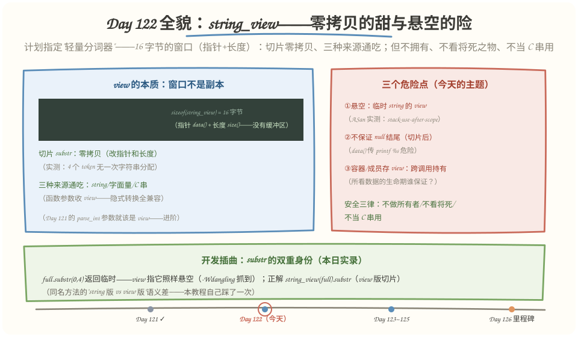
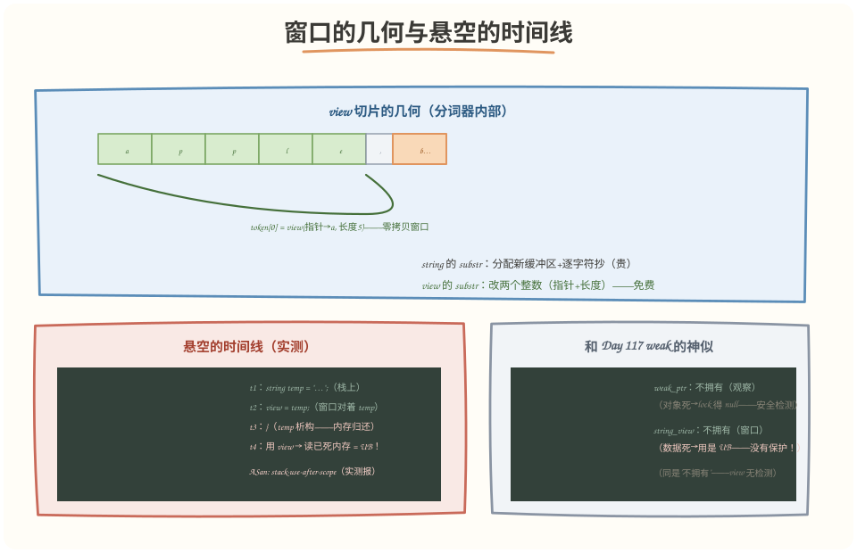
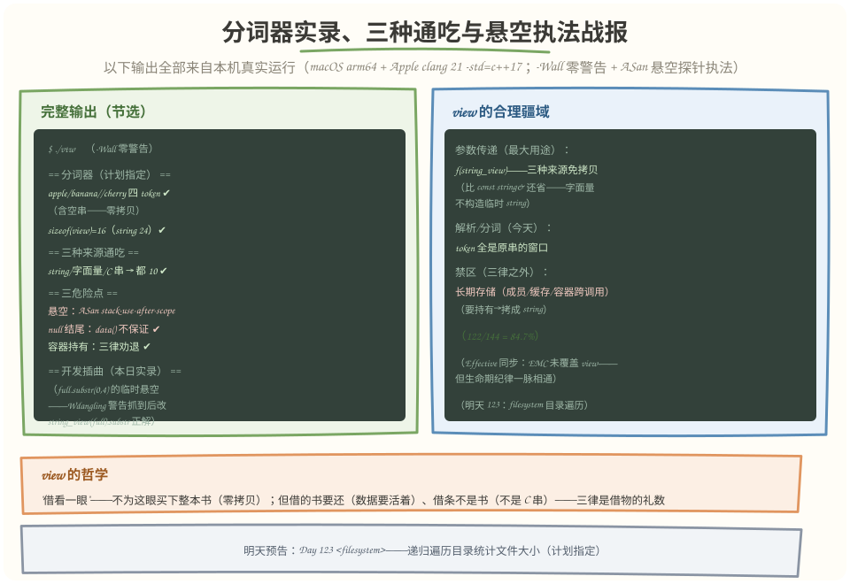

# 第 122 天：string_view 深入与危险点

> **今日目标**：完成本教程后，你能做到：写计划指定的**轻量分词器**（tokenize——view 切片零拷贝）；说出 view 的本质（16 字节窗口：指针+长度——不是副本）；避开**三个危险点**（临时 string 的悬空——ASan 实测 stack-use-after-scope；data() 不保证 null 结尾；容器/成员的跨调用持有）；背出**安全三律**（不做所有者/不看将死之物/不当 C 串用）；识别 substr 的双重身份（string 版临时 vs view 版切片）。
> **预计时间**：学习 20 分钟＋实践 40 分钟
> **前置准备**：完成 Day 121（值语义三容器——view 是"借看"的第四种形态）。
> **今日产出**：分词器四 token 实测、三种来源通吃、悬空执法、substr 插曲实录。

## 1. 今天解决什么问题？

**string_view** 是 C++17 的"借看一眼"：16 字节的窗口（指针+长度）——切片零拷贝、string/字面量/C 串三种来源通吃（函数参数的理想形态）。但**不拥有**——甜头的背面是三个坑：**悬空**（临时 string 的 view——ASan 亲测 stack-use-after-scope）、**不保证 null 结尾**（data() 传给 C API 危险）、**跨调用持有**（容器/成员存 view 的生命期问题）。

计划指定的**轻量分词器**是甜面主角：tokenize 返回的每个 token 都是原串的窗口——零次字符串分配。今天还有**本教程自己的踩坑实录**（substr 的双重身份——-Wdangling 警告抓到的真坑）。

## 2. 先看全貌：今天的内容位于哪里？



**图 1**：左卡蓝是 view 的本质（窗口不是副本）；右卡红是三个危险点；下方绿卡是 substr 插曲。路线图：**122/144 = 84.7%**。

三步概括今天：

1. 本质：16 字节窗口——substr 改两个整数（零拷贝）；
2. 三险：悬空（ASan 实测）/null 结尾/跨调用持有；
3. 三律：不做所有者/不看将死/不当 C 串用。

## 3. 核心概念：先用直觉，再给准确定义

### 3.1 view 的本质：窗口不是副本

- **一句通俗解释**：string_view 是"指着别人家窗户看风景"——16 字节（指针+长度）记录"看哪、看多长"；风景（字符串内容）不在你这。
- **一个类比**：望远镜——看得到远山（字符串）但山不是你的；转动旋钮（substr）改视角**瞬间完成**（不用把山搬过来）。
- **对应到技术上是**：实测——**分词器**（计划指定）：`tokenize("apple,banana,,cherry", ',')` 得 4 个 token（含空串——"banana"后的",,"切出空 token ✔）**零次字符串分配**（每个 token 是原串的窗口）；`sizeof(string_view)` = **16**（string 是 24——更轻）；**三种来源通吃**：`f(string_view)` 收 string/字面量/`const char*` 全隐式转换（实测计数都 10）。**substr 的几何**（图 2）：string 版 = 分配+逐字符抄（贵）；view 版 = 改指针和长度（**免费**）。类比的边界：view 没有 c_str() 的"完整副本"语义——要改内容/要 C 串还得回 string（3.2 的第二险）。
- **常见误解**："view 是更快的 string"——是**不同工具**：只读的窗口；写、追加、null 结尾都不归它管。

### 3.2 三个危险点

- **一句通俗解释**：①悬空（看着已拆的房子）；②不保证 null 结尾（借条不是书）；③跨调用持有（借了不还——没人保证书还在）。
- **一个类比**：借阅图书馆的书——书被回收（悬空）、复印件没盖"完"章（null 结尾）、想把借书卡当书架用（持有）。
- **对应到技术上是**：**①悬空（实测）**：`{ string temp; view = temp; } 用 view` → ASan 报 **stack-use-after-scope**（探针执法——读已死栈内存）；最常见形态：**`f(std::string("临时"))` 里 view 存成成员/返回后用**（临时在语句尾死）。**②null 结尾**：view 的切片（substr 后）指向原串中间——**data() 末尾没有 '\\0'**；传给 `printf("%s", view.data())` 会**越读**（要 C 串：`std::string(view).c_str()`）。**③跨调用持有**：成员/容器/缓存存 view——所看数据的生命期**没人保证**（原 string 一改一析构全完）；经验：**view 只做函数参数和局部变量**。类比的边界：字面量（`"hello"`）的 view 安全（静态存储期——活到程序结束）；危险的是**动态生命期**（string/容器/临时）。
- **常见误解**："编译过就没悬空"——悬空是 UB（编译器不拦）；-Wdangling 能抓一部分（今天的插曲就是它抓的）但不是全部——**三律靠纪律**。

### 3.3 substr 的双重身份（本日插曲）与三律

- **一句通俗解释**：`full.substr(0,4)`（string 版）返回**临时 string**——view 指它照样悬空；`string_view(full).substr(0,4)`（view 版）才是零拷贝切片——同名方法的语义天差地别。
- **一个类比**：同名的两个柜台——A 柜（string 版）给你的是**复印件**（原件马上销毁——你拿着复印件的"地址"）；B 柜（view 版）给你的是**原件的窗口**（原件还在那）。
- **对应到技术上是**：**本教程踩坑实录（诚实记录）**：写"危险点二"的演示代码时——`std::string_view part = std::string("full-string").substr(0, 4);` 编译器报 **-Wdangling 警告**（临时 string 的悬空）；第一版"修复"改成 `full.substr(0,4)`（以为先存 string 就行）——**警告还在**！因为 substr 返回的是**临时 string**（view 指的临时）；最终正解：`std::string_view(full).substr(0,4)`（**先转 view 再切**——切片作用在原串上）。**教训**：踩坑两次才对——同名方法的身份差比想象更隐蔽。**安全三律**（总结）：①**不做所有者**（参数/局部用——不长期存）；②**不看将死之物**（临时 string 的 view 立刻悬空）；③**不当 C 串用**（data() 不保证 null 结尾）。**和 Day 117 weak 的神似**：都是"不拥有"——但 weak 的 lock **能检测**对象死没死（null）；view **没有任何保护**（UB 直接来）——所以三律的纪律要求更高。类比的边界：C++23 的 `std::span`（数组的 view）同款风险同款三律——学一次管一族。
- **常见误解**："先存了 string 再 substr 就安全"——substr 返回临时——**view 要指的必须是稳定存在的字符**；转 view 后再切才是正解。

## 4. 图解核心机制



**图 2**：上半部分蓝卡是 view 切片的几何（分词器内部——token[0] 的窗口箭头）+ 两种 substr 的成本对照；左下红卡是悬空的时间线（四拍：建/看/死/用=UB）；右下灰卡是和 weak_ptr 的神似对比。

按图逐步讲：

1. **看窗口的箭头**：token[0] = view(指针→'a', 长度 5)——原串格子上的括线——零拷贝的几何直观；
2. **对比两种 substr**：string 版（分配+抄）vs view 版（改两个整数）——同名的天差地别；
3. **走悬空四拍**：temp 建 → view 看 → 块结束 temp 死 → 用 view = UB——**ASan 在第四拍抓**（stack-use-after-scope）；
4. **连 weak 的对比**：同样"不拥有"——weak 有 lock 的安全检测、view 裸奔——纪律等级不同的原因。

## 5. 动手实践：完成一个最小可运行例子

### 5.1 准备文件

```bash
cd ai-compiler-roadmap/tutorials/day-122/examples
```

主角：`view_tokenizer.cpp`（分词器 + 三险演示 + 三律）。

### 5.2 编写代码

核心（完整代码见本目录）：

```cpp
std::vector<std::string_view> tokenize(std::string_view text, char sep) {
    std::vector<std::string_view> tokens;
    std::size_t start = 0;
    while (start <= text.size()) {
        auto pos = text.find(sep, start);
        if (pos == std::string_view::npos) { tokens.push_back(text.substr(start)); break; }
        tokens.push_back(text.substr(start, pos - start));   // view 切片——零拷贝！
        start = pos + 1;
    }
    return tokens;
}

// 三种来源通吃（参数收 view）
auto count_non_space = [](std::string_view v) { /* 遍历计数 */ };
count_non_space(std::string("hello world"));   // string ✔
count_non_space("hello world");                // 字面量 ✔
count_non_space(cs);                           // const char* ✔

// 悬空（危险的形态——演示用注释保留）
std::string_view bad;
{ std::string temp = "…"; bad = temp; }        // temp 死——bad 悬空
// 用 bad → UB

// substr 双重身份（本日插曲的正解）
std::string_view part = std::string_view(full).substr(0, 4);   // 先转 view 再切 ✔
```

### 5.3 运行与观察

```bash
g++ -Wall -std=c++17 view_tokenizer.cpp -o vtw && ./vtw
```

实际执行结果（本机，节选）：

```text
== 计划指定：轻量分词器（零拷贝） ==
  ["apple"]（长度 5）
  ["banana"]（长度 6）
  [""]（长度 0）
  ["cherry"]（长度 6）
  （每个 token 是原串的切片——没有一次字符串拷贝）
  sizeof(string_view) = 16 字节（指针+长度——比 string 的 24 轻）

== 隐式转换的便利 ==
  string → 10
  字面量 → 10
  const char* → 10
  （函数参数收 view——string/字面量/C 串全兼容）

== 危险点一：悬空 view（临时的命） ==
  temp 已析构——bad 悬空（输出未定义，别解引用）
  （正确做法：view 的命不能超过所看的数据）

== 危险点二：view 不保证 null 结尾 ==
  part = "full"（长度 4）
  （view 不是 C 串！传给需要 const char* 的 API 前要确认）
  （要 C 串：先转 std::string 再 c_str()）

== 危险点三：存进容器的坑（跨调用持有） ==
  成员/容器/缓存里存 view——所看数据的生命期谁保证？
  （经验：view 只做'函数参数和局部'——不当长期所有者）

== 安全使用三律 ==
  ①不做所有者（参数/局部用——不长期存）
  ②不看将死之物（临时 string 的 view 立刻悬空）
  ③不当 C 串用（data() 不保证 null 结尾）
```

**悬空执法**（ASan 探针实测）：

```text
==44499==ERROR: AddressSanitizer: stack-use-after-scope on address 0x00016b8f2c60
```



**图 3**：左上完整输出（分词/通吃/三险/三律 + **本日插曲实录**）；右侧是 view 的合理疆域（参数传递最大用途/解析分词/禁区清单）；下方橙卡是 view 的哲学。

**开发插曲（诚实记录）**：写"危险点二"的演示时 `std::string_view part = std::string("...").substr(0,4)` 报 **-Wdangling** 警告；第一版修复（`full.substr(0,4)`）**警告仍在**（substr 返回临时）——最终正解 `string_view(full).substr(0,4)`。**同名方法的双重身份踩了两次才对**——比任何讲解都深刻。

### 5.4 修改一个输入再观察：view 与 string 的性能差

写个基准：对 1MB 的字符串做 100 万次 `substr(0, 100)`——string 版（每次分配+拷 100 字节）vs view 版（改两个整数）——`<chrono>` 计时（Day 114 的方法）。预期：**数量级的差距**（string 版要秒级、view 版毫秒内）。这就是"零拷贝"的量化——和分词器的甜一脉相承。

## 6. 常见错误与排查

**错误 1：`-Wdangling` 警告或 ASan 报 stack/heap-use-after-scope**

- 现象：view 指向临时 string——警告或运行崩；
- 原因：临时的生命只在整条语句——view 出语句就悬空；
- 定位：警告/ASan 指到 view 的赋值行；
- 修复：让源先活（`string s = …; view = s;`）或 view 版方法（`string_view(s).substr`）；真要持有拷 string。

**错误 2：view.data() 传给 C API 越读**

- 现象：printf %s 打出乱码尾巴；
- 原因：切片后 data() 末尾无 '\\0'（view 不保证 null 结尾）；
- 定位：乱码总在内容后；
- 修复：`std::string(view).c_str()`（要副本换安全）；或确认是完整 view（非切片）。

**错误 3：成员/缓存里存了 view（跨调用后数据没了）**

- 现象：存的 view 偶尔读到空/垃圾；
- 原因：所看的 string 在某次操作后析构/重分配；
- 定位：审计 view 的存储位置（成员/容器——违反三律①）；
- 修复：长期持有改存 string（拷贝）；view 只在函数内用。

## 7. 今日练习

### 必做练习（计划指定：轻量分词器）

扩展 tokenize 支持多分隔符（`tokenize(text, ",; ")` 三种分隔符都切）+ 跳过空 token（开关参数）。测试 `"a, b;;c"` → `[a][b][c]`。预期产出：新版分词器 + 测试输出。

### 选做挑战

"Day 121 的 view 化"：把昨天的 `parse_int(const std::string&)` 参数改成 `std::string_view`——调用方传 string/字面量都免拷贝（三律①的正当用法）；验证六例行为不变。两个 C++17 词汇表的组合。

## 8. 今日验收

- [ ] 我的分词器四 token 全过（计划指定——零拷贝、含空串）
- [ ] 我的三种来源通吃实测（string/字面量/C 串 → 同一函数）
- [ ] 我的悬空执法目击（ASan stack-use-after-scope）
- [ ] 我能讲出 substr 双重身份（本日插曲——string 临时 vs view 切片）
- [ ] 我背得出安全三律（不做所有者/不看将死/不当 C 串）

## 9. 一句话总结与明天预告

今天的问题是"零拷贝的窗口怎么用才不摔跤"；机制上，view 是 16 字节窗口（substr 改两个整数——免费）、三险（悬空——ASan 可证/null 结尾/跨调用持有）、三律（不做所有者/不看将死/不当 C 串）；实践上，分词器、三源通吃、悬空执法、substr 踩坑两次的插曲全部实录；验证标准是看到任何 view 用法能报出"源活多久、要不要 C 串、能不能存"。明天 **Day 123：\<filesystem\> 库**——递归遍历目录统计文件大小（计划指定）：目录树的现代遍历。
