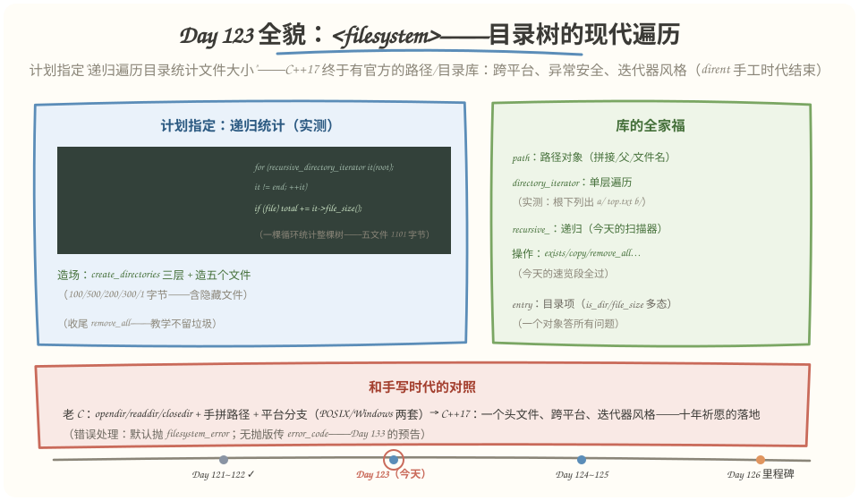
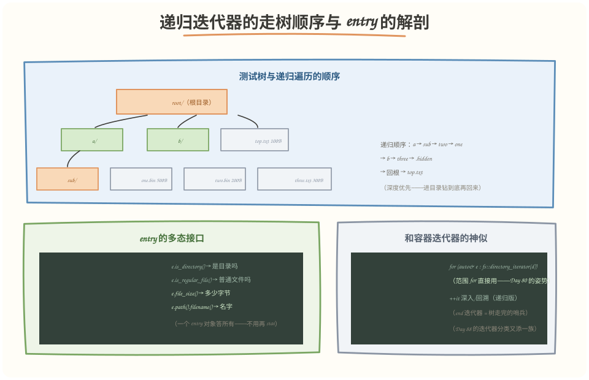

# 第 123 天：&lt;filesystem&gt;——目录的现代遍历

> **今日目标**：完成本教程后，你能做到：写计划指定的**递归遍历统计**（recursive_directory_iterator——文件数/目录数/总字节/最大文件全实测）；用 path/entry 的核心接口（create_directories/exists/file_size/copy/remove_all）；说出三种遍历姿势（单层/递归/范围 for）；对比老 C 的 opendir 时代（跨平台/异常安全的十年祈愿落地）。
> **预计时间**：学习 20 分钟＋实践 40 分钟
> **前置准备**：完成 Day 121~122（C++17 词汇表的第三块——值语义/view 之后是文件系统）。
> **今日产出**：三层五文件测试树的完整统计（1101 字节手算同）、三种遍历、操作速览。

## 1. 今天解决什么问题？

C++17 终于有了**官方文件系统库**：`<filesystem>` 的 path 对象、目录迭代器、文件操作——跨平台（POSIX/Windows 一套代码）、异常安全（可选 error_code）。老 C 时代要 opendir/readdir/closedir + 手拼路径 + 平台分支——十年祈愿今天落地。

计划指定的**递归遍历统计文件大小**是主场景：一棵 `recursive_directory_iterator` 循环统计整棵树（文件数/目录数/总字节/最大文件）——实测三层五文件 **1101 字节**（手算同）。

## 2. 先看全貌：今天的内容位于哪里？



**图 1**：左卡蓝是计划指定的递归统计；右卡绿是库的全家福；下方红卡是老 C 对照。路线图：**123/144 = 85.4%**。

三步概括今天：

1. 递归迭代器：一棵循环走整棵树（深度优先）；
2. entry：目录项的多态接口（is_dir/file_size/path）；
3. path + 操作：create/copy/remove_all 的速览。

## 3. 核心概念：先用直觉，再给准确定义

### 3.1 递归遍历统计（计划指定）

- **一句通俗解释**：`recursive_directory_iterator` 是"自动钻洞的探员"——遇到目录就钻进去、走完才回来（深度优先）；循环里逐项分类统计。
- **一个类比**：图书馆盘点员——逐架走（单层）、见到套间就进去清点（递归）、套间里的套间继续进（深度优先）——一圈下来全馆清点完。
- **对应到技术上是**：实测——造三层测试树（root/a/sub、root/b + 五文件 100/500/200/300/1 字节含隐藏文件）；scan 后：**目录 3、文件 5、总 1101 字节**（100+500+200+300+1 手算同 ✔）、**最大 one.bin 500B** ✔。**循环骨架**：`for (auto it = fs::recursive_directory_iterator(root); it != fs::recursive_directory_iterator(); ++it)`——`is_directory` 分类、`is_regular_file` 才 `file_size`（目录问大小无意义）。**走树顺序**（图 2）：a → sub → two → one → b → three → .hidden → 回根 top.txt（深度优先的钻与回）。**教学不留垃圾**：remove_all 收尾（已删 ✔）。类比的边界：符号链接默认**不跟随**（防环——follow_directory_symlink 要显式开）。
- **常见误解**："递归迭代器会无限循环（环链）"——默认不跟符号链接——环不可能；要跟就自己防。

### 3.2 path 与 entry：对象化的路径

- **一句通俗解释**：`fs::path` 是路径对象（`/` 拼接、`.filename()` 取名）；`directory_entry` 是目录项（一个对象答 is_dir/file_size/path 所有问题）。
- **一个类比**：path 是"地址的名片"（可拆省市区）；entry 是"按门铃看到的"（是住户还是信箱、多大、叫什么——一问全知）。
- **对应到技术上是**：实测——`root / "a" / "sub"`（`/` 运算符拼接——比字符串 + 干净且跨平台分隔符）；`e.path().filename().string()` 取文件名；`e.is_directory() / e.is_regular_file() / e.file_size()` 三连问（entry 一站式）。**范围 for 的姿势**：`for (const auto& e : fs::directory_iterator(dir))`（Day 80 的迭代器习惯直接套——迭代器家族又添一族）。**单层 vs 递归**：directory_iterator 只走一层（实测根下列出 a/ top.txt b/）；recursive 钻到底——按需选。类比的边界：entry 的接口会**缓存**查询（某些系统上重复问更快）——细节不影响用法。
- **常见误解**："path 就是 string"——是对象（拼接跨平台/可拆父名/可比较）；`path::string()` 才转本地编码的串。

### 3.3 操作全家福与错误处理

- **一句通俗解释**：exists/file_size/create_directories/copy/remove_all——日常文件操作一个头文件全包；错误默认抛异常（无抛版传 error_code）。
- **一个类比**：工具箱换新——旧的三件套（opendir/stat/unlink 各平台一套）换成一整套统一制式的新工具。
- **对应到技术上是**：实测——`create_directories(root/"a"/"sub")`（多层一次建 ✔）；`fs::copy(src, dst)`（复制后 exists=1 ✔）；`remove_all(root)`（整树删——造场前清和收尾都用）；`current_path()`（当前目录——打印截断防溢出）。**错误处理的两版**：默认抛 `filesystem_error`（带路径详情——Day 133 JSON 错误处理的预告）；无抛版 `fs::exists(p, ec)` 传 `std::error_code`（老 C 返回码的现代版——两版按场景选）。**和 JSON 项目周的连接**：解析器要读文件（ifstream + path）、测试要扫描用例目录——今天学的直接上场。类比的边界：权限/并发（别的进程在改目录）会让迭代器抛或跳——生产级要容错（练习从简）。
- **常见误解**："file_size 对目录也返回总和"——目录的大小（条目表的字节数）不是内容总和——总和自己累加（今天的 scan 做法）。

## 4. 图解核心机制



**图 2**：上半部分蓝卡是测试树的结构图（三层 + 五文件的树形）和递归走树顺序的标注；左下绿卡是 entry 的多态接口一览；右下灰卡是和容器迭代器的神似（范围 for 姿势/++ 的深入回溯/end 哨兵）。

按图逐步讲：

1. **沿树走一遍顺序**：a 钻到 sub 再到 two——**深度优先**的钻与回（图上的箭头）；
2. **数五文件的贡献**：100+500+200+300+1 = 1101——统计的算术就是遍历的累加；
3. **读 entry 的三连问**：is_directory/is_regular_file/file_size——一个对象答所有（不用再 stat）；
4. **连 Day 80**：范围 for 的迭代器习惯直接套——`for (auto& e : fs::directory_iterator(d))` 和遍历容器同款手感。

## 5. 动手实践：完成一个最小可运行例子

### 5.1 准备文件

```bash
cd ai-compiler-roadmap/tutorials/day-123/examples
```

主角：`dir_stats.cpp`（造树 + scan + 三种遍历 + 操作速览）。

### 5.2 编写代码

核心（完整代码见本目录）：

```cpp
namespace fs = std::filesystem;

Stats scan(const fs::path& root) {                             // 计划指定
    Stats st;
    for (auto it = fs::recursive_directory_iterator(root);
         it != fs::recursive_directory_iterator(); ++it) {
        if (it->is_directory()) { ++st.dirs; continue; }
        if (it->is_regular_file()) {
            ++st.files;
            auto sz = it->file_size();
            st.total_bytes += sz;
            if (sz > st.max_file) { st.max_file = sz; st.max_name = it->path().string(); }
        }
    }
    return st;
}

// 造场
fs::create_directories(root / "a" / "sub");                    // 多层一次建
std::ofstream f(path, std::ios::binary); f << std::string(n, 'x');   // 造文件

// 三种遍历
for (const auto& e : fs::directory_iterator(root)) { … }       // 单层·范围 for
fs::copy(src, dst);  fs::remove_all(root);                     // 操作
```

### 5.3 运行与观察

```bash
g++ -Wall -std=c++17 dir_stats.cpp -o ds && ./ds
```

实际执行结果（本机，节选）：

```text
== 计划指定：递归遍历统计 ==
  目录数：3（a、a/sub、b + 根）
  文件数：5
  总字节：1101（100+500+200+300+1 = 1101）
  最大文件：…/d123_demo/a/one.bin（500 字节）

== 遍历的三种姿势 ==
  ①directory_iterator（单层）：
    a/
    top.txt
    b/
  ②recursive_directory_iterator（递归——今天的扫描器）
  ③范围 for + entry 的多态接口（is_directory/file_size…）

== entry 的能力一览 ==
  sub：目录？Y 大小=-
  one.bin：目录？N 大小=500

== 常用操作速览 ==
  exists / file_size / create_directories ✔（今天用了）
  remove_all（清目录）✔（造场前清了）
  copy：复制后文件数+1 → 1
  当前目录 current_path() = /Users/chenbinbin/Documents/de…

（测试目录已清理——已删）
```


**图 3**：左上完整输出（统计/三遍历/entry/速览四段）；右侧是身边的 filesystem 场景（构建扫描/磁盘分析/备份同步——JSON 周直接受益）；下方橙卡是标准库的版图。

### 5.4 修改一个输入再观察：真实目录的扫描

把 root 换成 `tutorials/day-076/examples`（教程自己的目录）——重跑：真实的文件数/字节数/最大文件（比测试树生动）；再扫 `tutorials/`（全库）看量级（几千文件——递归的实用感）。**两棵真树**：从玩具到真实负载——同一 scan 函数一字不改（泛用的验证）。

## 6. 常见错误与排查

**错误 1：`filesystem_error` 异常（目录不存在）**

- 现象：迭代不存在的路径抛异常；
- 原因：路径错了/权限不足；
- 定位：异常的 path 信息（自带详情）；
- 修复：先 `fs::exists(p)` 检查；或 catch 处理；或无抛版传 error_code。

**错误 2：`file_size()` 对目录抛**

- 现象：遍历中对目录项调 file_size 抛异常；
- 原因：目录没有"文件大小"语义；
- 定位：异常栈指向 file_size 行；
- 修复：`if (e.is_regular_file())` 先分类（今天的 scan 写法）。

**错误 3：符号链接导致走环**

- 现象：递归遍历死循环；
- 原因：显式开了 follow_directory_symlink + 链接成环；
- 定位：卡在固定的几层路径重复；
- 修复：默认不跟链接（保持）；确要跟则自己记 visited 集合防环。

## 7. 今日练习

### 必做练习（计划指定：递归遍历统计）

给 scan 加**按扩展名分组**（`.cpp/.svg/.md` 各多少个/各多少字节）——用 `map<string, pair<count, bytes>>`（Day 85 + 今天的组合）。扫 tutorials 全库输出分组表。预期产出：三行的分组统计。

### 选做挑战

"du 风格目录报表"：递归统计每个**子目录**（不是每文件）的大小，按大小降序输出 Top 5——需要"进入子目录前后记账"（`it.depth()` 或分治递归）。磁盘分析工具的最小版。

## 8. 今日验收

- [ ] 我的递归统计全过（计划指定——目录 3/文件 5/1101 字节/最大 500B 手算同）
- [ ] 我的三种遍历姿势过（单层列出/递归扫描/范围 for）
- [ ] 我的 entry 三连问实测（is_dir/file_size/filename）
- [ ] 我的操作速览全过（create/copy/remove_all/current_path）
- [ ] 我知道错误处理的两版（抛异常 vs error_code——Day 133 的预告）

## 9. 一句话总结与明天预告

今天的问题是"目录树怎么跨平台地走和统计"；机制上，recursive_iterator 深度优先走整树（默认不跟链接防环）、path/entry 对象化（`/` 拼接 + 一站式查询）、操作全家福（错误两版）；实践上，三层五文件的完整统计、三种遍历、真实目录试扫全部落地；验证标准是看到任何目录需求能报出"用哪个迭代器、entry 怎么问、错误怎么接"。明天 **Day 124：C++20 概览**——concepts / ranges / 协程（认知级·跑通示例）：新标准的三大件先睹为快。
