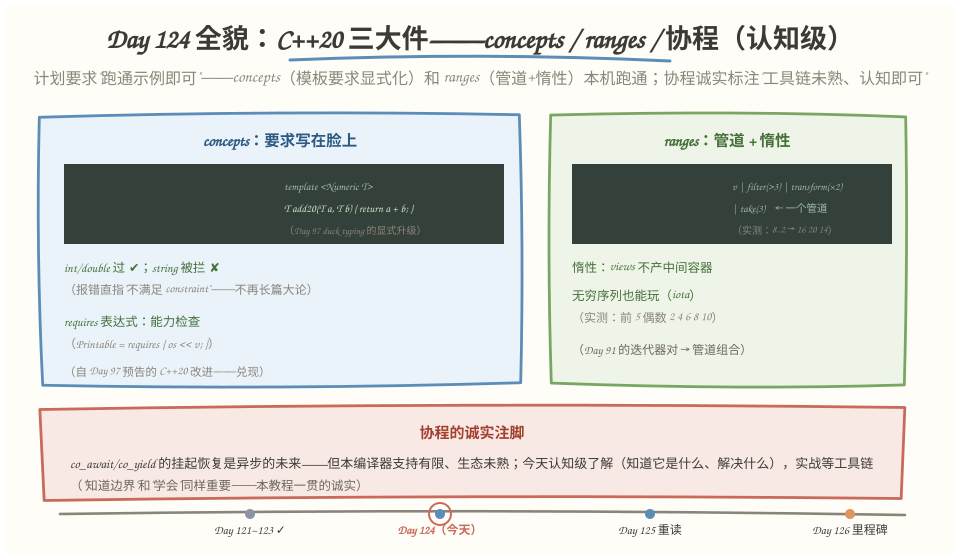
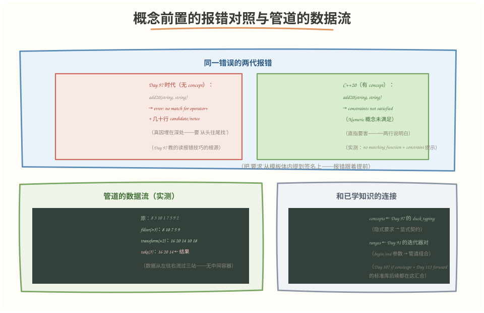
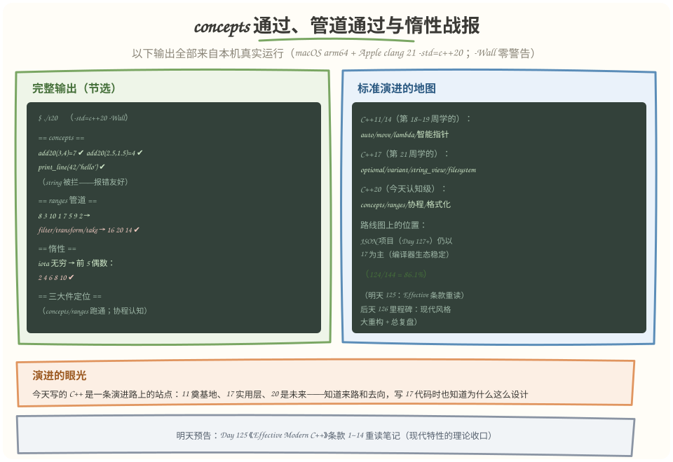

# 第 124 天：C++20 概览——concepts / ranges / 协程（认知级）

> **今日目标**：完成本教程后，你能做到：跑通 **concepts** 示例（`template <Numeric T>`——Day 97 duck typing 的显式升级；string 被拦的友好报错）；跑通 **ranges** 管道（`v | filter | transform | take`——惰性不产中间容器；无穷序列也能玩）；说出三大件的定位（concepts=模板要求显式 / ranges=算法管道 / 协程=挂起恢复——后者诚实标注"工具链未熟、认知即可"）。
> **预计时间**：学习 20 分钟＋实践 35 分钟
> **前置准备**：完成 Day 97/107（concepts 的两处预告）+ Day 91（ranges 的迭代器前身）。
> **今日产出**：concepts 双通过+拦截执法、管道实测（16 20 14）、无穷序列取 5。

## 1. 今天解决什么问题？

C++20 三大件的**认知级之旅**（计划："跑通示例即可"）：**concepts**——把模板的隐式要求（Day 97 学 duck typing 时说"C++20 会改进"——今天兑现）变成签名上的显式契约，报错从几十行 candidate 变一两行直指要害；**ranges**——算法的管道组合（`|` 连接、惰性求值、无穷序列可玩）——Day 91 迭器对的升级形态；**协程**——挂起恢复的异步未来，但**本编译器支持有限、生态未熟**——诚实标注认知即可。

两个跑通 + 一个认知 = 今天的合理份量。

## 2. 先看全貌：今天的内容位于哪里？



**图 1**：左卡蓝是 concepts；右卡绿是 ranges；下方红卡是协程的诚实注脚。路线图：**124/144 = 86.1%**。

三步概括今天：

1. concepts：要求写在签名上——报错直指要害；
2. ranges：管道 + 惰性——无穷也能玩；
3. 协程：认知即可（工具链边界）。

## 3. 核心概念：先用直觉，再给准确定义

### 3.1 concepts：要求写在脸上

- **一句通俗解释**：`template <Numeric T>` 把"T 必须是数值"写在签名上——不满足直接拦（报错友好），不用等实例化到 `a + b` 才炸。
- **一个类比**：招聘启事——旧时代"进来试用才发现不会写代码"（实例化才炸+长报错）；concepts 是"JD 上写清要求，不符合简历关就被刷"（一两行说清）。
- **对应到技术上是**：实测——`add20(3,4)` = 7 ✔、`add20(2.5,1.5)` = 4 ✔（int/double 满足 Numeric）；**拦截执法**：`add20(string, string)` → `error: no matching function` + **constraints not satisfied**（一两行——对照 Day 97 时代的几十行 candidate）。**两种定义**：①组合现有概念（`std::integral<T> || std::floating_point<T>`）；②**requires 表达式**（`requires { os << v; }`——能力检查；今天的 Printable）。**和 Day 97 的闭环**：当时学"报错长是因为要求隐式"——今天的要求显式化正是解药（三天前埋的"进阶预告"兑现）。类比的边界：concepts 不改变运行时（纯编译期契约）——只是把"约定"提前到签名。
- **常见误解**："concepts 让模板变慢"——零运行时影响（编译期的门卫）；编译时间还可能更快（提前拒绝不用深挖）。

### 3.2 ranges：管道 + 惰性

- **一句通俗解释**：`v | filter(>3) | transform(×2) | take(3)`——数据从左流过三站（像水管）；**views 是惰性的**（不产中间容器、用到才算）。
- **一个类比**：流水线——原料（vector）依次过筛（filter）、加工（transform）、截取（take）；传送带不囤半成品（无中间容器）。
- **对应到技术上是**：实测——{8,3,10,1,7,5,9,2} → 管道 → **16 20 14**（>3 的 8,10,7 ×2 = 16,20,14 取前 3 ✔）。**惰性的实证**：`std::views::iota(1)` 是**无穷序列**（1,2,3,…），`| filter(偶) | take(5)` → **2 4 6 8 10**（无穷也能玩——取 5 才算 5 步）。**和 Day 91 的对照**：旧版 `copy_if` + `transform` + 手动截断（三步+中间容器）；管道一个表达式（读——改——用一条线）。**views vs 容器**：views 是视图（类似 Day 122 string_view 的思路——不拥有只看；但 ranges 视图更安全——生命期规则更严）。类比的边界：管道要**终结操作**（范围 for/materialize）才真正执行——纯定义管道不跑。
- **常见误解**："ranges 就是新算法名"——是**组合方式**的升级（迭代器对 → 管道）；单步算法两者皆可，多步加工管道完胜。

### 3.3 协程：认知即可（诚实边界）

- **一句通俗解释**：`co_await/co_yield` 让函数能**挂起再恢复**（异步的语法级支持）——强大但工具链未熟，今天知道它是什么、解决什么即可。
- **一个类比**：可以暂停的电影——看到一半暂停（挂起）、去干别的、回来接着放（恢复）；普通函数是一部不能停的片子（进去了必须跑完）。
- **对应到技术上是**：**协程的形态**：`co_yield x`（生成器——依次产出）、`co_await expr`（等待异步完成）。**为什么今天不实战**：①本机 clang 的协程库（`<coroutine>`）可用但 std::generator 等 C++23 才有——手写 promise_type 门槛高；②生态（异步框架）未定形。**诚实的课程决策**：认知级了解（知道定位和解决什么），实战等工具链——和"教学从简"的一贯原则一致。**异步的替代**：线程已够基础场景（本系列未覆盖并发——std::thread 需另行学习）。类比的边界："认知级"不是"不重要"——JSON 项目后如果有余力可以回头看（教程主线 144 天不依赖它）。
- **常见误解**："协程=多线程"——协程是**协作式**（自己让出；单线程也行）；线程是抢占式（OS 调度）——两种并发模型。

## 4. 图解核心机制



**图 2**：上半部分蓝卡是同一错误的两代报错（Day 97 的几十行 vs C++20 的一两行）；左下绿卡是管道的数据流（四步逐行）；右下灰卡是和已学知识的连接。

按图逐步讲：

1. **对比两代报错**：同一个 add20(string,string)——旧版真因埋深处（Day 97 教的"从头往尾找"）、新版直指 constraints——**要求前置的红利**；
2. **走管道的数据流**：原数组 → filter 后 → transform 后 → take 后——四行数字就是管道的执行痕迹；
3. **记惰性的威力**：无穷 iota 取 5 偶数——"用到才算"（不取就永远不算）；
4. **连已学知识**：concepts ← Day 97、ranges ← Day 91、if constexpr/forward 的标准库后续在这里汇合——演进是连续的。

## 5. 动手实践：完成一个最小可运行例子

### 5.1 准备文件

```bash
cd ai-compiler-roadmap/tutorials/day-124/examples
```

主角：`cpp20_tour.cpp`（concepts + ranges 的跑通集）。

### 5.2 编写代码

核心（完整代码见本目录）：

```cpp
template <typename T>
concept Numeric = std::integral<T> || std::floating_point<T>;   // 组合现有概念

template <Numeric T>                                            // requires 子句
T add20(T a, T b) { return a + b; }

template <typename T>
concept Printable = requires(std::ostream& os, const T& v) {    // requires 表达式
    os << v;
};

auto result = v
    | std::views::filter([](int x) { return x > 3; })
    | std::views::transform([](int x) { return x * 2; })
    | std::views::take(3);                                      // 管道

auto evens = std::views::iota(1)                                // 无穷序列
    | std::views::filter([](int x) { return x % 2 == 0; })
    | std::views::take(5);
```

### 5.3 运行与观察

```bash
g++ -Wall -std=c++20 cpp20_tour.cpp -o t20 && ./t20
```

实际执行结果（本机）：

```text
== ① concepts：要求写在脸上 ==
  add20(3, 4) = 7（int 满足 Numeric ✔）
  add20(2.5, 1.5) = 4（double ✔）
  （string 版会被 concept 拦截——报错信息直指'不满足 Numeric'）
  42
  hello concept
  （Printable：有 operator<< 就能印——要求写在签名上）

== ② ranges：管道风格 ==
  原始：8 3 10 1 7 5 9 2
  管道(>3 → ×2 → 前3)：16 20 14
  （views 是惰性的——不产生中间容器）

== ranges 的惰性实证 ==
  无穷序列取前 5 个偶数：2 4 6 8 10 （无穷也能玩——惰性的威力）

== C++20 三大件的定位 ==
  concepts：模板要求的类型系统（Day 97 隐式 → 显式）
  ranges：算法的管道组合（Day 91 的迭代器对升级）
  协程：co_await/co_yield 的挂起恢复（本编译器支持有限——认知即可）
  （今天的两个跑通；协程等工具链成熟再战）
```

**concept 拦截执法**（探针实测）：

```text
/tmp/cc.cpp:6:14: error: no matching function for call to 'add20'
（附 constraints not satisfied 提示——一两行说清）
```



**图 3**：左上完整输出（concepts/管道/惰性/定位四段）；右侧是**标准演进的地图**（11/14 → 17 → 20——教程各周对应的位置）；下方橙卡是演进的眼光。

### 5.4 修改一个输入再观察：管道的组分实验

把管道的 `take(3)` 改成 `take(5)`——重跑：结果变 16 20 14 10 18（多取两站）；再改成先 transform 再 filter（`×2 后 >15`）——结果不同（顺序影响语义——管道不是交换的）。**三组对照**：管道的每一站都是真加工（改一站全链变）——组合的乐趣与责任。

## 6. 常见错误与排查

**错误 1：`constraints not satisfied`（concept 拦截）**

- 现象：传不满足概念的类型编译错；
- 原因：类型能力不符合签名契约（如 string 不满足 Numeric）；
- 定位：报错直指概念名（新式的友好）；
- 修复：换满足的类型；或放宽概念（`requires` 加条件）。

**错误 2：管道定义了但"没输出"**

- 现象：定义管道后打印为空；
- 原因：views 惰性——没有终结操作不执行；
- 定位：检查有没有消费（范围 for / ranges::to）；
- 修复：`for (int x : result)` 消费它。

**错误 3：协程示例编不过（缺 generator）**

- 现象：co_yield + std::generator 编译错；
- 原因：std::generator 是 C++23；C++20 要手写 promise_type（门槛高）；
- 定位：报错提 generator 未定义；
- 修复：等 C++23 库；或用第三方（cppcoro）；或今天认知级跳过（诚实的选择）。

## 7. 今日练习

### 必做练习（计划："跑通示例即可"）

自定义一个概念 `Container`（requires 表达式：有 begin/end 且能迭代）——用它约束一个 `print_all(Container auto&& c)` 模板（测试 vector/string 过、int 拦）。预期产出：概念定义 + 双通过 + 拦截证据。

### 选做挑战

"ranges 的六站管道"：对一个词表做 `filter(长度>3) | transform(转大写) | take(4) | drop(1)`——写出每站的数据流注释（今天的 5.4 式对照）。管道组合的肌肉记忆。

## 8. 今日验收

- [ ] 我的 concepts 双通过（int/double ✔ + string 拦截执法——一两行报错）
- [ ] 我的管道实测（8 个数 → 16 20 14——filter/transform/take）
- [ ] 我的惰性实证（无穷 iota → 前 5 偶数）
- [ ] 我能说出三大件定位（concepts 显式/ranges 管道/协程认知）
- [ ] 我知道和 Day 97/91 的连接（要求显式化/迭代器升级）

## 9. 一句话总结与明天预告

今天的问题是"C++20 给了我们什么"；机制上，concepts 把模板要求前置（报错直指要害——Day 97 的兑现）、ranges 管道组合+惰性（无穷可玩——Day 91 的升级）、协程诚实认知（工具链边界）；实践上，双通过、拦截执法、惰性实验全部落地；验证标准是看到模板报错能说出"C++20 会怎么改"、看到多步算法能写出管道版。明天 **Day 125：《Effective Modern C++》条款 1~14 重读**——现代特性的理论收口：五个月实践后的"回头看"。
