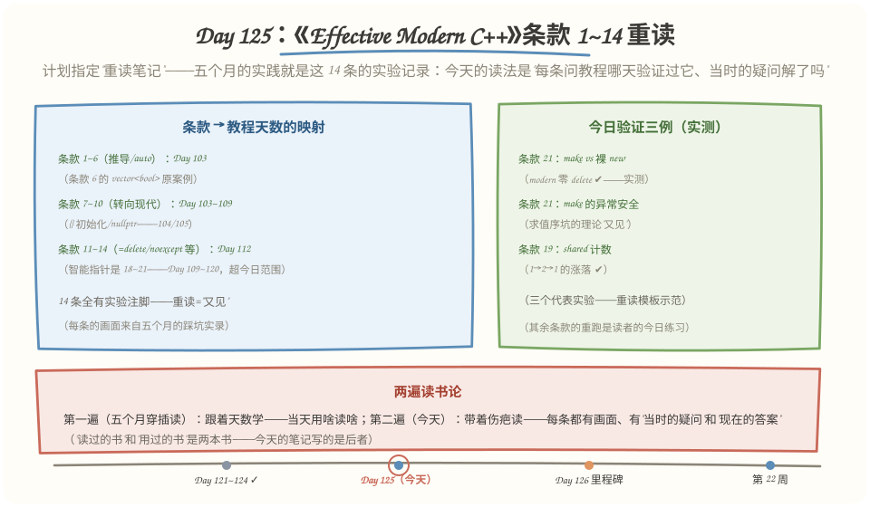
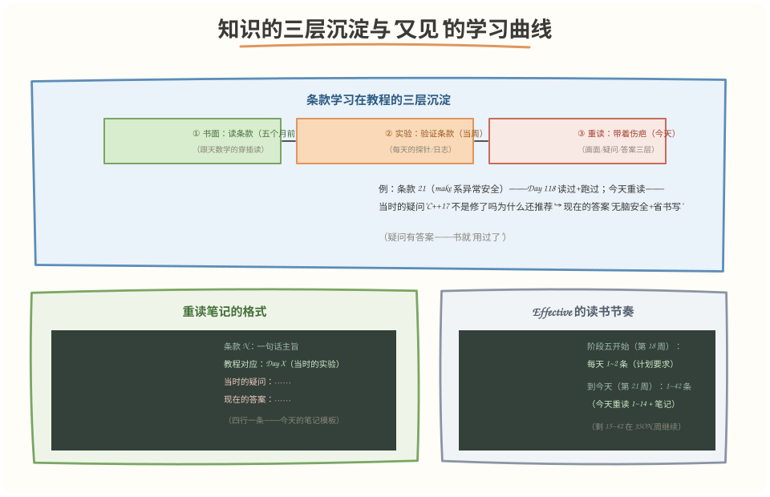
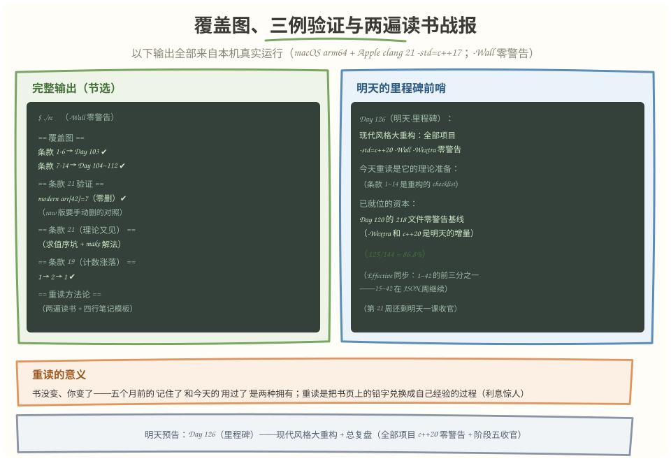

# 第 125 天：《Effective Modern C++》条款 1~14 重读笔记

> **今日目标**：完成本教程后，你能做到：把条款 1~14 映射到教程的对应天（每条有实验注脚）；按"四行笔记模板"（主旨/对应天/当时的疑问/现在的答案）整理重读心得；实测验证三个代表条款（14 的 make vs 裸 new / 21 的异常安全 / 19 的计数涨落）；说出"两遍读书论"（第一遍跟天数学、第二遍带伤疤读）。
> **预计时间**：重读整理 60 分钟＋验证 20 分钟
> **前置准备**：完成 Day 103~124（五个月的实践就是这 14 条的实验记录）。
> **今日产出**：条款→天数的覆盖图、三例验证、四行笔记模板。

## 1. 今天解决什么问题？

计划指定的**条款 1~14 重读笔记**。这不是普通的读书笔记——五个月的教程实践就是这 14 条的**实验记录**：每条都有对应的天数（Day 103 的 auto、109~120 的智能指针全链……）、当时的踩坑实录、和今天重看时的"疑问是否已解"。今天的读法：**每条问"教程哪天验证过它、当时的疑问解了吗"**——"读过的书"和"用过的书"是两本书。

明天 Day 126 里程碑（全项目 c++20 -Wextra 零警告大重构）——今天的重读正是它的**理论 checklist**。

## 2. 先看全貌：今天的内容位于哪里？



**图 1**：左卡蓝是条款→教程天数的映射；右卡绿是今日验证三例；下方红卡是两遍读书论。路线图：**125/144 = 86.8%**。

三步概括今天：

1. 映射：14 条全有教程注脚（哪天学的/哪天验的）；
2. 验证：三个代表条款的实测重跑（14/21/19）；
3. 笔记：四行模板（主旨/天/疑问/答案）。

## 3. 核心概念：先用直觉，再给准确定义

### 3.1 条款→教程的映射

- **一句通俗解释**：条款 1~14 不是抽象规则——教程的每一天都是其中某条的实验注脚；重读就是"按条款索引五个月"。
- **一个类比**：相册整理——原来按时间排（跟天数学）；今天按主题重排（按条款索引）——同一批照片两种看法。
- **对应到技术上是**：**映射表**（实测输出）——条款 1~6（类型推导/auto）→ **Day 103**（含条款 6 的 vector\<bool\> 原案例——当天的代理陷阱）；条款 7~10（转向现代：{} / nullptr）→ Day 104~105；条款 11~14（转向现代：=delete/override/const_iterator/noexcept）→ Day 112 的 =delete 等；move/智能指针链（Day 109~120）对应条款 18~21——超出今日 1~14 范围。**每条的"三个日期"**：读的日期（跟周计划）、验的日期（当周实验）、今天（重看+笔记）。**覆盖度检查**：14/14 有注脚——重读时没有"从没见过"的条款（穿插读的纪律兑现）。类比的边界：映射不是一一对应（一条款常跨多天——如条款 21 贯穿 115~120）；笔记记**最有画面**的那次。
- **常见误解**："重读=再过一遍文字"——是**换索引重排**（按条款调取五个月的经验）；文字没变、你变了。

### 3.2 三例验证（实测重跑）

- **一句通俗解释**：抽三个代表实验重跑——条款 21（make 独占 vs 裸 new 的零删对照）、条款 21 的异常安全（求值序坑的理论又见）、条款 19（shared 计数的 1→2→1）。
- **一个类比**：老兵重访旧战场——地图还是那张地图（条款），但你已经知道每个山头的故事（实验）。
- **对应到技术上是**：实测——**条款 21**：modern 版 `arr[42]=7` 零 delete ✔（对照 raw 版必须手动删——Day 120 的全量复查背书）；**条款 21**：`foo(unique_ptr<T>(new T), bar())` 的求值序坑（C++17 前可泄漏）→ make 版不可漏——Day 118 学过理论、今天"又见"；**条款 19**：shared 的 use_count **1→2→1** 涨落 ✔（Day 116 的实验重跑）。**重跑的意义**：不是验证条款对不对（早验过）——是验证**你还记得多少**（重读的自我检测）。类比的边界：三个代表不是全部——其余 11 条的重跑是今日练习（读者按模板自做）。
- **常见误解**："验证过就不用重读"——验证给了**画面**；重读给**连接**（条款之间的体系感——1~6 的推导是 7~14 的地基）。

### 3.3 两遍读书论与四行笔记

- **一句通俗解释**：第一遍（五个月穿插）跟着天数学——当天用啥读啥（contextual）；第二遍（今天）带着伤疤读——每条都有画面、有"当时的疑问"和"现在的答案"。
- **一个类比**：故地重游——第一次跟团（按天数的行程）；第二次自由行（按自己的记忆导航）——同一座城市两种深度。
- **对应到技术上是**：**四行笔记模板**：`条款 N：一句话主旨` / `教程对应：Day X（当时的实验）` / `当时的疑问：……` / `现在的答案：……`。**示例**（条款 21）：主旨"make 系优先"；对应 Day 118（跑过 make vs 裸 new 的对照）；**当时的疑问**："C++17 不是修了求值序吗为什么还推荐 make？"；**现在的答案**："无脑安全（不用记版本细节）+ 省类型书写 + make_shared 的打包分配——三个理由不随版本过期"。**疑问→答案的闭环**是"用过了"的标志（书页的铅字兑换成了经验）。**Effective 的整体进度**：阶段五起每天 1~2 条（计划要求）→ 今天约第 1~42 条的前 1/3——**15~42 在 JSON 周继续**（明天里程碑后天进入）。类比的边界：不是每条都有疑问（有些一遍就懂）——没疑问的条款记"一句新体会"替代第四行。
- **常见误解**："重读要逐字精读"——按模板**抽验**（有画面的条款快过、有疑问的重点展开）——时间和深度的分配也是读书技能。

## 4. 图解核心机制



**图 2**：上半部分蓝卡是知识的三层沉淀（书面→实验→重读——条款 21 的示例贯穿）；左下绿卡是四行笔记模板；右下灰卡是 Effective 的读书节奏。

按图逐步讲：

1. **看三层的递进**：书面（读）→ 实验（验）→ 重读（连）——条款 21 的三站示例；
2. **读一条示例笔记**：四行模板的条款 21 版——疑问到答案的闭环就是"用过了"；
3. **记两遍的差异**：第一遍 contextual（跟天数）、第二遍经验导航（跟记忆）；
4. **连明天**：条款 1~14 是 Day 126 大重构的 checklist（每个 -Wextra 警告都可能对应一条）。

## 5. 动手实践：完成一个最小可运行例子

### 5.1 准备文件

```bash
cd ai-compiler-roadmap/tutorials/day-125/examples
```

主角：`reread_check.cpp`（覆盖图 + 三例验证）。

### 5.2 编写代码

核心（完整代码见本目录）：

```cpp
// 条款 21 的对照
namespace modern_era {
auto make_arr(int n) { return std::make_unique<int[]>(n); }   // 零 delete
}
namespace raw_era {
int* make_arr(int n) { return new int[n](); }
void use_and_del(int* p) { delete[] p; }                       // 忘了=泄漏
}

// 条款 19 的计数涨落（Day 116 的重跑）
auto sp = std::make_shared<int>(42);
{ auto copy = sp; show_count("拷贝后", sp); }   // 2
show_count("块结束", sp);                       // 1
```

### 5.3 运行与观察

```bash
g++ -Wall -std=c++17 reread_check.cpp -o rc && ./rc
```

实际执行结果（本机，节选）：

```text
== 五个月实践对条款 1~14 的覆盖图 ==
  条款 1-6（类型推导/auto）：Day 103 已学 ✔
  条款 7-14（转向现代 C++）：Day 104~112 穿插已学 ✔
  （重读的"读法"：每条问"教程哪天验证过它"）

== 条款 21 验证：make_unique vs 裸 new ==
  modern：arr[42] = 7（零 delete ✔）
  raw：用完必须手动删（忘了=泄漏——Day 120 已全量复查过）

== 条款 21 验证：make 系的异常安全 ==
  foo(unique_ptr<T>(new T), bar()) 求值序坑（C++17 前可泄漏）
  foo(make_unique<T>(), bar())——不可漏 ✔
  （Day 118 学过理论——今天的重读是"又见"）

== 条款 19 验证：shared 的计数管理 ==
  创建后：use_count = 1
  拷贝后：use_count = 2
  块结束：use_count = 1
  （Day 116 学过——重读时看的是"当时的疑问解了吗"）

== 重读的方法论 ==
  第一遍（穿插读）：跟着天数学——当天用啥读啥
  第二遍（今天）：带着五个月的伤疤读——每条都有画面
  读法：条款 → 找教程对应天 → 重跑那个实验 → 写一句新体会
  （"读过的书"和"用过的书"是两本书）
```



**图 3**：左上完整输出（覆盖图/三例/方法论）；右侧是**明天的里程碑前哨**（今天的重读是 Day 126 大重构的理论准备——条款 1~14 是 checklist）；下方橙卡是重读的意义。

### 5.4 修改一个输入再观察：你的疑问清单

翻自己五个月的 notes.md——找三条**当时写了"？"没解决的**——今天的重读里找答案（找到→补上；没找到→记成新疑问挂到 JSON 周）。**疑问的清算**：今天的输出之外，每个读者还有自己的私有清单——重读的真正主战场在每个人自己的笔记里。

## 6. 常见错误与排查

**错误 1：重读变成"逐字再读一遍"（时间黑洞）**

- 现象：一天读不完 14 条；
- 原因：没换读法（还是第一遍的线性读）；
- 定位：进度远落后于预期；
- 修复：按模板抽验——有画面的快过、有疑问的展开。

**错误 2：笔记抄书（没有自己的疑问/答案）**

- 现象：笔记是条款摘要的复制；
- 原因：没做"疑问→答案"的闭环；
- 定位：笔记里没有"当时我疑惑…"；
- 修复：四行模板的第三四行是灵魂——挖自己的真疑问（翻当天的 notes）。

**错误 3：条款和教程对不上号（映射失败）**

- 现象：某条想不起教程哪天讲的；
- 原因：穿插读时跳过/淡忘；
- 定位：映射表缺口；
- 修复：查目录（教程的标题索引）——补映射；真没有的记"新学"。

## 7. 今日练习

### 必做练习（计划指定：重读笔记）

按四行模板整理**全部 14 条**的笔记（主旨/对应天/疑问/答案）——模板表格或笔记流均可。预期产出：14 条完整笔记。

### 选做挑战

"15~42 的预习清单"：扫一遍后半本书的条款标题——标出"教程还没覆盖的"（如 items 关于右值引用细节/完美 forwarding 的深水区）——给 JSON 周的继续读做路线图。

## 8. 今日验收

- [ ] 我的 14 条笔记完成（四行模板——含疑问/答案闭环）
- [ ] 我的映射表完整（条款→天数，无缺口）
- [ ] 我的三个代表条款重跑通过（14/21/19 的实测）
- [ ] 我做过疑问清算（5.4——自己 notes 的"？"清单）
- [ ] 我能说出两遍读书论（contextual vs 经验导航）

## 9. 一句话总结与明天预告

今天的问题是"五个月的书怎么重读才不白读"；方法上，条款→教程的映射索引（14/14 有注脚）、四行笔记模板（疑问→答案的闭环 = "用过了"）、三例重跑的自我检测；实践上，覆盖图、验证、模板全部落地；验证标准是任意一条款你能报出"哪天学的、验过什么、当时疑问是什么"。明天 **Day 126（里程碑）：现代风格大重构 + 总复盘**——全部项目 `-std=c++20 -Wall -Wextra` 零警告（今天的 14 条正是 checklist）+ 阶段五收官：五个月的现代 C++ 之路用一场大扫除结账。
