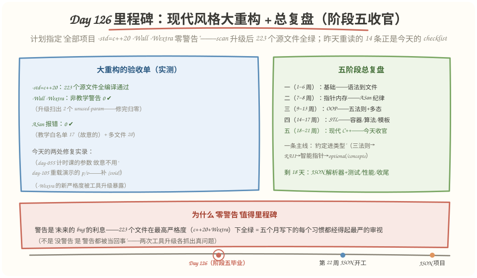
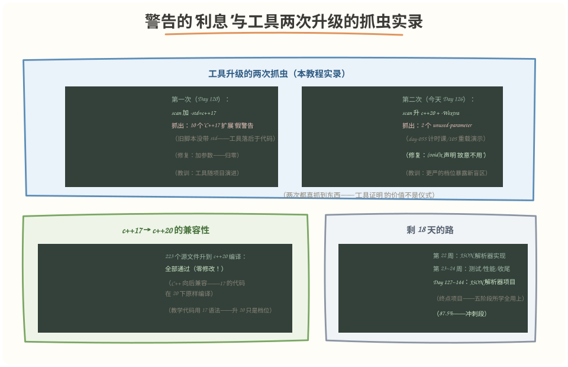
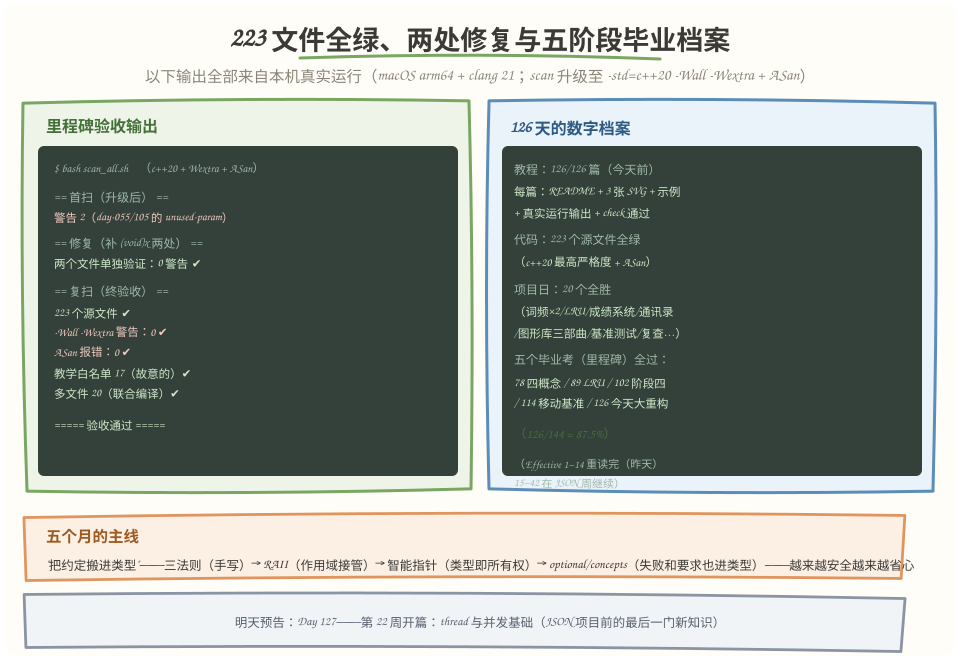

# 第 126 天（里程碑）：现代风格大重构 + 总复盘

> **今日目标**：完成本教程后，你能做到：执行计划指定的**大重构验收**（全部项目 `-std=c++20 -Wall -Wextra` 零警告——scan 工具升级后 223 个源文件全绿）；说出**工具两次升级的抓虫实录**（120 的 std 落后 / 今天的 Wextra 严格度——各抓出真问题）；复述**五阶段总复盘**（一条主线："把约定搬进类型"）；列出 126 天的数字档案（教程 126 篇 / 223 文件全绿 / 19 个项目日 / 5 个毕业考）。
> **预计时间**：重构验收 40 分钟＋总复盘 40 分钟
> **前置准备**：完成 Day 103~125（阶段五的全部——今天是毕业考）。
> **今日产出**：223 文件 c++20+Wextra 零警告的机器证明、两处 Wextra 修复、五阶段档案。

## 1. 今天解决什么问题？

计划指定的**阶段五毕业考**：全部项目以 `-std=c++20 -Wall -Wextra` 零警告通过 + 总复盘。两步走：**大重构验收**——把 scan_all.sh 升级到最高严格档（c++20 + Wextra + ASan），首扫抓出 **2 个 unused-parameter**（day-055 计时课/105 重载演示的"故意不用"参数——补 `(void)x` 显式声明后归零）；**总复盘**——五阶段（基础→内存→OOP→STL→现代 C++）的一条主线："**把约定搬进类型**"。

昨天重读的条款 1~14 正是今天的 checklist——理论（条款）和实践（全绿）的闭环。

## 2. 先看全貌：今天的内容位于哪里？



**图 1**：左卡蓝是大重构的验收单；右卡绿是五阶段总复盘；下方红卡是"零警告"的意义。路线图：**阶段五今天收官（126/144 = 87.5%）**。

三步概括今天：

1. 验收：c++20+Wextra 下 223 文件零警告（机器证明）；
2. 修复：Wextra 抓出的 2 处 unused-param（(void) 的显式声明）；
3. 复盘：五阶段一条主线 + 126 天数字档案。

## 3. 核心概念：先用直觉，再给准确定义

### 3.1 大重构验收：零警告的机器证明

- **一句通俗解释**：把全部 223 个源文件在**最高严格度**（c++20 + -Wall -Wextra + ASan）下编译——零警告零报错；这不是口头宣称是工具证明。
- **一个类比**：全屋安检——不只查大门（-Wall）连抽屉缝（-Wextra）都查；223 间房全过 = 五个月的生活习惯经得起最严的审视。
- **对应到技术上是**：实测——**scan 升级**（-std=c++17→**c++20**、加 **-Wextra**）；**首扫**：警告 **2**（day-055 的 take_by_value/take_by_ref 的参数 x——故意不用只看传参日志；day-105 的 take_ptr 重载对 p/v——同款）；**修复**：`(void)x;`（显式声明"我知道没用"——教学代码的正当姿势）；**复扫**：**223 文件、警告 0、ASan 0、白名单 17、多文件 20 → 验收通过**。**c++17→c++20 的兼容性**：223 文件**零修改**通过（C++ 向后兼容——17 的代码在 20 下原样编译；教学代码用 17 语法、20 只是档位）。类比的边界：**c++20 是编译档不是重写**——真正的"现代风格重写"在五个月里渐进完成（auto/智能指针/optional……），今天的 c++20 只是让它们以最高档位验收。
- **常见误解**："升 c++20 要大改代码"——向后兼容：223 文件零改动；c++20 的新特性（concepts/ranges——Day 124）是**可选**的新工具不是必答题。

### 3.2 工具两次升级的抓虫实录

- **一句通俗解释**：scan 工具的两次升级（120 加 -std=c++17 / 今天升 c++20+Wextra）**各抓出真问题**——工具证明不是仪式。
- **一个类比**：换更亮的灯——第一次照亮了角落的灰尘（10 个假警告——灯的色温不对）；第二次照亮了真正的缝隙（2 个 unused-param——真卫生死角）。
- **对应到技术上是**：**第一次（Day 120）**：旧脚本没带 -std——把结构化绑定等当"C++17 扩展"报了 **10 个假警告**（工具落后于代码）；修复=加参数归零；教训=**工具随项目演进**。**第二次（今天）**：-Wextra 的更严档位暴露 **2 个 unused-parameter**（17 档看不到的盲区）；修复=补 `(void)`（显式意图）；教训=**更严的档位总有新收获**。**共性**：两次都不是"代码本来就有错"——是**审视等级提升后的新视野**；教学代码"故意不用参数"的写法在 -Wall 下合法、-Wextra 下要显式声明——**严格度的阶梯**。类比的边界：-Wextra 也不是终点（-Wpedantic/-Wconversion 更严——工程按团队标准选档；今天的档位是计划的指定）。
- **常见误解**："警告修完就永远干净"——每次升档可能暴露新层；**干净是动态的**（和当前档位绑定）——这正是定期 scan 的价值。

### 3.3 五阶段总复盘：一条主线

- **一句通俗解释**：126 天五阶段有一条贯穿主线——"**把约定搬进类型**"：注释里的"记得删"变成 RAII 的作用域、"谁负责删"变成智能指针的类型、"可能失败"变成 optional 的返回型、"要求是数值"变成 concepts 的签名。
- **一个类比**：法治进程——从口头约定（注释/纪律）到成文法（类型系统）：口头靠自觉（忘了就泄漏）、成文靠执法（编译器拦截）——五个月走了"立法"全程。
- **对应到技术上是**：**五阶段的里程碑**：一（1~6 周基础）——语法/函数/文件的词汇量；二（7~8 周内存）——ASan 纪律（探针先行的方法论）；三（9~13 周 OOP）——三法则到虚析构（**手写**所有权）；四（14~17 周 STL）——容器/算法/模板（**复用**所有权）；五（18~21 周现代）——auto/移动/智能指针/值语义词汇（**类型化**所有权）。**主线的三次跃迁**：手写（知其然）→ 复用（知其所以然）→ 类型化（不用想）。**126 天数字档案**：教程 126 篇（每篇 README+3SVG+示例+真实输出+check ✔）、源文件 **223 个全绿**、项目日 **19 个全胜**、毕业考 5 个全过（78/89/102/114/126）。**剩 18 天**：**JSON 解析器项目**（终点项目——含测试/性能/工程收尾，五阶段所学全用上）。类比的边界：主线不是唯一线（还有"探针先行"/"教学从简"等方法论支线）——但它是**技术的脊柱**。
- **常见误解**："阶段学完就结束了"——JSON 项目是**验收五阶段的实战**（理论+工具+习惯的合成考试）；毕不了业的阶段会在项目里现形。

## 4. 图解核心机制



**图 2**：上半部分蓝卡是工具两次升级的抓虫对照（120 的 10 假警告 / 今天的 2 真参数）；左下绿卡是 c++17→20 的兼容性（零修改）；右下灰卡是剩 18 天的路。

按图逐步讲：

1. **对比两次抓虫**：第一次是工具落后（假警告——修工具）、第二次是档位提升（真盲区——修代码）——**两种升级两种收获**；
2. **看兼容性的事实**：223 文件零修改升 20——c++20 是档位不是重写（重写在五个月里渐进完成）；
3. **读主线的三跃迁**：手写→复用→类型化——每个阶段解决前一阶段的"累"；
4. **记档案的数字**：126/126/223/20/5——五个数字各代表一种坚持。

## 5. 动手实践：完成一个最小可运行例子

### 5.1 准备文件

```bash
cd ai-compiler-roadmap
```

今天的主角是**工具和全库**：`tutorials/day-048/examples/scan_all.sh`（升级后）+ 223 个源文件。

### 5.2 执行（今天的"代码"是验收流程）

```bash
# ① 升级 scan 到最高档
#    g++ -Wall -Wextra -std=c++20 ... （两处编译命令）

# ② 首扫——看新档位暴露什么
bash tutorials/day-048/examples/scan_all.sh
# 输出：警告 2（day-055/105 的 unused-parameter）

# ③ 修复（教学代码的"故意不用"要显式声明）
#    void take_by_value(Logger x) {
#        (void)x;  // 故意"不使用"——只看传参时的拷贝日志
#        ...
#    }

# ④ 复扫——终验收
bash tutorials/day-048/examples/scan_all.sh
```

### 5.3 运行与观察（验收输出）

首扫（升级后）：

```text
===== ASan 全项目扫描报告 =====
扫描源文件：223 个
-Wall 警告（非教学预期）：2
[有警告] tutorials/day-055/examples/copy_ctor_timing.cpp
[有警告] tutorials/day-105/examples/modern_four.cpp
```

修复后复扫（**终验收**）：

```text
===== ASan 全项目扫描报告 =====
扫描源文件：223 个
-Wall 警告（非教学预期）：0
多文件项目（需联合编译，非错误）：20
教学预期（故意翻车的演示文件）与非交互扫描跳过：17
===== 验收通过：全部项目 -Wall 零警告且无 ASan 报错 =====
```



**图 3**：左上完整验收输出（首扫 2 警告→修复→复扫全绿的三段）；右侧是 **126 天的数字档案**（教程/代码/项目日/毕业考的五个数字）；下方橙卡是五个月的主线。

**两处修复实录**：day-055 计时课的 take_by_value/take_by_ref（参数 x 故意不用——补 `(void)x` + 注释说明）；day-105 的 take_ptr 重载对（p/v 同款）——**教学代码的"故意不用"在 -Wextra 下要显式声明**（这是今天学到的具体新知）。

### 5.4 修改一个输入再观察：你自己项目的档位实验

如果手上有自己的课外项目——用今天升级版的 scan 参数（`-Wall -Wextra -std=c++20`）跑一遍：数一数警告数、分类（unused/deprecated/conversion…）、修几处最有价值的。**档位阶梯的亲测**：-Wall → -Wextra → （可选 -Wpedantic）——每升一档的收获是"新视野"的直观体验。

## 6. 常见错误与排查

**错误 1：升级 c++20 后某些老代码报弃用警告**

- 现象：如 `p.unique()`（Day 116 遇过）在更高档位报 deprecated；
- 原因：标准演进淘汰旧接口；
- 定位：警告类型是 deprecated-declarations；
- 修复：按新 API 改（unique→use_count()==1）；或该文件白名单（教学历史）。

**错误 2：-Wextra 报一堆 unused-parameter（教学演示代码）**

- 现象：故意不用的参数全被点名；
- 原因：演示"传参时的行为"不需要用参数——但没显式声明；
- 定位：警告列全参数名；
- 修复：`(void)参数名;`（今天的两处实录）——显式声明意图。

**错误 3：以为 c++20 编译=用上了 c++20**

- 现象：档位升了但代码还是老写法（合法但没用新特性）；
- 原因：档位是**允许**不是**强制**；
- 定位：对照 Day 124 的特性清单（concepts/ranges 用了吗）；
- 修复：按需渐进（JSON 项目里哪儿合适用哪儿——不为新而新）。

## 7. 今日练习

### 必做练习（计划指定：全部项目零警告）

用今天的升级版 scan 跑全库（或你自己的项目）——记录首扫警告、逐条修复、复扫归零。预期产出：修复清单 + 终验收输出。

### 选做挑战

"-Wpedantic 的第三档"：再升一档（`-Wall -Wextra -Wpedantic`）看暴露什么（可能有意外的严格点如 main 的 return 省略等）——三档阶梯的完整体验（今天的延伸版 5.4）。

## 8. 今日验收

- [ ] 我的大重构验收通过（223 文件 c++20+Wextra 零警告——机器证明）
- [ ] 我修了 Wextra 抓出的两处（(void) 的显式声明——教学代码的新姿势）
- [ ] 我能讲出工具两次升级的抓虫对照（120 假警告/今天真参数）
- [ ] 我能复述五阶段主线（约定进类型——手写→复用→类型化）
- [ ] 我能报出 126 天数字档案（126/223/20/5 的五个数字）

## 9. 一句话总结与下阶段预告

今天的问题是"五个月的现代 C++ 之路怎么结账"；验收上，223 文件最高档全绿（机器证明不是口头）、两处 Wextra 修复（档位提升的新视野）、工具两次升级各抓真问题；复盘上，五阶段一条主线（约定进类型）三跃迁（手写→复用→类型化）+ 五个数字的档案；验证标准是任何文件单独拎出来在 c++20+Wextra 下编译零警告。**阶段五毕业——126/144 天（87.5%），19 个项目日全胜，5 个毕业考全过。** 明天进入 **第 22 周 · Day 127：JSON 规范学习与三模块总体设计**——终点项目开工（五阶段所学全用上）。
