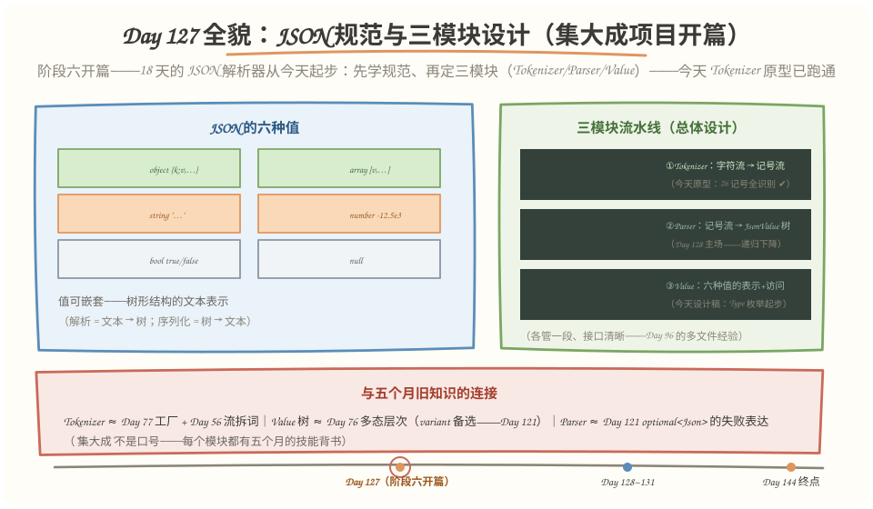
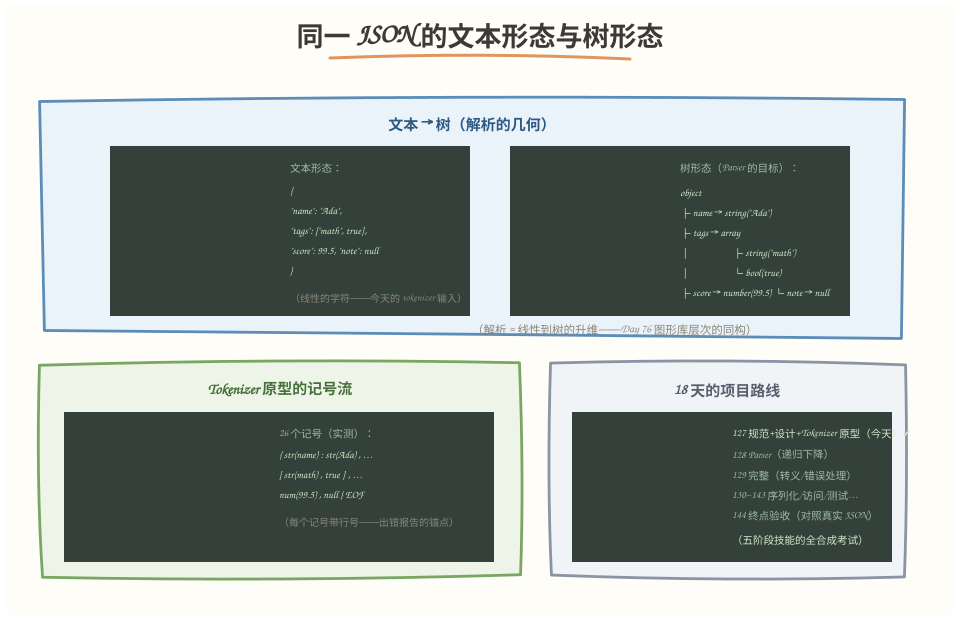
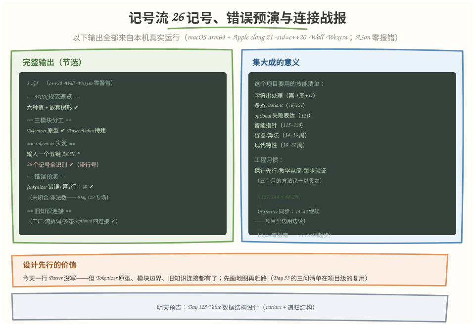

# 第 127 天：JSON 规范学习与三模块总体设计

> **今日目标**：完成本教程后，你能做到：说出 JSON 的**六种值**（object/array/string/number/bool/null——值可嵌套成树）；定下**三模块流水线**的边界（Tokenizer 字符流→记号流 / Parser 记号流→树 / Value 表示+访问）；跑通 **Tokenizer 原型**（26 记号全识别 + 行号 + 错误预演）；列出与五个月旧知识的四条连接（工厂/流拆词/多态/optional）。
> **预计时间**：规范学习 30 分钟＋设计+原型 40 分钟
> **前置准备**：阶段五毕业（Day 126）——集大成项目今天开篇。
> **今日产出**：Tokenizer 原型（26 记号 + '@' 拒绝）、JsonValue 设计稿、18 天路线图。

## 1. 今天解决什么问题？

阶段六（**JSON 解析器**——18 天的集大成项目）开篇。今天三件事：**学 JSON 规范**（六种值 + 嵌套树形——解析的"目的地"长什么样）；**定总体设计**（Tokenizer / Parser / Value 三模块——各管一段、接口清晰——Day 96 多文件经验的项目级复用）；**跑通 Tokenizer 原型**（第一段流水线的最小实现——26 记号全识别）。

**设计先行的价值**：今天一行 Parser 不写——但模块边界、旧知识连接、18 天路线都有了（先画地图再赶路）。

## 2. 先看全貌：今天的内容位于哪里？



**图 1**：左卡蓝是 JSON 的六种值；右卡绿是三模块流水线；下方红卡是旧知识连接。路线图：**阶段六开篇（127/144 = 88.2%）**。

三步概括今天：

1. 规范：六种值可嵌套——文本是树的线性表示；
2. 设计：三模块流水线（Tokenizer 今天 ✔ / Value 明天 / Parser Day 132）；
3. 原型：26 记号 + 行号 + 错误拒绝。

## 3. 核心概念：先用直觉，再给准确定义

### 3.1 JSON 规范：六种值的嵌套树

- **一句通俗解释**：JSON 只有六种值（object/array/string/number/bool/null）——但值可以**嵌套**（数组里放对象、对象值是数组……）——所以它能表达树形结构。
- **一个类比**：乐高六种基础块——块数不限、嵌着搭——能拼出任意结构；JSON 的六值同理（简单类型+组合规则=复杂表达）。
- **对应到技术上是**：**六种值**：`{"k":v,…}`（object——键值对集）、`[v,…]`（array——有序列表）、`"…"`（string——双引号+转义）、数字（`-12.5e3`——整数/浮点/科学计数）、`true/false`、`null`。**树形本质**（图 2）：`{"name":"Ada","tags":["math",true],"score":99.5}` 的文本是线性的——但它**表示**一棵树（object 有三个子、tags 下还有 array 两子）——**解析 = 线性到树的升维**（序列化反之）。**规范细节**（完整版的坑）：字符串转义（`\"`/`\\`/`\n`/`\uXXXX`）、数字的完整文法（负号/小数/指数）、空白容忍（哪里可有哪里不可有）——Day 129 的错误处理专场展开。类比的边界：JSON 规范很小（RFC 8259 才 ~20 页）——**小规范大生态**（web 配置/API 的通用语）。
- **常见误解**："JSON 就是字符串"——字符串只是六值之一；JSON 是**树形数据**的文本表示——解析后是结构（今天的 Value 模块）。

### 3.2 三模块流水线：总体设计

- **一句通俗解释**：`文本 → [Tokenizer] → 记号流 → [Parser] → 值树 → [Value] → 访问/序列化`——三段流水线各管一段。
- **一个类比**：报纸印刷——排字（Tokenizer：字符→单词）、组版（Parser：单词→版面结构）、阅读（Value：版面的访问接口）。
- **对应到技术上是**：**Tokenizer**（今天原型）：吃字符串、吐记号流——`{`/`}`/`string("Ada")`/`number(99.5)`/`true`…每个记号带**行号**（出错报告的锚点——Day 48 的老习惯）。**Parser**（Day 132 主场）：吃记号流、吐 JsonValue 树——**递归下降**（见 `{` 就解析对象、见 `[` 就解析数组——嵌套的自然解法）。**Value**（今天设计稿）：六种值的表示——`Type` 枚举起步；两条实现路线：**继承多态**（Day 76 图形库同构——JsonValue 基类+六派生）或 **variant**（Day 121——封闭六选一的完美场景）；项目里按需选。**三模块的价值**：接口清晰（各测各的）、错误定位分层（词法错/语法错/语义错）、复用（Tokenizer 单独可用于语法高亮等）。类比的边界：小项目可以一锅端——但 18 天的项目**分层是纪律**（每步可验证）。
- **常见误解**："直接字符串查找就行"（find("\"name\"")）——脆弱（嵌套/转义/空白都会骗过它）；正规解析是唯一稳路——今天开始的就是它。

### 3.3 Tokenizer 原型与旧知识连接

- **一句通俗解释**：今天的原型 60 行——跳空白、认 6 种单字符记号、读字符串/数字/字面量——`{"name":"Ada",…}` 变 26 个带行号的记号。
- **一个类比**：超市扫码——每个商品（记号）扫出类型和条码（text）——收银（Parser）只管扫过的流水。
- **对应到技术上是**：实测——**26 记号全识别**（`{` `string("name")` `:` `string("Ada")` `,` … `[` `string("math")` `,` `true` `]` … `null` `}` `EOF`——行号全程第 1 行）；**错误预演**：`{"k": @}` → `[tokenizer 错误] 第 1 行：意外字符 '@'`（拒绝 ✔）；**未完成的诚实清单**：转义（`\"` 等今天暂缺）、未闭合字符串、数字完整文法——Day 129 专场。**旧知识四连接**：①Tokenizer ≈ **Day 77 工厂**（一行一对象的分派思路）+ **Day 17 istringstream**（拆词）；②Value 树 ≈ **Day 76 多态层次**（图形库同构；variant 备选——Day 121）；③Parser 的失败表达 ≈ **Day 121 optional\<Json\>**；④整个流程 ≈ **Day 84 词频统计**（读→处理→输出的三段）。**集大成不是口号**——每个模块都有五个月的技能背书。类比的边界：原型有意从简（教学从简原则）——完整版（转义/数字文法/错误恢复）是 Day 129 的增量。
- **常见误解**："原型太简没有用"——原型的价值是**验证设计**（模块边界对不对、接口顺不顺）——今天跑通就是设计成立的证据。

## 4. 图解核心机制



**图 2**：上半部分蓝卡是同一 JSON 的文本形态（左）与树形态（右）——解析的几何；左下绿卡是记号流的实测；右下灰卡是 18 天的项目路线。

按图逐步讲：

1. **对照文本和树**：线性字符 vs 嵌套结构——解析就是**升维**（明天的 Parser 做这件事）；
2. **数记号流**：26 个记号 = 今天的输出——Tokenizer 把"词"分好了；
3. **读 18 天路线**：今天 127 → 128 Value → 129 完整版 → 132 Parser → … → 144 终点验收——每天一小步；
4. **连四条旧知识**：工厂/流拆词/多态/optional——每条连接都是"已验证的技能"。

## 5. 动手实践：完成一个最小可运行例子

### 5.1 准备文件

```bash
cd ai-compiler-roadmap/tutorials/day-127/examples
```

主角：`json_design.cpp`（JsonValue 设计稿 + Tokenizer 原型）。

### 5.2 编写代码

核心（完整代码见本目录）：

```cpp
enum class Tok { LeftBrace, RightBrace, LeftBracket, RightBracket,
                 Colon, Comma, String, Number, True, False, Null, End };

struct Token { Tok type; std::string text; int line; };   // 行号 = 错误锚点

std::vector<Token> tokenize(const std::string& src) {
    std::vector<Token> out;  std::size_t i = 0;  int line = 1;
    while (i < src.size()) {
        char c = src[i];
        if (c == '\n') { ++line; ++i; continue; }
        if (c == ' ' || c == '\t' || c == '\r') { ++i; continue; }
        switch (c) {
            case '{': out.push_back({Tok::LeftBrace, "", line}); ++i; break;
            // … } [ ] : , 同款
            case '"': { /* 读到闭引号 → String 记号（text 存内容） */ }
            default:  { /* 数字/true/false/null 或报"意外字符" */ }
        }
    }
    out.push_back({Tok::End, "", line});
    return out;
}

// JsonValue 设计稿：Type 枚举（六种）——Day 128 起长出血肉
```

### 5.3 运行与观察

```bash
g++ -Wall -Wextra -std=c++20 json_design.cpp -o jd && ./jd
```

实际执行结果（本机，节选）：

```text
== JSON 规范速览（六种值） ==
  对象 {"k":v,…}｜数组 [v,…]｜字符串 "…"
  数字（-12.5e3）｜布尔 true/false｜null
  （值可嵌套——树形结构的文本表示）

== 三模块的分工（总体设计） ==
  Tokenizer：字符流 → 记号流（今天原型 ✔）
  Parser：记号流 → JsonValue 树（Day 132 主场）
  Value：六种值的表示 + 访问/序列化
  （三层流水线——各管一段，接口清晰）

== Tokenizer 原型实测 ==
  输入：{"name": "Ada", "age": 36, "tags": ["math", true], "score": 99.5, "note": null}
  输出记号流（26 个）：
    {  [第1行]
    string("name")  [第1行]
    :  [第1行]
    string("Ada")  [第1行]
    …
    [  [第1行]
    string("math")  [第1行]
    ,  [第1行]
    true  [第1行]
    ]  [第1行]
    …
    null  [第1行]
    }  [第1行]
  EOF

== 出错报告的预演 ==
  [tokenizer 错误] 第 1 行：意外字符 '@'
  （'@' 被拒——第 1 行意外字符 ✔）

== 与旧知识的连接 ==
  Tokenizer ≈ Day 77 工厂（一行一对象）+ Day 17 istringstream
  Value 树 ≈ Day 76 图形库的多态层次（variant 也行——Day 121）
  Parser ≈ Day 121 的 optional<Json>（失败表达）
```



**图 3**：左上完整输出（规范/分工/实测/错误/连接五段）；右侧是**集大成的技能清单**（六周技能+方法论——每项有天数背书）；下方橙卡是设计先行的价值。

### 5.4 修改一个输入再观察：换你自己的 JSON

把 demo 换成自己写的一个 JSON（比如模拟自己的配置文件：嵌套对象+数组+多层）——重跑看记号流；再故意打错一处（少引号/非法字符）看行号报错。**输入的多元化**：Tokenizer 对任意合法 JSON 都该吐正确记号流——你的配置文件是最好的测试用例。

## 6. 常见错误与排查

**错误 1：字符串记号吞掉了后面的内容（未处理转义）**

- 现象：含 `\"` 的字符串解析错乱；
- 原因：原型没处理转义（今天暂缺）；
- 定位：记号流的 string 内容异常；
- 修复：Day 129 补（读字符串时遇 `\\` 看下一字符）。

**错误 2：数字记号把 `1,2` 当一个数（逗号没断开）**

- 现象：数组 `[1,2]` 的记号数不对；
- 原因：数字扫描的字符集判断要排除 `,`（今天的 default 分支正确处理了——digit/./-/+/e/E 才续）；
- 定位：记号流对照；
- 修复：核对数字续读的字符集。

**错误 3：忘了 EOF 记号（Parser 边界）**

- 现象：Parser 循环不知道何时停；
- 原因：记号流没有哨兵；
- 定位：明天写 Parser 时发现；
- 修复：今天的 `push(Tok::End)`（Day 80 半开区间的同款思想）。

## 7. 今日练习

### 必做练习（计划指定：规范+设计）

手写一个**规范笔记**：六种值各配一例 + 嵌套规则一句话 + 转义字符表（查 RFC 或教程）；再画**自己版的模块图**（三模块+接口箭头——和今天的对照）。预期产出：一页规范笔记 + 一张模块图。

### 选做挑战

"Tokenizer 扩展"：给原型加**字符串转义**（`\"` → `"`、`\\` → `\`、`\n` → 换行——读字符串时处理）+ **未闭合检测**（到 EOF 还没闭引号 → 报行号错误）——提前完成 Day 129 的一部分。

## 8. 今日验收

- [ ] 我能默写六种值（各配一例）并说出"嵌套成树"的本质
- [ ] 我的三模块边界清楚（谁吃什么吐什么——接口一句话）
- [ ] 我的 Tokenizer 原型跑通（26 记号 + 行号 + '@' 拒绝）
- [ ] 我列得出四条旧知识连接（工厂/流拆词/多态/optional）
- [ ] 我知道 18 天路线（127 设计 → 128 Value → 132 Parser → … → 144 终点）

## 9. 一句话总结与明天预告

今天的问题是"18 天的项目从哪里起步"；设计上，三模块流水线（Tokenizer/Parser/Value——各管一段接口清晰）、六种值的规范（嵌套成树——解析 = 线性到树的升维）；实践上，Tokenizer 原型 26 记号、错误预演、旧知识四连接全部落地；验证标准是给任意小 JSON 能手推它的记号流和树形。明天 **Day 128：Value 数据结构设计**（std::variant + 递归结构）：六种值从今天的设计稿长出血肉——variant 封闭六选一、递归结构撑起嵌套树（Parser 的递归下降留到 Day 132 主场）。
