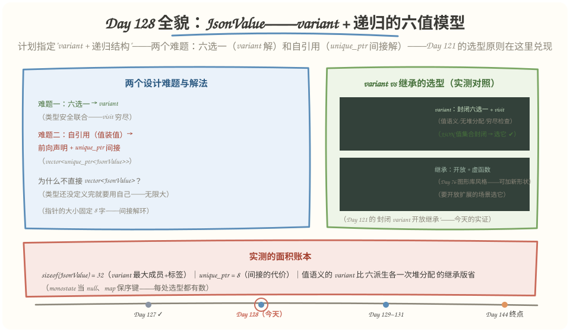
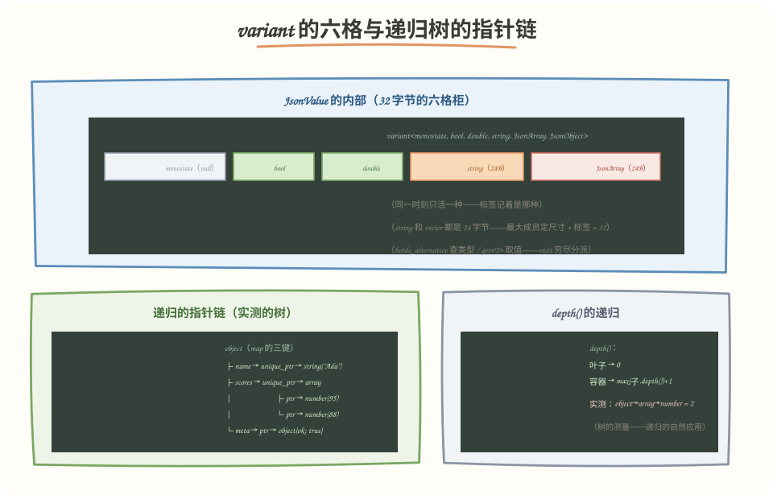
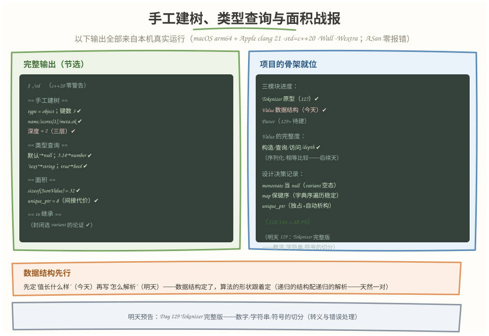

# 第 128 天：Value 数据结构设计——std::variant + 递归结构

> **今日目标**：完成本教程后，你能做到：写出 JsonValue 的 **variant 六选一**（monostate/bool/double/string/JsonArray/JsonObject）；解释**自引用的解法**（前向声明 + unique_ptr 间接——为什么不能直接 vector\<JsonValue\>）；手工建一棵三层嵌套树并访问（depth 的递归测量）；说出 **variant vs 继承的选型论证**（JSON 值集合封闭 → variant——Day 121 原则的实证）；报出面积账本（32/8 字节）。
> **预计时间**：学习 20 分钟＋实践 45 分钟
> **前置准备**：完成 Day 127（三模块设计——今天是 Value 模块的血肉）。
> **今日产出**：JsonValue 完整设计（构造/查询/访问/depth）、手工建树实测、选型论证。

## 1. 今天解决什么问题？

JSON 解析器的**心脏**：JsonValue 的数据结构。两个设计难题：**六选一**（null/bool/number/string/array/object——variant 的完美场景）和**自引用**（数组的元素、对象的值又是 JsonValue——类型还没定义完就要用自己）。解法组合：**前向声明 + unique_ptr 间接**（`vector<unique_ptr<JsonValue>>`——指针大小固定 8 字，间接解环）。

**variant vs 继承**的选型论证也在今天落地：JSON 的值集合**封闭**（规范定死六种）→ variant（Day 121 原则的实战兑现）。数据结构定了，明天起 Parser 的形状跟着定（递归结构配递归解析）。

## 2. 先看全貌：今天的内容位于哪里？



**图 1**：左卡蓝是两个设计难题与解法；右卡绿是 variant vs 继承的选型；下方红卡是面积账本。路线图：**128/144 = 88.9%**。

三步概括今天：

1. 六选一：variant（monostate 当 null）；
2. 自引用：前向声明 + unique_ptr（间接解环）；
3. 选型：封闭 → variant（继承是开放场景的工具）。

## 3. 核心概念：先用直觉，再给准确定义

### 3.1 自引用：间接解环

- **一句通俗解释**：数组的元素、对象的值又是 JsonValue——"类型还没定义完就要用自己"；直接嵌套（`vector<JsonValue>`）会让类型无限大——**指针的间接**（大小固定 8 字）解环。
- **一个类比**：俄罗斯套娃的说明书——"盒子里装一个'同款盒子'"——不能画一个包含自己的图（无限）；写"此处指向另一个同款"（指针）就画得下了。
- **对应到技术上是**：**前向声明**（`class JsonValue;`——先告诉编译器"有这个名字"）；**别名定义**（`using JsonArray = std::vector<std::unique_ptr<JsonValue>>;`——元素是**指针**不是值）；**类里用别名**（variant 的第五六格）。**为什么不能直接 vector\<JsonValue\>**：JsonValue 的大小取决于 vector 的大小、vector 的大小取决于元素（JsonValue）的大小——**循环依赖**编译器解不了；指针切断环（unique_ptr 的大小固定）。**间接的代价**：元素在堆上（访问多一跳）——换"能定义出来"（值得）。**Day 115 的连接**：unique_ptr 管独占所有权——树节点的父子关系正是独占（父拥有子）。类比的边界：共享节点（多处引用同一子树）才需要 shared——JSON 树是纯树（无共享）→ unique 够。
- **常见误解**："用指针是为了性能"——是**为了能定义**（环）；性能上间接反而是代价——但没得选（这就是递归数据的本质）。

### 3.2 variant 六选一：monostate 当 null

- **一句通俗解释**：六个类型装进 variant 的"六格柜"（同一时刻只活一种）；null 用 `std::monostate`（variant 的空态类型）当占位。
- **一个类比**：六格工具箱——一次只带一件工具（variant 的互斥）；"不带任何工具"也是一种状态（monostate——null）。
- **对应到技术上是**：实测——**类型查询**：`is_null()/is_bool()/…`（holds_alternative 的六个包装）；**访问器**：`as_number()/as_string()/as_bool()`（get\<T\> 的包装——错类型今天返默认值、完整版 Day 131 抛异常）；**容器访问**：`as_object()["name"]->as_string()`（map 的 [] + 解引用——链式下钻）。**monostate 的角色**：variant 至少要一个可默认构造的类型——monostate 是"空标记"（正好映射 JSON 的 null）；**默认构造 = null**（实测：默认构造的 JsonValue 的 type_name 是 "null"）。**面积账本**（实测）：sizeof(JsonValue) = **32**（最大成员 string/vector 的 24 + 标签）；unique_ptr = **8**（间接的代价）；**值语义的红利**：variant 版的叶子值（number/string）就在对象里（无堆分配）——继承版每值都要 new（六派生各一次堆分配）。类比的边界：variant 的访问要**类型对**（get 错了抛 bad_variant_access——Day 121 学过；今天的包装先温和返默认）。
- **常见误解**："variant 和 union 一样不安全"——variant **记着**当前是哪种（标签）+ 类型检查——是 union 的安全版（Day 121 的老结论在项目里坐实）。

### 3.3 选型论证与 depth 的递归

- **一句通俗解释**：JSON 值集合**封闭**（规范六种、不会加第七种）→ variant（穷尽检查保完整）；继承是**开放**扩展的工具（Day 76 图形库可加新形状）——用错场合各自难受。
- **一个类比**：国籍的六选一（封闭——variant：入境检查穷尽）vs 职业的自由发展（开放——继承：随时加新职业）。
- **对应到技术上是**：**选型三比**：①扩展性（JSON 封闭/图形开放）；②内存（variant 值语义省堆/继承每值一跳）；③检查（visit 穷尽编译期/虚函数运行期）——**两比一胜**给 variant（JSON 场景）。**depth() 的递归**（树的测量）：叶子 → 0；容器 → max(子的 depth)+1；实测手工树（object→array→number）= **2**（三层）。**递归结构配递归算法**：depth 是明天 Parser（递归下降）的预演——**结构上定义的递归天然召唤算法上的递归**。**map vs unordered_map**：选 map（键字典序——序列化输出稳定可测试；unordered 的桶序无保证——Day 116 的教训）。类比的边界：如果 JSON 要扩展（比如注释、日期类型）——继承版更从容；但规范封闭是事实——variant 是对题的。
- **常见误解**："继承更 OOP 所以更好"——OOP 不是目的；**封闭集合的 variant** 拿到编译期检查和值语义——选型看问题不看主义。

## 4. 图解核心机制



**图 2**：上半部分蓝卡是 variant 的六格柜（32 字节的内部布局——标签+最大成员）；左下绿卡是递归的指针链（手工树的实测形态）；右下灰卡是 depth() 的递归。

按图逐步讲：

1. **看六格柜**：同一时刻只活一种（标签记着）——string/vector 的 24 字节定尺寸；
2. **沿指针链走树**：object → name/scores/meta 三键 → scores 下 array → number 叶子——**每层一跳**（unique_ptr 的间接）；
3. **读 depth 的递归**：叶子 0、容器子 max+1——递归结构配递归算法的第一次合演；
4. **记选型的三比**：扩展/内存/检查——JSON 封闭 → variant 两胜。

## 5. 动手实践：完成一个最小可运行例子

### 5.1 准备文件

```bash
cd ai-compiler-roadmap/tutorials/day-128/examples
```

主角：`value_design.cpp`（JsonValue 完整设计 + 手工建树）。

### 5.2 编写代码

核心（完整代码见本目录）：

```cpp
class JsonValue;                                        // 前向声明（解环第一步）
using JsonArray  = std::vector<std::unique_ptr<JsonValue>>;   // 指针间接
using JsonObject = std::map<std::string, std::unique_ptr<JsonValue>>;

class JsonValue {
public:
    using Storage = std::variant<
        std::monostate, bool, double, std::string, JsonArray, JsonObject>;
    JsonValue() : data_(std::monostate{}) {}            // 默认 = null
    JsonValue(bool b) : data_(b) {}
    JsonValue(double n) : data_(n) {}
    // … string/Array/Object 同款

    bool is_number() const { return std::holds_alternative<double>(data_); }
    double as_number() const { return is_number() ? std::get<double>(data_) : 0.0; }

    int depth() const {                                 // 递归测量
        if (is_array())  { int d = 0; for (auto& e : as_array())  d = std::max(d, e->depth()); return d + 1; }
        if (is_object()) { int d = 0; for (auto& [k, v] : as_object()) d = std::max(d, v->depth()); return d + 1; }
        return 0;
    }
private:
    Storage data_;
};

// 手工建树（明天起由 Parser 自动）
auto num = [](double n) { return std::make_unique<JsonValue>(n); };
JsonObject root;
root["name"] = std::make_unique<JsonValue>(std::string("Ada"));
root["scores"] = std::make_unique<JsonValue>(std::move(scores));
root["meta"] = std::make_unique<JsonValue>(std::move(inner));
JsonValue doc(std::move(root));
```

### 5.3 运行与观察

```bash
g++ -Wall -Wextra -std=c++20 value_design.cpp -o vd && ./vd
```

实际执行结果（本机，节选）：

```text
== 设计的核心：递归 + variant ==
  难题：值可嵌套（数组装对象、对象装数组…）——类型要自引用
  解法：前向声明 + unique_ptr 间接（数组/对象的元素是指针）
  variant：六选一的类型安全联合（Day 121 的技能上场）

== 手工建树实测 ==
  doc.type_name() = object
  键数 = 3
  name = Ada
  scores[1] = 88
  meta.ok = 1
  深度 = 2（object→array→number 三层）

== 类型查询的实测 ==
  默认构造 → null
  3.14 → number
  "text" → string
  true → bool

== 六值模型的面积 ==
  sizeof(JsonValue) = 32 字节
  （variant 的最大成员 + 判别标签）
  sizeof(vector<unique_ptr<JsonValue>>) = 24 字节
  sizeof(unique_ptr<JsonValue>) = 8 字节（间接的代价）

== 为什么不用继承多态（对照） ==
  继承版：基类+六派生+虚函数——开放扩展（Day 76 风格）
  variant版：封闭六选一+visit 穷尽——JSON 的值集合封闭 ✔
  （Day 121 的选型原则：封闭用 variant、开放用继承）
```



**图 3**：左上完整输出（设计/建树/查询/面积/选型五段）；右侧是项目三模块进度（Tokenizer ✔ / **Value 今天 ✔** / Parser 待建）和设计决策记录；下方橙卡是数据结构先行的价值。

### 5.4 修改一个输入再观察：更深的人工树

手工建一棵五层深的树（object→array→object→array→number）——depth 应报 **4**；再建"空容器"（`{}` 空 object、`[]` 空 array——depth 各 1）；对照"单叶子"（number——depth 0）。**三种形态**：深树/空容器/纯叶子——depth 的边界行为全过（递归测量的可信度）。

## 6. 常见错误与排查

**错误 1：`incomplete type` 编译错（忘了前向声明或指针间接）**

- 现象：`vector<JsonValue>` 直接嵌套报"类型不完整"；
- 原因：自引用环（JsonValue 的大小算不出来）；
- 定位：报错指向 using 别名行；
- 修复：前向声明 + `unique_ptr<JsonValue>`（今天的两步）。

**错误 2：`bad_variant_access`（get 错类型）**

- 现象：as_number() 对 string 值抛异常（或访问器没防）；
- 原因：variant 的当前类型和要取的不符；
- 定位：异常栈指向 get 行；
- 修复：先 is_xxx() 查再取（今天的包装内置了检查——错类型返默认）；完整版 Day 131 改抛专用异常。

**错误 3：map 的 [] 意外插入空键**

- 现象：查询不存在的键后 map 多了一项（null 值）；
- 原因：map::operator[] **会插入**（Day 85 的陷阱在项目里复发）；
- 定位：size 变了；
- 修复：查询用 find/count（只读路径）；今天的 [] 只在建树（写入）时用。

## 7. 今日练习

### 必做练习（计划指定：variant + 递归结构）

给 JsonValue 加 `size()`（容器元素数——array 的元素数/object 的键数；叶子返回 0）和 `count_leaves()`（叶子总数——递归累加）。手工树实测两个数。预期产出：两个方法 + 数字。

### 选做挑战

"visit 版的 type_name"：把 type_name 的 if 链改写成 `std::visit` + 泛型 lambda（`[](const auto& v) -> const char* { using T=…; if constexpr… }`——Day 121/124 的组合）——体验 variant 的穷尽检查（漏一种编译不过）。

## 8. 今日验收

- [ ] 我能说出自引用的解法（前向声明 + unique_ptr——为什么直接嵌不行）
- [ ] 我的 variant 六格设计完成（monostate 当 null——默认构造实测）
- [ ] 我的手工树访问全过（name/scores[1]/meta.ok + depth=2）
- [ ] 我能复述选型三比（扩展/内存/检查——封闭 → variant）
- [ ] 我报得出面积账本（JsonValue 32 / unique_ptr 8）

## 9. 一句话总结与明天预告

今天的问题是"嵌套的六值怎么用类型表达"；机制上，variant 六选一（monostate 当 null——封闭集合的类型安全）、前向声明+unique_ptr 解自引用环（指针的固定大小切断循环依赖）、选型三比（JSON 封闭 → variant 胜继承）；实践上，手工建树、类型查询、depth 递归、面积测量全部落地；验证标准是看到任何 JSON 值能报出"它在这个类型的哪一格、树形哪一层"。明天 **Day 129：Tokenizer 完整版**——数字/字符串/符号的切分（转义与错误处理）：流水线第一段的成品化。
