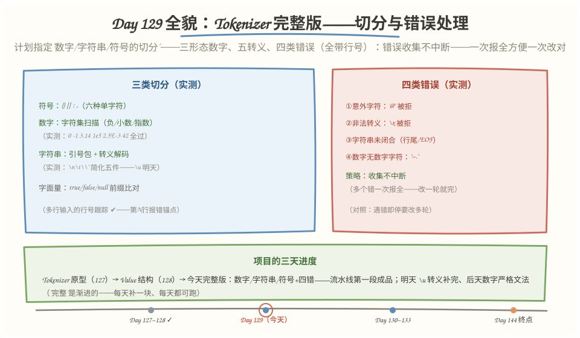
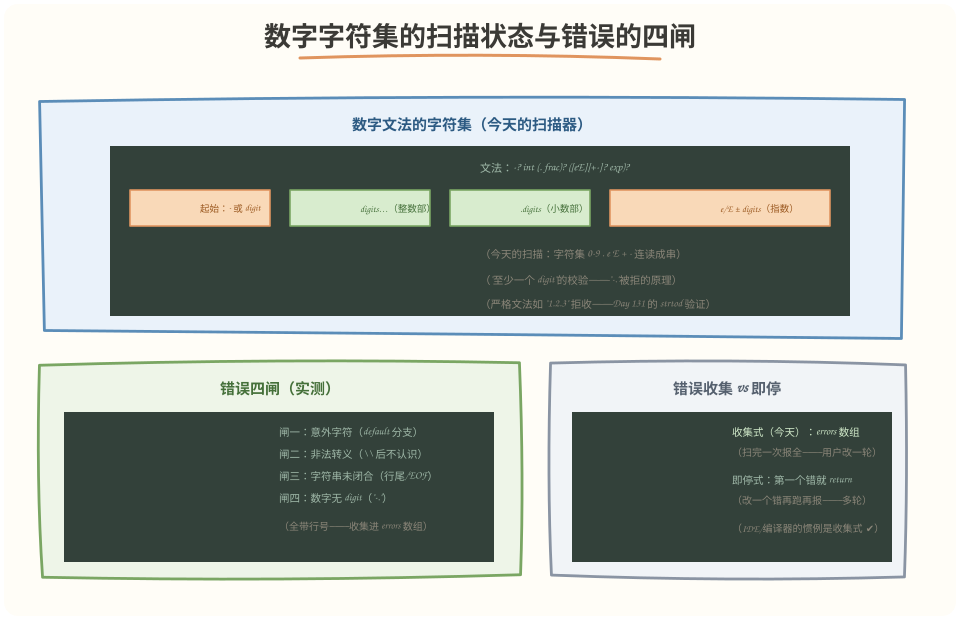
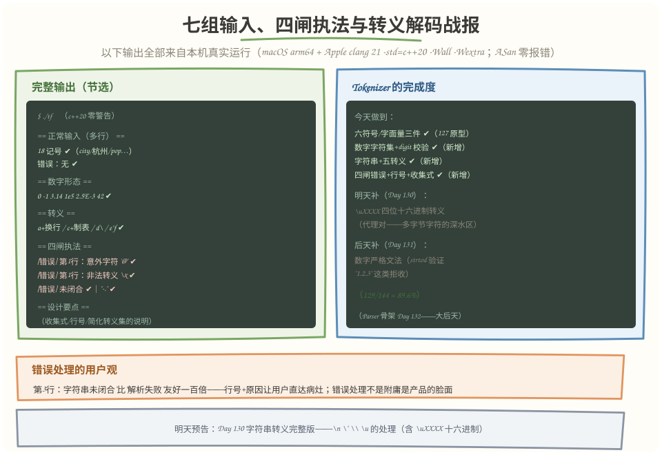

# 第 129 天：Tokenizer 完整版——数字 / 字符串 / 符号的切分

> **今日目标**：完成本教程后，你能做到：实现**三类切分**（六符号单字符；数字的字符集扫描含负/小数/指数；字符串含五转义解码 + 字面量三件）；实现**四闸错误**（意外字符/非法转义/未闭合/数字无 digit——全带行号）；说出**收集式 vs 即停式**的取舍（今天选收集——一次报全用户改一轮）；标注两块明天的增量（\uXXXX 转义 / strtod 严格文法）。
> **预计时间**：实现 50 分钟＋对照 30 分钟
> **前置准备**：完成 Day 127~128（原型和 Value——今天的完整版是流水线第一段的成品）。
> **今日产出**：七组输入全测（正常/数字/转义/四闸）、18 记号多行实例、错误收集。

## 1. 今天解决什么问题？

计划指定的 **Tokenizer 实现**：数字/字符串/符号的切分。从 127 的原型到今天的**完整版**——补上三块：**数字的字符集扫描**（`-` 或 digit 起始、`0-9 . e E + -` 连读、**至少一个 digit** 的校验——"-." 被拒）；**字符串的五转义解码**（`\n \t \" \\ \/`——`\uXXXX` 明天）；**四闸错误处理**（意外字符/非法转义/未闭合/数字无 digit——**收集式**不中断、全带行号）。

错误处理的用户观是今天的灵魂：**"第3行：字符串未闭合"比"解析失败"友好一百倍**。

## 2. 先看全貌：今天的内容位于哪里？



**图 1**：左卡蓝是三类切分；右卡红是四闸错误；下方绿卡是项目进度。路线图：**129/144 = 89.6%**。

三步概括今天：

1. 切分：符号/数字（字符集+校验）/字符串（引号+五转义）；
2. 四闸：全带行号——收集式报全；
3. 增量：\u 明天、strtod 后天——"完整"是渐进的。

## 3. 核心概念：先用直觉，再给准确定义

### 3.1 三类切分

- **一句通俗解释**：符号一眼认（单字符对照表）；数字连着读（起始 `-`/digit、续读数字字符集）；字符串读引号对（中途解码转义）。
- **一个类比**：海关三通道——外交护照（符号——秒过）、商务签证（数字——查证件链）、行李开箱（字符串——逐件过扫描）。
- **对应到技术上是**：实测——**符号**：`{}[] : ,` 六个单字符 switch（127 原型已有）；**数字**：`c=='-'||isdigit(c)` 起始 → `0-9 . e E + -` 连读成串 → **has_digit 校验**（"-." 无 digit 被拒 ✔）；六种数字形态全过（`0 -1 3.14 1e5 2.5E-3 42`）；**字符串**：开引号 → 逐字符（遇 `\\` 看下一字符解码：n/t/\"/\\\\/\\/ 五件——其他的报非法转义）→ 闭引号（没等到 → 未闭合错）；实测 `a\nb` 解出**真换行**、`e\"f` 解出 `e"f`。**字面量**：`true/false/null` 的前缀比对（compare）。**行号**：换行 `++line`——记号的 line 字段全程跟踪（多行输入实测：city 在第 2 行）。类比的边界：数字的"连读"是**字符集近似**（"1.2.3" 这种畸形今天放行——严格文法 Day 131 的 strtod 验证）。
- **常见误解**："数字扫描越严越好"——分两层：词法层保底（有 digit）、语法层严格（strtod 能不能解析）——今天第一层、后天第二层——**渐进完整**。

### 3.2 四闸错误与收集式

- **一句通俗解释**：四类词法错误各有一闸（意外字符/非法转义/未闭合/无 digit）；闸不住的进 **errors 数组**（不中断）——扫完一次报全。
- **一个类比**：机场安检的四个关口——每关拦下的记在登记本（数组）、全部旅客过完（扫完）统一广播——而不是拦第一个就全场清空（即停）。
- **对应到技术上是**：实测四闸——`'@'` → `第1行：意外字符 '@'`；`"bad\x"` → `第1行：非法转义 \x`；`"oops` → `第1行：字符串未闭合`；`-.` → `数字缺少数字字符 "-."`。**收集式 vs 即停式**：收集（今天）——用户一次看到全部问题、改一轮；即停——改一个错再跑再报（多轮）；**编译器的惯例是收集**（clang 一次报多个 error——我们体验了 126 天）。**ERROR 记号**：出错的输入也生成 Error 记号（保留在流里——Parser 明天可以选择跳过它做恢复——进阶）。**行号的价值**：用户直达病灶（不用全文找）。类比的边界：有些错误会**破坏后续切分**（如未闭合吞到行尾）——今天的未闭合处理是"断在行尾"（JSON 不允许字符串内裸换行——顺带报错）。
- **常见误解**："错了就该立刻停"——工具的**用户体验**恰恰相反（一次报全省多轮）；即停的唯一好处是实现简单。

### 3.3 明天的增量与渐进完整

- **一句通俗解释**：今天的"完整版"还差两块——`\uXXXX` 转义（明天）和数字严格文法（后天）——**完整是渐进的**（每天都可跑、每天都更完整）。
- **一个类比**：装修收尾——今天水电全通（能住）；明天装灯（\u）、后天验防水（strtod）——每步都是"更好的家"。
- **对应到技术上是**：**\uXXXX 的难点**：四位十六进制 → 码点；码点可能要**代理对**（UTF-16 的多字节——`\uD83D\uDE00` 是 emoji 😀）——明天专场；**数字严格文法**：字符集放行了 "1.2.3"——`strtod` 解析会停在第二个 `.`（剩余字符=畸形证据）——后天的验证方案。**渐进完整的工程观**：与其憋大爆炸式发布，不如**每天一个可跑的版本**（今天的七组测试就是回归防线——明天加 \u 后重跑应全绿 + 新用例）。**与 Parser 的接口稳定性**：记号流的形状（Token{type, text, line}）今天定——Parser（大后天）只依赖这个形状（内部怎么改不影响它——模块化的红利）。类比的边界："渐进"不是"拖延"——两块增量都有明确的天数（130/131）。
- **常见误解**："完整版=没有待补"——工程里的完整是**相对的**（满足当前测试集 + 已知缺口有计划）；绝对的完整不存在。

## 4. 图解核心机制



**图 2**：上半部分蓝卡是数字文法的四段状态（起始/整数/小数/指数——今天的字符集扫描）；左下绿卡是错误四闸；右下灰卡是收集式 vs 即停的对照。

按图逐步讲：

1. **走数字的四段**：`-` 或 digit 起 → digits → `.digits` → `e/E±digits`——"-." 卡在"没有 digit"；
2. **数四闸的位置**：default 分支（意外字符）/转义 switch 的 default（非法）/闭引号检查（未闭合）/has_digit 校验（数字）——每闸一个 errors.push_back；
3. **对比两种错误策略**：收集（今天——数组攒着一次报）vs 即停（return 第一个）——用户体验的分野；
4. **连三天的渐进**：今天完整版 → 明天 \u → 后天 strtod——每天可跑每天更全。

## 5. 动手实践：完成一个最小可运行例子

### 5.1 准备文件

```bash
cd ai-compiler-roadmap/tutorials/day-129/examples
```

主角：`tokenizer_full.cpp`（完整版切分 + 四闸 + 七组测试）。

### 5.2 编写代码

核心（完整代码见本目录）：

```cpp
std::vector<Token> tokenize(const std::string& src, std::vector<TokError>& errors) {
    std::vector<Token> out;  std::size_t i = 0;  int line = 1;
    while (i < src.size()) {
        char c = src[i];
        if (c == '\n') { ++line; ++i; continue; }
        if (c == ' ' || c == '\t' || c == '\r') { ++i; continue; }
        switch (c) {
            /* 六符号：{ } [ ] : , —— 单字符直推 */
            case '"': {
                std::string s;  ++i;  bool closed = false;
                while (i < src.size()) {
                    if (src[i] == '"') { closed = true; ++i; break; }
                    if (src[i] == '\\' && i + 1 < src.size()) {
                        char e = src[i + 1];
                        switch (e) {                       // 五转义
                            case 'n': s += '\n'; break;  case 't': s += '\t'; break;
                            case '"': s += '"';  break;  case '\\': s += '\\'; break;
                            case '/': s += '/';  break;
                            default: errors.push_back({"非法转义 \\" + std::string(1, e), line});
                        }
                        i += 2;  continue;
                    }
                    if (src[i] == '\n') { break; }         // 字符串内裸换行
                    s += src[i++];
                }
                if (!closed) { errors.push_back({"字符串未闭合", line}); }
                push(Tok::String, std::move(s));
                break;
            }
            default: {
                if (c == '-' || isdigit(c)) {             // 数字：字符集连读
                    std::string s;
                    while (i < src.size() && is_num_char(src[i])) { s += src[i++]; }
                    bool has_digit = /* 扫一遍找 digit */;
                    if (!has_digit) { errors.push_back({"数字缺少数字字符", line}); push(Tok::Error, s); }
                    else { push(Tok::Number, s); }
                }
                /* true/false/null 前缀比对；其他 → 意外字符错 */
            }
        }
    }
    push(Tok::End);
    return out;
}
```

### 5.3 运行与观察

```bash
g++ -Wall -Wextra -std=c++20 tokenizer_full.cpp -o tf && ./tf
```

实际执行结果（本机，节选）：

```text
== 正常输入（多行） ==
  输入：{ "city": "杭州", "pop": 12620000, "codes": [310, false] }
  记号（18 个）：{ string[city] : string[杭州] , string[pop] : number[12620000] , string[codes] : [ number[310] , false ] } EOF
  错误：无 ✔

== 数字形态 ==
  记号（14 个）：[ number[0] , number[-1] , number[3.14] , number[1e5] , number[2.5E-3] , number[42] ] EOF
  错误：无 ✔

== 字符串转义 ==
  记号（10 个）：[ string[a（真换行）b] , string[c（真制表）d] , string[d\] , string[e"f] ] EOF
  错误：无 ✔

== 错误：非法字符 ==
  [错误] 第1行：意外字符 '@'

== 错误：非法转义 ==
  [错误] 第1行：非法转义 \x

== 错误：未闭合 ==
  [错误] 第1行：字符串未闭合（到行尾/EOF）

== 错误：数字无数字字符 ==
  [错误] 第1行：数字缺少数字字符："-."
```



**图 3**：左上完整输出（七组输入全过 + 设计要点）；右侧是 Tokenizer 的完成度清单（今天做到/明天补/后天补）和 Parser 的接口稳定性说明；下方橙卡是错误处理的用户观。

### 5.4 修改一个输入再观察：你自己的 JSON 文件

把 Day 123 学的 filesystem 用上——读一个真实的 `.json` 文件（自己写的或网上下载的小配置）→ tokenize → 打印记号数和错误。**真实负载**：格式化过的多行 JSON（行号大显身手）vs 压缩单行——同一个 tokenizer 两种形态都该正确切分。

## 6. 常见错误与排查

**错误 1：`意外字符` 报了一串（其实是字符串未闭合吞行）**

- 现象：一个未闭合引号后跟着一堆意外字符错；
- 原因：字符串吞到行尾断掉——后续内容裸奔；
- 定位：第一个错误通常是根源（未闭合）；
- 修复：按**第一个**错误修（收集式的阅读顺序——后面的可能是连锁）。

**错误 2：中文字符串被当意外字符**

- 现象："杭州" 的 UTF-8 字节被 default 分支拒；
- 原因：字符串**外**的中文确实是非法——字符串**内**的走 `"..."` 分支（逐字节收）；
- 定位：确认中文在引号内；
- 修复：引号内中文没问题（实测"杭州"过 ✔）；引号外的中文该报（JSON 只允许六值）。

**错误 3：数字 "1.2.3" 没被拒（今天的已知放行）**

- 现象：畸形数字生成了 Number 记号；
- 原因：字符集扫描的近似（有 digit 就过）；
- 定位：Day 131 的 strtod 验证会补；
- 修复：今天接受（诚实记录）；后天解决。

## 7. 今日练习

### 必做练习（计划指定：数字/字符串/符号切分）

给 tokenize 加**第五闸**：字符串内**控制字符**（`< 0x20` 的裸控制符——JSON 规范禁止）→ 报"字符串含控制字符"；测试 `["a\x01b"]`（真实控制符）被拒。预期产出：新闸 + 测试。

### 选做挑战

"Token 流的打印器"：写 `print_tokens(vector<Token>)`——对齐的表格输出（类型/文本/行号三列——`std::setw` 格式化）；今天的单行打印升级成调试工具（Parser 开发时的眼睛）。

## 8. 今日验收

- [ ] 我的三类切分全过（六符号/六数字形态/五转义——各配实测）
- [ ] 我的四闸执法通过（'@'/\x/未闭合/"-."——全带行号）
- [ ] 我能说出收集式 vs 即停的取舍（今天选收集的理由）
- [ ] 我知道两块增量的去向（\u 明天 / strtod 后天——渐进完整）
- [ ] 我的多行输入行号跟踪正确（city 在第 2 行）

## 9. 一句话总结与明天预告

今天的问题是"词法层怎么切得全、错得清"；机制上，三类切分（符号单字符/数字字符集+校验/字符串引号对+五转义）、四闸错误（全带行号）、收集式策略（一次报全）；实践上，七组输入、18 记号、四闸执法全部落地；验证标准是给任意小 JSON 能手推记号流、给四种错误能预判哪闸拦。明天 **Day 130：字符串转义完整版**——`\n \" \\ \u` 的处理（含 `\uXXXX` 四位十六进制与代理对的深水区）：字符串这块的最后一里。
