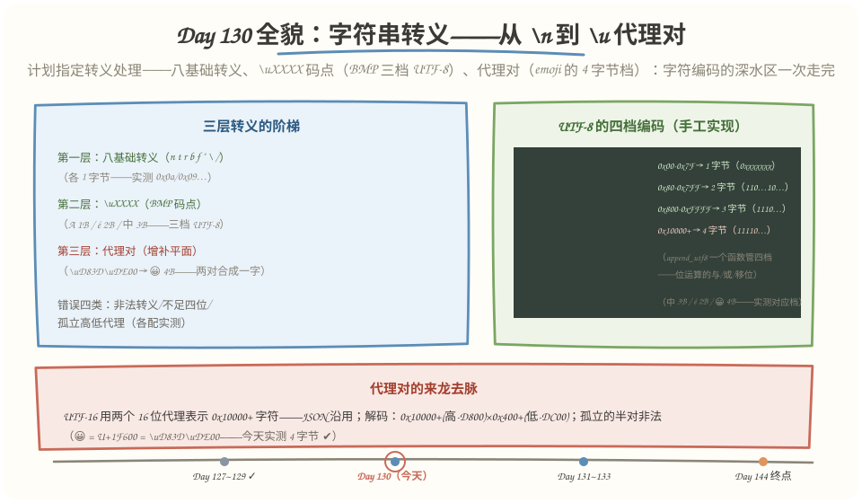
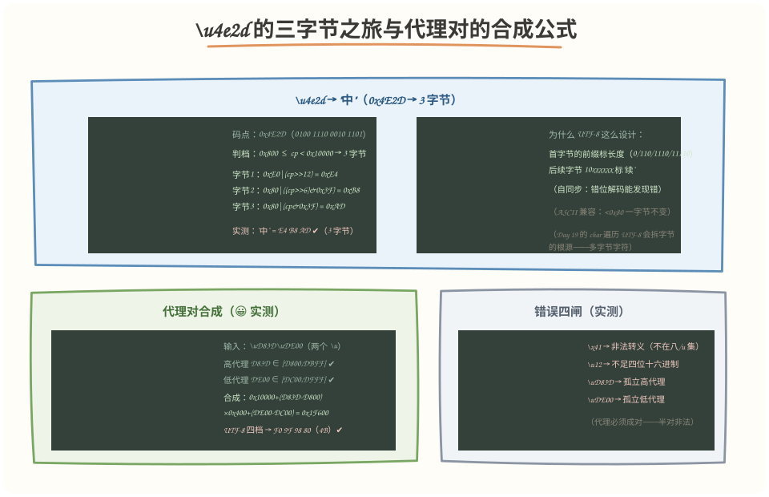
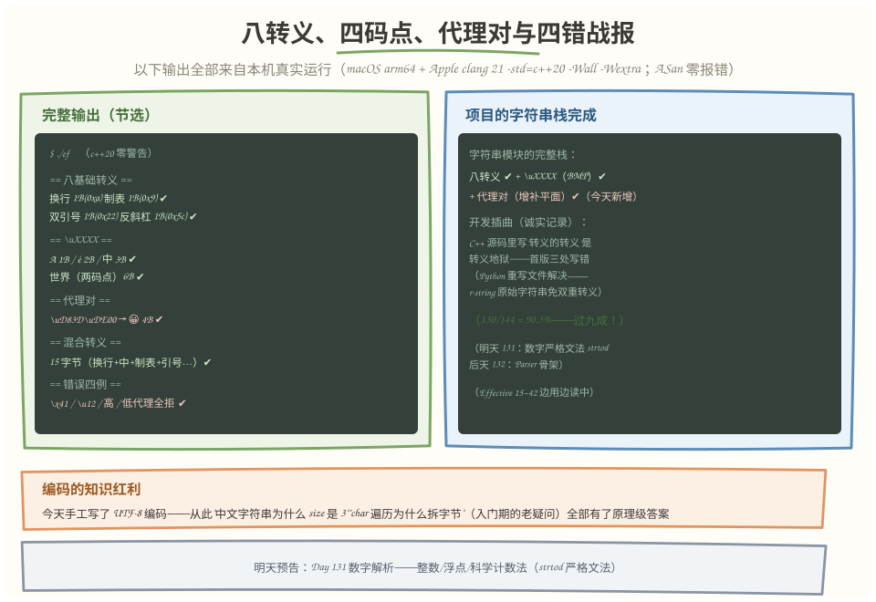

# 第 130 天：字符串解析——转义字符 `\n \" \\ \u` 处理

> **今日目标**：完成本教程后，你能做到：实现**八基础转义**的解码（n/t/r/b/f/"/\\// 各 1 字节——实测首字节码）；实现 **\uXXXX 码点解码**（四位十六进制 → BMP 码点 → UTF-8 的 1/2/3 字节三档——手工 append_utf8）；实现**代理对合成**（高+低代理 → 0x10000+ 码点 → 4 字节档——😀 的实测）；拒绝**错误四类**（非法转义/不足四位/孤立高低代理）。
> **预计时间**：学习 25 分钟＋实践 45 分钟
> **前置准备**：完成 Day 129（五转义是今天的起点——今天补全 \u）。
> **今日产出**：完整转义解码器（三层阶梯）、UTF-8 四档编码的手工实现、代理对合成。

## 1. 今天解决什么问题？

计划指定的**字符串转义完整处理**。从昨天的五转义升级到**全量 JSON 转义集**：八基础转义（+r/b/f 三件）+ **\uXXXX 码点**（四位十六进制 → UTF-8 的手工编码——1/2/3 字节三档）+ **代理对**（增补平面的 emoji 要**两个** \u 合成一个 4 字节字符——UTF-16 的历史包袱）。

这是**字符编码的深水区**：码点/UTF-8 的四档设计/UTF-16 的代理机制——今天全部亲手实现。Day 19 的老疑问（"中文字符串为什么 size 是 3、char 遍历为什么拆字节"）今天有原理级答案。

## 2. 先看全貌：今天的内容位于哪里？



**图 1**：左卡蓝是三层转义的阶梯；右卡绿是 UTF-8 四档编码；下方红卡是代理对的来龙去脉。路线图：**130/144 = 90.3%——过九成**。

三步概括今天：

1. 八转义：各 1 字节（实测首字节码）；
2. \uXXXX：码点 → UTF-8 三档（A 1B / é 2B / 中 3B）；
3. 代理对：高低合成 0x10000+ → 4 字节档（😀）。

## 3. 核心概念：先用直觉，再给准确定义

### 3.1 八基础转义

- **一句通俗解释**：`\n \t \r \b \f \" \\ \/` 八种——各解出**一个字节**（控制字符或被转义的字符本身）。
- **一个类比**：摩斯电码的八个简码——每个两字符组合（\\+x）对应一个固定输出。
- **对应到技术上是**：实测——换行 1B（0x0a）、制表 1B（0x09）、回车 0x0d、退格 0x08、换页 0x0c、双引号 0x22、反斜杠 0x5c、斜杠 0x2f——八个全过（首字节码打印）。**昨天到今天的增量**：+r/b/f 三件（昨天五件今天八件——补全 JSON 规范的完整集）。**`\/` 的冷知识**：JSON 允许转义 `/`（为了在 `</script>` 标签里嵌 JSON 时防 HTML 解析干扰）——平时不转也合法。类比的边界：八转义都是**单字节**输出——码点都 < 0x80（ASCII 区）。
- **常见误解**："\\n 是两个字符"——源码文本里是两个（反斜杠+n）；**解码后**是一个字节（0x0a）——今天的 decoded 字段存解码后。

### 3.2 \uXXXX 与 UTF-8 三档

- **一句通俗解释**：`\uXXXX` 是**码点**的十六进制写法；解码要转成 UTF-8 的字节——码点大小决定档位（<0x80 一字节 / <0x800 两字节 / <0x10000 三字节）。
- **一个类比**：邮政编码转地址——码点是统一编号（Unicode）、UTF-8 是落地格式（信封上怎么写——编号大的信封长）。
- **对应到技术上是**：实测——`\u0041` → **A**（1B：0x41——ASCII 区直通）；`\u00e9` → **é**（2B：0xC3 0xA9——两档 `110xxxxx 10xxxxxx`）；`\u4e2d` → **中**（3B：**E4 B8 AD**——三档 `1110xxxx 10xxxxxx 10xxxxxx`）；`\u4e16\u754c` → **世界**（6B——两码点各 3B）。**append_utf8 的手工位运算**（图 2 的中字演算）：cp=0x4E2D → 字节1 `0xE0|(cp>>12)`=0xE4、字节2 `0x80|((cp>>6)&0x3F)`=0xB8、字节3 `0x80|(cp&0x3F)`=0xAD。**UTF-8 的设计智慧**：首字节前缀标长度（0/110/1110/11110）、后续字节 10 开头标"续"——**自同步**（解码错位能发现错）+ **ASCII 兼容**（<0x80 不变）。**Day 19 疑问的解答**：中文字符串 size=3（三档编码一个字）；char 遍历拆字节（遍的是字节不是字符）。类比的边界：码点是**逻辑字符**、UTF-8 是**物理字节**——一对多（1~4）。
- **常见误解**："\u4e2d 是三个字符"——是一个码点（一个逻辑字符）；物理上占 3 字节——**逻辑与物理的分层**。

### 3.3 代理对：emoji 的真相

- **一句通俗解释**：😀 的码点 0x1F600 **超过** 0xFFFF（16 位装不下）——UTF-16 用**两个** 16 位"代理"拼：`\uD83D\uDE00`（高代理+低代理）；解码时合回一个码点 → UTF-8 的 4 字节档。
- **一个类比**：超长货柜拆两节车皮——两节各有编号（高低代理）、运到后拼回一整柜（合成码点）；只有一节（孤立代理）是残次品（非法）。
- **对应到技术上是**：实测——`\uD83D\uDE00` → **4 字节 UTF-8**（F0 9F 98 80）→ 终端显示 **😀** ✔。**合成公式**：`0x10000 + (高-0xD800)×0x400 + (低-0xDC00)` = 0x10000 + 0x83D×0x400 + 0x200 = **0x1F600** ✔。**检测逻辑**：高代理 ∈ [D800,DBFF] → 期望后面紧跟 `\uDC00-DFFF` 的低代理；两个**孤立**（只高不低/只低不高）都报错（实测两错 ✔）。**历史包袱**：UTF-16 设计时代 Unicode 只有 65536 字——后来扩展（emoji 等）只能用代理机制兼容——JSON 沿用（\u 只能写 16 位）。**与 UTF-8 的对照**：UTF-8 天然可扩展（前缀 11110 就是 4 字节档）——没有代理问题；**今天的流水线**：`\uXXXX×2`（UTF-16 风格）→ 合成码点 → UTF-8（物理存储）。类比的边界：大部分文本是 BMP（基本多文种平面——中英日韩都在）——代理对是 emoji/古文字等**增补平面**才用。
- **常见误解**："emoji 是一个字符打不出来是 bug"——是**两个 \u 代理**（四个 UTF-8 字节）——解析器必须支持代理对才能处理 emoji（今天做到了）。

## 4. 图解核心机制



**图 2**：上半部分蓝卡是 \u4e2d 的三字节之旅（码点位运算逐步 + UTF-8 设计智慧）；左下绿卡是代理对合成（公式演算——😀 实测）；右下灰卡是错误四闸。

按图逐步讲：

1. **走中字的位运算**：0x4E2D → 判三档 → 三个字节逐个算——**手工编码的每一步都可验**；
2. **读 UTF-8 的设计**：前缀标长 + 续字节 10 开头——自同步与 ASCII 兼容；
3. **算代理对的公式**：高 0xD83D 低 0xDE00 → 0x1F600 → 四档 F0 9F 98 80——两步合成；
4. **数错误四闸**：非法转义/不足四位/孤立高低——代理的"成对律"是核心。

## 5. 动手实践：完成一个最小可运行例子

### 5.1 准备文件

```bash
cd ai-compiler-roadmap/tutorials/day-130/examples
```

主角：`escape_full.cpp`（三层转义的完整解码器）。

### 5.2 编写代码

核心（完整代码见本目录）：

```cpp
int hex_val(char c);                          // '0'-'9'/'a'-'f'/'A'-'F' → 0-15

void append_utf8(std::string& out, uint32_t cp) {     // 四档编码
    if (cp < 0x80)       { out += char(cp); }                               // 1 字节
    else if (cp < 0x800) { out += char(0xC0|(cp>>6)); out += char(0x80|(cp&0x3F)); }
    else if (cp < 0x10000) { /* 三字节同款 */ }
    else                 { /* 四字节：0xF0 前缀 */ }
}

EscResult decode_escape(const std::string& s, std::size_t p) {
    char e = s[p + 1];
    switch (e) {
        case 'n': …（八转义各 1B）
        case 'u': {
            uint32_t cp;
            if (!parse_u(s, p + 2, cp)) { r.error = "\\u 后不是四位十六进制"; return r; }
            if (cp >= 0xD800 && cp <= 0xDBFF) {          // 高代理
                /* 期望紧跟 \uDC00-DFFF 的低代理 → 合成 */
                uint32_t full = 0x10000 + ((cp - 0xD800) << 10) + (lo - 0xDC00);
                append_utf8(r.decoded, full);  r.chars_consumed = 12;  return r;
            }
            if (cp >= 0xDC00 && cp <= 0xDFFF) { r.error = "孤立的低代理"; return r; }
            append_utf8(r.decoded, cp);  r.chars_consumed = 6;  return r;
        }
    }
}

bool decode_string(const std::string& raw, std::string& out, std::string& err);
```

**开发插曲（诚实记录）**：C++ 源码里写"转义的转义"（要表示文本 `\n` 得写 `"\\n"`、`\` 得写 `"\\\\"`）是**转义地狱**——首版三处写错（编译错/输出错）；最终用 Python 的 r-string 重写整个文件解决。**教训**：生成"讲转义的代码"时用外层工具（r-string/生成器）比手写 C++ 字面量稳。

### 5.3 运行与观察

```bash
g++ -Wall -Wextra -std=c++20 escape_full.cpp -o ef && ./ef
```

实际执行结果（本机，节选）：

```text
== 基础八转义 ==
  换行：解出 1 字节（首字节 0xa）
  制表：解出 1 字节（首字节 0x9）
  回车：解出 1 字节（首字节 0xd）
  退格：解出 1 字节（首字节 0x8）
  换页：解出 1 字节（首字节 0xc）
  双引号：解出 1 字节（首字节 0x22）
  反斜杠：解出 1 字节（首字节 0x5c）
  斜杠：解出 1 字节（首字节 0x2f）

== \uXXXX 码点（BMP） ==
  "\u0041" → "A"（字母 A，1 字节）
  "\u4e2d" → "中"（汉字 中，3 字节）
  "\u00e9" → "é"（两字节，2 字节）
  "\u4e16\u754c" → "世界"（两码点，6 字节）

== 代理对（emoji 的真相） ==
  \uD83D\uDE00 → 4 字节 UTF-8：😀（😀）
  （两个 \u 代理对 → 一个 4 字节字符——UTF-16 的历史包袱）

== 混合转义 ==
  解码结果（15 字节）：
  "line1
中	"q"\e"

== 错误四例 ==
  "\x41" → [错误] 非法转义 \x
  "\u12" → [错误] \u 后不是四位十六进制
  "\uD83D" → [错误] 孤立的高代理 \uD800-\uDBFF
  "\uDE00" → [错误] 孤立的低代理 \uDC00-\uDFFF
```



**图 3**：左上完整输出（八转义/码点/代理/混合/错误五段）；右侧是字符串栈的完成度和**转义地狱的开发插曲**；下方橙卡是编码的知识红利。

### 5.4 修改一个输入再观察：真实 emoji 的往返

写一个含真实 emoji 的 JSON 字符串（`"你好😀世界"`——直接在源文件里输入 emoji 字符）→ 打印它的 `size()`（**13 字节**：你好 6 + 😀 4 + 世界 6）——对照今天的手工解码（\uD83D\uDE00 → 4B）：**物理真相一致**。再把 emoji 换成 `\uD83D\uDE00` 的转义写法——解码后两种输入**完全相同**（转义与直写等价——JSON 的两种写法）。

## 6. 常见错误与排查

**错误 1：`\u12` 报"不足四位"（十六进制短了）**

- 现象：`\u` 后只有两三位；
- 原因：parse_u 检查 pos+4 > size 或遇非 hex；
- 定位：错误信息直指；
- 修复：输入侧补足四位（`\u0012`）。

**错误 2：孤立代理没被拒（解码出乱码）**

- 现象：单独一个 `\uD83D` 解出了垃圾字节；
- 原因：没做代理区间检查；
- 定位：输出乱码（0xED 开头的错形 UTF-8）；
- 修复：今天的区间检查（D800-DBFF 必须配对 / DC00-DFFF 必须跟高）。

**错误 3：C++ 源码写转义测试用例时把自己绕晕（转义地狱）**

- 现象：测试输入的字符串和预期对不上；
- 原因：C++ 字面量的转义 + JSON 转义双层叠加；
- 定位：打印 raw 的字节看实际内容；
- 修复：用外层工具写文件（今天的 Python r-string 方案）；或 C++ 的 R"(...)" 原始字符串。

## 7. 今日练习

### 必做练习（计划指定：转义处理）

给 decode_escape 加**第 9 转义**的测试：验证 `\u0000`（码点 0——空字符）解出 1 字节 0x00——虽然 JSON 场景罕见（C 字符串的终结符陷阱）——但解码器该正确处理；再测 `\uFFFF`（BMP 的最大码点 → 3 字节 EF BF BF）。预期产出：两边界码点的实测。

### 选做挑战

"UTF-8 字节数统计器"：写 `size_in_chars(const std::string&)`——数 UTF-8 字符数（按首字节前缀跳过多字节——`(b & 0xC0) != 0x80` 就是新字符的起点）；测 "你好😀世界" = **5 字符**（13 字节）。Day 19 老坑的正式解药。

## 8. 今日验收

- [ ] 我的八基础转义全过（各 1 字节——首字节码打印）
- [ ] 我的 \uXXXX 三档实测（A 1B / é 2B / 中 3B——位运算可复述）
- [ ] 我的代理对合成过（😀 4B——公式 0x10000+(高-D800)×0x400+(低-DC00)）
- [ ] 我的错误四闸全过（非法/不足四位/孤立高低）
- [ ] 我能说出 Day 19 疑问的原理答案（中文 3B / char 遍历拆字节）

## 9. 一句话总结与明天预告

今天的问题是"转义和编码的深水区怎么过"；机制上，三层阶梯（八转义 1B → \uXXXX 码点三档 → 代理对 4B 档）、append_utf8 的手工位运算（四档前缀设计——自同步+ASCII 兼容）、代理对公式（UTF-16 的历史包袱——JSON 沿用）；实践上，八转义、四码点、emoji、四错全部实测（附转义地狱的开发插曲）；验证标准是看到任何 \u 序列能手推码点和字节数。明天 **Day 131：数字解析**——整数/浮点/科学计数法（strtod 严格文法）：数字栈的最后一块（"1.2.3" 拒收）。
