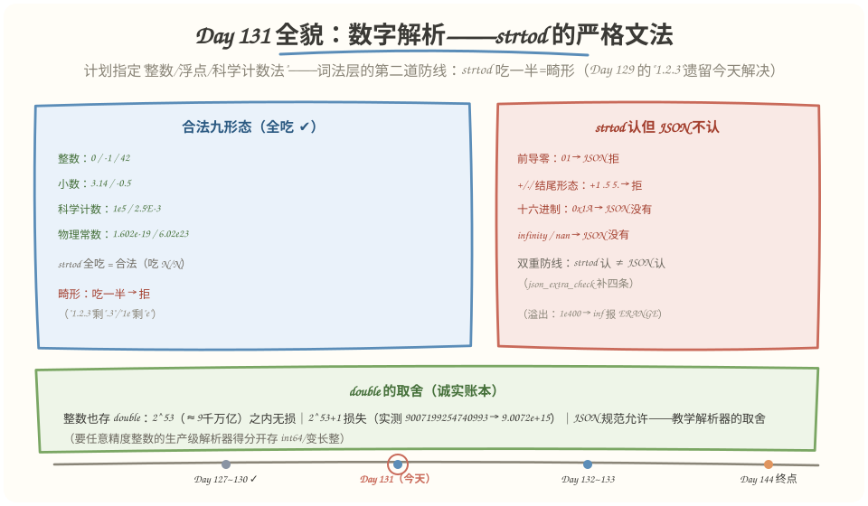
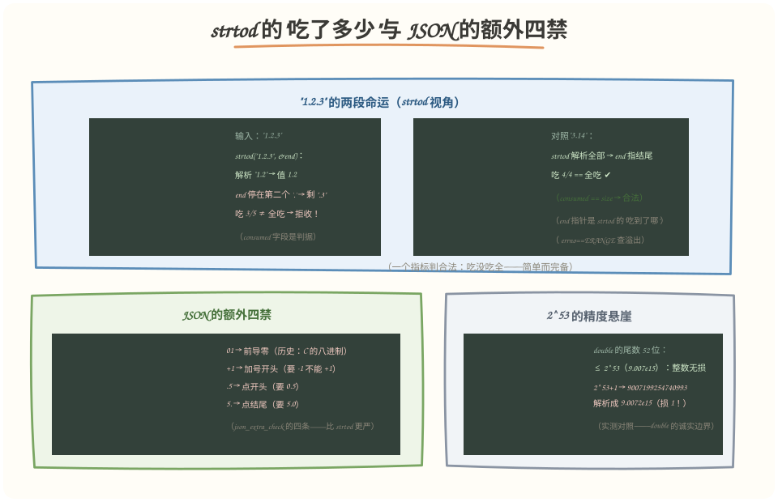
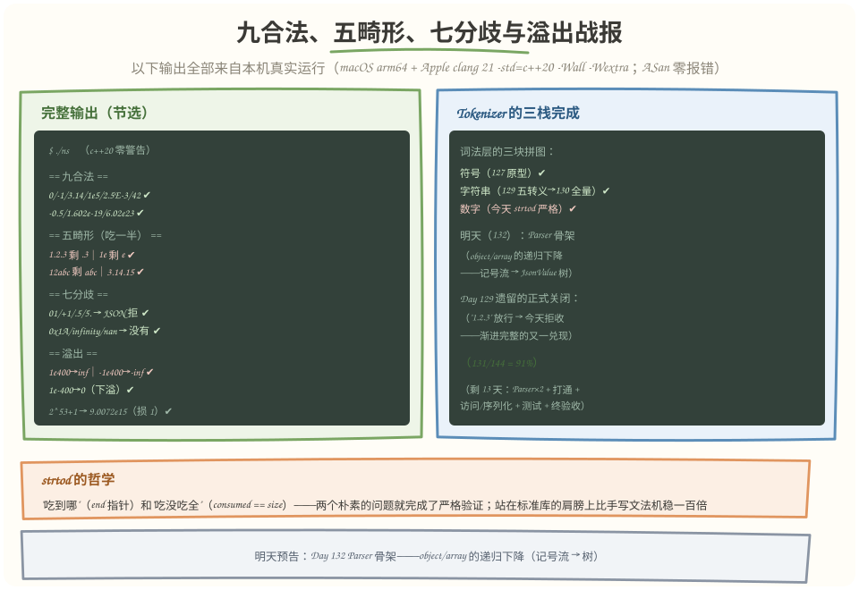

# 第 131 天：数字解析——整数 / 浮点 / 科学计数法

> **今日目标**：完成本教程后，你能做到：用 **strtod 的 consumed 判据**实现严格验证（吃没吃全——"1.2.3" 拒收、Day 129 遗留关闭）；补上 **JSON 额外四禁**（前导零/+ 开头/点开头/点结尾——strtod 认但 JSON 不认）；实测**溢出边界**（1e400 → ERANGE）；说出 **double 的取舍**（2^53 之内整数无损——+1 损失的实测）。
> **预计时间**：学习 20 分钟＋实践 40 分钟
> **前置准备**：完成 Day 129~130（词法层的字符串栈完成——今天补数字栈）。
> **今日产出**：九合法/五畸形/七分歧/三溢出的全套实测、Tokenizer 三栈完成。

## 1. 今天解决什么问题？

计划指定的**数字解析**。核心武器是 **strtod 的"吃了多少"**：`strtod(s, &end)` 返回解析值、end 指针告诉你**吃到哪**——`consumed == size` 就是合法（全吃）；吃一半（"1.2.3" 剩 ".3"）就是畸形。**Day 129 的遗留问题今天正式关闭**（字符集放行 → strtod 拒收）。

两层验证的分工：**strtod 层**（能不能解析/吃全没/溢出没）+ **JSON 额外层**（前导零/+/点开点结——strtod 认但 JSON 文法没有）。加一个诚实的取舍说明：整数也存 double（**2^53 之内无损**——+1 损失的实测）。

## 2. 先看全貌：今天的内容位于哪里？



**图 1**：左卡蓝是九合法形态；右卡红是七分歧（strtod 认 ≠ JSON 认）；下方绿卡是 double 的取舍。路线图：**131/144 = 91%**。

三步概括今天：

1. 判据：strtod 的 consumed == size（全吃=合法）；
2. 双层：strtod 层 + JSON 四禁；
3. 取舍：double 存整数（2^53 无损——边界实测）。

## 3. 核心概念：先用直觉，再给准确定义

### 3.1 strtod 的 consumed 判据

- **一句通俗解释**：strtod 像"吃东西的统计员"——你给它一串字符，它吃掉**能解析的部分**、end 指针停在**吃不到的地方**；吃没吃全（consumed == size）就是合法与否的判据。
- **一个类比**：吃鱼——肉吃完刺留着（"1.2.3"：吃 "1.2" 剩 ".3"——没吃干净=畸形）；整条吃完（"3.14"——全吃=合法）。
- **对应到技术上是**：实测——**九合法全过**（0/-1/3.14/1e5/2.5E-3/42/-0.5/1.602e-19/6.02e23——各 consumed N/N）；**五畸形全拒**（"1.2.3" 剩 ".3"、"1e" 剩 "e"、"1e+" 剩 "e+"、"12abc" 剩 "abc"、"3.14.15" 剩 ".15"——都是吃一半）；**溢出三态**（1e400 → inf + ERANGE、-1e400 → -inf、1e-400 → 0 下溢——errno 的检查）。**end 指针的机制**：`end - s.c_str()` 就是 consumed（指针差=字符数）。**为什么不手写文法机**：strtod 是**标准库的成熟实现**（处理各国 locale/inf/nan/hex——站在肩膀上比手写稳）；我们只要"吃全没"的判据。类比的边界：strtod 认的**不全是 JSON 认的**（hex/inf/nan/前导零——见 3.2）。
- **常见误解**："strtod 返回 0 就是失败"——不（"0" 合法且值就是 0）；失败判据是 **consumed == 0**（没吃任何字符）。

### 3.2 JSON 额外四禁

- **一句通俗解释**：strtod 比.json 更宽松——前导零（01）、加号开头（+1）、点开头（.5）、点结尾（5.）它都认；JSON 文法**没有这些**——要额外拦。
- **一个类比**：边检 vs 海关——边检（strtod）看证件有效性；海关（JSON）还有本国禁带清单——两层都要过。
- **对应到技术上是**：实测——**七分歧**：01（strtod ✔ 值 1 / JSON 拒——前导零的历史包袱：C 的八进制）；+1（✔/拒——JSON 只要 - 不要 +）；.5 和 5.（✔/拒——JSON 要 0.5 和 5.0）；0x1A（strtod ✔ 值 26 / JSON **没有十六进制**）；infinity 和 nan（strtod ✔ / JSON **没有**——NaN 的 IEEE 陷阱）。**json_extra_check 的四条**：前导零/+ 开头/点开头/点结尾——加上 strtod 层就是**完整的 JSON 数字文法**。**为什么 JSON 这么严**：互操作性（一个数只有一种写法——序列化/反序列化不产生歧义）。类比的边界：真实解析器（nlohmann 等）也是**双层**（strtod + JSON 补丁）——同款架构。
- **常见误解**："数字验证自己写正则就行"——能（但不推荐）：边界情况（locale 的小数点/inf/nan/溢出）自己踩不完；strtod + 四禁是**成熟路线**。

### 3.3 double 的取舍

- **一句通俗解释**：JSON 数字统一存 double（教学取舍）——整数**也**存 double：2^53（约 9 千万亿）之内无损、**2^53+1 损失 1**（实测）。
- **一个类比**：用量筒量米——小量精确（2^53 内每粒都数得清）；超大量糊了（+1 看不出差别）。
- **对应到技术上是**：实测——**9007199254740993**（2^53+1）解析得 **9.0072e15**（=2^53——**损了 1**！尾数 52 位装不下 53 位+1 的精度）。**为什么 JSON 允许**：规范的互操作建议（大多数实现用 double——JavaScript 的 Number 就是 double）；要任意精度的实现可以自己存 int64 或字符串。**教学取舍的诚实**：我们的 JsonValue 的 Number 格是 double（Day 128 的设计）——**大部分场景够**（分数/价格/坐标）；金融级的分币数等要 int64 的场景记为"已知限制"。类比的边界：**序列化回写**时 double 可能带科学计数（6.02e23）——JSON 允许（合法形态）。
- **常见误解**："double 存整数总会丢"——2^53 内**无损**（日常整数远小于这个量级）；丢的是天文数字级的精确整数（ID 号等——那场景该用字符串）。

## 4. 图解核心机制



**图 2**：上半部分蓝卡是 "1.2.3" 的两段命运（strtod 视角——吃 3/5 剩 .3 → 拒）；左下绿卡是 JSON 额外四禁；右下灰卡是 2^53 的精度悬崖。

按图逐步讲：

1. **走 "1.2.3" 的命运**：strtod 吃 "1.2" 停在第二个 '.'——consumed 3/5 ≠ 全吃 → 拒（对照 "3.14" 的 4/4 ✔）；
2. **记四禁的场景**：前导零的历史（C 八进制）/正负号的不对称/点的前后——每条都是 JSON 的互操作设计；
3. **看 2^53 的悬崖**：9.007e15 内无损、+1 就丢——double 的诚实边界（实测数字）；
4. **连 Day 129**：字符集放行的"1.2.3"今天被 strtod 层拦截——**渐进完整的第二次兑现**（第一次是转义）。

## 5. 动手实践：完成一个最小可运行例子

### 5.1 准备文件

```bash
cd ai-compiler-roadmap/tutorials/day-131/examples
```

主角：`number_strict.cpp`（strtod 验证 + JSON 四禁 + 边界实测）。

### 5.2 编写代码

核心（完整代码见本目录）：

```cpp
NumResult parse_number(const std::string& s) {
    NumResult r;
    errno = 0;
    char* end = nullptr;
    double v = std::strtod(s.c_str(), &end);          // end 指向"吃到哪"

    std::size_t used = static_cast<std::size_t>(end - s.c_str());
    r.consumed = used;

    if (used == 0)            { r.error = "不是数字开头"; return r; }
    if (used < s.size())      { r.error = "吃了一半：剩 \"" + s.substr(used) + "\""; return r; }
    if (errno == ERANGE)      { r.error = "溢出"; return r; }
    r.value = v;  r.ok = true;
    return r;
}

std::string json_extra_check(const std::string& s) {   // JSON 比 strtod 更严的四条
    if (s.size() > 1 && s[0]=='0' && isdigit(s[1]))  return "前导零";
    if (!s.empty() && s[0]=='+')                     return "+ 开头";
    if (!s.empty() && s[0]=='.')                     return ". 开头";
    if (!s.empty() && s.back()=='.')                 return ". 结尾";
    return "";
}
```

### 5.3 运行与观察

```bash
g++ -Wall -Wextra -std=c++20 number_strict.cpp -o ns && ./ns
```

实际执行结果（本机，节选）：

```text
== 合法形态（strtod 全吃 ✔） ==
  "0" → 0（吃 1/1）✔
  "3.14" → 3.14（吃 4/4）✔
  "1e5" → 100000（吃 3/3）✔
  "1.602e-19" → 1.602e-19（吃 9/9）✔
  "6.02e23" → 6.02e+23（吃 7/7）✔

== 畸形：吃一半（Day 129 的遗留） ==
  "1.2.3" → [拒] 吃了一半：剩 ".3" 没消费——畸形数字
  "1e" → [拒] 吃了一半：剩 "e" 没消费——畸形数字
  "12abc" → [拒] 吃了一半：剩 "abc" 没消费——畸形数字

== strtod 认但 JSON 不认 ==
  "01"：strtod ✔（1）；但 JSON 拒：JSON 不允许前导零（01）
  "+1"：strtod ✔（1）；但 JSON 拒：JSON 不允许 + 开头
  "0x1A"：strtod ✔（26）；JSON 文法没有这些（hex/inf/nan）
  "infinity"：strtod ✔（inf）；JSON 文法没有这些（hex/inf/nan）

== 溢出边界 ==
  "1e400" → inf（溢出（超 double 范围））
  "1e-400" → 0（溢出（超 double 范围））

== 整数/浮点之分（存成 double 的取舍） ==
  42 → 42（整数也存 double）
  精度：2^53 = 9.0072e+15（之内整数无损）
  9007199254740993（2^53+1）→ 9.0072e+15（！损失——double 的边界）

== Day 129 遗留问题的解决 ==
  "1.2.3"：昨天字符集放行 → 今天 strtod 吃一半 → 拒收 ✔
```



**图 3**：左上完整输出（四段 + 精度取舍）；右侧是 Tokenizer 三栈完成和 Day 129 遗留的关闭；下方橙卡是 strtod 的哲学。

### 5.4 修改一个输入再观察：真实 JSON 的数字集

找一个真实的 API 返回 JSON（天气/汇率等——含各种数字：整数价格/小数/时间戳）——把它的数字串逐个喂 parse_number——全部应 ✔（真实数据的数字都是合法形态）；再手打几个畸形混进去验证拒绝。**真实负载**的数字栈验收。

## 6. 常见错误与排查

**错误 1：`strtod` 没重置 errno（上一轮的残留误报）**

- 现象：合法数字报了溢出；
- 原因：errno 是全局的——上一次调用的残留；
- 定位：ERANGE 报告对合法值；
- 修复：调用前 `errno = 0;`（今天的代码有）。

**错误 2：`consumed == 0` 误判成"值为 0"**

- 现象：非数字输入没报错；
- 原因：混淆了"解析值 0"和"没解析"；
- 定位：对照 used 字段；
- 修复：先查 used==0（没吃）再谈值。

**错误 3：忘了 locale 的小数点差异（进阶坑）**

- 现象：某些环境下 "3.14" 解析不对；
- 原因：locale 的 decimal_point 可能是逗号（德语等）；
- 定位：跨 locale 的诡异失败；
- 修复：解析前 `std::setlocale(LC_NUMERIC, "C");` 或用 from_chars（免 locale——进阶）。

## 7. 今日练习

### 必做练习（计划指定：整数/浮点/科学计数法）

写 `classify_number(const std::string&)` → 返回 "int"/"float"/"sci"/"bad"（按形态分类：无点无 e 是 int、有点无 e 是 float、有 e 是 sci）——测试 10 例混合。预期产出：分类器 + 10 例对照。

### 选做挑战

"int64 的双轨"：给 JsonValue 加一个 `bool is_int64` 标记 + `int64_t as_int64()`（当 double 值在 int64 范围且无小数部分时返回精确整数）——测试 9007199254740992（2^53）内外的行为。缓解今天讲的 double 边界（生产解析器的常见补丁）。

## 8. 今日验收

- [ ] 我的 consumed 判据实测（九合法全吃 / 五畸形吃一半全拒）
- [ ] 我的 JSON 四禁补丁通过（01/+1/.5/5. 各配拒绝理由）
- [ ] 我的溢出三态过（inf/-inf/下溢 0 + ERANGE）
- [ ] 我能说出 2^53 的取舍（内无损/外损失——实测数字）
- [ ] 我知道 Day 129 遗留已关闭（"1.2.3" 的完整链路）

## 9. 一句话总结与明天预告

今天的问题是"数字怎么验证才严格"；机制上，strtod 的 consumed 判据（吃没吃全——一个指标判合法）、JSON 四禁（比 strtod 更严的互操作层）、double 的 2^53 边界（教学取舍的诚实）；实践上，九合法、五畸形、七分歧、三溢出全部实测；验证标准是看到任何数字串能报出"strtod 吃几成、JSON 认不认、double 存得下吗"。明天 **Day 132：Parser 骨架**——object/array 的递归下降（记号流 → JsonValue 树）：三栈齐备后的组装大戏。
