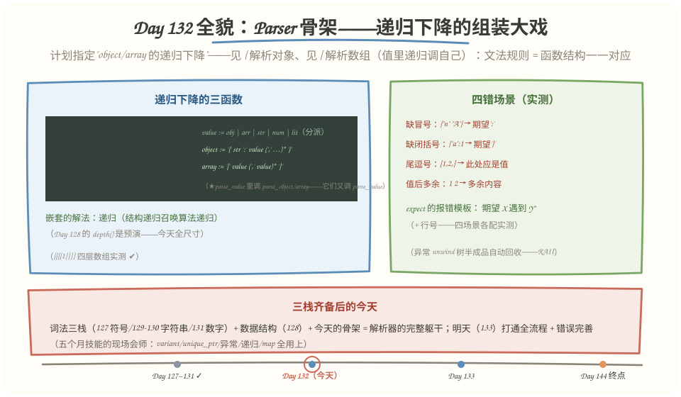
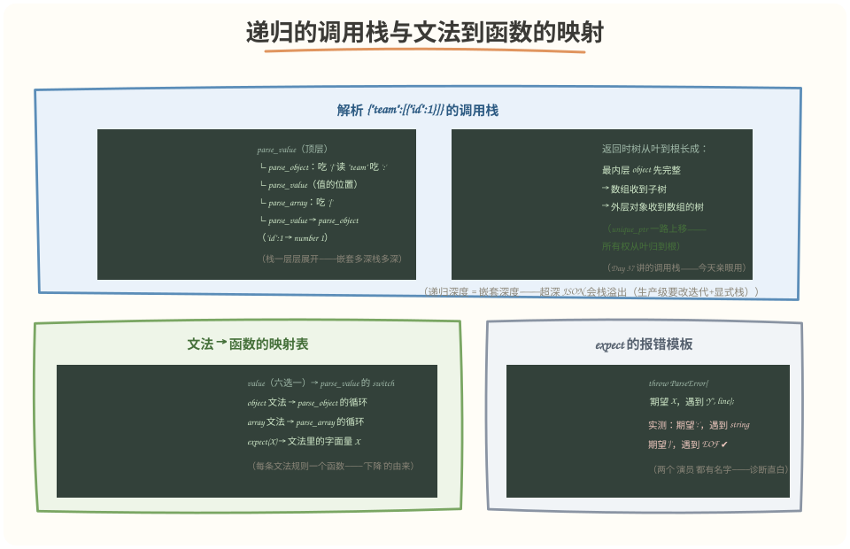
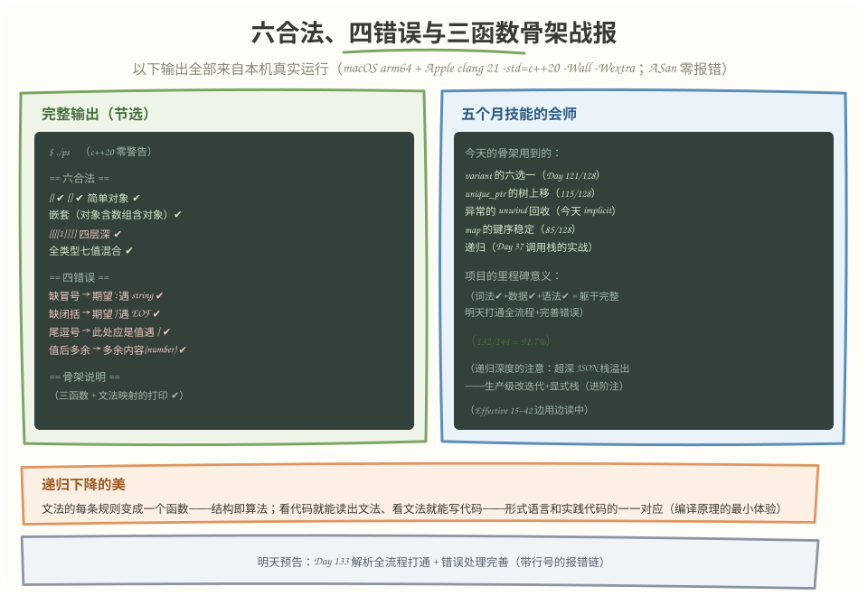

# 第 132 天：Parser 骨架——object / array 的递归下降解析

> **今日目标**：完成本教程后，你能做到：写出**递归下降的三函数**（parse_value 六选一分派 / parse_object 的 '{'键:值'}' / parse_array 的 '['值']'——文法规则与函数结构一一对应）；实现 **expect 的报错模板**（"期望 X 遇到 Y"+行号——四错误场景实测）；走通**六合法场景**（含 [[[[1]]]] 四层深嵌套和全类型七值混合）；说出递归深度=嵌套深度（超深栈溢出的进阶注）。
> **预计时间**：实现 50 分钟＋对照 30 分钟
> **前置准备**：完成 Day 127~131（三栈+数据结构齐备——今天是组装大戏）。
> **今日产出**：完整 Parser 骨架（六合法全过 + 四错误各配实测）、调用栈的图解。

## 1. 今天解决什么问题？

计划指定的 **Parser 骨架**：object/array 的递归下降。核心思想一句话——**文法规则 = 函数结构**：`value := obj|arr|str|num|lit` 对应 parse_value 的 switch；`object := '{' str ':' value (','…)* '}'` 对应 parse_object 的循环——见 `{` 解析对象、值的位置**递归调回 parse_value**（嵌套的解法：结构递归召唤算法递归——Day 128 depth 的全尺寸版）。

**expect 的报错**（"期望 X 遇到 Y"）让错误信息直白；四类错误场景（缺冒号/缺闭括/尾逗号/值后多余）各配实测。

## 2. 先看全貌：今天的内容位于哪里？



**图 1**：左卡蓝是递归下降的三函数；右卡绿是四错场景；下方红卡是三栈齐备的意义。路线图：**132/144 = 91.7%**。

三步概括今天：

1. 分派：parse_value 的 switch（六值各走各路）；
2. 递归：object/array 的值位置调回 parse_value（嵌套）；
3. 报错：expect 的"期望 X 遇到 Y"（+行号）。

## 3. 核心概念：先用直觉，再给准确定义

### 3.1 递归下降：文法即函数

- **一句通俗解释**：每条文法规则写成一个函数——`parse_object` 照文法吃 '{'、读键、吃 ':'、**值的位置递归调 parse_value**、逗号循环、吃 '}'。"下降"指从文法顶层往下走。
- **一个类比**：导游带团——总调度（parse_value）看景点类型（记号）派专门的导游（object/array 各一个）；景点里套景点（嵌套）就地请下一位导游（递归）。
- **对应到技术上是**：实测——**三函数骨架**：①`parse_value` 的 switch 六分派（LeftBrace→object / LeftBracket→array / String/Number/True/False/Null 各自成值）；②`parse_object`：`expect('{')` → 循环{键 expect(String) + expect(':') + `obj[key]=parse_value()`（★心脏）}+ expect('}')；③`parse_array` 同构。**调用的展开**（图 2）：`{"team":[{"id":1}]}` → parse_value→parse_object→parse_value→parse_array→parse_value→parse_object→number——六层调用栈逐层返回时**树从叶到根长成**（unique_ptr 一路上移——所有权归到根）。**Day 37 的回收**：调用栈的知识今天实战——递归深度=嵌套深度（[[[[1]]]] 四层实测）。类比的边界：**超深 JSON**（千层嵌套）会栈溢出——生产级改迭代+显式栈（进阶注；教学范围接受递归的优雅）。
- **常见误解**："递归下降很难"——是最**贴近文法**的解析法（看代码=读文法）；难的其实是文法本身——JSON 的文法三条就完了。

### 3.2 expect 与错误报法

- **一句通俗解释**：`expect(X)` 是"应该来了个 X"的守门员——不是就抛 `ParseError{期望 X，遇到 Y, 行号}`——两个"演员"都有名字。
- **一个类比**：验票员——"这里该是 VIP 券（X），您给的是普通票（Y）"——一句话说清差什么。
- **对应到技术上是**：实测四错——**缺冒号** `{"name" "Ada"}` → `期望':'，遇到 string`（键之后该冒号来了个字符串）；**缺闭括号** `{"a":1` → `期望'}'，遇到 EOF`（到头了还没等到）；**尾逗号** `[1,2,]` → `此处应是值，遇到 ]`（逗号后进 parse_value 分派不了）；**值后多余** `1 2` → `值结束后还有多余内容（number）`（parse 的 EOF 检查）。**异常的 unwind**：抛出后调用栈层层解开——**半成品的树被 unique_ptr 的析构自动回收**（RAII 的隐形福利——不用手写清理）。**行号的传递**：Token 带 line（Day 129 的设计）——ParseError 直接引用 cur().line。类比的边界：今天抛异常**中断在第一个错**（Parser 层的惯例——和 Tokenizer 的收集式不同：语法错后状态难恢复）；错误恢复（跳到下一个逗号继续）是进阶话题。
- **常见误解**："错误处理是最后加的"——expect 从第一天就内建（"期望 X 遇到 Y"的模板）——**报错质量是解析器的产品脸面**。

### 3.3 组装的意义：五个月技能的会师

- **一句通俗解释**：今天的 150 行骨架用上了 variant（六选一）、unique_ptr（树上移）、异常（unwind 回收）、map（键序）、递归（调用栈）——**五个月的技能在一个文件里会师**。
- **一个类比**：毕业设计——四年学的课（数据结构/算法/语言特性）在一篇论文里全部用上；每章的知识点都能在论文里找到影子。
- **对应到技术上是**：**技能清单**：variant（Day 121 → 128 的 Storage）、unique_ptr（115 的独占 → 128 的树）、异常（今天 implicit 的 unwind）、map（85 的键序 → 128 的 JsonObject）、递归（37 的调用栈 → 今天的主算法）、optional（121——明天 parse 的失败表达升级）。**"集大成"不是口号**——每个语法元素都有天数背书。**项目里程碑**：词法三栈（127/129-130/131）+ 数据结构（128）+ 今天语法骨架 = **解析器的完整躯干**；明天（133）打通全流程 + 错误完善、后天起序列化/访问/测试。类比的边界：会师不等于完工——躯干要长出血肉（明天的全流程打通）。
- **常见误解**："骨架能跑就是完成"——还要全流程（文件到树的端到端）、序列化（树回文本）、测试集——**骨架是里程碑不是终点**。

## 4. 图解核心机制



**图 2**：上半部分蓝卡是 {"team":[{"id":1}]} 的调用栈展开（六层递归 + 返回时树的生长）；左下绿卡是文法→函数的映射表；右下灰卡是 expect 的报错模板。

按图逐步讲：

1. **沿调用栈走一遍**：六层的进（分派→对象→值→数组→值→对象）和出（叶到根的树生长 + unique_ptr 上移）；
2. **读映射表**：value 六选一 → switch；object/array 的文法 → 循环结构；字面量 → expect——**一一对应**；
3. **背报错模板**："期望 X，遇到 Y"+行号——四实测各对应一个"演员错位"；
4. **连 Day 37**：调用栈的知识（当年看 void f() 的递归）今天解析真实语言结构——知识的复利。

## 5. 动手实践：完成一个最小可运行例子

### 5.1 准备文件

```bash
cd ai-compiler-roadmap/tutorials/day-132/examples
```

主角：`parser_skeleton.cpp`（三函数骨架 + 六合法 + 四错误的完整测试）。

### 5.2 编写代码

核心（完整代码见本目录）：

```cpp
class Parser {
    const std::vector<Token>& toks_;
    std::size_t pos_ = 0;
    const Token& cur() const { return toks_[pos_]; }
    Token expect(Tok t, const char* what) {
        if (!check(t)) {
            throw ParseError{std::string("期望 ") + what + "，遇到 " + tok_name(cur().type), cur().line};
        }
        return advance();
    }

    std::unique_ptr<JsonValue> parse_value() {          // 六选一分派
        switch (cur().type) {
            case Tok::LeftBrace:   return parse_object();
            case Tok::LeftBracket: return parse_array();
            case Tok::String:      return std::make_unique<JsonValue>(advance().text);
            case Tok::Number:      return std::make_unique<JsonValue>(std::stod(advance().text));
            case Tok::True:        advance(); return std::make_unique<JsonValue>(true);
            /* False/Null 同款；default 抛"此处应是值" */
        }
    }

    std::unique_ptr<JsonValue> parse_object() {         // '{' 键:值 (',' …)* '}'
        expect(Tok::LeftBrace, "'{'");
        JsonObject obj;
        if (!check(Tok::RightBrace)) {
            while (true) {
                Token key = expect(Tok::String, "键（字符串）");
                expect(Tok::Colon, "':'");
                obj[key.text] = parse_value();          // ★ 递归的心脏
                if (!match(Tok::Comma)) { break; }
            }
        }
        expect(Tok::RightBrace, "'}'");
        return std::make_unique<JsonValue>(std::move(obj));
    }
    // parse_array 同构（'[' 值 (',' 值)* ']'）
};
```

### 5.3 运行与观察

```bash
g++ -Wall -Wextra -std=c++20 parser_skeleton.cpp -o ps && ./ps
```

实际执行结果（本机）：

```text
== 空对象 ==
  ✔ 解析成功：类型 = object
== 空数组 ==
  ✔ 解析成功：类型 = array
== 简单对象 ==
  ✔ 解析成功：类型 = object
== 嵌套（对象含数组含对象） ==
  ✔ 解析成功：类型 = object
== 深层嵌套 ==
  ✔ 解析成功：类型 = array          ← [[[[1]]]] 四层
== 全类型 ==
  ✔ 解析成功：类型 = array          ← [1, 2.5, "three", true, false, null, {...}]

== 错误：缺冒号 ==
  ✘ [第1行] 期望 ':'，遇到 string
== 错误：缺闭括号 ==
  ✘ [第1行] 期望 '}'，遇到 EOF
== 错误：尾逗号 ==
  ✘ [第1行] 此处应是值，遇到 ]
== 错误：值后多余 ==
  ✘ [第1行] 值结束后还有多余内容（number）

== 递归下降的骨架 ==
  parse_value 分派六种值（对象/数组递归进下一层）
  （文法规则 = 函数结构——一一对应）
```



**图 3**：左上完整输出（六合法/四错误/骨架说明）；右侧是五个月技能的会师清单和里程碑意义；下方橙卡是递归下降的美。

### 5.4 修改一个输入再观察：你自己写一个"找茬"JSON

手写五个**故意有错**的 JSON（换不同位置错：对象的中段/数组的嵌套深处/字符串后/文件末尾）——逐个跑，看报错的**行号和"期望/遇到"对不对**；再修好重跑确认。**找茬-修复的循环**是明天全流程打通的预演（错误链的完整性检验）。

## 6. 常见错误与排查

**错误 1：递归深度过大（栈溢出）**

- 现象：解析超深嵌套（万层）崩；
- 原因：递归深度=嵌套深度——每层一个栈帧；
- 定位：崩在 parse_value/object 的递归链；
- 修复：教学范围接受（合理 JSON 不会那么深）；生产级改迭代+显式栈（进阶）。

**错误 2：报错说"遇到 EOF"但用户觉得莫名（错误位置在很前面）**

- 现象：缺 '{' 的错报到 EOF 才发现；
- 原因：文法允许某些位置后跟多种东西——错的是**前面**少写了；
- 定位：看"期望 X"的 X 往前找；
- 修复：这是递归下降的固有特性（报错点是**发现点**不是**病因点**）——错误信息里两个演员都给，用户能推断。

**错误 3：stod 抛 invalid_argument（number 记号的 text 有问题）**

- 现象：解析崩在 stod；
- 原因：简化 tokenizer 放行了 "-." 之类（Day 131 的 strtod 层没接上——今天的演示 tokenizer 从简）；
- 定位：异常栈指向 stod；
- 修复：接上 Day 131 的 parse_number（完整版明天合并）。

## 7. 今日练习

### 必做练习（计划指定：object/array 递归下降）

给骨架加**重复键的处理**（`{"a":1,"a":2}`——map 的 [] 会覆盖：旧值被替换）——实测后决定语义（覆盖还是报错——JSON 规范说"应该唯一"但解析器多容忍）并写一句设计决策注释。预期产出：行为 + 决策注释。

### 选做挑战

"迭代版的前瞻"：把 parse_array 改成**迭代+显式栈**的版本（用 vector 模拟调用栈——处理任意深度不溢出）——对照递归版的代码量/可读性。这是生产级解析器的真实做法（进阶体验）。

## 8. 今日验收

- [ ] 我的三函数骨架全过（六合法——含四层深嵌套和七值混合）
- [ ] 我的四错误实测（缺冒号/缺闭括/尾逗号/值后多余——"期望 X 遇到 Y"）
- [ ] 我能走一遍调用栈（{"team":[{"id":1}]} 的六层展开和树的生长）
- [ ] 我能说出文法→函数的映射（每条规则一个函数）
- [ ] 我知道递归深度的边界（超深栈溢出——生产级的迭代改法）

## 9. 一句话总结与明天预告

今天的问题是"嵌套结构怎么解析"；机制上，递归下降（文法规则=函数结构——parse_value 六分派、object/array 的值位置递归）、expect 的报错模板（两个演员都有名字）、异常 unwind 的自动回收（RAII 的隐形福利）；实践上，六合法、四错误、调用栈展开全部落地——**五个月技能在 150 行里会师**；验证标准是看到任何 JSON 能描出它的解析调用栈。明天 **Day 133：解析全流程打通 + 错误处理完善**——文件到树的端到端（Tokenizer+Parser+Value 的合体）：躯干长出血肉。
