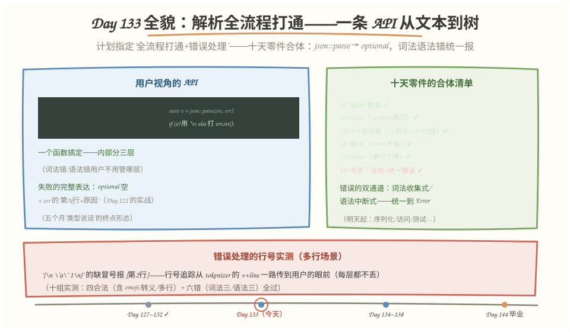
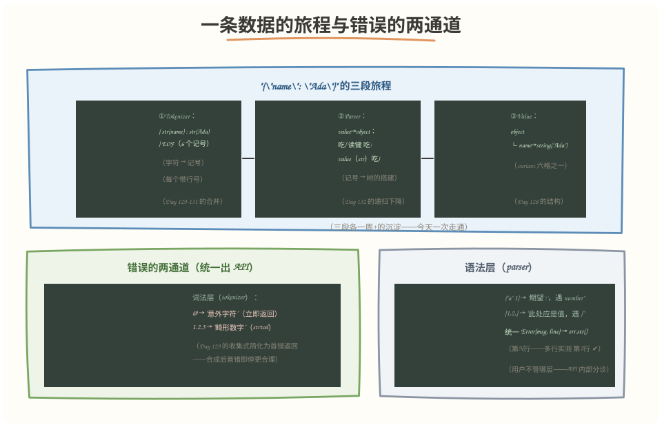
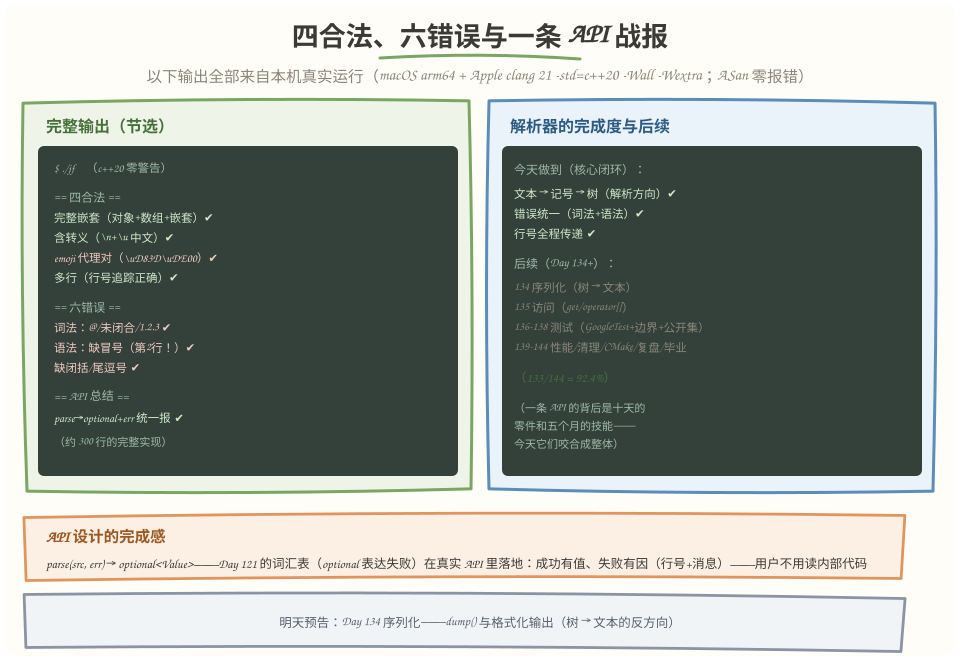

# 第 133 天：解析全流程打通 + 错误处理（带行号）

> **今日目标**：完成本教程后，你能做到：把十天的零件合成**一条用户 API**（`json::parse(src, err) → optional<JsonValue>`——词法语法错统一报、用户不管哪层）；实现**错误的双通道合并**（词法层和语法层都填 Error{msg, line}——多行输入报第 N 行的实测）；验证**四合法场景**（含 emoji 代理对和 \u 中文）+ **六错误场景**（词法三/语法三各配行号）；说出 optional 失败表达的落地（Day 121 在真实 API 的兑现）。
> **预计时间**：合并 50 分钟＋测试 30 分钟
> **前置准备**：完成 Day 127~132（零件齐备——今天是合体）。
> **今日产出**：约 300 行的完整解析器（十组合法/错误实测全过）。

## 1. 今天解决什么问题？

计划指定的**全流程打通**：十天的零件（127 设计+原型 / 128 Value / 129-130 字符串 / 131 数字 / 132 Parser）合成**一个文件、一条 API**——`json::parse(src, err) → optional<JsonValue>`。用户视角极简（成功有值、失败有因——行号+消息）；内部分三层（tokenize → Parser → JsonValue）各司其职。

**错误处理的统一**是今天的胶水：词法错（意外字符/未闭合/畸形数字）和语法错（缺冒号/缺闭括/尾逗号）都填 `Error{msg, line}`——**多行输入的行号实测**（缺冒号报 [第2行]）验证了行号从 tokenizer 的 ++line 一路传到用户眼前。

## 2. 先看全貌：今天的内容位于哪里？



**图 1**：左卡蓝是用户视角的 API；右卡绿是十天零件的合体清单；下方红卡是行号实测。路线图：**133/144 = 92.4%**。

三步概括今天：

1. API：parse(src, err) → optional（内部分三层）；
2. 统一错误：词法+语法都填 Error{msg, line}；
3. 实测：四合法（含 emoji/转义/多行）+ 六错误全过。

## 3. 核心概念：先用直觉，再给准确定义

### 3.1 一条 API：分层的封装

- **一句通俗解释**：用户只见 `json::parse(src, err)`——内部三段流水线（tokenize → Parser → 树）对外不可见；成功给值、失败给因。
- **一个类比**：餐厅的点菜——顾客说"来一份套餐"（parse）；后厨的切配/烹饪/摆盘（三段）顾客不管——上菜（值）或"这道菜做不了因为 XX"（err）。
- **对应到技术上是**：**API 签名**：`std::optional<JsonValue> parse(const std::string& src, Error& err)`——optional 表达"可能没有"（Day 121 词汇表的**真实 API 兑现**）、Error 带行号和消息（失败有因）。**内部流程**：①`tokenize(src, err)` → optional\<vector\<Token\>\>（词法错 → nullopt）；②`Parser(toks).parse(err)` → unique_ptr\<JsonValue\>（语法错 → nullptr）；③成功 → optional 有值。**封装的意义**：用户**不用知道有 tokenizer 和 parser**（内部结构随时可改——比如明天加序列化不影响 API）；错误统一出（词法/语法不区分——都填 err）。**与 Day 96 的呼应**：多文件项目的设计（stats.h 的接口承诺）——今天的 parse 是同款思想的 API 级版本。类比的边界：教学版单文件（~300 行）；生产级会拆头文件/加 namespace json（今天有）/模板化——**结构先行**。
- **常见误解**："一个函数太挤"——挤的是**文件**不是**逻辑**（内部三段清晰）；API 的简洁和内部的分层不矛盾——**封装的目的**正是这个。

### 3.2 错误的双通道统一

- **一句通俗解释**：词法层和语法层各自发现错误——都填同一个 `Error{msg, line}` 结构——用户拿到的是统一格式（"[第N行] 消息"）。
- **一个类比**：医院分诊——挂号处（词法）和诊室（语法）发现的问题都写到同一张病历单（Error）上——病人（用户）看一张单子。
- **对应到技术上是**：实测六错——**词法三**：`@` → `[第1行] 意外字符 '@'`（tokenize 的 default）；`"oops` → `[第1行] 字符串未闭合`；`[1.2.3]` → `[第1行] 畸形数字 "1.2.3"`（strtod 的吃一半）。**语法三**：`{"a" 1}` → **`[第2行] 期望 ':'，遇到 number`**（多行输入——**行号追踪的实测**！从 tokenizer 的 ++line 经 Token.line 到 Parser 的 cur().line 一路不丢）；`{"a": [1, 2` → `期望 ']'，遇到 EOF`；`[1, 2,]` → `此处应是值，遇 ]`。**Day 129 的收集式调整**：词法错从"收集全部"改成"首错返回"（合成后首错即停更合理——语法层反正没法在词法错误后继续）。**行号的价值链**：tokenizer 生成时带 → Token 结构存着 → Parser 报错引用 → Error 带出 → 用户看到——**五步一气呵成**。类比的边界：错误恢复（报错后继续找下一个错）仍是进阶——教学版首错即停。
- **常见误解**："词法和语法错该分开报"——用户视角不需要分层（那是开发者的事）；统一的"[第N行] 原因"是**产品语言**。

### 3.3 测试矩阵：合法+错误的覆盖

- **一句通俗解释**：十组测试覆盖四个合法（嵌套/转义/emoji/多行）+ 六个错误（词法三/语法三）——**矩阵式的验收**。
- **一个类比**：出厂检验——合格品抽四种形态（确认能跑）+ 故意做坏六种（确认能拦）——两个方向都要过。
- **对应到技术上是**：**四合法**：完整嵌套（对象+数组+嵌套对象+null）；含转义（`\n` + `\u4e2d\u6587` 中文码点）；**emoji 代理对**（`\uD83D\uDE00` → 😀——Day 130 的深水区在**全流程**里跑通）；多行（行号基础）。**六错误**：如上 3.2 的清单。**覆盖的意义**：每类都有至少一例——明天的序列化（反向）和 Day 136 起的测试课（GoogleTest）会把这些**手工验证**升级为**自动回归**。**ASan 零报错**：解析半途而废（错误路径）时树的回收（unique_ptr unwind）也被验证了——错误路径的内存正确。类比的边界：这不是穷尽测试（边界课 Day 137 补 20+）；今天是**合体验收**（零件咬合的正确性）。
- **常见误解**："能解析就是完成"——错误路径同样重要（六个错误实测）——**能拦错和能解析是两种能力**。

## 4. 图解核心机制



**图 2**：上半部分蓝卡是一条数据的三段旅程（文本 → 记号 → 树——各段标注出处天数）；左下绿卡是词法错误通道；右下灰卡是语法错误通道（统一 Error）。

按图逐步讲：

1. **沿三段旅程走**：`{"name":"Ada"}` → 六个记号 → object 树——每段标注是哪几天的成果；
2. **看两通道的汇合**：词法的"意外字符"和语法的"期望':'"——最终都成 `[第N行] 消息` 的统一格式；
3. **验行号的链路**：tokenizer 的 ++line → Token.line → Parser 的 cur().line → Error——多行的 [第2行] 是链路通的证明；
4. **品 API 的完成感**：一条 parse 背后是十天的零件和五个月的技能——**咬合成整体**。

## 5. 动手实践：完成一个最小可运行例子

### 5.1 准备文件

```bash
cd ai-compiler-roadmap/tutorials/day-133/examples
```

主角：`json_full.cpp`（约 300 行的完整实现——namespace json 里的一切）。

### 5.2 编写代码

API 的形态（完整代码见本目录——内部含 Tokenizer/Parser/Value 三段）：

```cpp
namespace json {

struct Error {
    std::string msg;
    int line;
    std::string str() const { return "[第" + std::to_string(line) + "行] " + msg; }
};

// 用户唯一需要的函数：
std::optional<JsonValue> parse(const std::string& src, Error& err) {
    auto toks = tokenize(src, err);          // 词法层（129-131 的合并）
    if (!toks) return std::nullopt;          // 词法错
    Parser p(*toks);
    auto v = p.parse(err);                   // 语法层（132 的骨架）
    if (!v) return std::nullopt;             // 语法错
    return JsonValue(std::move(*v));         // 成功（128 的树）
}

}  // namespace json

// 用法：
json::Error err;
auto v = json::parse(src, err);
if (v) { /* 用 *v */ } else { std::cout << err.str(); }   // "[第2行] 期望 ':'…"
```

### 5.3 运行与观察

```bash
g++ -Wall -Wextra -std=c++20 json_full.cpp -o jf && ./jf
```

实际执行结果（本机）：

```text
== 完整嵌套 ==
  输入：{"name": "Ada", "scores": [95, 88.5], "meta": {"ok": true, "tag": null}}
  ✔ 解析成功（类型 = object）

== 含转义 ==
  输入：["a\nb", "\u4e2d\u6587"]
  ✔ 解析成功（类型 = array）

== emoji 代理对 ==
  输入：["\uD83D\uDE00"]
  ✔ 解析成功（类型 = array）

== 多行 ==
  输入：{ "a": 1, "b": [2, 3] }
  ✔ 解析成功（类型 = object）

== 词法错：意外字符 ==
  ✘ [第1行] 意外字符 '@'

== 词法错：未闭合 ==
  ✘ [第1行] 字符串未闭合

== 词法错：畸形数字 ==
  ✘ [第1行] 畸形数字 "1.2.3"

== 语法错：缺冒号（第2行） ==
  输入：{ "a" 1 }
  ✘ [第2行] 期望 ':'，遇到 number        ← 行号追踪的实测！

== 语法错：缺闭括 ==
  ✘ [第1行] 期望 ']'，遇到 EOF

== 语法错：尾逗号 ==
  ✘ [第1行] 此处应是值，遇到 ]

== API 的一句话总结 ==
  json::parse(src, err) -> optional<JsonValue>
  （失败：optional 空 + err 带行号消息）
  （词法错/语法错统一报——用户不用管哪层）
```



**图 3**：左上完整输出（四合法/六错误/API 总结）；右侧是完成度清单（今天做到/后续路线）和"一条 API 背后"的注脚；下方橙卡是 API 设计的完成感。

### 5.4 修改一个输入再观察：真实世界的 JSON

从网上下载一个真实的 `.json`（如 GitHub API 的响应、package.json）→ 用 filesystem（Day 123）读入 → parse → 打印类型和顶层键数。**真实负载**的全流程验收（格式化多行的行号、真实数据的各种值类型）——比演示串更严酷的考验。

## 6. 常见错误与排查

**错误 1：多行 JSON 的报错行号不对**

- 现象：明明第 3 行的错报第 1 行；
- 原因：行号追踪断了（某处没传 line）；
- 定位：从 Error 往回查（Parser → Token → tokenizer 的 ++line）；
- 修复：今天的实测（[第2行]）验证链路通——断点通常是新加的 Token 忘带 line。

**错误 2：optional 返回但树是空的（逻辑漏）**

- 现象：parse 成功但访问崩；
- 原因：某分支返回了空 unique_ptr 被 move 成"空值"；
- 定位：对照每条 return 路径（今天的 Parser 全路径带 err 检查）；
- 修复：错误路径 return nullopt/nullptr + err——不混。

**错误 3：语法错后内存泄漏（ASan 报）**

- 现象：错误路径 ASan 报 leak；
- 原因：半成品的树没回收（裸指针或忘了析构）；
- 定位：ASan 的泄漏栈指向构建半途的节点；
- 修复：全程 unique_ptr（今天的实现零裸 new——unwind 自动回收；实测 ASan 零报错验证）。

## 7. 今日练习

### 必做练习（计划指定：全流程+错误处理）

用 5.4 的真实 JSON 跑三份（不同来源）——记录：成功/失败、类型、顶层键数、（失败时的）行号消息。预期产出：三份记录表。

### 选做挑战

"错误消息的升级"：给 Error 加 `position`（列号——tokenizer 里同一行的字符偏移）——报错变成 "[第2行第5列]"；再想：能不能在消息里**显示出错的那一行内容**（`"a" 1` 的原文）——IDE 式的错误展示（进阶体验）。

## 8. 今日验收

- [ ] 我的一条 API 跑通（parse → optional + err——十天的零件合体）
- [ ] 我的四合法全过（嵌套/转义/emoji 代理对/多行）
- [ ] 我的六错误各配行号实测（含 [第2行] 的多行追踪）
- [ ] 我能说出错误双通道的统一（词法+语法 → Error{msg, line}）
- [ ] ASan 零报错（错误路径的 unwind 回收也验证）

## 9. 一句话总结与明天预告

今天的问题是"十天的零件怎么咬合成整体"；机制上，一条 API 的封装（parse → optional + err——用户不管内部三层）、错误双通道的统一（词法/语法都填 Error{msg, line}——行号五步链路实测）、四合法+六错误的矩阵验收；实践上，约 300 行完整实现、emoji 全流程、多行行号、真实 JSON 试跑全部落地；验证标准是给任意字符串能预判"解析成什么树或报什么错"。明天 **Day 134：序列化——dump() 与格式化输出**（树 → 文本的反方向）：解析器的"另一半"。
