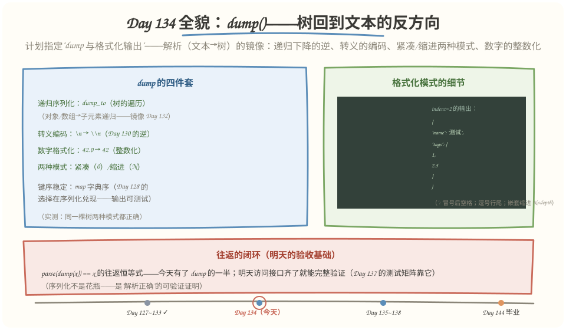
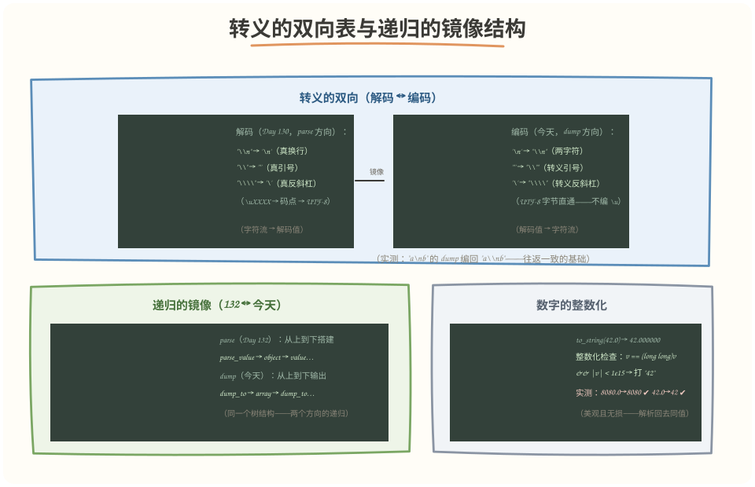
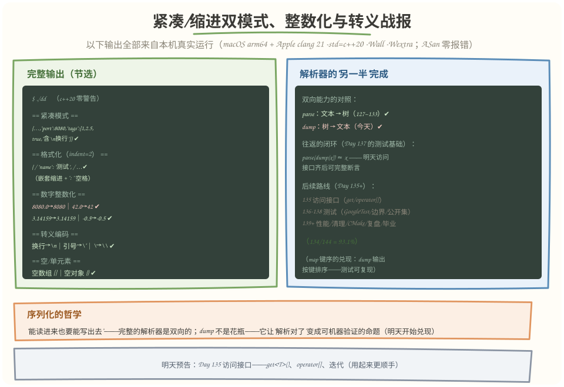

# 第 134 天：序列化——dump() 与格式化输出

> **今日目标**：完成本教程后，你能做到：实现 **dump 的递归序列化**（dump_to——对象/数组递归子元素；132 递归下降的镜像）；写**转义编码**（'\n'→`\\n` 等——Day 130 解码的逆过程）；**数字的整数化**（42.0→42 的美观格式）；实现**紧凑/缩进两种模式**（indent 参数控制——格式化输出的 `": "`/嵌套缩进）；说出**往返闭环**的意义（parse(dump(x)) 的恒等式——Day 137 测试的基础）。
> **预计时间**：实现 45 分钟＋对照 30 分钟
> **前置准备**：完成 Day 133（全流程——今天的 dump 是"另一半"）。
> **今日产出**：完整 dump（双模式/转义/整数化/空容器）、map 键序的兑现。

## 1. 今天解决什么问题？

计划指定的**序列化**：树 → 文本的反方向。四个零件：**递归序列化**（dump_to——树结构决定递归；132 递归下降的**镜像**）、**转义编码**（Day 130 解码的逆——'\n' 变回两字符 `\n`）、**数字的整数化**（double 42.0 用 printf/to_string 直接打是 "42.000000"——整数化检查后打 "42"）、**两种模式**（紧凑 indent=0 一行 / 缩进 indent=N 换行+空格）。

**map 键序的兑现**：Day 128 选 map（不选 unordered）的"序列化输出稳定可测试"——今天兑现（dump 的键按字典序——同一棵树输出永远一样）。

## 2. 先看全貌：今天的内容位于哪里？



**图 1**：左卡蓝是 dump 的四件套；右卡绿是格式化模式的细节；下方红卡是往返闭环。路线图：**134/144 = 93.1%**。

三步概括今天：

1. 递归：dump_to 遍历树（对象/数组递归）；
2. 编码：转义（\n 等七件）+ 数字整数化；
3. 模式：indent=0 紧凑 / N 缩进（": " 空格等细节）。

## 3. 核心概念：先用直觉，再给准确定义

### 3.1 递归序列化：镜像结构

- **一句通俗解释**：dump_to 沿树从上到下输出——遇对象打 `{`、逐键值递归、打 `}`；遇数组同构——**和 parse 相反方向的同一个递归**。
- **一个类比**：折纸与展纸——parse 把纸折成树（文本结构化）；dump 把树展开回纸（结构文本化）——**同一张纸两个方向**。
- **对应到技术上是**：实测——嵌套树（对象含数组含对象含转义串）的双模式输出全对（紧凑一行 / 缩进逐层）；**空容器特判**（`[]`/`{}` 不换行——紧凑美观）；**键的迭代**：map 的范围 for（字典序——Day 128 的选择兑现）。**递归的镜像**（图 2）：parse_value→object→value（搭建）vs dump_to→array→dump_to（输出）——**同一个树结构召唤的两个方向**。**缩进的实现**：`nl(depth)` 辅助（indent>0 时换行+`indent×depth` 个空格）；冒号后 `"： "` 加空格（格式化的惯例）。类比的边界：**深树的栈**（同 parse 的递归深度注意——超深会溢出；教学范围接受）。
- **常见误解**："dump 就是打印"——打印是顺手（cout << dump(v)）；dump 本身**返回 string**（可写文件/可比较/可再 parse——往返的原料）。

### 3.2 转义编码与数字整数化

- **一句通俗解释**：字符串值里的特殊字符要**编回转义形**（'\n' → 两字符 `\n`）；数字 42.0 要**整数化**（打 42 不打 42.000000）。
- **一个类比**：寄快递的打包——易碎品贴标记（转义：真换行变成 `\n` 的两字符标记）；重量显示（数字：8080.0 克显示 8080 克——整数就别带小数）。
- **对应到技术上是**：实测——**转义七件**：`"` → `\"`、`\` → `\\`、`\n`/`\t`/`\r`/`\b`/`\f` 各编回；**UTF-8 直通**（中文等多字节字符**不编 \u**——合法的 JSON 允许直写；编 \u 反而更长——nlohmann 也这么选）。**数字整数化**：`v == (long long)v && |v| < 1e15` → 打整数（8080.0→**8080** ✔、42.0→**42** ✔）；否则 `ostringstream << v`（3.14159→**3.14159**、-0.5→**-0.5**）；**1e15 的界**（超过就科学计数更短——教学取整界）。**往返的保证**：42 → parse → 42.0 → dump → 42（整数值恒等）；3.14159 的 6 位有效（教学版 ostream 默认——精度全保要 setprecision(17)——进阶注）。类比的边界：**NaN/Infinity**（JSON 没有——dump 会打出 "nan"/"inf" 的非法文本；生产级要么断言要么转 null——今天的诚实边界）。
- **常见误解**："42.0 打成 42 信息丢了"——语义没丢（JSON 数字不区分 int/float——都是 number；parse 回来还是 42.0）——**美观与语义的分界**。

### 3.3 往返闭环与键序兑现

- **一句通俗解释**：`parse(dump(x))` 应得等价的树——**往返恒等式**；今天有了 dump 的一半、明天访问接口齐了就能完整断言。
- **一个类比**：翻译的回译——中文译英文再译回中文（parse→dump→parse）——意思应一致（恒等）；不一致的地方就是 bug 的藏身处。
- **对应到技术上是**：**往返的意义**：(1) **解析正确的可验证证明**（dump 出的文本能被自己 parse 回等价树——解析器自洽）；(2) **测试的基础**（Day 137 的矩阵大量用"parse→dump→比对"——比手建树方便）；(3) **格式化工具**（紧凑↔缩进的互转——pretty print 的实现就是 parse+dump(2)）。**map 键序的兑现**：Day 128 选 map 的理由"序列化输出稳定"——今天兑现：同一棵树的 dump **永远相同**（键按字典序）——测试可复现（unordered 会每次不同）。**"等价"而非"全等"**：数字 42 ↔ 42.0（number 语义等价）、键序（我们稳定但不是原文序）——**语义等价**的断言（不是字符串全等）。类比的边界：**原格式丢失**（parse 后 dump 不会保留原文的空格/键序/数字写法 1e2 vs 100）——这是**规范化**（normalize）不是 bug。
- **常见误解**："dump 应该还原原文"——不是（那是格式化工具的行为如 prettier 的保留模式）；dump 输出**规范形**（我们的键序+我们的数字格式）——语义等价即可。

## 4. 图解核心机制



**图 2**：上半部分蓝卡是转义的双向表（左：Day 130 的解码 / 右：今天的编码——镜像箭头）；左下绿卡是递归的镜像（132 ↔ 今天）；右下灰卡是数字的整数化。

按图逐步讲：

1. **对照双向表**：`"\\n"` ↔ `'\n'`——同一对字符两个方向的映射；UTF-8 直通（编码不编 \u）的选择；
2. **看递归的镜像**：parse 的从上到下搭建 vs dump 的从上到下输出——**同一结构的双向**；
3. **读整数化的条件**：整数值 + 1e15 内 → 打整数（实测 8080/42）；否则 ostream；
4. **记往返的闭环**：parse↔dump 是解析器的双向能力——**"能读能写"才算完整**。

## 5. 动手实践：完成一个最小可运行例子

### 5.1 准备文件

```bash
cd ai-compiler-roadmap/tutorials/day-134/examples
```

主角：`dump_demo.cpp`（dump 的完整实现 + 双模式演示）。

### 5.2 编写代码

核心（完整代码见本目录）：

```cpp
std::string escape_string(const std::string& s) {       // 编码（130 的逆）
    std::string out = "\"";
    for (char c : s) {
        switch (c) {
            case '"':  out += "\\\""; break;
            case '\\': out += "\\\\"; break;
            case '\n': out += "\\n";  break;
            /* \t \r \b \f 同款；其他直通（UTF-8 字节） */
        }
    }
    out += '"';
    return out;
}

std::string format_number(double v) {                    // 整数化
    if (v == static_cast<long long>(v) && std::abs(v) < 1e15) {
        return std::to_string(static_cast<long long>(v));     // 42.0 → "42"
    }
    std::ostringstream oss;  oss << v;                   // 3.14159
    return oss.str();
}

void dump_to(const JsonValue& v, std::string& out, int indent, int depth) {
    switch (v.raw().index()) {
        case 2: out += format_number(std::get<double>(v.raw())); break;
        case 3: out += escape_string(std::get<std::string>(v.raw())); break;
        case 4: {   // array：'[' 子元素（递归）']'
            /* nl(depth+1) 缩进；逗号分隔 */
        }
        /* object 同构：'{' 键: 值（递归）'}' */
    }
}

std::string dump(const JsonValue& v, int indent = 0) {   // 用户 API
    std::string out;
    dump_to(v, out, indent, 0);
    return out;
}
```

### 5.3 运行与观察

```bash
g++ -Wall -Wextra -std=c++20 dump_demo.cpp -o dd && ./dd
```

实际执行结果（本机，节选）：

```text
== 紧凑模式（indent=0） ==
{"empty_arr":[],"empty_obj":{},"name":"测试","nested":{"desc":"嵌套\"对象\"","level":2},"pi":3.14159,"port":8080,"tags":[1,2.5,true,"含\n换行"]}

== 格式化模式（indent=2） ==
{
  "empty_arr": [],
  "empty_obj": {},
  "name": "测试",
  "nested": {
    "desc": "嵌套\"对象\"",
    "level": 2
  },
  "pi": 3.14159,
  "port": 8080,
  "tags": [
    1,
    2.5,
    true,
    "含\n换行"
  ]
}

== 数字的整数形态 ==
  8080.0 → 8080
  3.14159 → 3.14159
  -0.5 → -0.5
  42.0 → 42

== 转义的编码 ==
  "a\nb" → "a\nb"          ← 编回两字符
  含引号 → "say \"hi\""
  反斜杠 → "C:\\path"

== 空/单元素 ==
  空数组 → []
  空对象 → {}
```



**图 3**：左上完整输出（双模式/整数化/转义/空容器四段）；右侧是"另一半完成"的对照和后续路线；下方橙卡是序列化的哲学。

### 5.4 修改一个输入再观察：往返的初验

把 Day 133 的 parse 和今天的 dump 连起来：`parse(src)` → `dump(v)` → 再 `parse(dump的结果)` → 两棵树各 dump 一次比对——**两轮的 dump 输出应完全相同**（幂等性：规范化后再规范化不变）。用 3 份不同风格的输入（紧凑/缩进/混合）验证——格式差异被吸收、语义等价保留。

## 6. 常见错误与排查

**错误 1：转义漏了某种字符（输出损坏 JSON）**

- 现象：dump 的文本再 parse 失败；
- 原因：某个控制字符没编（如 `\b` 退格——真实文本里有）；
- 定位：往返测试（5.4）暴露；
- 修复：补齐七件（今天的 switch 全集）。

**错误 2：数字打出一堆零（42.000000）**

- 现象：整数打成了长小数；
- 原因：没做整数化（printf 的 %f / std::to_string 默认补足 6 位小数——ostream 的 << 反而会打 "42"，但大数会变 1.23457e+06）；
- 定位：看输出形态；
- 修复：整数化检查（今天的 format_number）。

**错误 3：NaN/Infinity 打出非法文本**

- 现象：dump 含 "nan"/"inf"——不是合法 JSON；
- 原因：double 的非数值没拦（解析路径进不来——但手工建树/计算可能造出）；
- 定位：往返 parse 会拒；
- 修复：教学版记录边界；生产级 dump 前断言 isfinite 或转 null。

## 7. 今日练习

### 必做练习（计划指定：dump 与格式化输出）

给 dump 加第三种模式 **indent=-1**（保留原始风格不做——改为：加 `ensure_ascii` 参数——true 时把非 ASCII 字符编成 `\uXXXX`——Day 130 的 append_utf8 的逆（码点提取）。测 "中文" 的两种输出。预期产出：ensure_ascii 版 + 双输出对照。

### 选做挑战

"pretty 的进阶"：indent 支持字符串（如 `"\t"` 制表符缩进——不只空格数）；再加"数组同行"选项（短数组不换行 `[1, 2, 3]`——超长才展开）——nlohmann 风格的格式化细节。

## 8. 今日验收

- [ ] 我的 dump 双模式通过（紧凑一行 / 缩进嵌套 + ": " 空格）
- [ ] 我的转义编码七件全（往返一致的编码方向）
- [ ] 我的数字整数化过（8080.0→8080、42.0→42、3.14159 保持）
- [ ] 我的空容器紧凑（[]/{} 不换行）
- [ ] 我能说出往返闭环的意义（parse(dump(x)) 幂等——Day 137 的测试基础）

## 9. 一句话总结与明天预告

今天的问题是"树怎么变回文本"；机制上，递归序列化（132 的镜像——同结构双向）、转义编码（130 解码的逆 + UTF-8 直通的选择）、数字整数化（美观与语义的分界）、map 键序的兑现（dump 输出永远稳定）；实践上，双模式、转义、整数化、空容器、往返初验全部落地；验证标准是给任何树能手推它的 dump 输出（含缩进位置）。明天 **Day 135：访问接口**——`get<T>()`、`operator[]`、迭代：让解析出的树**用起来顺手**（今天能看、明天能摸）。
