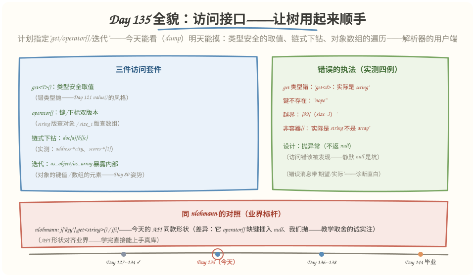
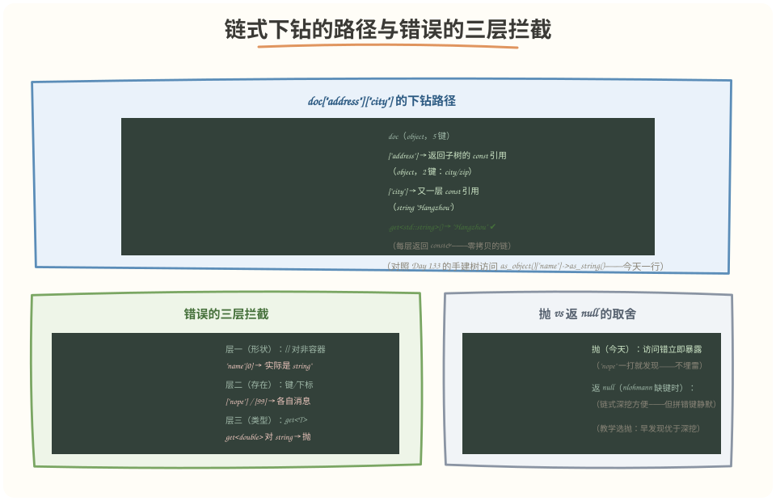
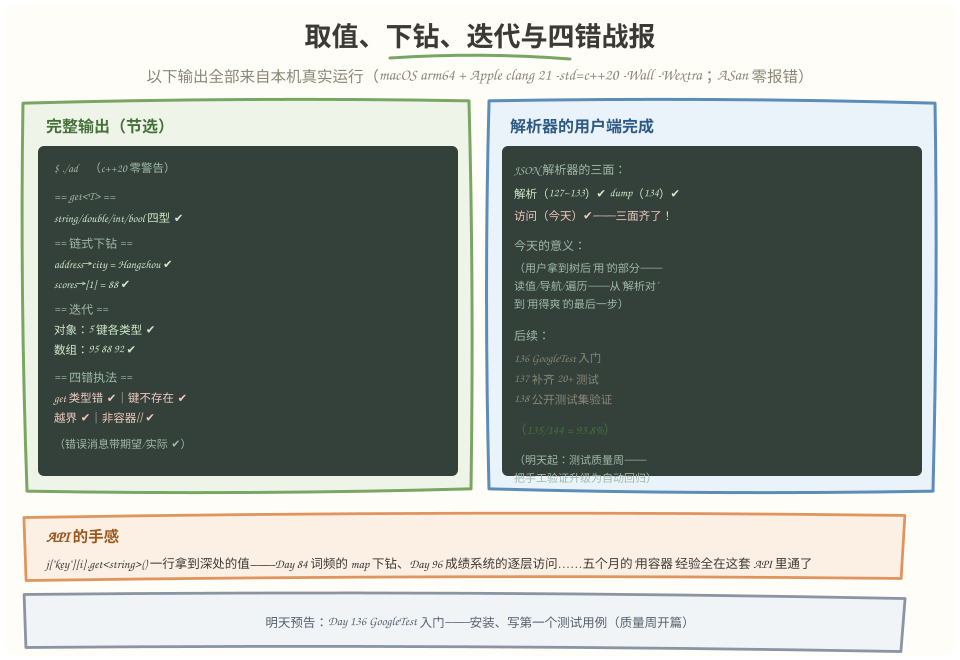

# 第 135 天：访问接口——`get<T>()`、`operator[]`、迭代

> **今日目标**：完成本教程后，你能做到：实现 **get\<T\>()** 的类型安全取值（错类型抛——Day 121 value() 风格 + get_int 便捷版）；实现 **operator[] 双版本**（string 键查对象 / size_t 下标查数组——链式下钻 `doc[a][b][c]`）；提供**迭代入口**（as_object/as_array——键值对和元素的遍历）；演示**错误的三层拦截**（形状/存在/类型——四错实测）；对照 nlohmann 的 API 形状（业界对齐——学完直接能上手真库）。
> **预计时间**：实现 40 分钟＋对照 30 分钟
> **前置准备**：完成 Day 133~134（树有了、能 dump——今天让它**用起来顺手**）。
> **今日产出**：完整访问套件（取值/下钻/迭代/四错执法）。

## 1. 今天解决什么问题？

解析器的**用户端**：拿到树之后怎么"用"——读值（get\<T\>）、导航（operator[] 链式下钻）、遍历（对象键值/数组元素）。昨天 dump 让树**能看**；今天让它**能摸**。至此解析器三面齐备：**解析（127~133）+ dump（134）+ 访问（今天）**。

**API 形状对齐业界**（nlohmann 的 `j["key"].get<string>()`）——学完这套接口直接能上手真库；差异点（缺键时抛 vs nlohmann 插 null）是教学的诚实取舍。

## 2. 先看全貌：今天的内容位于哪里？



**图 1**：左卡蓝是三件访问套件；右卡绿是四错执法；下方红卡是 nlohmann 对照。路线图：**135/144 = 93.8%**。

三步概括今天：

1. get\<T\>：类型安全（错类型抛——"期望/实际"消息）；
2. operator[]：键/下标双版（链式下钻零拷贝）；
3. 迭代：as_object/as_array 暴露内部（Day 80 的姿势）。

## 3. 核心概念：先用直觉，再给准确定义

### 3.1 get<T>()：类型安全取值

- **一句通俗解释**：`v.get<std::string>()`——"我知道这是 string，给我"；如果不是（比如实际是 number）→ **抛异常**（消息带期望和实际）。
- **一个类比**：取快递报手机尾号——对不上（类型错）柜台拒付（抛）——而不是给你一个空包裹（静默默认值）。
- **对应到技术上是**：实测——`doc["name"].get<std::string>()` → **"Ada"** ✔；`get<double>` 对 name（实际 string）→ `get<d>：实际是 string` 抛 ✔；`get_int()`（便捷版——number 转 int：36.0 → **36**）。**实现**：`if constexpr` 按类型分派（Day 107 的舞台）到 variant 的 `get<T>`——外面包一层类型检查（是 X 才 get\<X\>）。**与 Day 121 的连接**：optional 的 value()（空时抛 bad_optional_access）——**同款风格**：访问失败抛比静默默认**更早暴露**。**get_int 的场景**：age 通常当整数用（`get<double>` 得 36.0 打出来带 .0 烦）——便捷版一步到位。类比的边界：**get 的 T 只有三种**（bool/double/string——容器用 as_object/as_array 走迭代路线）。
- **常见误解**："get 失败返回 0"——**抛**（返回 0 是坑：合法的 0 和失败的 0 分不清）；要默认值自己 try 或先 is_xxx() 查。

### 3.2 operator[]：链式下钻

- **一句通俗解释**：`doc["address"]["city"]` 一行拿到深处的值——对象版查键、数组版查下标；**每层返回 const 引用**（零拷贝的链）。
- **一个类比**：门牌导航——"X 栋"（键）→ "3 单元"（键）→ "502 室"（下标）——一路问下去直达。
- **对应到技术上是**：实测——`doc["address"]["city"].get<std::string>()` → **"Hangzhou"** ✔；`doc["scores"][1].get<double>()` → **88** ✔。**双版本的重载**：`operator[](const std::string&)`（对象——find 键）和 `operator[](std::size_t)`（数组——下标+越界检查）。**const 引用的链**：每层返回 `const JsonValue&`——不拷贝子树（大 JSON 的深挖零成本）。**对照 Day 133**：手建树时代的访问是 `doc.as_object()["name"]->as_string()`（三层方法+迭代器）——今天一行（**用户端的进化**）。**错误消息的设计**：越界带 size（"[99]（size=3）"）、键错带键名（'"nope"'）——**诊断信息直白**。类比的边界：**写访问**（operator[]= 赋值）没实现——教学范围只读（写要处理"中间层不存在要建"的语义——进阶）。
- **常见误解**："[] 应该像 map 一样缺键插入"——那是 nlohmann 的选择（缺键插 null 方便深挖但拼错静默）；我们**抛**——教学的取舍（访问错早发现优于深挖方便；见图 2 右下的对照）。

### 3.3 迭代与 as_object/as_array

- **一句通俗解释**：`as_object()` 拿到 map（键值遍历）、`as_array()` 拿到 vector（元素遍历）——**暴露内部给范围 for**（Day 80 的姿势）。
- **一个类比**：图书馆的开放书架——不通过管理员（get 单点取）自己浏览（迭代）整个架子。
- **对应到技术上是**：实测——**对象迭代**：`for (const auto& [k, v] : doc.as_object())` → 5 键各类型（active: bool、address: object…——**结构化绑定** Day 106）；**数组迭代**：`for (const auto& e : doc["scores"].as_array())` → 95 88 92。**size()**：对象键数/数组元素数（容器的通用查询）。**教学取舍的诚实**：暴露内部（as_object 返回 `const map&`）——不是最纯的封装（纯版要包 iterator 类——进阶）；但**用起来最直白**（范围 for 直接跑）。**与 Day 80 的连接**：给自己的类型加 begin/end 是那天的选做——今天用 as_xxx 暴露法（同效果的另一路）。类比的边界：**修改**（非 const 版的 as_object/as_array）没提供——只读访问（写树用 parse 重建或进阶的 mutator）。
- **常见误解**："应该像容器一样直接 begin/end"——可以（Day 80 的路）但 variant 六格没有统一迭代语义（number 迭代什么？）——as_xxx **显式选形态**更清晰。

## 4. 图解核心机制



**图 2**：上半部分蓝卡是 doc["address"]["city"] 的下钻路径（三层 const 引用链——零拷贝）；左下绿卡是错误的三层拦截（形状/存在/类型）；右下灰卡是抛 vs 返 null 的取舍对照。

按图逐步讲：

1. **沿下钻路径走**：doc → address（引用）→ city（引用）→ get（值）——**每层零拷贝**；
2. **数三层拦截**：形状（非容器[]）、存在（键/下标）、类型（get 错）——每层一个 throw；
3. **读抛 vs null 的对照**：教学选抛（早发现）；nlohmann 选插（深挖方便）——**两种设计的适用面**；
4. **连 Day 84/96**：词频的 map 下钻、成绩系统的逐层访问——五个月的"用容器"经验在今天的 API 里通了。

## 5. 动手实践：完成一个最小可运行例子

### 5.1 准备文件

```bash
cd ai-compiler-roadmap/tutorials/day-135/examples
```

主角：`access_demo.cpp`（访问套件 + 简化 parse + 四错演示）。

### 5.2 编写代码

核心（完整代码见本目录）：

```cpp
// get<T>：类型安全（if constexpr 分派——Day 107）
template <typename T>
T get() const {
    if constexpr (std::is_same_v<T, bool>) {
        if (is_bool()) return std::get<bool>(data_);
    } else if constexpr (std::is_same_v<T, double>) {
        if (is_number()) return std::get<double>(data_);
    } else if constexpr (std::is_same_v<T, std::string>) {
        if (is_string()) return std::get<std::string>(data_);
    }
    throw std::runtime_error("get<>：实际是 " + std::string(type_name()));
}

// operator[] 双版本（链式下钻的基石）
const JsonValue& operator[](const std::string& key) const {
    if (!is_object()) { throw …("实际是 " + type_name() + " 不是 object"); }
    auto it = std::get<JsonObject>(data_).find(key);
    if (it == …end()) { throw …("键不存在：\"" + key + "\""); }
    return *it->second;                        // const 引用——零拷贝
}
const JsonValue& operator[](std::size_t i) const { /* 数组版 + 越界检查 */ }

// 迭代入口
const JsonObject& as_object() const { … }       // 键值遍历（结构化绑定）
const JsonArray&  as_array()  const { … }       // 元素遍历

// 用法：
doc["address"]["city"].get<std::string>();      // 链式下钻一行
for (const auto& [k, v] : doc.as_object()) { … }
```

### 5.3 运行与观察

```bash
g++ -Wall -Wextra -std=c++20 access_demo.cpp -o ad && ./ad
```

实际执行结果（本机，节选）：

```text
== get<T>()：类型安全取值 ==
  get<std::string>(name) = Ada
  get<double> 经 [age] = 36
  get_int(age) = 36
  get<bool>(active) = true

== operator[] 的链式下钻 ==
  doc["address"]["city"] = Hangzhou
  doc["scores"][1] = 88

== 迭代 ==
  顶层键（对象迭代）：
    active : bool
    address : object
    age : number
    name : string
    scores : array
  scores 逐个（数组迭代）：
    95     88     92

== 错误的执法 ==
  get 类型错："get<d>：实际是 string" ✔
  键不存在："键不存在："nope"" ✔
  越界："数组越界：[99]（size=3）" ✔
  非容器[]："operator[](index)：实际是 string 不是 array" ✔
```



**图 3**：左上完整输出（取值/下钻/迭代/四错四段）；右侧是"三面齐备"的对照和测试周的预告；下方橙卡是 API 的手感。

### 5.4 修改一个输入再观察：你自己的 JSON 导航

写一份自己领域的 JSON（游戏配置/课程表/书单——任意嵌套）→ parse → 用链式下钻取**最深处**的一个值、迭代打印**全部顶层键**、找**数组里的第三个**——三个操作各一行代码。**手感的自测**：如果哪个操作写起来别扭（要查文档/要想半天）——就是 API 设计该改进的信号（API 是给人用的）。

## 6. 常见错误与排查

**错误 1：`get<T>` 编译错"no matching function"（T 不在三种里）**

- 现象：`get<int>()` 直接编不过（如果没用 if constexpr 的 else 分支）；
- 原因：T 只支持 bool/double/string（int 用 get_int）；
- 定位：编译错指 get 实例化；
- 修复：int → get_int()；容器 → as_object/as_array。

**错误 2：链式下钻中间断了（catch 到"不是 object"）**

- 现象：doc["a"]["b"] 抛"实际是 string 不是 object"；
- 原因：a 的值不是对象（结构理解和 JSON 实际不符）；
- 定位：错误消息带实际类型——打印那层的 dump 看看；
- 修复：对照 JSON 的结构（或用 is_object() 先验）。

**错误 3：遍历时想改值（const 编译错）**

- 现象：迭代里赋值编不过；
- 原因：as_object/as_array 返回 const 引用（只读设计）；
- 定位：编译错指 const；
- 修复：教学版只读——要改就重建（parse 新串）或等进阶的 mutator。

## 7. 今日练习

### 必做练习（计划指定：get/operator[]/迭代）

给访问套件加 **contains(key)**（对象是否含键——不抛的查询版）和 **at(i) 的带边界检查版**（同 operator[] 但语义更显式）——测"存在/不存在"两路。预期产出：两个方法 + 测试。

### 选做挑战

"路径访问"：`at_path("address/city")`（斜杠分隔的路径一次下钻——每段是 [] 调用）+ `try_path`（失败返 optional 而不抛——Day 121 的组合）——JSON Path 的最简版（进阶库的常见功能）。

## 8. 今日验收

- [ ] 我的 get\<T\> 四型通过（string/double/int/bool——错类型的抛实测）
- [ ] 我的链式下钻过（address→city / scores→[1]——const 引用零拷贝）
- [ ] 我的迭代通过（对象五键 / 数组三元素——结构化绑定）
- [ ] 我的四错执法全过（类型/键/越界/形状——消息带期望实际）
- [ ] 我能说出与 nlohmann 的异同（API 形状对齐 / 缺键抛 vs 插 null 的取舍）

## 9. 一句话总结与明天预告

今天的问题是"解析出的树怎么用得顺手"；机制上，get\<T\> 的类型安全（错类型抛——失败早暴露）、operator[] 双版本的链式下钻（const 引用零拷贝）、as_object/as_array 的迭代入口（Day 80 姿势 + Day 106 绑定）；实践上，取值、导航、遍历、四错执法全部落地——**解析器三面齐备**（解析/dump/访问）；验证标准是任何嵌套取值能一行写出（链式下钻）。明天 **Day 136：GoogleTest 入门**——安装、写第一个测试用例：质量周开篇（手工验证升级为自动回归）。
