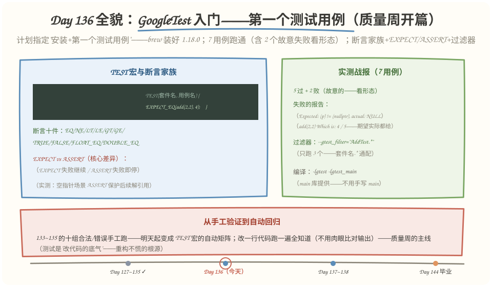
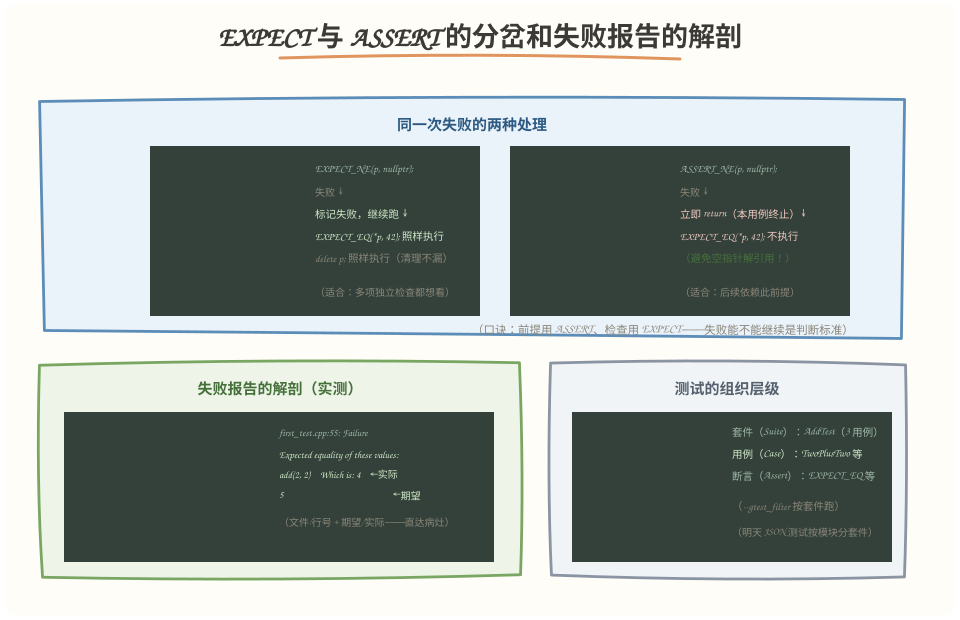
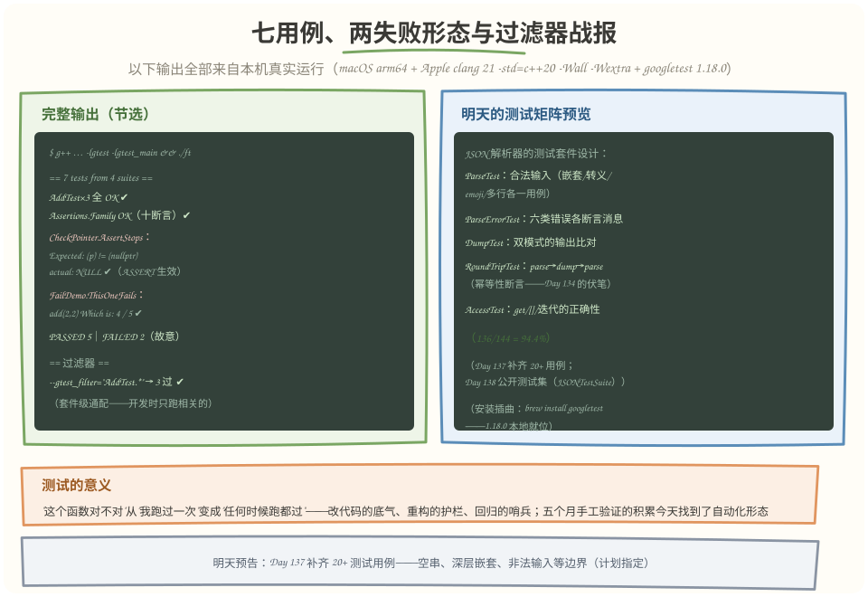

# 第 136 天：GoogleTest 入门——安装、写第一个测试用例

> **今日目标**：完成本教程后，你能做到：**安装并编译** GoogleTest（brew install googletest 1.18.0——链接 -lgtest -lgtest_main）；写 **TEST 宏的测试用例**（套件/用例两级组织——AddTest 三个用例）；用**断言家族**（EQ/NE/LT/LE/GT/GE/TRUE/FALSE/FLOAT_EQ/DOUBLE_EQ 十件）；说出 **EXPECT vs ASSERT 的差异**（失败继续 vs 立即停——空指针保护实测）；读懂**失败报告**（文件：行号 + 期望/实际）；用 **--gtest_filter** 按套件过滤。
> **预计时间**：安装 15 分钟＋学习 40 分钟
> **前置准备**：完成 Day 133~135（被测对象就绪——明天起测 JSON 解析器）。
> **今日产出**：7 用例全跑通（含 2 个故意的失败看形态）、断言家族实测、过滤器演示。

## 1. 今天解决什么问题？

**质量周开篇**（Day 136~138）：计划指定的 GoogleTest 入门。前三天的解析器靠**手工验证**（跑一次看输出）——今天起升级为**自动回归**（任何时候跑都自动比对）。三步：**安装**（brew install googletest——1.18.0 落地）；**第一个用例**（TEST 宏 + EXPECT_EQ 的 add 测试）；**核心概念**（EXPECT vs ASSERT 的差异、失败报告的阅读、过滤器的用法）。

故意保留**两个失败的用例**——看失败报告长什么样（学习测试框架要看两面：成功和失败）。

## 2. 先看全貌：今天的内容位于哪里？



**图 1**：左卡蓝是 TEST 宏与断言家族；右卡绿是实测战报；下方红卡是从手工到自动的意义。路线图：**136/144 = 94.4%**。

三步概括今天：

1. 安装与编译：brew + -lgtest -lgtest_main（main 库提供）；
2. TEST + 断言：套件/用例两级 + 十件断言；
3. EXPECT vs ASSERT：失败继续 vs 立即停（前提用 ASSERT、检查用 EXPECT）。

## 3. 核心概念：先用直觉，再给准确定义

### 3.1 TEST 宏与断言家族

- **一句通俗解释**：`TEST(套件名, 用例名) { 断言… }`——套件分组（AddTest）、用例各跑各的（TwoPlusTwo 等）；断言是"应该成立"的陈述（不成立就报告）。
- **一个类比**：质检流水线——车间（套件）里的多道工序（用例）；每道工序的验收标准（断言）逐项打勾——不合格贴标签（失败报告）。
- **对应到技术上是**：实测——**AddTest 三用例**（TwoPlusTwo/NegativeNumbers/Zero 全过）；**断言十件**（EQ 相等/NE 不等/LT 小于/LE 小于等/GT/GE/TRUE/FALSE/**FLOAT_EQ 浮点近似**——0.1+0.2 vs 0.3 过了（4 位 ULP 的容忍——二进制浮点表示误差的老问题在这解决）/DOUBLE_EQ）。**编译命令**：`g++ … -lgtest -lgtest_main`（**main 库提供**——不用手写；`Running main() from gtest_main.cc` 的提示可证）。**组织的层级**：套件 → 用例 → 断言（三层——明天的 JSON 测试按 Parse/Dump/Access 分套件）。类比的边界：TEST 宏是**无夹具**的轻量版（共享状态的 TEST_F 是进阶——今天够用）。
- **常见误解**："测试要写 main"——链接 gtest_main 就不用（框架提供）；要自定义初始化才手写。

### 3.2 EXPECT vs ASSERT：失败的分岔

- **一句通俗解释**：**EXPECT** 失败**继续跑**（后续断言照样执行——多项独立检查都看）；**ASSERT** 失败**立即停**（本用例 return——保护后续的依赖前提）。
- **一个类比**：体检报告——普通异常项（EXPECT——记下来继续查其他）；需要空腹但吃了早餐（ASSERT——某项检查做不了，后面的依赖项直接取消）。
- **对应到技术上是**：实测（图 2 的分岔图）——`EXPECT_NE(p, nullptr)` 失败后 `EXPECT_EQ(*p, 42)` 和 `delete p` **照样执行**（清理不漏但可能空指针崩）；`ASSERT_NE(p, nullptr)` 失败**立即 return**（`*p` 的解引用不执行——**保护**）。**实测证据**：CheckPointer.AssertStops 的失败报告（`Expected: (p) != (nullptr), actual: NULL`）+ 后续行没跑（只有一条失败——ASSERT 拦住了）。**选用的口诀**：**前提用 ASSERT、检查用 EXPECT**（后续依赖此前提吗？——是就 ASSERT：空指针/文件打开/容器非空）。类比的边界：ASSERT 在**非 void 函数**里不能随便用（return 不了——编译错）；TEST 宏环境是 void 所以没问题。
- **常见误解**："全用 ASSERT 严格"——后续断言被跳过（信息量损失）；要看**依赖关系**选。

### 3.3 失败报告与过滤器

- **一句通俗解释**：失败报告带**文件：行号 + 期望/实际**（直达病灶）；`--gtest_filter` 按套件过滤（开发时只跑相关的）。
- **一个类比**：报告是病历（哪科哪个诊室哪项指标——直接挂号复查）；过滤器是挂号系统的按科室（只看今天要查的）。
- **对应到技术上是**：实测——**失败报告解剖**（图 2）：`first_test.cpp:55: Failure` + `Expected equality of these values:` + `add(2, 2) Which is: 4`（实际）+ `5`（期望）——**两边的值都给**（不用再打印调试）；**汇总**：`PASSED 5 / FAILED 2` + 失败用例列表（一眼看清状态）；**过滤器**：`--gtest_filter="AddTest.*"` → 只跑 3 个（套件名.通配——开发改了 add 就跑 AddTest；不用全量）。**故意的失败**：FailDemo.ThisOneFails（2+2 ≠ 5——看形态的教学设计；明天删掉）。**退出码**：失败非零（CI 的挂钩——Day 142 CMake 集成的基础）。类比的边界：过滤器的语法还有 `:*`（多个）、`-`（排除）——今天用最常见的套件.*。
- **常见误解**："失败的用例很吵"——**失败是信息**（报告的期望/实际就是调试起点）；全绿才该是常态（今天两败是故意的）。

## 4. 图解核心机制



**图 2**：上半部分蓝卡是同一次失败的两种处理（EXPECT 继续跑后续 vs ASSERT 立即 return——保护空指针）；左下绿卡是失败报告的解剖（文件：行号 + 期望/实际）；右下灰卡是测试的组织层级（套件→用例→断言）。

按图逐步讲：

1. **走分岔的两路**：EXPECT 失败后 delete p 照样执行（清理）/ ASSERT 失败后 `*p` 不执行（保护）——**各自的适用**；
2. **解剖报告的三行**：位置（文件：行）+ 期望值 + 实际值——**报告就是调试**；
3. **记组织的三层**：套件分组、用例独立、断言逐项——明天 JSON 测试的套件设计；
4. **连五个月的手工**：133~135 的十组手工跑——今天找到了自动化的形态。

## 5. 动手实践：完成一个最小可运行例子

### 5.1 准备文件

```bash
cd ai-compiler-roadmap/tutorials/day-136/examples
```

主角：`first_test.cpp`（7 用例：3 过的 add + 断言家族 + EXPECT/ASSERT 对照 + 2 故意失败）。

### 5.2 编写代码

核心（完整代码见本目录）：

```cpp
#include <gtest/gtest.h>

int add(int a, int b) { return a + b; }        // 被测函数

TEST(AddTest, TwoPlusTwo) {                     // 套件.用例
    EXPECT_EQ(add(2, 2), 4);                    // 断言：期望相等
}

TEST(Assertions, Family) {                      // 断言家族
    EXPECT_EQ(1 + 1, 2);  EXPECT_NE(1 + 1, 3);
    EXPECT_LT(1, 2);      EXPECT_LE(2, 2);
    EXPECT_GT(3, 2);      EXPECT_GE(3, 3);
    EXPECT_TRUE(1 == 1);  EXPECT_FALSE(1 == 2);
    EXPECT_FLOAT_EQ(0.1 + 0.2, 0.3);            // 浮点近似（4 ULP）
    EXPECT_DOUBLE_EQ(1.0 / 3.0 * 3.0, 1.0);
}

TEST(CheckPointer, AssertStops) {               // ASSERT 的保护
    int* p = nullptr;
    ASSERT_NE(p, nullptr);      // 失败 → 立即 return（下面的不跑）
    EXPECT_EQ(*p, 42);          // 被保护（不会空指针解引用）
}

// 编译：g++ … -lgtest -lgtest_main（main 由库提供）
// 运行：./ft  或  ./ft --gtest_filter="AddTest.*"
```

### 5.3 运行与观察

```bash
g++ -Wall -Wextra -std=c++20 -I/opt/homebrew/include first_test.cpp \
    -o ft -L/opt/homebrew/lib -lgtest -lgtest_main && ./ft
```

实际执行结果（本机，节选）：

```text
Running main() from googletest/src/gtest_main.cc
[==========] Running 7 tests from 4 test suites.
[----------] 3 tests from AddTest
[ RUN      ] AddTest.TwoPlusTwo
[       OK ] AddTest.TwoPlusTwo (0 ms)
[ RUN      ] AddTest.NegativeNumbers
[       OK ] AddTest.NegativeNumbers (0 ms)
…
[ RUN      ] CheckPointer.AssertStops
first_test.cpp:48: Failure
Expected: (p) != (nullptr), actual: NULL vs (nullptr)
[  FAILED  ] CheckPointer.AssertStops (0 ms)

[ RUN      ] FailDemo.ThisOneFails
first_test.cpp:55: Failure
Expected equality of these values:
  add(2, 2)
    Which is: 4
  5
[  FAILED  ] FailDemo.ThisOneFails (0 ms)
…
[  PASSED  ] 5 tests.
[  FAILED  ] 2 tests, listed below:（故意的——看形态）
…
$ ./ft --gtest_filter="AddTest.*"
[==========] Running 3 tests from 1 test suite.（只跑 AddTest ✔）
```



**图 3**：左上完整输出（7 用例 + 两失败形态 + 过滤器）；右侧是**明天的测试矩阵预览**（Parse/Error/Dump/RoundTrip/Access 五套件）和安装插曲；下方橙卡是测试的意义。

### 5.4 修改一个输入再观察：删掉故意失败的用例

把 FailDemo.ThisOneFails 和 AssertStops 的故意失败逻辑删掉（AssertStops 改成 p = new int(42)——正常路径）——重编译重跑：**7 用例全绿**（exit code 0）——这就是日常状态的形态。**对照两轮**：有失败 vs 全绿——CI 的红灯和绿灯。

## 6. 常见错误与排查

**错误 1：链接错（undefined symbol _ZN7testing…）**

- 现象：编译过链接败；
- 原因：忘了 -lgtest（只链了头文件）；
- 定位：链接错误的一大串 testing:: 符号；
- 修复：加 `-lgtest -lgtest_main`（或 -pthread——有些平台要）。

**错误 2：ASSERT 用在非 void 辅助函数里（编译错）**

- 现象：`ASSERT_…` 在返回值的函数里编不过；
- 原因：ASSERT 的实现是 return——非 void 返回不了；
- 定位：编译错指 ASSERT 行；
- 修复：辅助函数用 EXPECT；或改 void + 出参；或返回 optional 表达失败。

**错误 3：浮点用 EXPECT_EQ（假失败）**

- 现象：0.1+0.2 == 0.3 失败（明明"相等"）；
- 原因：二进制浮点的表示误差；
- 定位：失败报告的两值差一点点；
- 修复：EXPECT_FLOAT_EQ / DOUBLE_EQ（ULP 容忍）或 EXPECT_NEAR(a, b, 1e-9)。

## 7. 今日练习

### 必做练习（计划指定：安装+第一个用例）

给昨天的 JSON 访问接口写**第一个真测试**：`TEST(JsonAccess, ChainDrill)`——parse Day 133 的演示串 → 断言 `doc["address"]["city"].get<std::string>() == "Hangzhou"` 和 `doc["scores"].size() == 3`。预期产出：通过的用例（把 access_demo 的手工验证变自动）。

### 选做挑战

"TEST_F 夹具版"：写 `class JsonTest : public ::testing::Test`（SetUp 里 parse 一份公共 JSON）——多个用例共享同一个夹具（TEST_F(JsonTest, X)）——避免每个用例重复 parse；对照 TEST 的重复代码量。

## 8. 今日验收

- [ ] 我的安装与编译通过（brew googletest 1.18.0 + -lgtest -lgtest_main）
- [ ] 我的 7 用例跑通（3 add + 家族 + EXPECT/ASSERT 对照 + 2 故意失败）
- [ ] 我能说出 EXPECT vs ASSERT 的分岔（失败继续/立即停——口诀：前提 ASSERT 检查 EXPECT）
- [ ] 我能读懂失败报告（文件：行号 + 期望/实际——三要素）
- [ ] 我用过过滤器（--gtest_filter="套件.*"——只跑相关的）

## 9. 一句话总结与明天预告

今天的问题是"手工验证怎么升级为自动回归"；机制上，TEST 宏的两级组织（套件/用例）、断言家族（十件——浮点近似比较内置）、EXPECT/ASSERT 的分岔（失败继续 vs 保护性停止——依赖关系选）、失败报告的自解释（文件行号+两边值）；实践上，安装、7 用例、两失败形态、过滤器全部落地；验证标准是给任何函数能十分钟写出它的测试。明天 **Day 137：补齐 20+ 测试用例**——空串、深层嵌套、非法输入等边界（计划指定）：解析器的完整测试矩阵。
