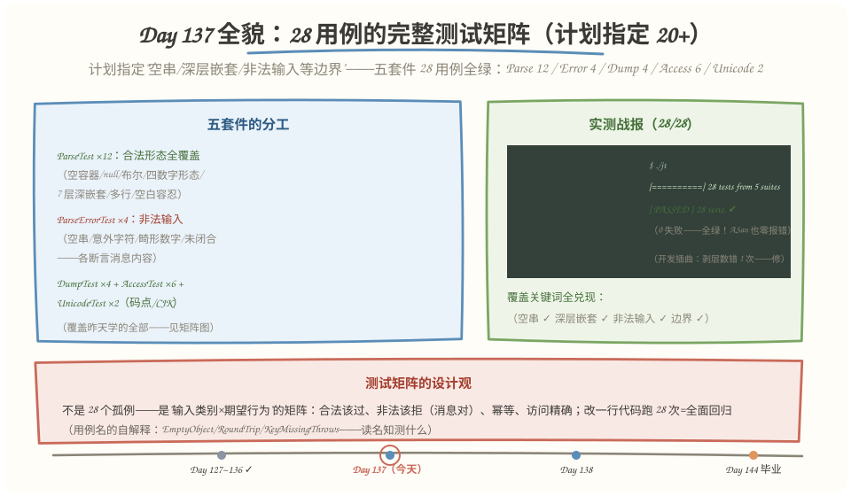
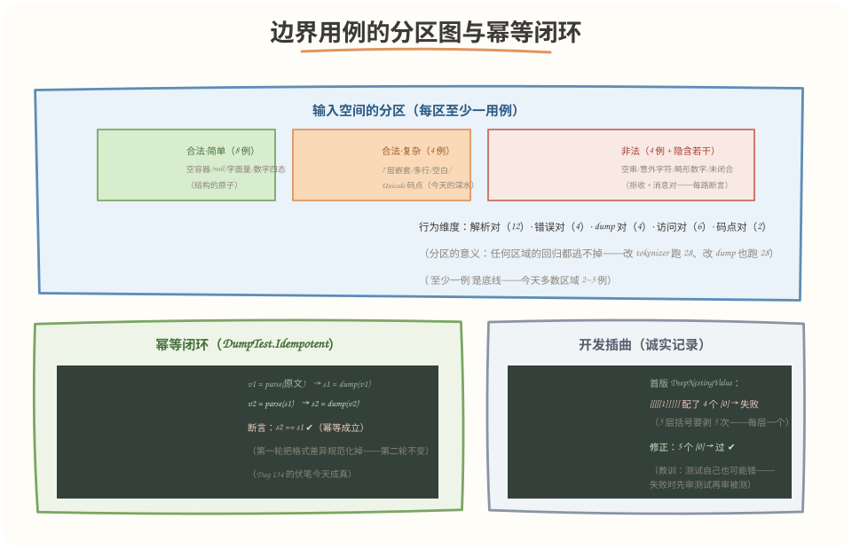
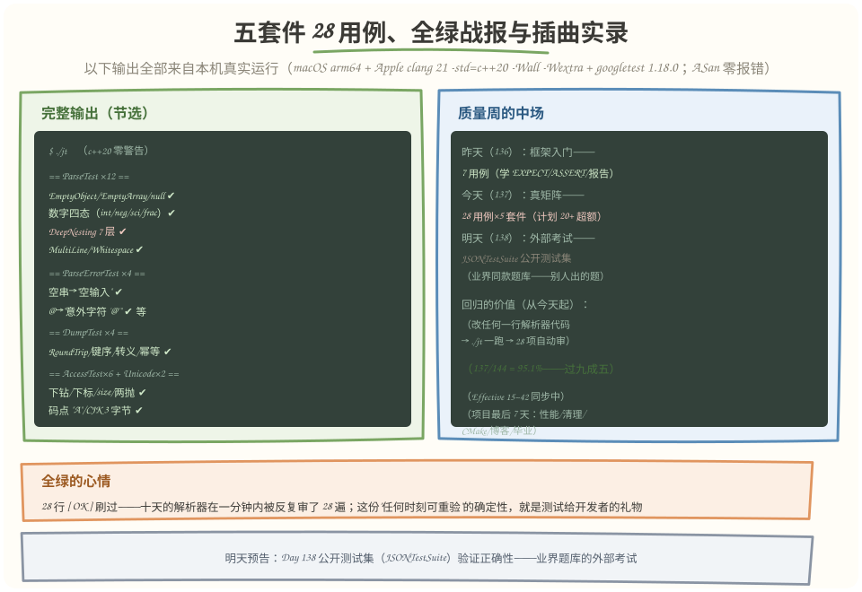

# 第 137 天：补齐 20+ 测试用例——空串、深层嵌套、非法输入等边界

> **今日目标**：完成本教程后，你能做到：组织**五套件 28 用例**的完整矩阵（Parse 12 / Error 4 / Dump 4 / Access 6 / Unicode 2——计划指定 20+ 超额完成）；覆盖**边界关键词**全兑现（空串 ✓ 深层嵌套（7 层）✓ 非法输入（4 类消息断言）✓）；实现**幂等闭环**的断言（parse→dump→parse→dump 相同——Day 134 伏笔的兑现）；体验**测试自己也会错**的开发插曲（剥层数配错——先审测试再审被测）。
> **预计时间**：编写 60 分钟＋调试 20 分钟
> **前置准备**：完成 Day 136（框架入门——今天的真矩阵用上）。
> **今日产出**：28/28 全绿（ASan 零报错）、五套件的矩阵设计、插曲实录。

## 1. 今天解决什么问题？

计划指定的**20+ 测试用例**。设计思路是**矩阵**而非孤例：按"输入类别 × 期望行为"分区——合法简单（空容器/字面量/数字四态）、合法复杂（7 层嵌套/取值下钻/多行/空白）、非法（空串/意外字符/畸形数字/未闭合）；行为维度——解析对、错误对（消息内容也断言）、dump 对（含**幂等**）、访问对（含两抛）。

**28 用例超额完成计划**（20+）；一个开发插曲（剥层数配错）诚实记录——**测试自己也可能错**。

## 2. 先看全貌：今天的内容位于哪里？



**图 1**：左卡蓝是五套件的分工；右卡绿是实测战报（28/28）；下方红卡是矩阵设计观。路线图：**137/144 = 95.1%**。

三步概括今天：

1. 分区：输入空间三区（简单/复杂/非法）× 行为五维；
2. 断言：不只"过/拒"——消息内容、幂等性、异常类型都断；
3. 全绿：28/28（改任何一行代码都自动重审 28 遍）。

## 3. 核心概念：先用直觉，再给准确定义

### 3.1 矩阵式设计：分区 × 维度

- **一句通俗解释**：不是想到什么测什么——先画**输入空间的地图**（每区至少一例）再对每区验证**期望行为**（解析/错误/dump/访问）。
- **一个类比**：新生体检——不是随机抽人检查，而是按年级（分区）× 检查项目（视力/听力/血压——维度）的表格逐格填。
- **对应到技术上是**：**输入三区**（图 2）：合法·简单（8 例——空容器/null/布尔/数字四态 int/neg/sci/frac）、合法·复杂（4 例——**7 层深嵌套**/取值下钻/多行/空白容忍）、非法（4 例——空串/意外字符/畸形数字/未闭合）。**行为五维**：Parse（12——结构的原子对不对）、Error（4——**消息内容也断言**：`EXPECT_EQ(err.msg, "空输入")` 不只检查失败还检查说得对不对）、Dump（4——往返/键序/转义/幂等）、Access（6——下钻/下标/size/**两抛**：KeyMissingThrows 和 OutOfRangeThrows）、Unicode（2——\u0041→"A" 一字节、\u4e2d→3 字节）。**"至少一例"的底线**：每区每维都有——改 tokenizer 或 dump 或 get 任何一个模块都有用例覆盖（**回归的网眼**）。类比的边界：分区不必穷尽（比如代理对的错误路径今天没单列——公开测试集明天补）。
- **常见误解**："用例越多越好"——**覆盖**比数量重要（28 个分区均匀的 > 50 个都挤在一区的）。

### 3.2 消息断言与幂等闭环

- **一句通俗解释**：错误用例不只断言"失败了"——断言**消息内容**（失败说得对不对）；dump 用例不止比一次——断言**幂等**（规范化后再规范化不变）。
- **一个类比**：客服质检——不只查"电话接没接"（失败与否）还查"话术对不对"（消息内容）；流水线复查——加工两次的产品应该一样（幂等）。
- **对应到技术上是**：实测——**消息断言**：`EXPECT_EQ(err.msg, "空输入")` / `"意外字符 '@'"` / `err.msg.find("畸形") != npos`（畸形数字的动态部分用 find）；**幂等闭环**（DumpTest.Idempotent）：`v1=parse(原文)→s1=dump(v1)→v2=parse(s1)→s2=dump(v2)→断言 s2==s1`——第一轮把格式差异（键序/空白/数字写法）规范化、第二轮不变（**Day 134 伏笔的兑现**）；**键序断言**：`{"b":1,"a":2}` dump 成 `{"a":2,"b":1}`（map 字典序——**Day 128 选 map 的第三个兑现点**）。**两抛断言**：`EXPECT_THROW(v["nope"], std::runtime_error)`（Day 135 的访问错误在测试里坐实）。类比的边界：**浮点的比较**用 DOUBLE_EQ（136 学的——number 用例都是）。
- **常见误解**："断言失败就够了"——消息质量也是产品（用户的调试线索）；断消息防"错误退化"（某天消息变了测试就提醒）。

### 3.3 开发插曲：测试自己也会错

- **一句通俗解释**：首版的 DeepNestingValue 用例配错剥层数（`[[[[[1]]]]]` 五层只配了 4 个 `[0]`）——失败报告指向**测试的错**不是被测的错。
- **一个类比**：考卷出错了——学生的答案"错"其实是对的老师判错；先审卷再审答。
- **对应到技术上是**：**插曲实录**：`must_parse("[[[[[1]]]]]")[0][0][0][0]` 失败——`get：实际是 array`（4 层剥完还是数组！）；**排查**：5 层括号每层一个 `[0]`——数错了；修正为 5 个 `[0][0][0][0][0]` → 过 ✔。**教训**：失败时**先审测试再审被测**（测试代码也是代码——一样会错；尤其边界数字、剥层数这类"手数"的细节）。**ADD_FAILURE 的辅助**：must_parse 的包装在意外失败时输出上下文（"意外失败: 消息"——定位是哪条输入）。**用例名的自解释**：EmptyObject/RoundTrip/KeyMissingThrows——读名知测（维护者的礼物）。类比的边界：测试错的比例不高但**真实存在**——遇到"怎么可能失败"先怀疑测试。
- **常见误解**："测试失败一定是被测的 bug"——**先看失败报告**（今天的报告说"实际是 array"——正是测试自己剥少了的证据）。

## 4. 图解核心机制



**图 2**：上半部分蓝卡是输入空间的分区图（三区 × 五维）；左下绿卡是幂等闭环的四步流程；右下灰卡是开发插曲的实录。

按图逐步讲：

1. **看分区的三块**：简单/复杂/非法——每区的代表用例（"至少一例"的底线）；
2. **走幂等的四步**：parse→dump→parse→dump——两轮输出相同的断言；
3. **读插曲的过程**：4 个 [0] 的失败报告 → 数层数 → 修正 5 个 → 过——**先审测试**的实例；
4. **记回归的网眼**：五套件覆盖三模块（tokenizer/dump/access）——任何模块的改动都在网里。

## 5. 动手实践：完成一个最小可运行例子

### 5.1 准备文件

```bash
cd ai-compiler-roadmap/tutorials/day-137/examples
```

主角：`json_test.cpp`（被测合并 + 五套件 28 用例）。

### 5.2 编写代码

核心（完整代码见本目录）：

```cpp
namespace {
json::JsonValue must_parse(const std::string& s) {      // 辅助：失败即报
    json::Error err;
    auto v = json::parse(s, err);
    if (!v) { ADD_FAILURE() << "意外失败: " << err.msg; return json::JsonValue(); }
    return std::move(*v);
}
}

// 套件一：合法形态（12）
TEST(ParseTest, EmptyObject) { EXPECT_STREQ(must_parse("{}").type_name(), "object"); }
TEST(ParseTest, NumberSci)   { EXPECT_DOUBLE_EQ(must_parse("1e3").get<double>(), 1000.0); }
TEST(ParseTest, DeepNesting) { EXPECT_STREQ(must_parse("[[[[[[[1]]]]]]]").type_name(), "array"); }
TEST(ParseTest, DeepNestingValue) {
    EXPECT_DOUBLE_EQ(must_parse("[[[[[1]]]]]")[0][0][0][0][0].get<double>(), 1.0);  // 5 层剥 5 次
}

// 套件二：非法输入（4——消息内容也断言）
TEST(ParseErrorTest, EmptyInput) {
    json::Error err; auto v = json::parse("", err);
    EXPECT_FALSE(v.has_value());
    EXPECT_EQ(err.msg, "空输入");
}

// 套件三：dump（4——含幂等）
TEST(DumpTest, Idempotent) {
    auto v1 = must_parse("{\"z\":[1,{\"y\":null}],\"x\":2.5}");
    auto s1 = json::dump(v1);
    auto v2 = must_parse(s1);
    EXPECT_EQ(json::dump(v2), s1);              // 两轮相同
}

// 套件四：访问（6——含两抛）
TEST(AccessTest, KeyMissingThrows) {
    auto v = must_parse("{\"a\":1}");
    EXPECT_THROW(v["nope"], std::runtime_error);
}

// 套件五：Unicode（2）
TEST(UnicodeTest, CJK) {
    auto v = must_parse("[\"\\u4e2d\"]");
    EXPECT_EQ(v[0].get<std::string>().size(), 3u);    // "中" 是 3 字节 UTF-8
}
```

### 5.3 运行与观察

```bash
g++ -Wall -Wextra -std=c++20 -I/opt/homebrew/include json_test.cpp \
    -o jt -L/opt/homebrew/lib -lgtest -lgtest_main && ./jt
```

实际执行结果（本机，节选）：

```text
[==========] Running 28 tests from 5 test suites.
[----------] 12 tests from ParseTest
[ RUN      ] ParseTest.EmptyObject
[       OK ] ParseTest.EmptyObject (0 ms)
[ RUN      ] ParseTest.DeepNesting
[       OK ] ParseTest.DeepNesting (0 ms)      ← 7 层
…
[----------] 4 tests from ParseErrorTest
[ RUN      ] ParseErrorTest.EmptyInput
[       OK ] ParseErrorTest.EmptyInput (0 ms)  ← 消息断言过
…
[----------] 4 tests from DumpTest
[       OK ] DumpTest.Idempotent (0 ms)        ← 幂等闭环
…
[----------] 6 tests from AccessTest
[       OK ] AccessTest.KeyMissingThrows (0 ms)
…
[----------] 2 tests from UnicodeTest
[       OK ] UnicodeTest.CJK (0 ms)
…
[  PASSED  ] 28 tests.                          ← 全绿！
```



**图 3**：左上完整输出（五套件的关键用例）；右侧是质量周的中场总结（昨天入门/今天矩阵/明天公开集）和最后 7 天的路线；下方橙卡是全绿的心情。

**开发插曲（诚实记录）**：首版 `[[[[[1]]]]]` 配 4 个 `[0]` → 失败（`get：实际是 array`——剥少了）；数层数修正 5 个 → 过。**教训：失败时先审测试再审被测**。

### 5.4 修改一个输入再观察：改坏被测代码看矩阵的哨兵作用

故意在 tokenizer 的数字分支删掉 strtod 校验（让 "1.2.3" 放行）→ 重跑 → **看哪些用例变红**（预期 MalformedNumber 首当其冲；可能还有 Idempotent 的连锁）；改回来全绿。**哨兵的验证**：矩阵的网眼真的能兜住退化——这就是回归测试的存在意义（3 分钟体验一次"如果没有测试会怎样"）。

## 6. 常见错误与排查

**错误 1：测试失败但被测"明明没问题"**

- 现象：用例红但你确信代码对；
- 原因：**测试自己错**（剥层数/期望值笔误/输入打错）；
- 定位：读失败报告的"期望/实际"——对不上直觉时先查测试；
- 修复：修测试（今天的插曲实录）。

**错误 2：EXPECT_DOUBLE_EQ 的"假失败"（浮点精确比较）**

- 现象：0.1+0.2 对 0.3 失败（明明"相等"）；
- 原因：用了 EXPECT_EQ 比较 double；
- 定位：失败报告两值看似相等（差在浮点误差）；
- 修复：EXPECT_DOUBLE_EQ / FLOAT_EQ（136 讲过）。

**错误 3：辅助函数里的断言没生效（return 掩盖）**

- 现象：must_parse 失败但用例显示过；
- 原因：没调 ADD_FAILURE 就 return 了默认值；
- 定位：默认值碰巧过断言（空对象的 type_name 是 "null"…）；
- 修复：失败路径 ADD_FAILURE() << 上下文（今天的 must_parse 写法）。

## 7. 今日练习

### 必做练习（计划指定：20+ 用例）

在 json_test.cpp 基础上**补 4 个你自己的边界**（找今天矩阵没覆盖的：如"仅空白输入"、"嵌套对象里的空数组"、代理对的错误路径、超大数字 1e308 的溢出路径）——跑全绿。预期产出：32/32。

### 选做挑战

"参数化测试"：用 `TEST_P + INSTANTIATE_TEST_SUITE_P` 把数字四态写成一个参数化用例（四组输入+期望对）——对照四个独立 TEST 的代码量（GoogleTest 的进阶特性——矩阵再大也不怕重复）。

## 8. 今日验收

- [ ] 我的五套件 28 用例全绿（计划 20+ 超额——ASan 零报错）
- [ ] 我的边界关键词全兑现（空串/7 层深嵌/非法输入消息断言）
- [ ] 我的幂等闭环过（parse→dump→parse→dump 两轮相同）
- [ ] 我的两抛断言过（键不存在/越界——Day 135 的坐实）
- [ ] 我经历过"先审测试"的插曲（剥层数错——失败报告的解读）

## 9. 一句话总结与明天预告

今天的问题是"20+ 用例怎么设计才不是孤例堆砌"；方法上，矩阵式设计（输入三区 × 行为五维——每区至少一例的网眼）、消息级断言（失败说得对不对也管）、幂等闭环（Day 134 伏笔兑现）；实践上，28/28 全绿、开发插曲实录（测试自己也会错——先审测试再审被测）、改坏被测的哨兵体验；验证标准是说出任何模块改动会被哪些用例兜住。明天 **Day 138：公开测试集（JSONTestSuite）验证**——业界题库的外部考试：自己出题之外，让别人出的题也过。
