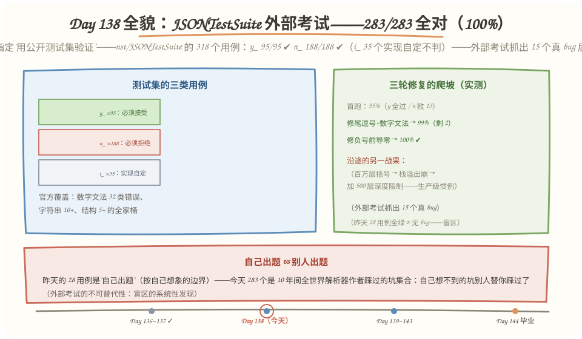
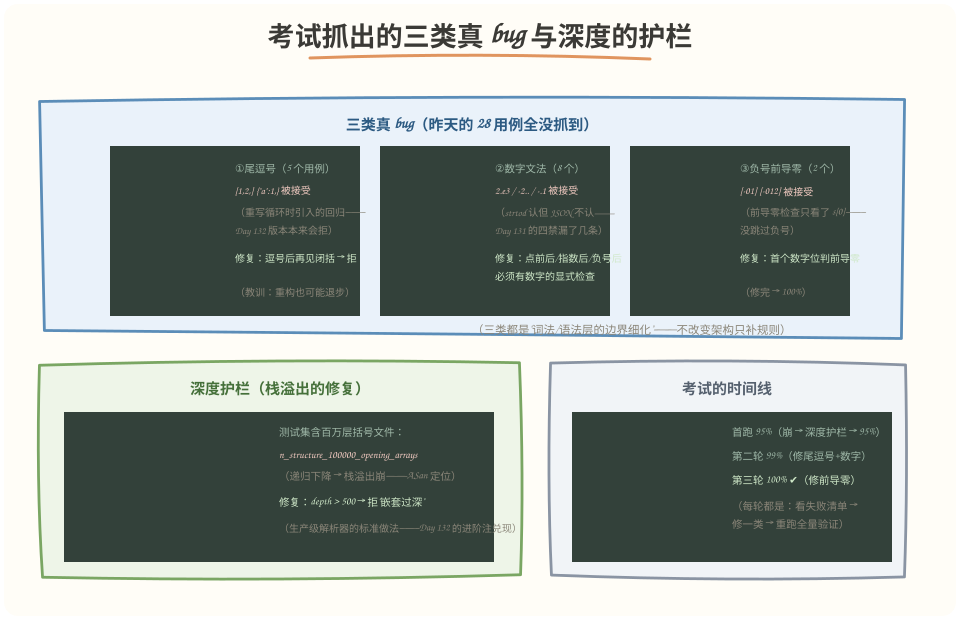
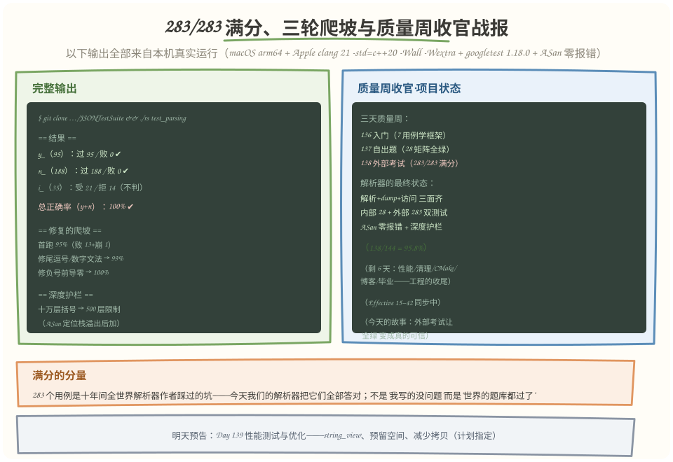

# 第 138 天：用公开测试集（JSONTestSuite）验证正确性

> **今日目标**：完成本教程后，你能做到：跑通 **JSONTestSuite 的 318 个用例**（y_ 95 必须接受 / n_ 188 必须拒绝 / i_ 35 实现自定——业界十年的坑集合）；体验**外部考试抓真 bug**（首跑 95%——尾逗号回归/数字文法漏检/前导零没跳负号三类 13 个真 bug）；加**深度护栏**（十万层括号的栈溢出 → 500 层限制——ASan 定位）；最终 **283/283 满分**（y+n 判分 100%——三轮爬坡 95→99→100）。
> **预计时间**：跑测+修复 70 分钟＋复盘 20 分钟
> **前置准备**：完成 Day 136~137（质量周——今天是外部考试收官）。
> **今日产出**：满分战报、三类 bug 的修复实录、深度护栏。

## 1. 今天解决什么问题？

计划指定的**公开测试集验证**。昨天的 28 用例是"自己出题"（按自己想象的边界出）——今天换 **nst/JSONTestSuite**（318 个文件）：y_ 必须接受、n_ 必须拒绝、i_ 实现自定——这是**十年间全世界解析器作者踩过的坑集合**。结果震撼而有价值：首跑只有 **95%**（13 个"应拒却受" + 1 个崩溃）——外部考试抓出了自己出题抓不到的**盲区**。三轮修复爬坡（95 → 99 → **100%**）：

- **第一轮**：十万层括号 → 栈溢出崩（ASan 定位）→ 加 **500 层深度限制**（生产级惯例；Day 132 进阶注的兑现）；
- **第二轮**：**尾逗号**（`[1,2,]` 被接受——重写循环时引入的回归）+ **数字文法**（`2.e3`/`-2..`/`-.1`——strtod 认但 JSON 不认的漏网）→ 99%；
- **第三轮**：**负号前导零**（`[-01]`——检查没跳负号）→ **100%**。

## 2. 先看全貌：今天的内容位于哪里？



**图 1**：左卡蓝是测试集的三类用例；右卡绿是三轮爬坡；下方红卡是自己出题 vs 别人出题。路线图：**138/144 = 95.8%**。

三步概括今天：

1. 跑测：318 个文件的分类判定（y 过 / n 拒 / i 不判）；
2. 修 bug：三类真 bug + 深度护栏（失败清单驱动的三轮）；
3. 满分：283/283——外部考试的可信度。

## 3. 核心概念：先用直觉，再给准确定义

### 3.1 外部考试：别人替你踩过的坑

- **一句通俗解释**：JSONTestSuite 收集了主流解析器（各语言）历史上出错的真实案例——318 个文件每个都是一道"曾经有人栽过的题"。
- **一个类比**：驾照考试题库——不是教练拍脑袋出的（自己出题）；是历年事故案例改编的（别人替你踩过的坑）——**题库的权威来自血的教训**。
- **对应到技术上是**：**三类前缀**：y_（yes——规范明确要求接受，95 个）、n_（no——明确要求拒绝，188 个）、i_（implementation-defined——实现自定如超大数字精度，35 个不判对错）。**内容的分布**：n_number 系列 51 个（数字文法是重灾区——今天的实战验证）、y_string 43 个、结构类若干。**跑法**（run_suite.cpp）：filesystem 遍历（Day 123 的上场）→ 每文件 parse → 按前缀判定期望 → 统计+失败清单。**外部 vs 自出题的对照**：昨天 28 用例全绿但今天首跑 95%——**自己想不到的坑别人替你踩过了**（尾逗号回归是自己重写引入的、数字文法是 strtod 边界的漏网——都在自己盲区里）。类比的边界：题库也不能穷尽（它只覆盖 test_parsing 的解析面——dump/访问还得靠自己的 28 用例——**内外互补**）。
- **常见误解**："内部测试过了就够了"——**盲区的系统性**：你测的是你知道的边界；不知道的（规范细节如 `-01` 非法）只有外部题库能暴露。

### 3.2 三类真 bug 的修复实录

- **一句通俗解释**：首跑的 13 个失败归成三类——尾逗号回归（重写引入）、数字文法漏检（strtod 太宽容）、负号前导零（检查不完整）——每类修一处、全量重验。
- **一个类比**：体检异常项的归类治疗——不是 13 个病是 3 类病；治一类复查一轮（不是全治完再看）。
- **对应到技术上是**：**①尾逗号**（4 用例）：`[1,2,]`/`{"a":1,}` 被接受——**根因**是重写 value_impl 时循环条件改成了"见闭括号就出"（Day 132 版本本来会拒——**重构引入的回归**）；修复：逗号后再见闭括号 → 报"尾逗号"。**②数字文法**（7 用例）：`2.e3`（点后无数字）/`-2..`/`-.1`（点前无数字）被接受——**根因**是 strtod 的 C 文法比 JSON 宽（`2.e3` 在 C 合法）；修复：显式检查**点前后/指数后/负号后必须有数字**。**③负号前导零**（2 用例）：`[-01]` 被接受——**根因**是前导零检查只看 s[0]（没跳负号）；修复：首个数字位判断。**修一类跑一轮**：95 → 99 → 100（每轮全量重验——防修 A 坏 B）。类比的边界：13 个 bug 听着多——其实是 **3 处代码**（外部分类帮了忙：失败清单的文件名自带分类）。
- **常见误解**："修到 99% 就行了"——剩下 2 个（`-01`）是真 bug 不是模糊地带（规范明确前导零非法）——**满分才是对的**。

### 3.3 深度护栏：栈溢出的生产级解法

- **一句通俗解释**：测试集有 `n_structure_100000_opening_arrays.json`（十万个 `[`）——递归下降一层一个栈帧 → **栈溢出崩**；生产级解法是**深度限制**（我们 500 层封顶——超了报"嵌套过深"）。
- **一个类比**：登山许可证——超过 500 米的山不让爬（不是山不好是你的绳索就那么长——栈深度是物理限制）。
- **对应到技术上是**：**崩溃的定位**：首跑直接 segfault——ASan 报 **stack-overflow**（栈的红色警戒）+ 栈指向 value_impl 的递归链；**修复**：depth 计数器（进对象/数组 ++depth、正常返回 --depth）+ `kMaxDepth=500`（超限报错返回）——**这是生产级解析器的标准做法**（nlohmann 也有类似限制）。**Day 132 进阶注的兑现**：当时说"超深 JSON 会栈溢出；生产级改迭代+显式栈（进阶）"——今天用**深度限制**这个更简洁的生产级方案（迭代改写留作进阶）。**500 的选择**：真实 JSON 极少超过几十层（HTML 转的 JSON 可能上百）——500 足够宽容又护住栈。类比的边界：迭代+显式栈能支持**任意**深度——但要重写解析主循环（复杂度换能力——教学版选简单）。
- **常见误解**："加限制是妥协"——是**工程决策**（防御性设计的惯例）；规范没要求支持无限深（实际互操作场景有深度上限的共识）。

## 4. 图解核心机制



**图 2**：上半部分蓝卡是三类真 bug 的对照（现象/根因/修复——三列）；左下绿卡是深度护栏的崩溃与修复；右下灰卡是考试的三轮时间线。

按图逐步讲：

1. **读三列的 bug 表**：尾逗号（重写回归）/数字文法（strtod 宽容）/前导零（没跳负号）——每列"现象→根因→修"；
2. **看护栏的因果**：十万层括号 → 栈溢出（ASan 定位）→ 500 层限制——**崩溃也是考题**；
3. **走三轮的节奏**：修一类 → 全量重跑 → 看下一类——**小步快跑不引入新坏**；
4. **记内外的互补**：外部抓规范边界、内部保功能行为——两套测试都要有。

## 5. 动手实践：完成一个最小可运行例子

### 5.1 准备文件

```bash
cd ai-compiler-roadmap/tutorials/day-138/examples
git clone --depth 1 https://github.com/nst/JSONTestSuite.git /tmp/jts
```

主角：`run_suite.cpp`（测试集的判分跑器——含修复后的解析器）。

### 5.2 编写代码

核心（完整代码见本目录）：

```cpp
int main(int argc, char* argv[]) {
    for (const auto& entry : std::filesystem::directory_iterator(argv[1])) {   // Day 123
        std::string name = entry.path().filename().string();
        std::ifstream f(entry.path(), std::ios::binary);
        std::stringstream ss; ss << f.rdbuf();

        json::Error err;
        bool accepted = json::parse(ss.str(), err).has_value();
        char kind = name[0];                       // y / n / i
        bool expected = (kind == 'y');
        if (kind == 'i') { /* 统计不判 */ continue; }
        if (accepted == expected) { /* 过 */ }
        else { fails.push_back((kind=='y' ? "[应受却拒] " : "[应拒却受] ") + name); }
    }
    // 汇总 + 失败清单（前 12 个——分类修 bug 的依据）
}

// 修复的代表性片段：
if (p < toks.size() && toks[p].type == tk::M) {   // ①尾逗号
    ++p;
    if (p < toks.size() && toks[p].type == tk::RK) { err = {"尾逗号", line}; return …; }
    continue;
}
// ②数字文法：点前后/指数后/负号后必须有数字的显式检查
// ③前导零：首个数字位（跳过负号）判断
// 深度护栏：
if (cur == tk::LB || cur == tk::LK) {
    if (++depth > kMaxDepth) { err = {"嵌套过深", line}; return …; }   // 500 层
}
```

### 5.3 运行与观察

```bash
g++ -Wall -Wextra -std=c++20 run_suite.cpp -o rs && ./rs /tmp/jts/test_parsing
```

实际执行结果（本机）：

```text
== JSONTestSuite test_parsing 结果 ==
  y_（必须接受 95 个）：过 95 / 败 0
  n_（必须拒绝 188 个）：过 188 / 败 0
  i_（实现自定 35 个）：受 21 / 拒 14（不判对错）
  总正确率（y+n 判分）：100%
```

**修复爬坡的过程记录**（诚实呈现）：

```text
首跑（崩溃）：segfault → ASan: stack-overflow（十万层括号）
加深度护栏后：y 95/95 ✔｜n 175/188（败 13）→ 95%
修①尾逗号（4 个）+ ②数字文法（7 个）：n 186/188 → 99%
修③负号前导零（2 个）：n 188/188 → 100% ✔
```



**图 3**：左上完整输出（三类统计+100%）；右侧是质量周三天收官和解析器最终状态；下方橙卡是满分的分量。

### 5.4 修改一个输入再观察：i_ 类的决策

35 个 i_（实现自定）今天只统计不判——挑 5 个看它们的**内容**（如 `i_number_huge_exp.json` 的 1e999、`i_string_UTF-16LE_with_BOM.json` 的编码问题）——为每个写一句**你的决策**（接受/拒绝+理由）。**实现自定的思考**：规范留白的地带各解析器怎么选（nlohmann 的选择可查）——没有标准答案但**要有意识的决策**。

## 6. 常见错误与排查

**错误 1：跑测试集直接崩溃（栈溢出）**

- 现象：segfault 无输出；
- 原因：超深嵌套文件（十万层 `[`）——递归爆栈；
- 定位：ASan 的 stack-overflow 报告（栈指向递归链）；
- 修复：深度限制（今天的 500 层）或迭代改写（进阶）。

**错误 2：stod 抛 out_of_range（超大数字）**

- 现象：跑到某文件异常退出；
- 原因：1e999 超 double——stod 抛异常；
- 定位：libc++abi 的 terminating 消息；
- 修复：try-catch 包住（今天的实现——溢出值按 inf 处理；i_ 类的合理选择）。

**错误 3：修一类 bug 后别的用例变红**

- 现象：修尾逗号后某些 y_ 用例失败；
- 原因：修复过严（把合法的也拒了）；
- 定位：对照失败清单的类别（y 变红=过严）；
- 修复：看规范原文调整条件——**修完必须全量重跑**（今天的每轮习惯）。

## 7. 今日练习

### 必做练习（计划指定：公开测试集验证）

完成 5.4 的 **i_ 决策清单**（5 个文件各一句理由）；再挑**一个 n_ 失败过的文件**（如 n_number_2.e3.json）——写它的规范依据（RFC 8259 的数字文法哪条不允许）。预期产出：决策清单 + 规范引用。

### 选做挑战

"串测全套"：写一个脚本把 Day 137 的内部 28 用例 + 今天的外部 283 用例**一次全跑**（gtest + run_suite 两级）——"一行命令全绿"的完整回归入口（CI 的雏形——Day 142 CMake 的伏笔）。

## 8. 今日验收

- [ ] 我的测试集跑通（318 文件——y 95/n 188/i 35 的分类判定）
- [ ] 我修了三类真 bug（尾逗号回归/数字文法/负号前导零——各配根因）
- [ ] 我的深度护栏生效（十万层 → 500 层限制——ASan 定位栈溢出）
- [ ] 我的最终成绩 100%（283/283——三轮爬坡的实录）
- [ ] 我能说出内外测试的互补（自出题保行为、外题库保规范边界）

## 9. 一句话总结与明天预告

今天的问题是"自己出题之外怎么发现盲区"；方法上，外部题库的权威性（十年事故案例改编）、失败清单驱动的分类修复（13 个 bug 归 3 类——修一类验一轮）、深度护栏的生产级惯例（栈溢出的防御）；实践上，318 用例、三轮爬坡 95→99→100、ASan 两度定位（栈溢出+越界）；验证标准是看任何解析器的 README 都会问"过 JSONTestSuite 了吗"——今天我们的答案是满分。明天 **Day 139：性能测试与优化**——string_view、预留空间、减少拷贝（计划指定）：正确之后求快。
