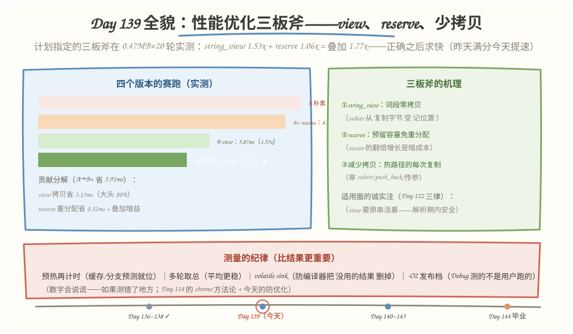
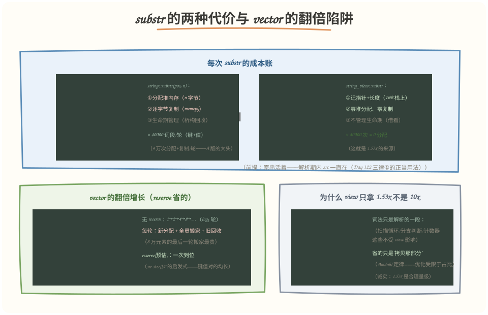
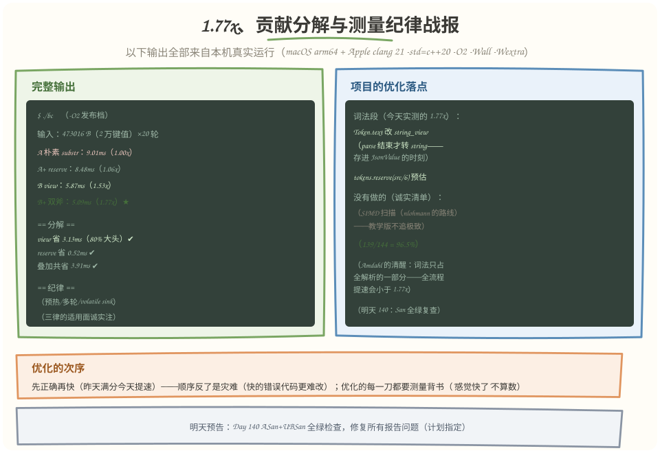

# 第 139 天：性能测试与优化——string_view、预留空间、减少拷贝

> **今日目标**：完成本教程后，你能做到：搭**可复现的基准**（预热+多轮+volatile sink+ -O2——测量纪律四件套）；实测计划指定的**三板斧**（string_view 零拷贝 **1.53x**、reserve 预留 **1.06x**、叠加 **1.77x**——0.47MB 输入的词法段）；解释 **substr 的两种代价**（堆分配+逐字节复制——view 省掉的）和 **vector 翻倍陷阱**（reserve 省的搬家）；说出 **Amdahl 的清醒**（优化受限于占比——1.53x 是合理量级）；牢记**先正确再快**的次序。
> **预计时间**：基准搭建 40 分钟＋测量+分析 40 分钟
> **前置准备**：完成 Day 138（满分——今天在正确的基础上提速）。
> **今日产出**：四版本赛跑的完整数据、贡献分解、测量纪律。

## 1. 今天解决什么问题？

计划指定的**性能三板斧**：string_view（词段零拷贝）、预留空间（vector 免翻倍重分配）、减少拷贝（热路径的每次复制都要审）。方法论的骨架是**基准先行**——没有测量就没有优化（"感觉快了"不算数）。今天的实验场：**词法段**（tokenizer 的核心循环）——四个版本的赛跑（朴素 substr / +reserve / +view / 双斧齐上），0.47MB 的 2 万键值对输入 × 20 轮，**1.77x 的叠加提速**。

**次序的纪律**：昨天满分（正确）、今天提速——顺序反了是灾难（快的错误代码更难改）。

## 2. 先看全貌：今天的内容位于哪里？



**图 1**：左卡蓝是四版本的柱状对比；右卡绿是三板斧的机理；下方红卡是测量纪律。路线图：**139/144 = 96.5%**。

三步概括今天：

1. 基准：预热+多轮+sink+O2（数字可信的前提）；
2. 赛跑：A 9.01ms → B+ 5.09ms（1.77x）；
3. 分解：view 省 80% 大头、reserve 省零头——机理各自说清。

## 3. 核心概念：先用直觉，再给准确定义

### 3.1 string_view：词段的零拷贝

- **一句通俗解释**：tokenizer 扫到 `"key123"` 时——string::substr 要**复制** 6 个字节到新堆块；string_view 只是**记下**（指针+长度）"在原串的这个位置"——零分配零复制。
- **一个类比**：图书馆抄书 vs 记页码——抄书（substr）一字一字誊（分配+复制）；记页码（view）只写"第 37 页第 4-9 行"（16 字节的栈上记录）。
- **对应到技术上是**：实测——**B 版 5.87ms vs A 版 9.01ms（1.53x）**；**成本账**（图 2）：每轮 4 万词段（键+值）×（①堆分配 ②memcpy ③析构回收）= A 版的大头；view 版同 4 万次但**零堆操作**。**生命期的安全前提**（Day 122 三律的正当用法）：view 的词段在**原串 src 内**——解析期内 src 一直活着（①不做所有者的正确场景）；**落点设计**：Token.text 存 view（解析期零拷贝）——**存进 JsonValue 的时刻才转 string**（树要活过解析——那时拷贝是必要的所有权转移）。类比的边界：**树内不能存 view**（src 可能比树先死——存 view 违反三律①；所以"最后一步转 string"是设计不是浪费）。
- **常见误解**："view 到处用越快越好"——生命期！只有"借看期间源确定活着"才安全（Day 122 的三律今天从理论变成工程决策）。

### 3.2 reserve：vector 的翻倍陷阱

- **一句通俗解释**：vector 没预留时按 1→2→4→8 翻倍长——每轮**新分配+全员搬家+旧回收**；reserve(n) 一次到位。
- **一个类比**：搬家——家具渐多每次都搬更大的房子（全员搬运）；一次租够大的（reserve）——虽然可能空着点但不用再搬。
- **对应到技术上是**：实测——**A+ 版 8.48ms（1.06x）**：省 0.52ms（相对小的收益——因为 view 版的 pair 才 24B 搬家便宜；搬 string（24B 但带堆指针的深拷贝）会贵得多——A 版里翻倍的深拷贝其实是 hidden cost）。**预估的启发式**：`src.size()/6`（键值对平均 6 字符——经验的 magic number）；**翻倍的成本模型**：N 次插入的总搬家 = O(N)（几何级数的和——数学上均摊 O(1) 但**每次的峰值分配**是真实的）。**reserve 的适用面**：知道量级时（解析场景能估）；瞎预留（估太大）浪费内存。类比的边界：reserve 是**锦上添花**——view（消除整个类别的工作）和 reserve（减少一类开销的次数）不是一个量级的杠杆。
- **常见误解**："reserve 总是好"——估不准时白占内存；**有依据的预估**才是好 reserve。

### 3.3 减少拷贝与测量的纪律

- **一句通俗解释**：第三板斧是个**审视习惯**——热路径上的每次 substr/push_back/传参都问"这次复制必要吗"；而**测量纪律**（预热/多轮/sink/O2）保证数字可信。
- **一个类比**：减肥的秤——不校准的秤测不出真实变化（测量纪律）；"少吃一口"的自觉（减少拷贝）要靠秤的反馈才知道有没有用。
- **对应到技术上是**：**纪律四件套**（图 1 红卡）：①**预热**（跑 2 轮再计时——缓存/分支预测就位）；②**多轮取总**（20 轮的总毫秒——平均更稳）；③**volatile sink**（累加结果到 volatile——编译器**不能删**"没用的结果"）；④**-O2**（发布档——Debug 的数字不代表用户跑的）。**Amdahl 的清醒**：词法只是解析的一段（还有 Parser 的树构建/递归）——**全流程的提速会小于 1.77x**（优化受限于占比——这是定律不是失败）。**没做的诚实清单**：SIMD 扫描（nlohmann 的路线——一次看 16/32 字节）教学版不追极致；内存池（节点的批量分配）同款理由。类比的边界：**过度优化是万恶之源**——1.77x 对教学解析器够交代（Knuth："过早优化是万恶之源"的后半句是"97% 的时间"）。
- **常见误解**："优化越高越好"——**够用就停**：可读性/正确性/时间的三权衡；每刀优化都要测量背书 + 测试仍绿（今天改完要重跑 Day 137/138 的 311 用例）。

## 4. 图解核心机制



**图 2**：上半部分蓝卡是 substr 的两种代价对照（string 三步 vs view 零步——× 4 万次的量级）；左下绿卡是 vector 的翻倍增长；右下灰卡是"为什么只有 1.53x"的 Amdahl 解释。

按图逐步讲：

1. **算 substr 的账**：4 万词段 ×（分配+复制+回收）——A 版的 3.13ms 就是这么攒出来的；
2. **看翻倍的过程**：1→2→4→…的搬家（每轮全员）——reserve 一次到位省的 0.52ms；
3. **读 Amdahl 的柱**：词法内的扫描/分支/计数不受 view 影响——**省的只是拷贝那部分**（1.53x 是诚实量级）；
4. **连 Day 122**：view 的三律从理论变成今天的工程决策（词段用 view、树节点用 string——生命期的分界线）。

## 5. 动手实践：完成一个最小可运行例子

### 5.1 准备文件

```bash
cd ai-compiler-roadmap/tutorials/day-139/examples
```

主角：`bench.cpp`（四版本的词法基准——含测量纪律）。

### 5.2 编写代码

核心（完整代码见本目录）：

```cpp
std::string make_input(int n) {          // 生成 2 万键值对的 ~0.47MB
    std::string s = "{";
    for (int i = 0; i < n; ++i) {
        if (i) s += ',';
        s += "\"key" + std::to_string(i) + "\":\"value" + std::to_string(i*7) + "\"";
    }
    return s + '}';
}

double bench_substr(const std::string& src, int repeat) {        // A：朴素
    auto t0 = std::chrono::steady_clock::now();
    volatile std::size_t sink = 0;                               // 防优化删除
    for (int r = 0; r < repeat; ++r) {
        std::vector<std::pair<int, std::string>> toks;
        std::size_t i = 0;
        while (i < src.size()) {
            char c = src[i];
            if (c == '"') {
                std::size_t start = ++i;
                while (i < src.size() && src[i] != '"') ++i;
                toks.emplace_back(6, src.substr(start, i - start));   // ★ 拷贝
                ++i;
            } else { toks.emplace_back(0, std::string(1, c)); ++i; }
        }
        sink += toks.size();
    }
    return std::chrono::duration<double, std::milli>(steady_clock::now() - t0).count();
}
// B：substr 换 string_view（零拷贝）；A+/B+：加 toks.reserve(src.size()/6 + 16)
```

### 5.3 运行与观察

```bash
g++ -Wall -Wextra -std=c++20 -O2 bench.cpp -o bc && ./bc
```

实际执行结果（本机）：

```text
Day 139：性能测试与优化

输入：473016 字节（20000 键值对）× 20 轮

== 词法段的四个版本（毫秒） ==
  A  朴素（substr 拷贝）：    9.01 ms（基线）
  A+ A + reserve 预留　：    8.48 ms（提速 1.06x）
  B  string_view 零拷贝：    5.87 ms（提速 1.53x）
  B+ view + reserve　　：    5.09 ms（提速 1.77x）★

== 优化的分解 ==
  reserve 的贡献（A→A+）：0.52 ms（省的重组分配）
  view 的贡献（A→B）　　：3.13 ms（省的字符串拷贝）
  叠加（A→B+）　　　　　：3.91 ms

== 测量的纪律 ==
  预热（缓存/分支预测就位）后再计时
  多轮取总时长（平均更稳）
  volatile sink 防优化掉（编译器不能删）
  （Day 114 的 chrono 方法论——今天加防优化）

== 三板斧的适用面（诚实注） ==
  string_view：词段的生命期在原串内才安全（Day 122 三律）
  reserve：知道量级时（src.size()/6 的预估）
  减少拷贝：热路径的每次 substr/push_back 都值得审
```



**图 3**：左上完整输出（赛跑/分解/纪律/适用面）；右侧是**项目优化落点**（Token.text 用 view + 存树时转 string 的生命期分界）和没做的诚实清单（SIMD/内存池）；下方橙卡是优化的次序。

### 5.4 修改一个输入再观察：改变输入形态

把输入从"2 万短键值对"换成"2 千长键值对"（每值 ~200 字符——总字节数接近）——重跑：**view 的提速比会更大**（词段越长单次拷贝越贵）；再换成"4 万超短键值对"（key0:v0 风格）——reserve 的占比上升（记号数多）。**输入形态影响优化收益**——这也是基准要贴近真实负载的原因。

## 6. 常见错误与排查

**错误 1：优化后测试红了（正确性回归）**

- 现象：view 改造后某些用例失败；
- 原因：树里存了 view 而 src 已死（悬空）——违反三律①；
- 定位：ASan 的 use-after-free；
- 修复：**存树时转 string**（生命期分界——今天的落点设计）。

**错误 2：基准数字抖动大（不可复现）**

- 现象：同代码两次跑差很多；
- 原因：没预热/后台负载/单轮计时；
- 定位：多次跑方差大；
- 修复：纪律四件套（预热+多轮+sink+关后台）；必要时取多轮中位数。

**错误 3：Debug 档测优化（数字无意义）**

- 现象：优化前后"没差"或 Debug 下更快；
- 原因：-O0 的代码没优化——测的不是用户跑的；
- 定位：检查编译命令；
- 修复：**-O2 基准**（发布档）。

## 7. 今日练习

### 必做练习（计划指定：三板斧）

把 5.4 的**两种输入形态**跑出来（长值版/超短键版）——记录各自的四版本数据和提速比变化——写三句结论（哪个优化对哪种形态更敏感）。预期产出：两张表 + 三句话。

### 选做挑战

"全流程的基准"：把优化落到 Day 138 的解析器上（Token.text 改 view——存树时转 string）——跑**完整 parse** 的前后对比（词法 1.77x 但全流程会小于它——Amdahl 的亲验）；Day 137/138 的 311 用例重跑保绿。

## 8. 今日验收

- [ ] 我的基准四件套就位（预热/多轮/volatile sink/-O2）
- [ ] 我的四版本数据（A 9.01 → B+ 5.09——1.77x 的叠加）
- [ ] 我能解释 substr 的两种代价（分配+复制——view 省的 80% 大头）
- [ ] 我能说出 vector 翻倍陷阱（reserve 省的 0.52ms——预估的启发式）
- [ ] 我知道 Amdahl 的清醒（全流程提速小于词法段——占比定律）

## 9. 一句话总结与明天预告

今天的问题是"正确之后怎么求快"；方法上，三板斧（view 零拷贝——生命期分界的工程决策 / reserve 预留——有依据的预估 / 减少拷贝——热路径审视）+ 测量纪律四件套（预热/多轮/sink/O2）；实践上，1.77x 叠加提速、贡献分解（view 80%）、Amdahl 的清醒、输入形态的影响全部实测；验证标准是任何优化建议都能回答"测了吗、多快、测试还绿吗"。明天 **Day 140：ASan+UBSan 全绿检查**——修复所有报告问题（计划指定）：优化的正确性复查（昨天改的代码今天过消毒柜）。
