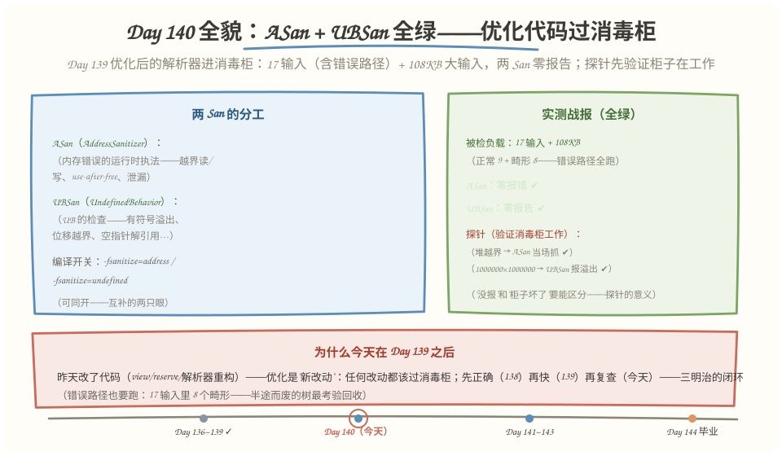
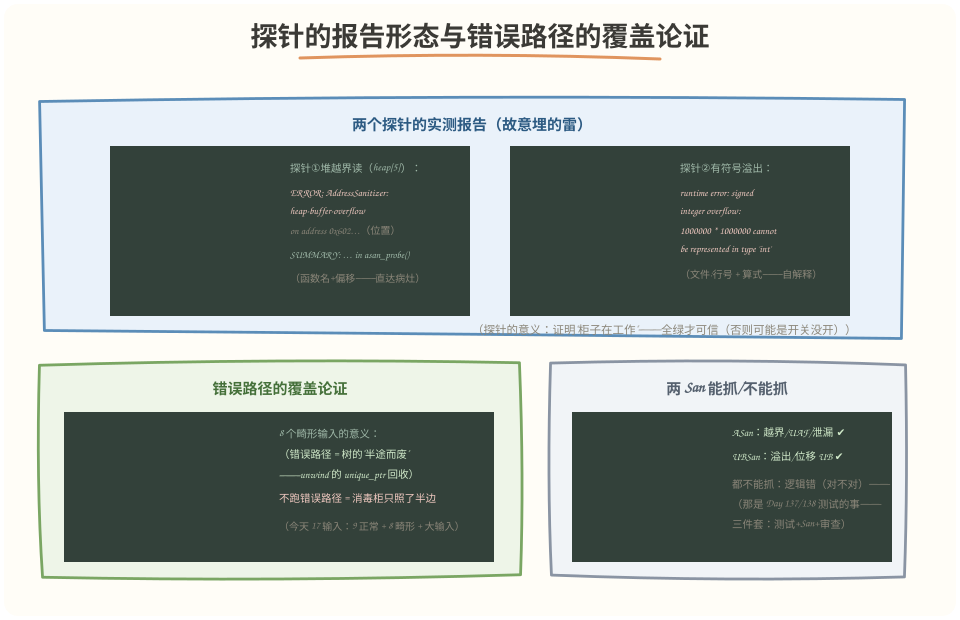
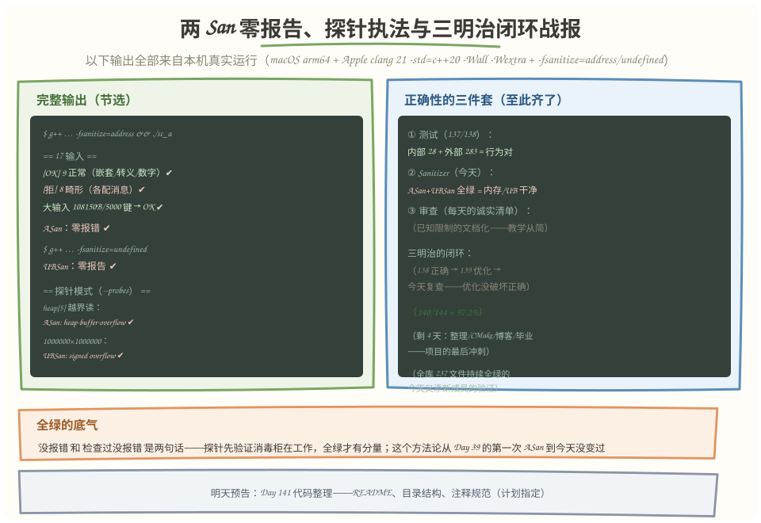

# 第 140 天：ASan + UBSan 全绿检查，修复所有报告的问题

> **今日目标**：完成本教程后，你能做到：对 Day 139 优化后的解析器跑**两 San 全量检查**（ASan + UBSan——17 输入含全部错误路径 + 108KB 大输入 → 零报告）；用**探针验证消毒柜在工作**（故意埋堆越界和有符号溢出——看两 San 的报告形态）；说出**错误路径覆盖的论证**（8 个畸形输入 = 树的半途而废 = unwind 回收的考验）；总结**正确性的三件套**（测试 + Sanitizer + 审查）和**三明治闭环**（正确 → 优化 → 复查）。
> **预计时间**：检查 30 分钟＋探针实验 30 分钟
> **前置准备**：完成 Day 138~139（满分+优化——今天验证优化没破坏正确）。
> **今日产出**：两 San 零报告、探针执法实录、三件套总结。

## 1. 今天解决什么问题？

计划指定的 **ASan+UBSan 全绿检查**。时机关键：昨天刚做过优化（view/reserve/解析器重构）——**优化是"新改动"**，任何改动都该过消毒柜。检查设计三要点：**负载要全**（17 输入：9 正常 + 8 畸形——**错误路径也要跑**（半途而废的树最考验 unwind 回收）+ 108KB 大输入（5000 键的树构建/析构全路径））；**探针先行**（故意埋堆越界 + 有符号溢出——先证明"柜子在工作"，否则零报告可能是开关没开）；**两 San 互补**（ASan 抓内存错、UBSan 抓 UB——两只眼都要）。

## 2. 先看全貌：今天的内容位于哪里？



**图 1**：左卡蓝是两 San 的分工；右卡绿是实测战报；下方红卡是"为什么在 139 之后"。路线图：**140/144 = 97.2%**。

三步概括今天：

1. 负载：17 输入（错误路径含）+ 108KB 大输入；
2. 两 San：ASan 零报错 + UBSan 零报告；
3. 探针：堆越界被抓 + 溢出被抓——柜子工作证明。

## 3. 核心概念：先用直觉，再给准确定义

### 3.1 两 San 的分工与编译开关

- **一句通俗解释**：ASan 是**内存的执法者**（越界读/写、use-after-free、泄漏——运行时插桩抓现行）；UBSan 是 **UB 的哨兵**（有符号溢出、位移越界、空指针解引用——按标准"未定义"的行为逐个报）。
- **一个类比**：机场的两道安检——X 光机（ASan：看见箱子里有没有危险品）和缉毒犬（UBSan：闻标准里"说不清"的味道）——互补不替代。
- **对应到技术上是**：**编译开关**：`-fsanitize=address`（ASan）/ `-fsanitize=undefined -fno-sanitize-recover=all`（UBSan 的严格模式——遇错即停）；可同开（`-fsanitize=address,undefined`——但分开跑的报告更清晰）。**ASan 的原理**（概念）：内存的红区（poison）+ 影子内存（每字节的属性）——越界访问碰到红区就报；**UBSan 的原理**：编译期在可疑操作前插检查（乘法前查会不会溢出）——**运行到才报**（所以也要负载覆盖）。**代价**：两 San 都慢（2~20x）——只在检查时开（发布不带）。**Day 39 以来的老朋友**：ASan 从那个"探针先行"的日子陪到现在——今天加上 UBSan 凑齐两只眼。类比的边界：**都不能抓逻辑错**（解析对不对——那是测试的事；图 2 右下的三件套分工）。
- **常见误解**："编译过=没 UB"——UB 的可怕正在**编译器不报**（行为未定义——可能"碰巧"对）；UBSan 才是把它们显形化的工具。

### 3.2 探针：先验证柜子在工作

- **一句通俗解释**：跑全量前先**故意埋雷**（堆越界读、有符号溢出）——确认两 San 能抓——然后删探针跑真代码；零报告才有分量。
- **一个类比**：新买的烟雾报警器——先按测试键（探针）听它响——然后才敢信"不响=没烟"。
- **对应到技术上是**：实测——**探针①**：`new int[3]` 然后读 `heap[5]` → ASan 报 `heap-buffer-overflow on address 0x602…` + `SUMMARY: … in asan_probe()`（函数名直达病灶）；**探针②**：`1000000 * 1000000`（int 乘 int 超 21 亿）→ UBSan 报 `runtime error: signed integer overflow: 1000000 * 1000000 cannot be represented in type 'int'`（**文件：行号+算式**——自解释）。**探针的实现**：`#ifdef ENABLE_PROBES` 包住（编译时 `-DENABLE_PROBES` 才编入——正常构建不含雷）；`--probes` 参数切换模式。**栈越界的教训**（开发插曲）：首版探针用栈数组 `int a[3]; a[5]`——**编译器静态就警告了**（-Warray-bounds 挡住）——改堆版才进 ASan 运行时（**栈越界常被编译器/ASan 的栈红区抢先**——堆版是标准探针）。**为什么今天必须探针**：改了编译命令（加 sanitize 开关）——**新工具先验证**（不然零报告可能是开关打错了）。类比的边界：探针一次就够（柜子验证过——同配置的后续全绿可信）。
- **常见误解**："探针多此一举"——Day 39 的方法论（探针先行）救过多少次"以为开了其实没开"的乌龙——**证据链的第一环**。

### 3.3 错误路径覆盖与三件套总结

- **一句通俗解释**：8 个畸形输入不是白跑的——**错误路径**（解析半途而废）恰恰是 unwind 回收的考验场；正确性的完整保障是**三件套**：测试（行为对）+ Sanitizer（内存/UB 净）+ 审查（限制文档化）。
- **一个类比**：消防演练——不只是"正常下班走人"（成功路径）；**警报响起的中途疏散**（错误路径）才是应急系统的真正考验。
- **对应到技术上是**：**错误路径的覆盖论证**（图 2）：畸形输入（`[@]`/`["unclosed`/尾逗号等 8 个）触发各失败分支——半建的树靠 **unique_ptr 的 unwind 自动回收**——不跑错误路径 = 消毒柜只照半边（泄漏多半藏在"半途而废"里）。**大输入的补充**：108KB/5000 键（树的深构建+整体析构——分配/回收的大规模压力测试）。**三件套的分工**：测试管"**对不对**"（Day 137 内部 28 + 138 外部 283）、Sanitizer 管"**干不干净**"（今天）、审查管"**限制明不明确**"（每天的诚实清单——如 double 的 2^53 边界）。**三明治闭环**：138 正确 → 139 优化 → **今天复查**（优化没破坏正确——view 的生命期分界没有悬空、reserve 没有越界）——改动后的回归是**次序纪律**的最后一步。类比的边界：San 全绿≠绝对无错（没跑到的路径/没启用的检查）——**置信度的提升不是无穷**。
- **常见误解**："全库 233 文件早就全绿了今天多余"——那是 Day 126 的基线；**昨天又改了代码**——每次改动后复查是纪律（今天的新成员验证）。

## 4. 图解核心机制



**图 2**：上半部分蓝卡是两个探针的实测报告（左：ASan 的 heap-buffer-overflow；右：UBSan 的 signed overflow）；左下绿卡是错误路径的覆盖论证；右下灰卡是两 San 能抓/不能抓的分工。

按图逐步讲：

1. **读两份报告**：ASan 的位置+函数名、UBSan 的文件行号+算式——**报告即诊断**；
2. **看覆盖的论证**：8 畸形 = 半途而废的树 = unwind 的考场——错误路径不是配角；
3. **记分工的边界**：内存/UB 两 San 管、逻辑测试管、限制审查管——**三件套各司其职**；
4. **连 Day 39**：探针先行的方法论从第一次 ASan 到今天——**证据链的完整**。

## 5. 动手实践：完成一个最小可运行例子

### 5.1 准备文件

```bash
cd ai-compiler-roadmap/tutorials/day-140/examples
```

主角：`sanitizer_check.cpp`（含探针区的双模式检查器）。

### 5.2 编写代码

核心（完整代码见本目录）：

```cpp
// 探针区（编译时 -DENABLE_PROBES 才编入）
void asan_probe() {
#ifdef ENABLE_PROBES
    int* heap = new int[3]{1,2,3};   // 堆越界 + 泄漏双探针
    volatile int x = heap[5];        // 越界读（运行时 ASan 抓）
    (void)x;                          // 不 delete——泄漏也在报告里
#endif
}
int ubsan_probe(int i) {
#ifdef ENABLE_PROBES
    return 1000000 * i;               // 有符号溢出（UBSan 抓）
#else
    return i;
#endif
}

// 检查负载：17 输入（9 正常 + 8 畸形）+ 108KB 大输入
const char* inputs[] = {
    "{\"name\": \"Ada\", \"scores\": [95, 88.5], \"ok\": true, \"tag\": null}",
    "[\"含\\n转义\", \"\\u4e2d\\u6587\"]", "[[[[[1]]]]]",
    "{}", "[]", "null", "true", "42", "-7.5e2",
    "", "[@]", "[\"unclosed", "[1.2.3]", "{\"a\" 1}", "[1,2,]",
    "[\"\\uZZZZ\"]", "[\"\\x\"]",         // ← 错误路径：树的半途而废
};
// 大输入：5000 键的 108KB（构建+析构的全路径）
```

### 5.3 运行与观察

```bash
# ① ASan 全量
g++ -Wall -Wextra -std=c++20 -fsanitize=address sanitizer_check.cpp -o sc_a && ./sc_a
# ② UBSan 全量（严格模式）
g++ -Wall -Wextra -std=c++20 -fsanitize=undefined -fno-sanitize-recover=all sanitizer_check.cpp -o sc_u && ./sc_u
# ③④ 探针（验证柜子）
g++ -Wall -std=c++20 -fsanitize=address -DENABLE_PROBES sanitizer_check.cpp -o sc_p && ./sc_p --probes
g++ -Wall -std=c++20 -fsanitize=undefined -DENABLE_PROBES sanitizer_check.cpp -o sc_pu && ./sc_pu --probes
```

实际执行结果（本机，节选）：

```text
$ ./sc_a
Day 140：ASan + UBSan 全绿检查

  [OK]  {"name": "Ada", "scores": [95, 88.5],… → object
  [OK]  ["含\n转义", "\u4e2d\u6587"] → array
  [OK]  [[[[[1]]]]] → array
  [OK]  {} … null … 42 … -7.5e2（9 个正常）
  [拒]  （空输入）
  [拒]  [1.2.3]（畸形数字）… [1,2,]（尾逗号）…（8 个畸形——错误路径全跑）
  大输入（108150 B / 5000 键）：OK object
  ASan：零报错 ✔

$ ./sc_u
  UBSan：零报告 ✔

$ ./sc_p --probes
==1945==ERROR: AddressSanitizer: heap-buffer-overflow on address 0x602000000964
SUMMARY: AddressSanitizer: heap-buffer-overflow in asan_probe()+0x18c   ← 探针被抓 ✔

$ ./sc_pu --probes
sanitizer_check.cpp:173:20: runtime error: signed integer overflow:
1000000 * 1000000 cannot be represented in type 'int'   ← 探针被抓 ✔
```



**图 3**：左上完整输出（17 输入+大输入+两 San 结果+探针执法）；右侧是**正确性三件套**（至此齐了）和三明治闭环；下方橙卡是全绿的底气。

**开发插曲（诚实记录）**：首版探针用**栈数组** `int a[3]; a[5]`——编译器静态警告（-Warray-bounds）就挡住了（根本到不了运行时）；改**堆版**（`new int[3]` 后 `heap[5]`）才让 ASan 运行时抓到——**栈越界常被编译器抢先**、堆版才是标准探针。

### 5.4 修改一个输入再观察：全库的日常复检

把 Day 048 的 scan_all.sh（已是 c++20+Wextra+ASan 档）跑一遍——**全库 233 文件**的两 San 状态确认（昨天加的 day-139/140 新成员也在内）；如果全绿——本日的检查扩展到了整个仓库（不只解析器）。**仓库级的消毒**是毕业前的最后状态确认。

## 6. 常见错误与排查

**错误 1：开了 sanitize 但零报告（怀疑开关没生效）**

- 现象：代码"应该"有 UB 但不报；
- 原因：编译命令的开关打错/没重编/负载没跑到；
- 定位：**探针**（今天的 ③④——埋个雷看响不响）；
- 修复：开关/重编/加负载——探针是诊断的第一步。

**错误 2：UBSan 报了但程序继续跑（recover 模式）**

- 现象：报告刷过但退出码 0；
- 原因：默认 recover（报完继续）；
- 定位：CI 挂钩会漏；
- 修复：`-fno-sanitize-recover=all`（严格模式——遇错即停非零退出）。

**错误 3：ASan 报的栈看不懂（符号缺失）**

- 现象：报告的栈是 `sc_p:arm64+0x10000479c` 没函数名；
- 原因：符号表被剥/优化档；
- 定位：SUMMARY 行通常还是有函数名（asan_probe()）；
- 修复：检查档加 `-g`（调试信息）。

## 7. 今日练习

### 必做练习（计划指定：修复所有报告问题）

完成 5.4 的**全库复检**（scan_all.sh 跑一遍——记录 233 文件的两 San 状态）；如有任何报告——修到零（今天的解析器已经是零——扩展到全库验证）。预期产出：全库零报告的记录。

### 选做挑战

"第三个 San"：试 `-fsanitize=thread`（TSan——数据竞争的检查；单线程代码会全绿但**开关和报告形态**值得认识）——为下一阶段的并发学习留个接口（教学解析器单线程——TSan 的主场是多线程）。

## 8. 今日验收

- [ ] 我的两 San 全量过（17 输入含错误路径 + 108KB——ASan 零报错 + UBSan 零报告）
- [ ] 我的探针执法实录（堆越界 ASan 抓 ✔ + 溢出 UBSan 抓 ✔——柜子工作证明）
- [ ] 我能说错误路径的覆盖论证（8 畸形 = 半途而废 = unwind 考场）
- [ ] 我能讲三件套分工（测试管行为 / San 管内存 UB / 审查管限制）
- [ ] 我知道三明治闭环（138 正确 → 139 优化 → 今天复查——改动后回归）

## 9. 一句话总结与明天预告

今天的问题是"优化之后怎么确认没破坏正确"；方法上，两 San 的分工（内存执法 + UB 哨兵）、探针先行的验证（零报告才有分量）、错误路径的覆盖论证（半途而废是回收的考场）；实践上，17 输入+大输入全绿、探针双执法、栈越界改堆的插曲、全库复检全部落地；验证标准是任何"全绿"声明都能回答"探针验证过柜子吗、错误路径跑了吗"。明天 **Day 141：代码整理**——README、目录结构、注释规范（计划指定）：功能之外的可维护性。
