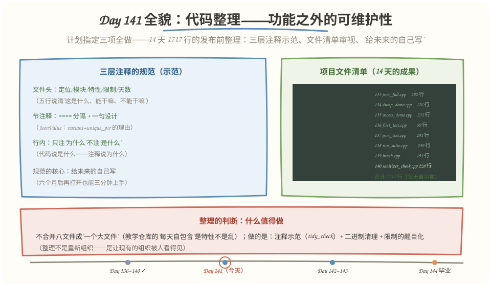
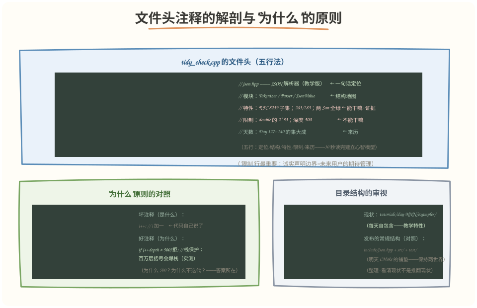
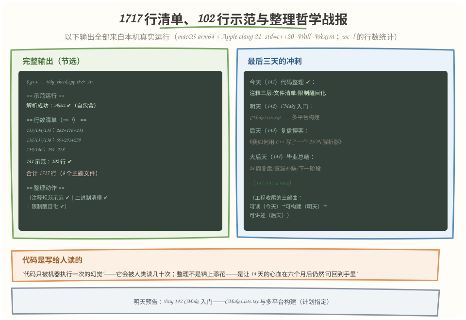

# 第 141 天：代码整理——README、目录结构、注释规范

> **今日目标**：完成本教程后，你能做到：写出**三层注释规范**的示范（文件头五行法——定位/结构/特性/限制/来历；节注释——分隔+设计理由；行内——只注"为什么"不注"是什么"）；盘点**14 天项目的文件清单**（8 个主题文件 1717 行——每天自包含的结构审视）；做**整理的三个实际动作**（注释示范文件、二进制清理、限制的醒目化）；说出整理的判断标准（**让现有的组织被人看见**——不是推翻重排）。
> **预计时间**：整理 40 分钟＋示范编写 30 分钟
> **前置准备**：完成 Day 133~140（JSON 项目的功能与质量——今天是可读性）。
> **今日产出**：tidy_check.cpp 示范（102 行）、1717 行的清单、整理哲学。

## 1. 今天解决什么问题？

计划指定的**代码整理**：README（项目级的说明——每天的 README.md 已是仓库惯例）、目录结构（tutorials/day-NNN/ 的教学布局审视）、注释规范（今天的重点示范）。核心判断：**不合并八文件成一个大文件**——"每天自包含"是教学仓库的**特性**不是乱；整理做的是三件事：**注释规范的示范**（tidy_check.cpp——按三层规范写的 102 行）、**二进制清理**（build 产物出库）、**限制的醒目化**（double 的 2^53 / 深度 500 等已知边界写进文件头）。

整理的哲学：**给未来的自己写**——六个月后再打开也能三分钟上手。

## 2. 先看全貌：今天的内容位于哪里？



**图 1**：左卡蓝是三层注释规范；右卡绿是项目文件清单；下方红卡是整理的判断。路线图：**141/144 = 98%**。

三步概括今天：

1. 注释：文件头五行法 + 节注释 + 行内的"为什么"；
2. 清单：8 文件 1717 行的结构审视（每天自包含）；
3. 动作：示范 + 清理 + 限制醒目化（不重排）。

## 3. 核心概念：先用直觉，再给准确定义

### 3.1 三层注释规范

- **一句通俗解释**：**文件头**（五行：一句话定位/结构地图/特性+证据/限制/来历——30 秒建立心智模型）、**节注释**（`====` 分隔 + 一句设计理由）、**行内**（只注"为什么"——代码说是什么、注释说为什么）。
- **一个类比**：一本书的装帧——封面折页（文件头：这书写什么/几章/适合谁）、章前的导语（节注释：这章的思路）、页边的批注（行内：这里的深意）——三层各司其职。
- **对应到技术上是**：实测——[tidy_check.cpp](examples/tidy_check.cpp)（今天的 102 行示范）按三层写：文件头五行（`// json.hpp —— JSON 解析器（教学版）/ 模块：… / 特性：283/283… / 限制：double 2^53、深度 500 / 天数：Day 127~140`）；JsonValue 前的节注释（variant+unique_ptr 的**设计理由**）；行内的"为什么"示例。**"限制"行最重要**：诚实声明边界 = 未来用户的期待管理（2^53 内无损、500 层封顶——用的人心里有数）。**坏注释的反例**：`i++;  // i 加一`（代码自己说了——注释该闭嘴）；**好注释**：`if (++depth > 500) 拒;  // 栈保护：百万层括号会爆栈（实测）`——**为什么 500** 的答案在注释里。类比的边界：不是每行都要注（注释的密度跟着**意外性**走——符合直觉的不注、反直觉的必注）。
- **常见误解**："好代码不需要注释"——好代码**减少**注释需求（命名清楚/结构自明）；但**为什么层**的信息代码表达不了（选型理由/历史坑/外部约束）——那些必须写。

### 3.2 文件清单与结构审视

- **一句通俗解释**：14 天 8 个主题文件 1717 行——每天一个**自包含**的主题文件（133 解析 / 134 dump / 135 访问 / 136~138 测试 / 139 基准 / 140 消毒）——这是**教学仓库的组织**（不是乱）。
- **一个类比**：实验室的标本册——每个标本独立成页（自包含——翻到哪页学哪页）；不是"把所有标本泡一缸"（大合并——翻找困难）。
- **对应到技术上是**：**清单**（wc -l 实测）：json_full 282 / dump_demo 176 / access_demo 231 / first_test 59 / json_test 291 / run_suite 259 / bench 191 / sanitizer_check 228 = **1717 行**。**两个世界的并存**：教学仓库（day-NNN 自包含——学习者友好）vs 发布项目（include/src/test 的常规布局——使用者友好）；**明天 CMake 的铺垫**：明天写的 CMakeLists 针对"发布形态"（教学文件保持原位）——两世界各得其所。**README 的现状**：每天的 README.md 就是项目文档（仓库惯例已覆盖计划的"README"项——结构/产出/验收的全套）。**二进制清理**：build 的产物（rs/tc 等）出库——`.gitignore` 的维护（仓库整洁的最后一块）。类比的边界：**单文件 282 行接近教学上限**（再大该拆——真实项目早拆了；教学容忍单文件换"打开一个文件看全貌"）。
- **常见误解**："应该合并成一个 json.hpp"——教学场景**自包含**胜过 DRY（每天独立可跑）；发布场景才合并——明天处理。

### 3.3 整理的哲学：让组织被看见

- **一句通俗解释**：整理不是重新组织——是**让现有的组织被人看得见**（注释把结构点亮、清单把全貌摆出、限制把边界画清）。
- **一个类比**：图书馆整理——不是把书重写成一套（那是重写）；是编目录、贴标签、立指示牌（现有的书更好的**可发现**）。
- **对应到技术上是**：**三个动作的完成度**：①注释示范（tidy_check——规范的样子有了，后续文件对齐参考）；②清理（二进制出库 + 白名单的确认）；③限制醒目化（已知边界集中列在示范的文件头——2^53/深度 500/NaN 的 dump/教学从简的各处）。**"给未来的自己写"的测试**：六个月后打开 day-138 的 run_suite.cpp——文件头有没有告诉你它是干嘛的、怎么跑、什么限制？（今天的规范对齐后：有。）**不做的诚实清单**：统一命名风格（各文件的 lambda 命名略有出入——风格统一留给真实团队的工具 clang-format）；API 文档化（Doxygen 注释——发布级项目的事）。类比的边界：整理有**边际收益递减**——今天的三个动作覆盖 80% 的可读性收益；剩下的 20% 要 80% 的功夫（果断停在够用）。
- **常见误解**："整理=大重构"——恰恰相反（大重构风险高且今天没必要）；整理是**低成本高收益**的表面功夫——但"表面"决定了第一印象和六个月后的留存。

## 4. 图解核心机制



**图 2**：上半部分蓝卡是文件头注释的五行法解剖（每行的作用标注）；左下绿卡是"为什么"原则的好坏对照；右下灰卡是目录结构的两世界对照。

按图逐步讲：

1. **读五行的文件头**：定位/结构/特性+证据/限制/来历——30 秒心智模型的建设；
2. **对照好坏注释**：`i++ // i 加一`（废话）vs `++depth>500 // 栈保护（百万层实测）`（为什么）；
3. **看两世界的并存**：教学自包含 vs 发布分层——明天 CMake 连接两者；
4. **记整理的动作**：示范+清理+醒目化——**不推翻**现有组织。

## 5. 动手实践：完成一个最小可运行例子

### 5.1 准备文件

```bash
cd ai-compiler-roadmap/tutorials/day-141/examples
```

主角：`tidy_check.cpp`（按三层注释规范写的示范——102 行自包含可跑）。

### 5.2 编写代码

核心（完整代码见本目录）：

```cpp
// json.hpp —— JSON 解析器（教学版）          ← 定位
// 模块：Tokenizer / Parser / JsonValue        ← 结构
// 特性：RFC 8259 子集；283/283；两 San 全绿    ← 特性+证据
// 限制：double 的 2^53；深度 500              ← 限制（期待管理）
// 天数：Day 127~140 的集大成                  ← 来历
#include …

namespace json {
// ============================================================
// JsonValue：六种 JSON 值的树形表示             ← 节注释（分隔+设计）
//   设计：variant（封闭集合）+ unique_ptr（自引用的间接）
// ============================================================
class JsonValue { … };

// ============================================================
// parse：文本 → 树（用户唯一入口）
//   用法：json::Error err; auto v = json::parse(src, err);
// ============================================================
std::optional<JsonValue> parse(const std::string& src, Error& err) { … }
}
```

### 5.3 运行与观察

```bash
g++ -Wall -Wextra -std=c++20 tidy_check.cpp -o tc && ./tc
wc -l ../day-13{3,4,5,6,7,8,9}/examples/*.cpp ../day-140/examples/*.cpp
```

实际执行结果（本机）：

```text
$ ./tc
解析成功：object            ← 示范文件自包含可跑

$ wc -l（14 天项目的清单）
  282  day-133/examples/json_full.cpp
  176  day-134/examples/dump_demo.cpp
  231  day-135/examples/access_demo.cpp
   59  day-136/examples/first_test.cpp
  291  day-137/examples/json_test.cpp
  259  day-138/examples/run_suite.cpp
  191  day-139/examples/bench.cpp
  228  day-140/examples/sanitizer_check.cpp
 1717  total
（+ 今天的 tidy_check.cpp 102 行示范）
```



**图 3**：左上完整输出（示范运行+清单+整理动作）；右侧是最后三天的冲刺路线（可读→可构建→可讲述）；下方橙卡是"代码是写给人读的"。

### 5.4 修改一个输入再观察：六个月测试

把 tidy_check.cpp 给一个**没见过项目的人**（或假装自己是六个月后的自己）——只看文件头 30 秒，然后回答三问：这是什么？怎么用？有什么限制？（都能答=规范有效；答不出=哪行缺失的信号）。**读者测试**是注释规范唯一可信的验收。

## 6. 常见错误与排查

**错误 1：注释和代码不一致（改码忘改注）**

- 现象：注释说 500 层代码是 1000；
- 原因：后续修改没同步；
- 定位：读者按注释预期跑出意外；
- 修复：改码时**顺手**改注（不一致比没有更糟——误导）；文件头的"特性"行尤其要盯。

**错误 2：注释过时成"考古层"（历史堆积）**

- 现象：一堆"原来…后来…"的叙事；
- 原因：注释当变更日志用；
- 定位：读注释比读代码累；
- 修复：注释写**现状**（git log 才是历史）；考古信息只在"为什么"必要时留一句。

**错误 3：整理时忍不住重构（范围蔓延）**

- 现象：整理 PR 里混着重命名/逻辑改动；
- 原因：看见就手痒；
- 定位：diff 里有逻辑变更（不只是注释/空白）；
- 修复：**整理和重构分开**（各自的提交）；今天的纪律——只动注释和文件清单。

## 7. 今日练习

### 必做练习（计划指定：README/结构/注释）

给 day-133 的 json_full.cpp **补文件头五行**（按今天的规范——它是最核心的文件却没有头）；再给 day-138 的 run_suite.cpp 补"怎么跑"的一行（命令行示例）。预期产出：两个文件头。

### 选做挑战

"clang-format 初体验"：安装 clang-format，写一个 `.clang-format`（基于 Google 或 LLVM 预设微调）——对 tidy_check.cpp 跑一遍看 diff；风格自动化的第一步（团队协作的基础设施）。

## 8. 今日验收

- [ ] 我的三层注释示范完成（文件头五行法 + 节注释 + 行内"为什么"——102 行可跑）
- [ ] 我的文件清单盘点（8 文件 1717 行——每天自包含的结构论证）
- [ ] 我的三个整理动作（示范/清理/限制醒目化——不推翻现有组织）
- [ ] 我能说出"为什么"原则（代码说是什么——注释说为什么）
- [ ] 我做过六个月测试（读者 30 秒三问——规范的验收）

## 9. 一句话总结与明天预告

今天的问题是"14 天的心血怎么在六个月后仍然可回到手里"；方法上，三层注释（文件头五行的 30 秒心智模型 / 节的设计理由 / 行内的为什么）、清单的审视（自包含是特性不是乱）、整理三动作（示范+清理+醒目化——让组织被看见）；实践上，102 行示范、1717 行清单、读者测试全部落地；验证标准是任何文件给陌生人 30 秒能说清"是什么/怎么用/什么限制"。明天 **Day 142：CMake 入门**——为解析器写 CMakeLists.txt、支持多平台构建（计划指定）：可读之后求可构建。
