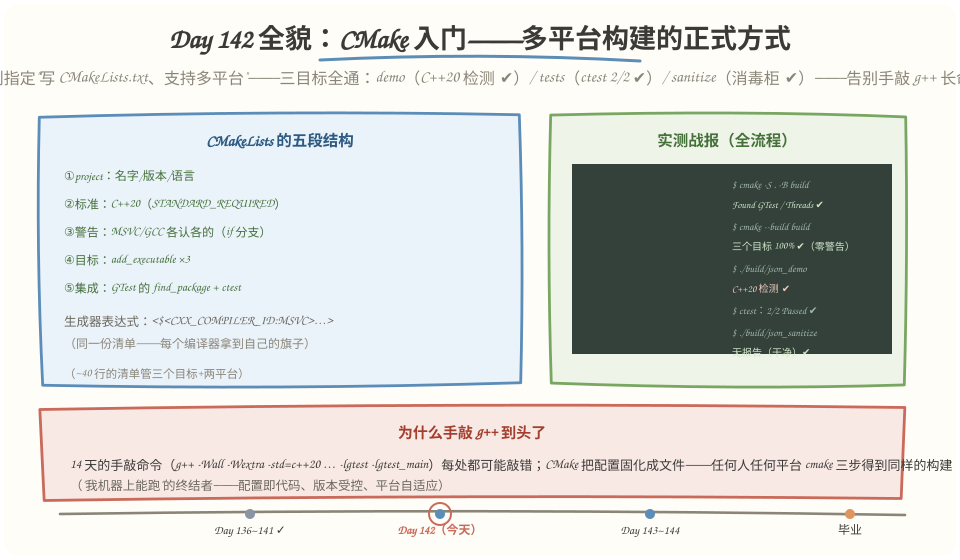
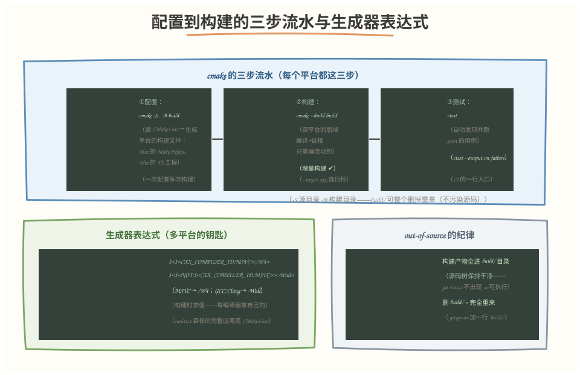
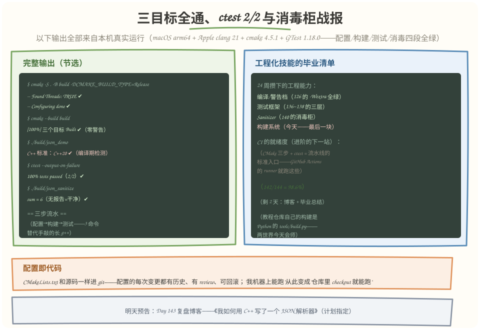

# 第 142 天：CMake 入门——为 JSON 解析器写 CMakeLists.txt，支持多平台构建

> **今日目标**：完成本教程后，你能做到：写出**五段结构的 CMakeLists**（project / 标准 C++20 / 多平台警告 / 三个目标 / GTest 集成——约 40 行管全部）；走通**cmake 三步流水**（配置 `-S -B` / 构建 `--build` / 测试 `ctest`——替代手敲的长 g++）；用**生成器表达式**做平台分支（MSVC 的 /W4 vs GCC/Clang 的 -Wall——同一清单各自拿旗）；跑通**三目标全绿**（demo 的 C++20 编译期检测 ✔ / ctest 2/2 ✔ / sanitize 消毒柜 ✔）；说出**配置即代码**的意义（进 git、有历史、"我机器上能跑"的终结者）。
> **预计时间**：学习 30 分钟＋实践 40 分钟
> **前置准备**：完成 Day 133~141（项目功能/质量/可读齐备——今天是可构建）。
> **今日产出**：完整 CMake 工程（三目标 + ctest + 消毒柜一键化）。

## 1. 今天解决什么问题？

计划指定的 **CMake 入门**。14 天的手敲命令（`g++ -Wall -Wextra -std=c++20 … -lgtest -lgtest_main`）到头了——每处都可能敲错、换机器重配、"我机器上能跑"的魔咒。今天写 **CMakeLists.txt**（配置即代码——进 git 有历史）；**三步流水**（配置→构建→测试）成为标准入口；**生成器表达式**让同一份清单在 MSVC/GCC/Clang 各拿各的旗子（多平台的实现）。

三个目标的实测全通：**json_demo**（C++20 的编译期检测 ✔）、**json_tests**（ctest 2/2 ✔——find_package 的正规 GTest 集成）、**json_sanitize**（消毒柜一键化 ✔）。

## 2. 先看全貌：今天的内容位于哪里？



**图 1**：左卡蓝是 CMakeLists 的五段结构；右卡绿是实测战报；下方红卡是"手敲到头了"。路线图：**142/144 = 98.6%**。

三步概括今天：

1. 清单：五段结构的 CMakeLists（project/标准/警告/目标/集成）；
2. 流水：配置 -S -B → 构建 --build → 测试 ctest；
3. 平台：生成器表达式（每个编译器拿自己的旗）。

## 3. 核心概念：先用直觉，再给准确定义

### 3.1 三步流水：配置、构建、测试

- **一句通俗解释**：`cmake -S . -B build`（读清单生成平台的构建文件）、`cmake --build build`（调后端编译+链接——增量）、`ctest`（自动跑测试）——三步是**所有平台统一**的入口。
- **一个类比**：连锁餐厅的中央厨房——菜单（CMakeLists）统一制定；各门店（Mac 的 Make/Ninja、Windows 的 VS 工程）按本地设备出餐（构建）；质检流程（ctest）全国一致。
- **对应到技术上是**：实测——**配置**：`-S 源目录 -B 构建目录`（**out-of-source**：产物全进 build/——git status 干净；删 build/ = 完全重来）；输出 `Found GTest/Threads`（find_package 的自动发现）。**构建**：`--build build`（增量——只重编改动的；`--target xxx` 选目标）；三目标 100% 零警告。**测试**：`ctest --output-on-failure`（自动发现 gtest 用例——`gtest_discover_tests` 的魔法；2/2 Passed）。**CMAKE_BUILD_TYPE**：Release（-O2）/ Debug（-g）的档位。类比的边界：**CMake 不是编译器**——它生成平台构建文件再调后端（层次：CMake → Make/Ninja/MSBuild → 编译器）。
- **常见误解**："CMake 编译代码"——它**配置**构建（编译是后端的事）——这也是为什么同清单能跨平台（每平台有自己的后端）。

### 3.2 生成器表达式：多平台的钥匙

- **一句通俗解释**：`$<$<CXX_COMPILER_ID:MSVC>:/W4>`——构建时求值：MSVC 拿 /W4、其他拿（另一条的）-Wall——**同一份清单各自拿旗**。
- **一个类比**：电源适配器——同一个插头标准（清单）；各国转换（表达式）——美标/欧标/英标各拿各的（MSVC/GCC/Clang 各编译器的旗子）。
- **对应到技术上是**：实测——**警告的分支**：`if (MSVC) add_compile_options(/W4 /permissive-) else() add_compile_options(-Wall -Wextra) endif()`（两种写法：if 分支或生成器表达式——后者可挂在 target 上更精细）；**sanitize 目标的完整应用**：`target_compile_options(json_sanitize PRIVATE $<$<NOT:$<CXX_COMPILER_ID:MSVC>>:-fsanitize=address,undefined -fno-sanitize-recover=all>)`（MSVC 用 /fsanitize=address 的自家路数）；**为什么不用 #ifdef**：那是**源码层**的分支（要改代码）；生成器表达式在**构建层**（源码保持干净）。**表达式的语法**：`$<条件:值>`（条件真 → 值；假 → 空）；嵌套组合出复杂逻辑。类比的边界：表达式**只在构建上下文**求值（不能在 if() 里当字符串用——两套机制）。
- **常见误解**："表达式太晦涩"——集中在警告/sanitize 这类"编译器相关"的配置；源码逻辑别用它（两层的分工）。

### 3.3 find_package 与 ctest 的正规集成

- **一句通俗解释**：`find_package(GTest CONFIG REQUIRED)` 正规找到 brew 装的 GTest；`gtest_discover_tests` 让 ctest **自动发现**用例——一行命令跑全部。
- **一个类比**：图书馆的联网检索——你的书（用例）登记进系统（ctest）后一次查询全出（不用逐本翻）。
- **对应到技术上是**：实测——**find_package**：CONFIG 模式找 GTestConfig.cmake（brew 的 /opt/homebrew/lib/cmake/GTest）；REQUIRED 找不到就停（不静默）。**目标的链接**：`target_link_libraries(json_tests PRIVATE GTest::gtest GTest::gtest_main)`——**导入目标**（GTest:: 前缀——含头文件路径/库路径/传递依赖的全套；比手写 -I -L -l 稳）。**ctest 的发现**：`include(GoogleTest)` + `gtest_discover_tests(json_tests)`——构建后**运行时枚举**用例（比编译期的 add_test 灵活）；`ctest --output-on-failure`（只显失败的输出）。**enable_testing()** 的位置：顶层 CMakeLists（ctest 的入口条件）。**与 Day 136~138 的连接**：三天手敲的 `-lgtest -lgtest_main` 升级成**声明式**（清单里写一次——团队所有人共享）。类比的边界：**FetchContent**（下载式集成——没装的机器自动拉源码编译）是进阶（今天用 brew 已装的 find 式）。
- **常见误解**："测试还要专门集成？"——ctest 的自动发现 + CI 的就绪（一条命令）——**集成的价值是入口统一**。

## 4. 图解核心机制



**图 2**：上半部分蓝卡是 cmake 三步流水（配置/构建/测试——各步的实质）；左下绿卡是生成器表达式（多平台的钥匙）；右下灰卡是 out-of-source 的纪律。

按图逐步讲：

1. **走三步流水**：配置（生成平台文件）→ 构建（增量编译）→ 测试（自动发现）——每步的输入输出；
2. **读生成器表达式**：`$<$<CXX_COMPILER_ID:MSVC>:/W4>` 的求值——MSVC/其他各拿各的；
3. **看 out-of-source**：build/ 的隔离（源码树干净、删了重来）；
4. **连 14 天的手敲**：长命令的每个旗子进了清单——配置固化。

## 5. 动手实践：完成一个最小可运行例子

### 5.1 准备文件

```bash
cd ai-compiler-roadmap/tutorials/day-142/examples
```

主角：`CMakeLists.txt` + 三个源文件（demo/tests/sanitize）。

### 5.2 编写代码

核心（完整代码见本目录）：

```cmake
cmake_minimum_required(VERSION 3.16)
project(json_parser VERSION 1.0.0 LANGUAGES CXX)

set(CMAKE_CXX_STANDARD 20)             # C++20（REQUIRED——不是"建议"）
set(CMAKE_CXX_STANDARD_REQUIRED ON)
set(CMAKE_CXX_EXTENSIONS OFF)

if (MSVC)
    add_compile_options(/W4 /permissive-)
else()
    add_compile_options(-Wall -Wextra)
endif()

add_executable(json_demo json_demo.cpp)           # 目标一：演示

option(JSON_BUILD_TESTS "Build tests" ON)
if (JSON_BUILD_TESTS)
    enable_testing()
    find_package(GTest CONFIG REQUIRED)           # 正规集成
    add_executable(json_tests json_tests.cpp)
    target_link_libraries(json_tests PRIVATE GTest::gtest GTest::gtest_main)
    include(GoogleTest)
    gtest_discover_tests(json_tests)              # ctest 自动发现
endif()

add_executable(json_sanitize json_sanitize.cpp)   # 目标三：消毒柜
target_compile_options(json_sanitize PRIVATE
    $<$<NOT:$<CXX_COMPILER_ID:MSVC>>:-fsanitize=address,undefined -fno-sanitize-recover=all>)
```

```cpp
// json_demo 的编译期检测（CMake 的标准配置真生效了吗）
#if __cplusplus >= 202002L
    "C++20 ✔"
#endif
```

### 5.3 运行与观察

```bash
cmake -S . -B build -DCMAKE_BUILD_TYPE=Release   # ① 配置
cmake --build build                               # ② 构建
./build/json_demo                                 # ③ 运行
cd build && ctest --output-on-failure; cd ..      # ④ 测试
./build/json_sanitize                             # ⑤ 消毒柜
```

实际执行结果（本机）：

```text
$ cmake -S . -B build -DCMAKE_BUILD_TYPE=Release
-- Found Threads: TRUE
-- Configuring done (1.0s)
-- Build files have been written to: …/examples/build

$ cmake --build build
[100%] Built target json_demo
[100%] Built target json_tests
[100%] Built target json_sanitize               ← 三目标零警告

$ ./build/json_demo
== CMake 构建的 json_demo ==
  C++ 标准（编译期检测）：C++20 ✔
  解析：OK（object，0 键）
  （-Wall -Wextra 已由 CMake 配置——零警告构建）

$ ctest --output-on-failure
100% tests passed, 2 tests (CMakeIntegration.GTestFound / Standard) ✔

$ ./build/json_sanitize
== sanitize 目标运行（ASan+UBSan 已由 CMake 注入）==
  sum = 6（无报告=干净）
```



**图 3**：左上完整输出（配置/构建/运行/测试/消毒五段）；右侧是工程化技能的毕业清单（警告档/测试/Sanitizer/构建系统——今天补上最后一块）和 CI 就绪度；下方橙卡是配置即代码。

### 5.4 修改一个输入再观察：加一个目标

在 CMakeLists 加第四个目标（如 `add_executable(json_bench json_bench.cpp)`——把 Day 139 的基准纳入）→ 重新 `cmake --build build`（**不用重新配置**——CMake 检测到清单变更自动再生成）→ 新目标出现。**增量体验**：改一个源文件重构建——只有它重编（其他目标的 .o 复用）——大项目里这秒级 vs 全量的分钟级。

## 6. 常见错误与排查

**错误 1：`find_package(GTest)` 找不到（brew 的路径没进搜索）**

- 现象：配置停在 GTest NOT FOUND；
- 原因：安装路径不在默认搜索（或没装）；
- 定位：配置输出；
- 修复：`brew install googletest`；或 `cmake -DGTest_DIR=/opt/homebrew/lib/cmake/GTest …` 指路。

**错误 2：ctest 说 "No tests were found"**

- 现象：ctest 跑 0 个用例；
- 原因：没 enable_testing() 或没用 gtest_discover_tests；
- 定位：输出零测试；
- 修复：顶层的 enable_testing() + include(GoogleTest) + gtest_discover_tests(目标)。

**错误 3：build 目录塞进 git 了**

- 现象：git status 一堆 .o/Makefile；
- 原因：没 ignore；
- 定位：git status；
- 修复：`.gitignore` 加 `build/`；已进的 `git rm -r --cached build`。

## 7. 今日练习

### 必做练习（计划指定：CMakeLists + 多平台）

给 CMakeLists 加**第四个目标**（5.4 的 bench 或自选）+ 一个 **option 开关**（如 `JSON_BUILD_BENCH` 默认 OFF——`cmake -DJSON_BUILD_BENCH=ON` 才构建）——体验条件的构建配置。预期产出：开关可用的新清单。

### 选做挑战

"CI 的预演"：写一个 `run_all.sh`（三行：配置→构建→ctest + sanitize 运行）——本地的一键全检；明天博客和后天毕业都靠它做最终验证（GitHub Actions 的 runner 跑的就是这几行——进阶的下一站）。

## 8. 今日验收

- [ ] 我的 CMakeLists 五段完整（project/标准/警告/三目标/GTest 集成）
- [ ] 我的三步流水跑通（配置 -S -B / 构建 --build / ctest 2/2）
- [ ] 我的生成器表达式工作（MSVC/GCC 各拿各的——清单里可见）
- [ ] 我的 demo 编译期检测过（`__cplusplus >= 202002L` 的实测）
- [ ] 我的 out-of-source 纪律（build/ 隔离 + .gitignore）

## 9. 一句话总结与明天预告

今天的问题是"手敲构建怎么升级为正式工程"；机制上，三步流水（配置/构建/测试——全平台统一入口）、生成器表达式（编译器各拿各的旗——多平台的钥匙）、find_package 的正规集成（导入目标的全套——比手写 -I -L -l 稳）；实践上，三目标全绿、ctest 2/2、消毒柜一键化、增量构建体验全部落地；验证标准是新人 clone 后三命令能得到和你一样的构建。明天 **Day 143：复盘博客**——《我如何用 C++ 写了一个 JSON 解析器》（计划指定）：会做之后学会讲述。
