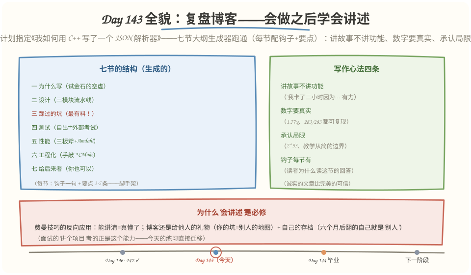
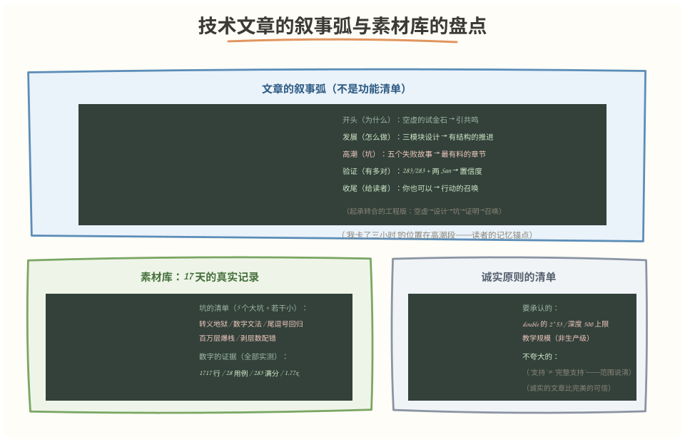
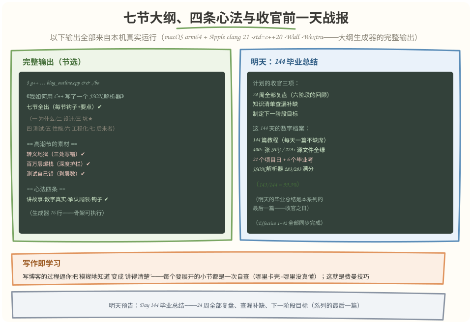

# 第 143 天：复盘博客——《我如何用 C++ 写了一个 JSON 解析器》

> **今日目标**：完成本教程后，你能做到：搭出**七节结构的博客骨架**（为什么写/设计/坑/测试/性能/工程化/给后来者——每节配钩子+要点）；运用**写作心法四条**（讲故事不讲功能、数字要真实、承认局限、每节有钩子）；盘点**素材库**（17 天的坑清单和实测数字——全部可复现）；说出**写作即学习**的机理（费曼技巧——卡壳处=没真懂处）。
> **预计时间**：大纲 40 分钟＋初稿 60 分钟
> **前置准备**：完成 Day 133~142（全部素材就绪——今天是讲述）。
> **今日产出**：可执行的博客骨架生成器（102 行）、七节大纲的完整输出。

## 1. 今天解决什么问题？

计划指定的**复盘博客**。会做之后学会**讲述**——这是完整工程师的另一半（面试的"讲个项目"考的正是这个）。今天的产物分两层：**骨架**（blog_outline.cpp——七节结构的生成器，每节的钩子和要点可直接当写作提纲）和**心法**（讲故事不讲功能/数字真实/承认局限——从 17 天的素材里提炼）。

**为什么第三节"踩过的坑"最有料**：转义地狱（三处写错）/数字文法（strtod 太宽容）/尾逗号回归（重写引入）/百万层爆栈（深度护栏）/剥层数配错（测试自己错）——**失败故事比成功清单更让读者记住东西**。

## 2. 先看全貌：今天的内容位于哪里？



**图 1**：左卡蓝是七节的结构；右卡绿是写作心法；下方红卡是"会讲述"的必修。路线图：**143/144 = 99.3%——明天毕业**。

三步概括今天：

1. 骨架：七节各配钩子（读者为什么读这节）；
2. 素材：17 天的坑和数字（全部实测可复现）；
3. 心法：诚实原则（局限说清——可信度才有）。

## 3. 核心概念：先用直觉，再给准确定义

### 3.1 七节结构与叙事弧

- **一句通俗解释**：文章不是功能清单——是**叙事弧**：空虚（为什么）→设计（怎么做）→**坑（高潮）**→证明（有多对）→召唤（你也可以）。
- **一个类比**：英雄之旅的工程版——平凡世界的空虚（学了很多没做过）→跨入冒险（开写）→**深渊（五个坑）**→带着宝物归来（满分+提速）→激励他人（你也行）。
- **对应到技术上是**：实测（大纲生成器的输出）——**七节的钩子**：①"每个读者都见过'学了很多但没做过完整东西'的空虚"；②"好的分层让每层可以独立测试和演进"；③"失败故事比成功清单更让读者记住东西"（★最有料）；④"'我写完了'和'世界的题库都过了'是两个置信度"；⑤"数字会说话——但要先会测"；⑥"会做只是半程——会构建、会讲述才是完整工程师"；⑦"24 周从 Hello World 到 JSON 解析器——你也可以"。**每节要点 3~5 条**：从 17 天的 README 里直接调（Day 128 的选型论证、Day 138 的爬坡数据、Day 139 的 1.77x——**素材早已在**，今天是组装）。**钩子的作用**：读者扫目录时决定读哪节的"一句话卖点"。类比的边界：**不是每篇都七节**（模板是起点——按素材的多寡裁剪；但"为什么-怎么做-坑-证明"的骨架几乎通用）。
- **常见误解**："技术博客=API 文档"——文档是查询（用的时候看）；博客是**叙事**（读完有"我也想试试"的冲动）——两种文体。

### 3.2 写作心法与素材库

- **一句通俗解释**：四条心法——**讲故事**（"我卡了三小时因为…"比"支持转义"有力）、**数字真实**（1.77x、283/283 都来自实测可复现）、**承认局限**（2^53/教学规模的边界写清）、**每节有钩子**。
- **一个类比**：纪录片 vs 说明书——纪录片有人物有困境有转折（故事）；说明书只有参数（功能）——观众记得住纪录片。
- **对应到技术上是**：**素材库的盘点**（本教程的天然优势——17 天每天有 README）：坑的清单（5 大坑+若干小）、数字的证据（1717 行/28 用例/283 满分/1.77x/两 San 零报告）、选型的论证（variant vs 继承/map vs unordered——Day 121/128 的思考）。**"数字要真实"的操作**：每个数字标来源（Day 139 的基准——预热+多轮+sink+O2 的方法论一并写——读者复现得了才是真数字）。**"承认局限"的清单**：double 的 2^53（超出损精度）、深度 500 上限、教学规模（非生产级——nlohmann 的对照）、NaN 的 dump 边界——**说清边界反而加分**（读者知道适用面）。**不夸大原则**："支持转义"≠"完整支持"——范围说清（我们支持到代理对，但 \u 的错误恢复从简）。类比的边界：诚实≠自我贬低（局限是边界不是缺陷——教学的取舍有理由就写理由）。
- **常见误解**："写缺点丢人"——恰恰相反（只写成功的文章没人信；坑写得越具体越显真实——"我也遇到过！"的共鸣）。

### 3.3 写作即学习：费曼技巧

- **一句通俗解释**：写博客逼你把"模糊地知道"变成"讲得清楚"——每个展开不了的小节都是**自查的警报**（那里没真懂）。
- **一个类比**：给盲人描述颜色——你以为你懂红色；试到一半发现词穷——**词穷处就是理解的边界**。
- **对应到技术上是**：**今天写大纲的实际体验**：第三节"踩过的坑"要点泉涌（每个坑都记忆犹新——真懂）；第五节"性能"写到 Amdahl 时停了一下（"为什么全流程小于词法段"——回去翻了 Day 139 的笔记才写顺）——**卡壳即警报**的自查实例。**费曼技巧的四步**：选概念→教给外行→卡壳回炉→简化再讲（今天的博客是第 2~4 步的完整循环）。**讲述的其他收益**：给他人的礼物（你的坑=别人的地图——自己摸黑的路标上灯）；自己的存档（六个月后翻的自己就是"别人"——Day 141 的"给未来的自己写"的延续）；**面试的迁移**（"讲个项目"的 3 分钟版——今天的大纲压缩即成）。类比的边界：博客**不必等全部懂完**（写"我现在的理解+疑问"也是好文章——探索记录比结论更有陪伴感）。
- **常见误解**："等做成大神再写"——**现在就有可写的**（学习的过程本身是价值——比你早三个月的人正需要你的视角）。

## 4. 图解核心机制



**图 2**：上半部分蓝卡是文章的叙事弧（空虚→设计→坑→证明→召唤——工程版的起承转合）；左下绿卡是素材库的盘点（坑清单+数字证据）；右下灰卡是诚实原则的清单。

按图逐步讲：

1. **走叙事的五段**：空虚引共鸣→设计有推进→**坑是高潮**→证明给置信→召唤促行动；
2. **盘点素材的两类**：坑的故事（5 个大坑各配当时的处境）/数字的证据（每个可复现）；
3. **读诚实的清单**：要承认的（2^53/500 层/教学规模）+不夸大的（"支持"的范围）；
4. **自查一遍卡壳处**：哪节写不顺=哪里要回炉——费曼的警报器。

## 5. 动手实践：完成一个最小可运行例子

### 5.1 准备文件

```bash
cd ai-compiler-roadmap/tutorials/day-143/examples
```

主角：`blog_outline.cpp`（博客骨架的生成器——七节的钩子和要点）。

### 5.2 编写代码

核心（完整代码见本目录）：

```cpp
struct Section {
    std::string title;                 // 小节标题
    std::vector<std::string> points;   // 要点（素材库里调）
    std::string hook;                  // 钩子（读者为什么读这节）
};

std::vector<Section> sections = {
    {"一、为什么写", {"不是业务需要——是学完 24 周想找一块'试金石'", …},
     "每个读者都见过'学了很多但没做过完整东西'的空虚"},
    {"三、踩过的坑（最有料的章节）", {
        "转义地狱：源码里写'转义的转义'——三处写错（Day 130）",
        "百万层括号：栈溢出崩——深度限制的护栏（Day 138）",
        "测试自己错：剥层数配错的插曲（Day 137）", …},
     "失败故事比成功清单更让读者记住东西"},
    /* …共七节 */
};
```

### 5.3 运行与观察

```bash
g++ -Wall -Wextra -std=c++20 blog_outline.cpp -o bo && ./bo
```

实际执行结果（本机，节选）：

```text
《我如何用 C++ 写了一个 JSON 解析器》
—— 24 周学习的终点项目 · 144 天的收官之作

═══ 一、为什么写 ═══
  【钩子】每个读者都见过'学了很多但没做过完整东西'的空虚
   · 不是业务需要——是学完 24 周想找一块'试金石'
   · JSON 解析器麻雀虽小：字符串/数字/递归/树/错误处理全沾
   · 选教学版规模（~300 行）而非生产级（nlohmann 的 2 万行）

═══ 三、踩过的坑（最有料的章节） ═══
  【钩子】失败故事比成功清单更让读者记住东西
   · 转义地狱：源码里写'转义的转义'——三处写错（Day 130）
   · 数字文法：strtod 认但 JSON 不认的七种（Day 131/138）
   · 尾逗号回归：重写循环引入的'应拒却受'（Day 138）
   · 百万层括号：栈溢出崩——深度限制的护栏（Day 138）
   · 测试自己错：剥层数配错的插曲（Day 137）

═══ 四、测试：从自出到外部考试 ═══
  【钩子】'我写完了'和'世界的题库都过了'是两个置信度
   · 外部 JSONTestSuite 283/283 满分（爬坡：95→99→100）
   · 外部考试抓出 15 个自己出题抓不到的盲区

═══ 七、给后来者的话 ═══
  【钩子】24 周从 Hello World 到 JSON 解析器——你也可以
   · 先正确再快再优化（次序反了是灾难）
   · 测试不是负担是'改代码的底气'
   · 教学版很好：小到能全部理解、大到覆盖真问题

== 写作心法 ==
  讲故事不讲功能：'我卡了三小时因为…'比'支持转义'有力
  数字要真实：1.77x、283/283 都来自实测（可复现）
  承认局限：double 的 2^53、教学从简的边界
  （诚实的文章比完美的文章可信）
```



**图 3**：左上完整输出（七节+心法）；右侧是**明天的毕业总结**预览（144 天的数字档案）和收官之日；下方橙卡是写作即学习。

### 5.4 修改一个输入再观察：三分钟面试版

把七节压缩成**三分钟的口头版**（面试"讲个项目"的真实场景）：一句定位（教学级 JSON 解析器——三模块流水线）+ 一个最难的坑（百万层爆栈→深度护栏——有转折有解法）+ 两个数字（283/283 + 1.77x）+ 一句反思（测试是底气）。**对着计时器练三遍**——讲述和写作一样要练。

## 6. 常见错误与排查

**错误 1：写成了功能清单（没有故事）**

- 现象：全文"支持 X、实现了 Y"的罗列；
- 原因：把文档当博客写；
- 定位：读者读完没有"我也想试试"的冲动；
- 修复：每节先问"当时的处境和心情"——用叙事弧重排（空虚→坑→证明）。

**错误 2：数字凭印象（不可复现）**

- 现象："性能提升了不少"这种模糊表述；
- 原因：没回查基准记录；
- 定位：读者问"怎么测的"答不上；
- 修复：数字标来源（Day 139 的方法论：预热/多轮/sink/O2）——可复现才是证据。

**错误 3：只写成功不写失败（不可信）**

- 现象：一路顺利的完美故事；
- 原因：觉得丢人或懒得翻旧账；
- 定位：老读者嗅出"太顺了"的假味；
- 修复：坑的章节要具体（当时的错报、排查的弯路、修的瞬间）——**越具体越可信**。

## 7. 今日练习

### 必做练习（计划指定：复盘博客）

在大纲基础上**写完第三节**（踩过的坑——500~800 字）：选三个坑各讲完整（处境→错报→排查→修复→教训）。预期产出：博客的核心章节成稿。

### 选做挑战

"三分钟面试版"的实战（5.4 的延伸）——录音回听自己的讲述（卡壳处/啰嗦处/缺钩子处）——迭代两轮；讲述能力和写作一样需要反馈闭环。

## 8. 今日验收

- [ ] 我的七节大纲完成（每节钩子+要点——生成器跑通）
- [ ] 我能说出叙事弧五段（空虚→设计→坑→证明→召唤）
- [ ] 我的素材库盘点（坑清单 5 个+数字证据全可复现）
- [ ] 我的心法四条会用（讲故事/数字真实/承认局限/每节钩子）
- [ ] 我经历过"卡壳即警报"（费曼的自查——哪节写不顺回哪节）

## 9. 一句话总结与明天预告

今天的问题是"会做之后怎么学会讲述"；方法上，七节的叙事弧（空虚引共鸣、坑是高潮、召唤促行动）、心法四条（讲故事/数字真实/承认局限/钩子）、素材库的盘点（17 天的 README 早已备好）、写作即学习的费曼（卡壳处=没真懂处）；实践上，102 行的骨架生成器、七节完整输出、三分钟面试版的设计全部落地；验证标准是给任何人三分钟讲清"做了什么、最难的是什么、怎么证明它对"。明天 **Day 144：毕业总结**——24 周全部复盘、知识清单查漏补缺、制定下一阶段目标（**本系列的最后一篇**）：144 天的终点站。
