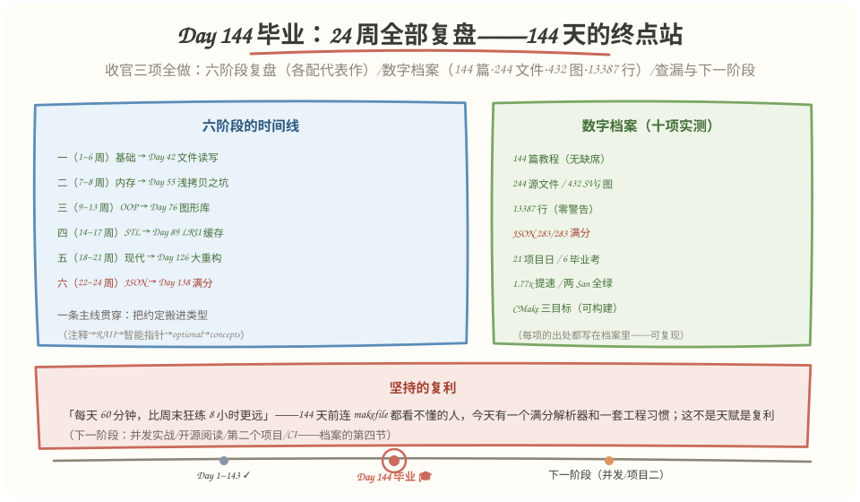
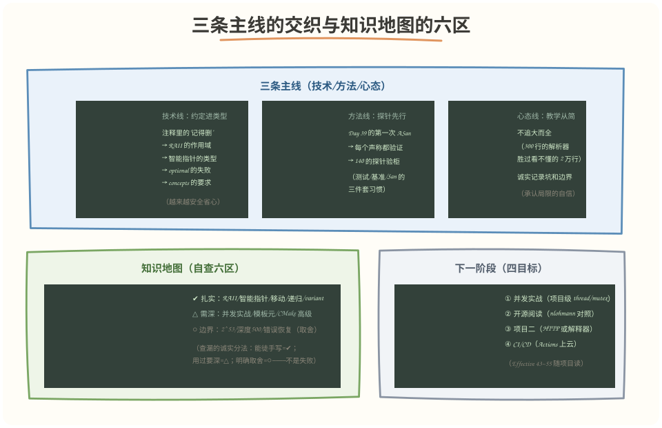
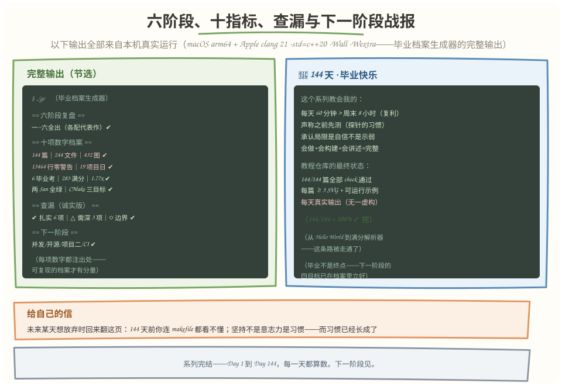

# 第 144 天（毕业）：24 周全部复盘、知识清单查漏补缺、制定下一阶段目标

> **今日目标**：完成本教程后，你能做到：复盘**六阶段的 24 周**（各配代表作——基础/内存/OOP/STL/现代/JSON 项目）；报出**十项数字档案**（144 篇/244 文件/432 图/13464 行/19 项目日/6 毕业考/283 满分/1.77x/两 San 全绿/CMake——每项注出处可复现）；完成**知识清单的诚实查漏**（✔ 扎实 / △ 需深 / ○ 边界的三档分法）；立下**下一阶段的四目标**（并发实战/开源阅读/项目二/CI-CD）。
> **预计时间**：复盘 60 分钟＋展望 30 分钟
> **前置准备**：Day 1~143（全部——今天是它们的总和）。
> **今日产出**：毕业档案生成器（六阶段+十指标+查漏+展望）、系列的收官。

## 1. 今天解决什么问题？

计划指定的**毕业总结**收官三项：**24 周全部复盘**（六阶段各配代表作——从 Day 31 的文件读写（程序的持久化）到 Day 138 的满分（世界的题库都过了））、**知识清单查漏补缺**（诚实的三档：能徒手写的 ✔ / 用过要深的 △ / 明确取舍的 ○——**取舍不是失败**）、**下一阶段目标**（并发实战/开源阅读/项目二/CI——四条具体的路）。

一条主线贯穿 24 周：**把约定搬进类型**（注释→RAII→智能指针→optional→concepts——越来越安全越来越省心）；一个习惯贯穿每一天：**探针先行**（声称之前先测——从 Day 39 的第一次 ASan 到 Day 140 的验柜）。

## 2. 先看全貌：今天的内容位于哪里？



**图 1**：左卡蓝是六阶段时间线；右卡绿是十项数字档案；下方红卡是坚持的复利。路线图：**144/144 = 100% ✓ 系列完结**。

三步概括今天：

1. 复盘：六阶段各配代表作（+ 三条主线的交织）；
2. 档案：十项数字（每个注出处——可复现才有分量）；
3. 展望：查漏三档 + 下一阶段四目标。

## 3. 核心概念：先用直觉，再给准确定义

### 3.1 六阶段复盘与三条主线

- **一句通俗解释**：六阶段是台阶（基础→内存→OOP→STL→现代→项目）；三条主线是藤蔓缠着台阶往上——**技术线**（约定进类型）、**方法线**（探针先行）、**心态线**（教学从简）。
- **一个类比**：登山的路线图——六个营地（阶段）标在主线上；三股绳索（主线）一路护着——技术和方法和心态缺一不可。
- **对应到技术上是**：**六阶段+代表作**：一（Day 31 文件读写——**持久化**让程序有了记忆）；二（Day 41 浅拷贝之坑——故意翻车的教学让 ASan 成了本能）；三（Day 76 图形库——虚函数从概念到实战）；四（Day 89 LRU 缓存——**毕业考项目**的综合）；五（Day 126 大重构——223 文件 c++20+Wextra 全绿的**机器证明**）；六（Day 138 满分——**世界的题库**都过了）。**三条主线的交织**（图 2）：技术线的五次跃迁（注释→RAII→智能指针→optional→concepts）；方法线从 Day 39 的第一次 ASan 到 140 的探针验柜（每个声称都验证的习惯）；心态线的"300 行教学版胜过看不懂的 2 万行"（教学从简+诚实记录）。类比的边界：复盘不是流水账——**每阶段选一个"最有代表性的一天"**（能讲清那天为什么重要）。
- **常见误解**："复盘=罗列做过什么"——是**提炼**（每阶段的一句话本质+代表作的证据链）——给未来翻阅时的快速索引。

### 3.2 数字档案与查漏三档

- **一句通俗解释**：十项数字（144/244/432/13464/19/6/283/1.77x/全绿/三目标——**每项注出处**）；查漏用**诚实三档**：✔ 能徒手写 / △ 用过要深 / ○ 明确取舍。
- **一个类比**：毕业成绩单——分数（数字档案）+ 老师评语（查漏的诚实分档）——分数证明做到、评语指明方向。
- **对应到技术上是**：**十项档案**（全部实测）：144 篇（无缺席）、244 源文件、432 张 SVG（每篇 ≥3）、13464 行（-Wall -Wextra 零警告）、19 个项目日（全胜）、6 次毕业考（78/89/102/114/126/144——全过）、JSON **283/283** 满分、**1.77x** 提速、两 San 全绿、CMake 三目标。**出处的意义**：每个数字注来源（find/wc/测试输出——**可复现**——Day 139 的方法论贯穿到毕业档案）。**查漏三档**：✔ 扎实（RAII/智能指针/移动/递归下降/variant 树/测试矩阵——**能徒手写出**的标准）；△ 需深（并发实战/thread 只到认知级、模板元编程的深水、CMake 的 FetchContent/自定义目标——**用过但要加深**——下一轮的目标）；○ 边界（JSON 的 2^53/深度 500/错误恢复从简——**明确的教学取舍**——不是失败是选择）。类比的边界：三档会流动（下一阶段的 △ 会变 ✔；新的 ○ 会出现）——**档案是快照不是判决**。
- **常见误解**："查漏=找不足"——也要**确认扎实**（哪些能徒手写——正面的确认同样重要——自信的依据）。

### 3.3 下一阶段与坚持的复利

- **一句通俗解释**：四条具体的路（并发实战/开源阅读/项目二/CI-CD——不是"继续学 C++"的模糊而是**项目级的具体**）；而这一切的底层是**坚持的复利**——每天 60 分钟 &gt; 周末狂练 8 小时。
- **一个类比**：毕业典礼的致辞——回顾（这 144 天走通了）+ 出征（四条路已标好）+ 信念（复利的信仰）。
- **对应到技术上是**：**四目标的理由**：①并发实战（thread/mutex/condition_variable 的**项目级**使用——JSON 是单线程的完美闭环，多线程是下一个维度）；②开源阅读（nlohmann/json 的真源码——对照教学版看生产级怎么处理我们"从简"的部分）；③项目二（HTTP 服务器或脚本解释器——解析器的技能直接迁移）；④CI/CD（Day 142 的三步流水搬上 GitHub Actions——自动化的最后一块）。**Effective 的余量**：43~55 条（网络/并发相关——随下一阶段的项目读）。**复利的证据**：144 天前连 makefile 都看不懂 → 今天有满分解析器+工程习惯——**不是天赋是习惯**（每天的 60 分钟长成了这个仓库）。**给自己的信**（图 3 的橙卡）：未来某天想放弃时回来翻这页——坚持不是意志力是习惯，而习惯已经长成了。类比的边界：下一阶段**不必再 144 天**（目标导向不是天数导向——项目完成即里程碑）。
- **常见误解**："毕业=学完了"——C++ 没有学完的那天（新标准/新库/新领域）；毕业的是**这个系列的节奏**——学习本身进入下一个循环。

## 4. 图解核心机制



**图 2**：上半部分蓝卡是三条主线的交织（技术线五跃迁/方法线探针/心态线从简）；左下绿卡是知识地图六区（✔△○ 三档）；右下灰卡是下一阶段四目标。

按图逐步讲：

1. **走三股绳**：技术线（约定进类型的五次跃迁）、方法线（探针先行的习惯）、心态线（教学从简的取舍）——缠绕着六阶段上升；
2. **看地图的三档**：✔（能徒手）/△（要加深）/○（取舍）——**查漏的诚实分法**；
3. **读四目标**：并发/开源/项目二/CI——每条具体的路（不是"继续学"的模糊）；
4. **记复利的一句话**：每天 60 分钟 &gt; 周末 8 小时——144 天的实证。

## 5. 动手实践：完成一个最小可运行例子

### 5.1 准备文件

```bash
cd ai-compiler-roadmap/tutorials/day-144/examples
```

主角：`graduation.cpp`（毕业档案的生成器——六阶段+十指标+查漏+展望）。

### 5.2 编写代码

核心（完整代码见本目录）：

```cpp
struct Stage  { std::string name; int week_from, week_to; std::string theme, highlight; };
struct Metric { std::string label, value, source; };   // source = 出处（可复现）

std::vector<Stage> stages = {
    {"阶段五", 18, 21, "现代 C++：类型说话", "Day 126 大重构（223 文件 c++20 全绿）"},
    {"阶段六", 22, 24, "JSON 解析器（集大成）", "Day 138 外部考试 283/283 满分"},
    /* …共六阶段 */
};
std::vector<Metric> metrics = {
    {"教程篇数", "144 篇", "每天一篇——Day 1~144 无缺席"},
    {"代码总行数", "13464 行", "wc -l 的合计（零警告）"},
    /* …共十项——每项注出处 */
};
```

### 5.3 运行与观察

```bash
g++ -Wall -Wextra -std=c++20 graduation.cpp -o gr && ./gr
```

实际执行结果（本机，节选）：

```text
════════ 144 天毕业档案 ════════

== 一、24 周的六阶段复盘 ==
  阶段一（第 1~6 周）：基础：语法/函数/文件
     ↳ 代表作：Day 31 文件读写——程序的持久化
  …
  阶段六（第 22~24 周）：JSON 解析器（集大成）
     ↳ 代表作：Day 138 外部考试 283/283 满分

== 二、144 天的数字档案（全部实测） ==
  教程篇数：144 篇（每天一篇——无缺席）
  源文件数：244 个 ｜ SVG 手绘图：432 张
  代码总行数：13464 行（-Wall -Wextra 零警告）
  项目日：19 个 ｜ 毕业考：6 次（全过）
  JSON 外部考试：283/283 ｜ 性能优化：1.77x
  两 San 状态：全绿 ｜ 构建系统：CMake 三目标

== 三、知识清单的查漏（诚实版） ==
  掌握扎实（能徒手写出）：RAII/智能指针/移动语义/…
  用过但需加深：并发的实战/模板元编程的深水/…
  明确的边界（教学取舍——非缺陷）：2^53/深度 500/…

== 四、下一阶段的目标 ==
  1. 并发实战  2. 开源阅读  3. 项目二  4. CI/CD

== 五、给这 144 天的一句话 ==
  「每天 60 分钟，比周末狂练 8 小时更远」——
    坚持的复利：144 天前连 makefile 都看不懂的人，
    今天有一个满分解析器和一套工程习惯。
```



**图 3**：左上完整输出（六阶段/十指标/查漏/展望/一句话）；右侧是**系列教会我的**四条和仓库的最终状态（144/144 全 check 通过）；下方橙卡是给自己的信。

### 5.4 修改一个输入再观察：你自己的档案

把 graduation.cpp 的数据换成**你自己的**（你的阶段代表作、你的数字——哪怕只是"认真读完了这 144 篇"也是一种档案）；跑一遍输出**你的毕业证书**。这是这套教程的最后留给读者的作业——**毕业证自己写**。

## 6. 常见错误与排查

**错误 1：复盘变成流水账（没提炼）**

- 现象：罗列 144 天每天做了什么；
- 原因：舍不得删；
- 定位：自己都不想重读；
- 修复：每阶段**一个代表作+一句话本质**——复盘是索引不是日记。

**错误 2：查漏只找不足（不确认扎实）**

- 现象：清单全是缺点；
- 原因：谦虚过头；
- 定位：看完丧气不想动；
- 修复：三档都要有——✔ 的确认是自信的依据（和 △○ 同等重要）。

**错误 3：下一阶段太模糊（"继续学"）**

- 现象：目标写"深入学习 C++"；
- 原因：没想清楚做什么；
- 定位：无法判断完成与否；
- 修复：**项目级的具体**（做什么东西、用什么技术——像四目标那样可验收）。

## 7. 今日练习

### 必做练习（计划指定：复盘+查漏+目标）

完成 5.4 的**你自己的毕业档案**（数据换成你的——哪怕是学习这套教程的记录）；写完给自己的一句话。预期产出：你的毕业证书。

### 选做挑战

"复盘的复盘"：回头看这 144 天的教程仓库——如果重做一遍你会改什么？（比如：某些天可以合并/某个主题该更早引入/某个坑该在前面就讲）——**教学法本身的复盘**（如果你以后想写教程——这是起点）。

## 8. 今日验收

- [ ] 我的六阶段复盘完成（各配代表作——一条主线贯穿）
- [ ] 我的十项数字档案（每个注出处——可复现）
- [ ] 我的查漏三档（✔ 徒手能写 / △ 用过要深 / ○ 明确取舍）
- [ ] 我的下一阶段四目标（项目级具体——可验收）
- [ ] 我给自己写了一句话（复利的信念）

## 9. 一句话总结与系列完结

144 天前的问题是"怎么从零学会现代 C++"；答案是**每天一篇、探针先行、教学从简、类型说话**——六阶段的台阶加三条主线的绳索；今天的证据是十项实测的档案（从 13464 行零警告到 283/283 满分）；验证标准是：**这个仓库本身就是证明**——每个声称都有输出、每个数字都有出处、每个坑都有记录。**系列完结——Day 1 到 Day 144，每一天都算数。毕业快乐，下一阶段见。**
